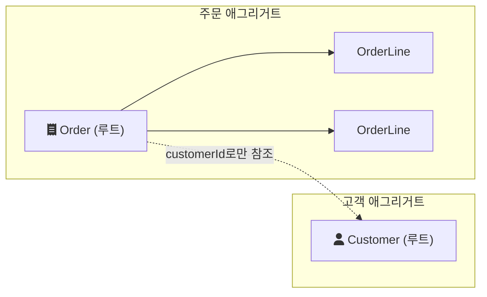

# 2021-04-21-TIL

## DDD and Aggregate

- https://www.infoq.com/articles/ddd-evolving-architecture/
- https://multifrontgarden.tistory.com/186
- https://medium.com/@chanhyeonglee/ddd-aggregate-%EC%95%A0%EA%B7%B8%EB%A6%AC%EA%B1%B0%ED%8A%B8-98d9c1313c23#:~:text=Aggregate%20%EB%8A%94%20%EC%9D%BC%EC%A2%85%EC%9D%98%20%EC%9D%BC%EA%B4%80%EC%84%B1%20(consistency,%EA%B2%BD%EA%B3%84%EB%A5%BC%20%EC%A7%80%ED%82%AC%20%EC%88%98%20%EC%9E%88%EB%8B%A4.
- https://medium.com/@SlackBeck/%EC%95%A0%EA%B7%B8%EB%A6%AC%EA%B2%8C%EC%9E%87-%ED%95%98%EB%82%98%EC%97%90-%EB%A6%AC%ED%8C%8C%EC%A7%80%ED%86%A0%EB%A6%AC-%ED%95%98%EB%82%98-f97a69662f63
- https://eocoding.tistory.com/36
- https://happycloud-lee.tistory.com/94
- https://sgc109.github.io/2020/08/09/ddd-aggregate/

## 애그리거트란

애그리거트(aggregate)는 하나의 단위로 다루는 도메인 객체 묶음이다. Martin Fowler는 주문과 주문 항목을 대표 예로 든다([DDD_Aggregate](https://martinfowler.com/bliki/DDD_Aggregate.html)). 주문 항목은 별도 객체지만 주문 없이 의미가 없으므로 주문과 함께 다룬다.

묶음 안의 객체 하나가 애그리거트 루트가 되고, 바깥에서는 루트만 참조한다. Fowler의 표현으로는 "Any references from outside the aggregate should only go to the aggregate root."(애그리거트 바깥에서의 참조는 루트로만 향해야 한다)이다. 그래야 루트가 묶음 전체의 규칙, 예를 들어 "주문 총액은 항목 금액의 합과 같다"를 지킬 수 있다.

## 애그리거트가 정하는 것

- 일관성 경계: 애그리거트는 통째로 읽고 통째로 저장하는 단위다. Fowler는 트랜잭션이 애그리거트 경계를 넘지 않아야 한다고 설명한다.
- 참조 방식: 다른 애그리거트는 객체 대신 id로 참조한다. 위 그림에서 `Order`는 `Customer` 객체가 아니라 `customerId`를 가진다. 객체로 연결하면 주문을 저장할 때 고객까지 같이 바뀔 수 있어서 경계가 흐려진다.
- 리포지토리 단위: 리포지토리는 애그리거트 루트마다 하나만 둔다. `OrderLineRepository`를 따로 만들면 바깥에서 루트를 거치지 않고 항목을 바꿀 수 있게 되기 때문이다. Spring Data JDBC도 같은 원칙으로 설계되어 있다([Spring 블로그](https://spring.io/blog/2018/09/24/spring-data-jdbc-references-and-aggregates)).

애그리거트를 크게 잡으면 한 번에 읽고 쓰는 데이터가 많아지고 동시에 수정할 때 충돌이 잦아진다. 작게 잡으면 애그리거트 사이의 규칙을 트랜잭션 하나로 지킬 수 없다. 그래서 "반드시 같이 바뀌어야 하는 것"만 한 애그리거트에 넣는 것이 출발점이다.

## AI 키워드: RoFormer와 RoPE

2021년 4월 20일 arXiv에 RoFormer 논문이 올라왔다. 이 논문이 제안한 RoPE(Rotary Position Embedding)는 토큰의 위치를 회전 행렬로 인코딩해서, 절대 위치를 넣으면서도 self-attention 계산에서는 두 토큰의 상대 위치가 드러나게 한다. 트랜스포머가 단어 순서를 아는 방법은 위치 임베딩을 어떻게 넣느냐에 달려 있다.

## 참고

- [DDD_Aggregate - Martin Fowler](https://martinfowler.com/bliki/DDD_Aggregate.html)
- [Spring Data JDBC, References, and Aggregates - Spring Blog](https://spring.io/blog/2018/09/24/spring-data-jdbc-references-and-aggregates)
- [RoFormer: Enhanced Transformer with Rotary Position Embedding - arXiv](https://arxiv.org/abs/2104.09864)
