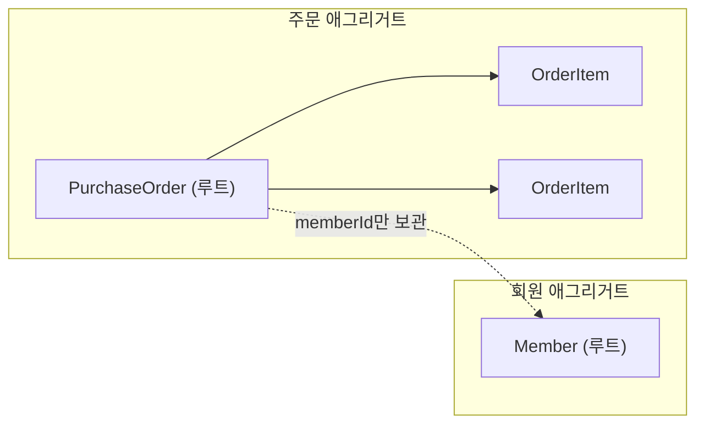

# 2021-04-23-TIL

## Spring Data JDBC

Spring Data JDBC를 적용하면서 모은 자료다. 주제별로 묶어 정리한다.

### JPA와 무엇이 다른가

Spring 블로그의 소개 글에 따르면 Spring Data JDBC는 JPA의 세 가지 기능을 일부러 빼 버렸다. 지연 로딩은 예상하지 못한 시점에 비싼 쿼리를 보내거나 예외를 낼 수 있고, 캐시는 엔티티의 두 버전을 비교하고 싶을 때 방해가 되며, 변경 감지(dirty tracking)는 모든 영속성 작업이 지나가는 한 지점을 찾기 어렵게 만든다는 이유다. 대신 SQL은 리포지토리 메서드를 호출할 때만 실행되고, 메서드가 반환한 객체는 이미 완전히 로딩된 상태다. 세션이나 프록시가 없어서 동작을 예측하기 쉽다는 것이 설계 목표다.

### 애그리거트와 참조

두 번째 블로그 글은 애그리거트(aggregate) 규칙을 설명한다. 애그리거트 루트에서 참조를 따라 닿을 수 있는 모든 것은 그 애그리거트에 속하고, 함께 저장되고 함께 삭제된다. 여러 애그리거트가 같은 엔티티를 참조한다면 그 엔티티는 어느 애그리거트에도 속할 수 없다. 그래서 다대일, 다대다 관계는 객체 참조가 아니라 ID만으로 모델링해야 한다고 정리한다.

ID 참조는 애그리거트 경계를 분명히 하고 도메인 모델 수준에서 결합을 끊는다. 일대다와 다대일 관계 자체의 차이는 Stack Overflow 답변이 테이블 관점에서 정리한다.

### ID와 insert/update 판단

Spring Data JDBC는 `save()`를 호출했을 때 엔티티가 새것인지를 보고 INSERT와 UPDATE를 고른다. 기본 규칙은 ID 필드가 `null`(원시 타입이면 0)이면 새 엔티티로 본다. 그래서 ID를 애플리케이션에서 직접 채워 넣는 경우에는 `Persistable`을 구현하거나 버전 필드를 두어 새 엔티티임을 알려 줘야 한다. "Id 삽입 전략" 글이 이 문제를 다룬다.

- https://velog.io/@bread_dd/Spring-Data-JDBC-vs-Spring-Data-JPA
- https://hackmd.io/@ddubson/rkn-sR4wU
- https://spring.io/blog/2018/09/17/introducing-spring-data-jdbc
- https://spring.io/blog/2018/09/24/spring-data-jdbc-references-and-aggregates
- https://www.docs4dev.com/docs/en/spring-data-jdbc/1.0.5.RELEASE/reference/all.html#reference
- https://ordina-jworks.github.io/java/2020/01/02/Spring-Data-Jdbc.html
- https://docs.spring.io/spring-data/jdbc/docs/1.1.0.RC2/reference/html/#reference
- https://docs.spring.io/spring-data/jdbc/docs/1.0.0.RC1/reference/html/
- https://javabydeveloper.com/spring-data-jdbc-2-0-with-spring-boot-example/
- https://stackoverflow.com/tags/spring-data-jdbc/hot?filter=year
- https://spring.io/blog/2018/09/17/introducing-spring-data-jdbc
- https://spring.io/blog/2018/09/24/spring-data-jdbc-references-and-aggregates
- https://stackoverflow.com/questions/3113885/difference-between-one-to-many-many-to-one-and-many-to-many#:~:text=In%20a%20One%2DTo%2DMany,in%20the%20larger%20application%20context).
- https://skyblue300a.tistory.com/9

### JdbcTemplate

Spring Data JDBC의 리포지토리로 표현하기 어려운 쿼리는 `JdbcTemplate`으로 직접 작성한다. `JdbcTemplate`은 커넥션 획득과 반납, 예외 변환 같은 반복 코드를 대신 처리하고, 개발자는 SQL과 결과를 객체로 바꾸는 `RowMapper`만 작성한다.

- https://www.baeldung.com/spring-jdbc-jdbctemplate

### DB 초기화

Spring Boot는 클래스패스 루트의 `schema.sql`(DDL)과 `data.sql`(초기 데이터)을 애플리케이션 시작 시 실행할 수 있다. Boot 2.0 문서 기준으로 내장 DB(H2 등)에서는 기본으로 실행되고, MySQL 같은 외부 DB에서는 `spring.datasource.initialization-mode=always`를 설정해야 실행된다.

- https://docs.spring.io/spring-boot/docs/2.0.0.M6/reference/html/howto-database-initialization.html
- https://pravusid.kr/java/2018/10/10/spring-database-initialization.html

### 엔티티와 DTO 변환

엔티티를 그대로 응답으로 내보내지 않고 DTO로 바꿔서 내보내는 이유와 방법, 그리고 변환 코드를 줄여 주는 ModelMapper 사용법을 다룬 글이다.

- https://dbbymoon.tistory.com/4

### JSON 필드 여러 개를 하나의 Java 필드로

요청 JSON에서 같은 의미의 값이 다른 키 이름으로 들어올 때, Jackson의 `@JsonAlias({"name", "title"})`를 쓰면 역직렬화 시 여러 이름을 한 필드로 받을 수 있다. 직렬화할 때는 원래 필드 이름(또는 `@JsonProperty`)만 쓴다.

- https://www.baeldung.com/json-multiple-fields-single-java-field

### Stream을 Set으로

`stream.collect(Collectors.toSet())`으로 모은다. 구현체가 정해져 있지 않으므로 특정 `Set`이 필요하면 `Collectors.toCollection(TreeSet::new)`를 쓴다.

- https://www.geeksforgeeks.org/convert-stream-set-java/

### MySQL 설정

MySQL 설정 관련 글이다. 그중 두 번째 글은 AWS에 띄운 MySQL에 외부에서 접속하도록 허용하는 방법을 다룬다. MySQL 사용자의 접속 허용 호스트와 `bind-address` 설정, 그리고 보안 그룹의 3306 포트 인바운드 규칙을 함께 열어야 접속된다.

- https://nickjoit.tistory.com/144
- https://emong.tistory.com/235

## API Document tools

mockapi.io는 엔드포인트와 응답 데이터를 정의하면 가짜 REST API를 만들어 주는 서비스다. 백엔드가 완성되기 전에 프론트엔드가 API 형식에 맞춰 먼저 개발할 수 있다.

- https://mockapi.io/projects

## 참고

- [Introducing Spring Data JDBC - Spring Blog](https://spring.io/blog/2018/09/17/introducing-spring-data-jdbc)
- [Spring Data JDBC, References, and Aggregates - Spring Blog](https://spring.io/blog/2018/09/24/spring-data-jdbc-references-and-aggregates)
- [Spring Data JDBC Reference: Entity State Detection](https://docs.spring.io/spring-data/relational/reference/jdbc/entity-persistence.html)
- [JsonAlias - Jackson Annotations API](https://fasterxml.github.io/jackson-annotations/javadoc/2.9/com/fasterxml/jackson/annotation/JsonAlias.html)
