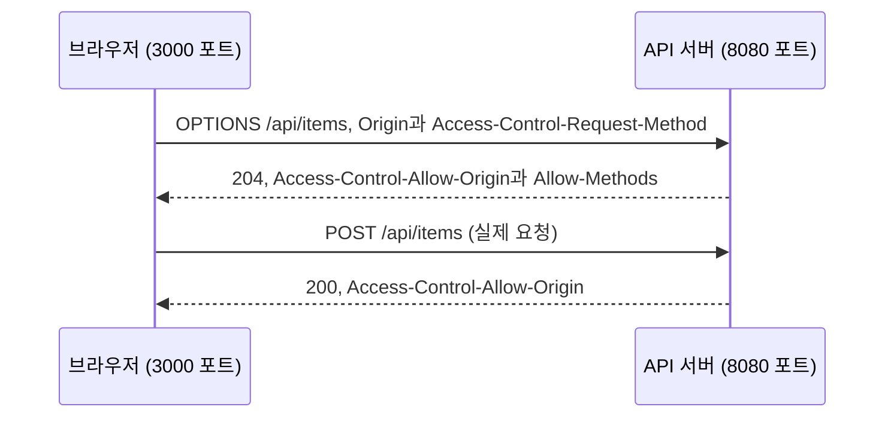

# 2021-05-11-TIL

## 크로스 도메인(CORS) 이슈

### 원인

웹페이지의 origin과 API의 origin이 달라서 발생

origin은 스킴(`http`, `https`), 호스트, 포트의 조합이다. 셋 중 하나만 달라도 다른 origin이다. 그래서 `http://localhost:3000`에서 뜬 페이지가 `http://localhost:8080`의 API를 부르는 것도 교차 출처 요청이다([MDN CORS](https://developer.mozilla.org/en-US/docs/Web/HTTP/Guides/CORS)).

브라우저는 보안상 스크립트(`fetch`, `XMLHttpRequest`)가 보내는 교차 출처 요청에 동일 출처 정책을 적용한다. CORS는 서버가 응답 헤더로 "이 origin은 내 리소스를 읽어도 된다"고 알려 주는 방법이다. 서버가 `Access-Control-Allow-Origin` 헤더를 보내지 않으면 요청은 서버까지 갔더라도 브라우저가 스크립트에 응답을 넘겨주지 않는다. Postman이나 curl에서는 잘 되는데 브라우저에서만 실패하는 이유가 이것이다.

### Preflight 요청

`GET`, `HEAD`, `POST` 중 하나이고 헤더와 `Content-Type`이 허용 목록 안에 있는 단순 요청(simple request)이 아니면, 브라우저는 실제 요청 전에 `OPTIONS` 메서드로 사전 요청(preflight)을 보낸다. JSON을 보내는 `Content-Type: application/json` 요청도 여기에 해당한다.



### 해결책

- CORS 정책을 지키도록 요청 헤더 변경
- API에서 허용하도록 설정 변경 -> `@CrossOrigin`을 컨트롤러에 붙여주기

결국 허용 여부는 서버가 정한다. Spring MVC에서는 `@CrossOrigin`을 컨트롤러 클래스나 메서드에 붙인다. 아무 속성 없이 붙이면 모든 origin, 모든 헤더, 매핑된 모든 HTTP 메서드를 허용하고, 자격 증명(쿠키)은 허용하지 않는다([Spring 문서](https://docs.spring.io/spring-framework/reference/web/webmvc-cors.html)).

```java
@CrossOrigin(origins = "http://localhost:3000")
@RestController
public class ItemController { ... }
```

컨트롤러가 많아지면 `WebMvcConfigurer`의 `addCorsMappings`로 전역 설정을 한곳에 두는 편이 관리하기 쉽다. 쿠키를 함께 보내야 하면 `Access-Control-Allow-Origin`에 `*`를 쓸 수 없고 origin을 명시해야 한다.

### 참고

- [스프링 부트에서 크로스도메인 이슈 처리하기. (@CrossOrigin 어노테이션을 사용) · 기억하기 위한 개발노트](http://jmlim.github.io/spring/2018/12/11/spring-boot-crossorigin/) — jmlim.github.io
- [API Gateway의 CORS 오류 문제 해결](https://aws.amazon.com/ko/premiumsupport/knowledge-center/api-gateway-cors-errors/) — AWS
- [Cross-Origin Resource Sharing (CORS)](https://developer.mozilla.org/en-US/docs/Web/HTTP/CORS#simple_requests) — HTTP | MDN
- [CORS](https://docs.spring.io/spring-framework/reference/web/webmvc-cors.html) — Spring Framework Reference
