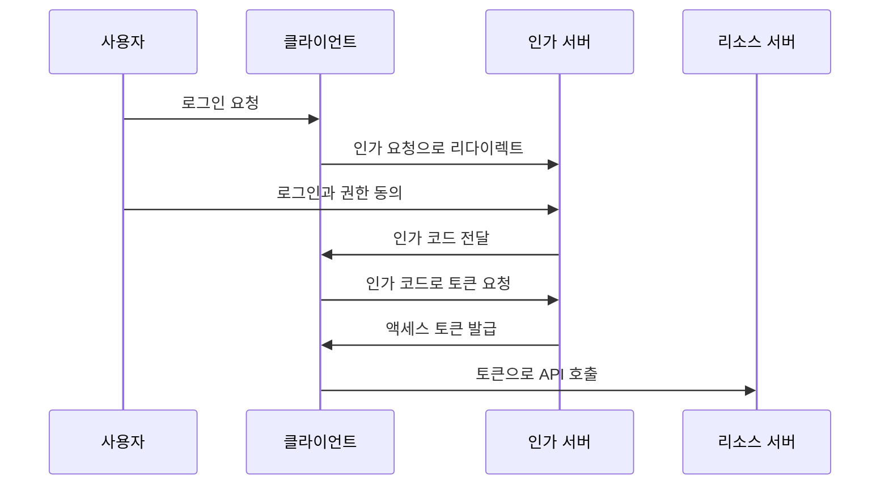

# 2021-06-02-TIL

## MyBatis

MyBatis는 SQL 매퍼 프레임워크다. 공식 문서는 MyBatis를 커스텀 SQL, 저장 프로시저, 고급 매핑을 지원하는 퍼시스턴스 프레임워크로 소개하며, JDBC 코드와 파라미터 설정, 결과 매핑 코드를 거의 모두 없애 준다고 설명한다. JPA가 객체를 기준으로 SQL을 생성한다면, MyBatis는 개발자가 SQL을 직접 쓰고 그 SQL을 Java 메서드에 연결한다. 매퍼 XML이나 애너테이션에 SQL을 작성하고 `#{}`로 파라미터를 바인딩하며, 조회 결과는 `resultType`이나 `resultMap`으로 객체에 매핑한다. 복잡한 조회나 DB 고유 기능을 그대로 쓰기 좋고, 대신 테이블이 바뀌면 SQL을 직접 고쳐야 한다.

- https://mybatis.org/mybatis-3/ko/index.html
- https://m.blog.naver.com/PostView.naver?isHttpsRedirect=true&blogId=songintae92&logNo=221216410360

## 데이터 환경 구축

쏘카 기술 블로그 글은 Apache Airflow로 데이터 파이프라인을 구성한 사례다. Airflow는 작업 사이의 의존 관계를 DAG(방향 비순환 그래프)로 정의하고, 정해진 일정에 따라 실행하며 실패한 작업을 재시도하고 상태를 모니터링하는 워크플로 도구다. 두 번째 링크는 개발 관련 글을 오래 써 온 Outsider의 개인 블로그다.

- https://tech.socarcorp.kr/data/2021/06/01/data-engineering-with-airflow.html
- https://blog.outsider.ne.kr/

## Windows에서 SCP 사용하기

PuTTY 배포 페이지에서는 SSH 클라이언트 `putty.exe`와 함께 명령줄 파일 전송 도구 `pscp.exe`(SCP 클라이언트)를 받을 수 있다. `pscp -i key.ppk 파일 user@host:/경로` 형태로 쓴다. PuTTY는 `.pem` 키를 직접 읽지 못하므로 PuTTYgen으로 `.ppk` 형식으로 변환해야 한다.

- https://www.chiark.greenend.org.uk/~sgtatham/putty/latest.html

## Windows에서 SSH 사용하기

Windows 10 1809 이후 버전에는 OpenSSH 클라이언트가 선택적 기능으로 들어 있어, PowerShell이나 명령 프롬프트에서 `ssh`, `scp`를 바로 쓸 수 있다. 그 이전 환경이라면 PuTTY 같은 별도 클라이언트를 설치한다.

- https://charging.tistory.com/94

## SCP로 AWS에 파일 전송하기

EC2 인스턴스로 파일을 보낼 때는 인스턴스를 만들 때 받은 키 페어로 인증한다. `scp -i my-key.pem ./app.jar ec2-user@<퍼블릭 DNS>:/home/ec2-user/`처럼 쓰고, 사용자 이름은 AMI에 따라 다르다(Amazon Linux는 `ec2-user`, Ubuntu는 `ubuntu`). 키 파일 권한이 너무 열려 있으면 SSH가 사용을 거부하므로 `chmod 400 my-key.pem`으로 권한을 줄인다. 보안 그룹에서 22번 포트 인바운드가 허용되어 있어야 한다.

## 기술블로그

국내 회사 기술 블로그 목록을 모은 글들이다.

- https://brunch.co.kr/@sicle-official/35
- https://velog.io/@jmkim87/%EA%B8%B0%EC%88%A0-%EB%B8%94%EB%A1%9C%EA%B7%B8-%EB%A7%81%ED%81%AC-%EB%AA%A8%EC%9D%8C
- https://programmers.co.kr/posts/tag/%EA%B3%B5%EC%8B%9D%20%EB%B8%94%EB%A1%9C%EA%B7%B8

## Jekyll

Jekyll 테마 적용 방법과 초안(draft) 관리 방법이다. Jekyll은 `_drafts` 폴더에 날짜 없는 파일명으로 둔 글을 기본 빌드에서 제외하고, `jekyll serve --drafts`로 실행할 때만 보여 준다. 공개하기 전의 글을 저장소에 함께 두면서 로컬에서 미리 볼 수 있다.

- https://dev-yakuza.posstree.com/ko/jekyll/theme/
- https://graspthegist.com/2017/01/16/working-with-draft-in-jekyll/

## JWT를 이용한 OAuth

JWT(JSON Web Token)는 RFC 7519가 정의한 토큰 형식으로, 헤더, 페이로드(클레임), 서명을 각각 Base64URL로 인코딩해 점(`.`)으로 이은 문자열이다. 서명이 있어서 서버는 토큰이 위조되지 않았는지 검증할 수 있고, 토큰 자체에 사용자 정보가 담겨 있어 매 요청마다 세션 저장소를 조회하지 않아도 된다. OAuth 2.0 액세스 토큰을 JWT 형식으로 발급하면 리소스 서버가 인가 서버에 묻지 않고 토큰을 직접 검증할 수 있다.

- https://brunch.co.kr/@sbcoba/7
- https://jwt.io/
- https://www.javainuse.com/spring/boot-jwt

## OAuth

OAuth 2.0(RFC 6749)은 사용자가 비밀번호를 제3자 애플리케이션에 넘기지 않고, 자신의 리소스에 대한 제한된 접근 권한을 위임하는 인가 프레임워크다. RFC는 리소스 소유자(사용자), 클라이언트(애플리케이션), 인가 서버, 리소스 서버의 네 역할을 정의하고, 권한 부여 방식으로 Authorization Code, Implicit, Resource Owner Password Credentials, Client Credentials를 둔다. 서버를 가진 웹 애플리케이션은 보통 Authorization Code 방식을 쓴다.

OAuth 1.0과 비교하면, 1.0은 요청마다 암호학적 서명을 만들어야 해서 구현이 까다로웠고, 2.0은 전송 보안을 TLS에 맡기고 Bearer 토큰을 써서 단순해졌다. 링크 중 `schema.sql`은 Spring Security OAuth 프로젝트가 클라이언트 정보와 토큰을 DB에 저장할 때 쓰는 테이블 정의다.

- https://brunch.co.kr/@sbcoba/5
- https://github.com/spring-projects/spring-security-oauth/blob/main/spring-security-oauth2/src/test/resources/schema.sql
- https://www.baeldung.com/rest-api-spring-oauth2-angular
- https://brunch.co.kr/@sbcoba/4
- https://spring.io/guides/tutorials/spring-boot-oauth2/
- https://parandol.tistory.com/6
- https://www.synopsys.com/blogs/software-security/oauth-2-0-vs-oauth-1-0/
- https://blusky10.tistory.com/305
- https://velog.io/@swchoi0329/%EC%8A%A4%ED%94%84%EB%A7%81-%EC%8B%9C%ED%81%90%EB%A6%AC%ED%8B%B0%EC%99%80-OAuth-2.0%EC%9C%BC%EB%A1%9C-%EB%A1%9C%EA%B7%B8%EC%9D%B8-%EA%B8%B0%EB%8A%A5-%EA%B5%AC%ED%98%84
- https://datatracker.ietf.org/doc/html/rfc6749

크롬의 F12 개발자 도구에서 네트워크 탭을 보면 토큰 정보가 보인다. 이 토큰을 복사해서 jwt.io에서 디코딩 해보면 원본 데이터가 JSON포맷으로 보여진다.

JWT의 페이로드는 암호화가 아니라 Base64URL 인코딩일 뿐이라 누구나 디코딩해 읽을 수 있다. 서명은 내용이 바뀌지 않았음을 보장할 뿐 내용을 숨기지 않는다. 그래서 페이로드에 비밀번호나 개인정보 같은 민감한 값을 넣으면 안 되고, 토큰 자체도 HTTPS로만 주고받아야 한다.

## 참고

- [MyBatis 3 - Introduction](https://mybatis.org/mybatis-3/)
- [Get started with OpenSSH for Windows - Microsoft Learn](https://learn.microsoft.com/en-us/windows-server/administration/openssh/openssh_install_firstuse)
- [Drafts - Jekyll Docs](https://jekyllrb.com/docs/posts/#drafts)
- [RFC 7519: JSON Web Token (JWT)](https://datatracker.ietf.org/doc/html/rfc7519)
- [RFC 6749: The OAuth 2.0 Authorization Framework](https://datatracker.ietf.org/doc/html/rfc6749)
