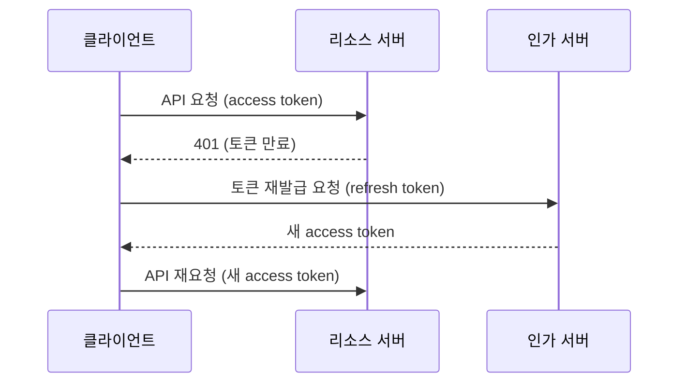

## Greenion 프로젝트

### 참고

Greenion 프로젝트를 기획하면서 참고한 서비스와 글이다. 화장품 정보 서비스, 인테리어 커뮤니티와 커머스, 패션 커머스, 글 플랫폼처럼 정보와 커뮤니티와 구매가 한곳에 모인 서비스들, 그리고 식물 관련 검색 결과와 글이 섞여 있다.

- [hwahae.co.kr/about](https://www.hwahae.co.kr/about) — hwahae.co.kr
- [blog.daum.net/krcpolicy/6925](https://blog.daum.net/krcpolicy/6925) — blog.daum.net
- [fldi.kr](https://www.fldi.kr/) — fldi.kr
- [ohou.se](https://ohou.se/) — ohou.se
- [styleshare.kr/store](https://www.styleshare.kr/store) — styleshare.kr
- [brunch.co.kr](https://brunch.co.kr/) — brunch.co.kr
- [식물 검색결과 : 네이버 지식iN](https://kin.naver.com/search/list.naver?query=%EC%8B%9D%EB%AC%BC) — kin.naver.com
- [magazine.channel.daum.net/daumapp_notice/search_flower](http://magazine.channel.daum.net/daumapp_notice/search_flower) — magazine.channel.daum.net
- [(React Native) react-native-permission 사용법](https://coding-dahee.tistory.com/145) — Tistory
- [coupang.com](https://www.coupang.com/) — coupang.com
- [내 소포라 죽은거얌? ㅜㅜ - 식물 갤러리](https://gall.dcinside.com/board/view/?id=tree&no=377147&page=1) — gall.dcinside.com
- [Plantgram(플랜트그램) 식물 물주기 알람 어플, 식물관리앱 추천](https://m.blog.naver.com/plantgram/222094640988) — m.blog.naver.com
- [봄맞이 플랜테리어 ① – 거실편](https://www.marieclairekorea.com/lifestyle/2021/03/planterior/) — marieclairekorea.com

### 협업툴

기획 단계에서 쓸 협업 도구다. Coggle은 여러 사람이 함께 편집하는 마인드맵 도구이고, InVision은 화면 디자인을 클릭해 볼 수 있는 프로토타입으로 만들어 공유하는 도구다.

- https://coggle.it/diagram/YV74H_FI5plVRRpJ/t/-
- https://www.invisionapp.com/

### Refresh Token

로그인 기능을 설계하려면 access token과 refresh token의 역할을 나눠 이해해야 한다. OAuth 2.0 명세(RFC 6749)에서 refresh token은 access token을 새로 발급받기 위한 자격 증명이다. 현재 access token이 만료되었거나, 더 좁은 권한의 토큰이 필요할 때 쓴다.

두 토큰을 나누는 이유는 노출 위험을 줄이기 위해서다. access token은 API를 호출할 때마다 리소스 서버로 전송되므로 유출될 기회가 많다. 그래서 수명을 짧게 둔다. refresh token은 명세상 인가 서버에만 보내고 리소스 서버로는 절대 보내지 않는다. 대신 수명이 길어서 유출되면 피해가 크므로 안전하게 보관해야 한다.

- https://auth0.com/docs/security/tokens/refresh-tokens

## 참고

- [RFC 6749 - The OAuth 2.0 Authorization Framework, 1.5 Refresh Token](https://www.rfc-editor.org/rfc/rfc6749#section-1.5) — IETF
