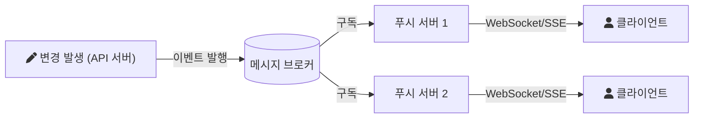

# 2021-10-23-TIL

## 카페24 서술형 시험
생각보다 문제가 훨씬 단순했다. 하지만 문제가 단순했다는 것이지 답이 단순한건 아니었다.

첫번째 문제는 자바스크립트 코드였는데, 무엇을 어떻게 고쳐야하는지 잘 몰라서 출력값만 나오도록 적당히 수정했다.
- https://poiemaweb.com/js-hello-world

두번째 문제는 웹 서버의 응답과 렌더링의 성능을 향상시키는 방법에 관한 문제였다.

시험이 끝난 뒤 두 번째 문제와 관련된 주제를 하나씩 찾아 정리했다.

---

### SSR vs CSR

CSR(Client Side Rendering)은 서버가 거의 빈 HTML과 JavaScript 번들을 보내고, 브라우저가 JavaScript를 실행해 화면을 그린다. 첫 화면이 뜨기까지 번들을 내려받고 실행하는 시간이 걸리지만, 이후 화면 전환은 필요한 데이터만 받아 빠르다. SSR(Server Side Rendering)은 서버가 데이터를 채운 완성된 HTML을 보내므로 첫 화면이 빨리 보이고 검색 엔진이 내용을 읽기 쉽다. 대신 요청마다 서버가 렌더링 비용을 지고, 화면이 보여도 JavaScript가 붙기(hydration) 전까지는 상호작용이 안 될 수 있다. Next.js, Nuxt.js는 첫 요청은 SSR로, 이후는 CSR로 동작하는 방식을 제공한다.

- https://smujihoon.tistory.com/215
- https://oneroomtable.tistory.com/entry/%EC%84%9C%EB%B2%84-%EC%82%AC%EC%9D%B4%EB%93%9C-%EB%A0%8C%EB%8D%94%EB%A7%81%EA%B3%BC-%ED%81%B4%EB%9D%BC%EC%9D%B4%EC%96%B8%ED%8A%B8-%EC%82%AC%EC%9D%B4%EB%93%9C-%EB%A0%8C%EB%8D%94%EB%A7%81%EC%9D%B4%EB%9E%80-%EB%AC%B4%EC%97%87%EC%9D%B8%EA%B0%80%EC%9A%94
- https://joshua1988.github.io/vue-camp/nuxt/ssr.html#%E1%84%8F%E1%85%B3%E1%86%AF%E1%84%85%E1%85%A1%E1%84%8B%E1%85%B5%E1%84%8B%E1%85%A5%E1%86%AB%E1%84%90%E1%85%B3-%E1%84%89%E1%85%A1%E1%84%8B%E1%85%B5%E1%84%83%E1%85%B3-%E1%84%85%E1%85%A6%E1%86%AB%E1%84%83%E1%85%A5%E1%84%85%E1%85%B5%E1%86%BC
- https://velog.io/@zansol/%ED%99%95%EC%9D%B8%ED%95%98%EA%B8%B0-%EC%84%9C%EB%B2%84%EC%82%AC%EC%9D%B4%EB%93%9C%EB%A0%8C%EB%8D%94%EB%A7%81SSR-%ED%81%B4%EB%9D%BC%EC%9D%B4%EC%96%B8%ED%8A%B8%EC%82%AC%EC%9D%B4%EB%93%9C%EB%A0%8C%EB%8D%94%EB%A7%81CSR
- https://www.omnisci.com/technical-glossary/server-side-rendering
- https://www.theserverside.com/feature/Take-advantage-of-these-5-benefits-of-server-side-rendering

---

### REST API 성능 개선

서버 응답을 빠르게 하는 방법은 대체로 다음으로 정리된다. 느린 쿼리를 인덱스와 실행 계획 점검으로 고치고 N+1 쿼리를 없앤다. 자주 읽고 잘 안 바뀌는 데이터는 캐시에 둔다. 목록은 페이지네이션으로 나눠 보내고 응답에는 필요한 필드만 담는다. 응답 본문을 gzip으로 압축하고, 오래 걸리는 작업(메일 발송, 파일 처리)은 비동기로 분리해 응답을 먼저 돌려준다.

- https://ehdvudee.tistory.com/24
- https://heewon26.tistory.com/173
- https://brunch.co.kr/@beennote/223

---

### GraphQL

GraphQL은 클라이언트가 필요한 데이터의 모양을 쿼리로 적어 보내면, 서버가 정확히 그 모양으로 응답하는 API 질의 언어다. REST에서는 화면 하나를 그리려고 여러 엔드포인트를 호출하거나(under-fetching), 쓰지 않는 필드까지 받는(over-fetching) 경우가 생기는데, GraphQL은 하나의 엔드포인트와 하나의 요청으로 이를 해결한다. 대신 URL 단위의 HTTP 캐시를 그대로 쓰기 어렵고, 클라이언트가 복잡한 쿼리를 보내 서버 부하를 키울 수 있어 쿼리 깊이나 비용 제한이 필요하다.

- https://www.howtographql.com/basics/1-graphql-is-the-better-rest/
- https://sdg9670.github.io/graphql/what-is-graphql/
- https://www.holaxprogramming.com/2018/01/20/graphql-vs-restful-api/
- https://blog.api.rakuten.net/graphql-vs-rest/

---

### Redis

Redis는 데이터를 메모리에 두는 키-값 저장소로, 문자열뿐 아니라 리스트, 해시, 셋, 정렬된 셋 같은 자료구조를 지원한다. 메모리에서 처리하므로 빠르고, 그래서 DB 앞단의 캐시, 세션 저장소, 랭킹(정렬된 셋), 분산 락, 메시지 발행/구독에 쓰인다. 메모리에 있는 데이터는 재시작하면 사라질 수 있어서, 필요하면 RDB 스냅샷이나 AOF 로그로 디스크에 영속화한다.

- https://taes-k.github.io/2020/07/23/redis-essential/
- https://velog.io/@hyeondev/Redis-%EB%9E%80-%EB%AC%B4%EC%97%87%EC%9D%BC%EA%B9%8C
- https://brunch.co.kr/@skykamja24/575

---

### 브라우저 렌더링 최적화

브라우저는 HTML을 파싱해 DOM을, CSS를 파싱해 CSSOM을 만들고, 둘을 합친 렌더 트리로 각 요소의 위치와 크기를 계산(layout, reflow)한 뒤 픽셀을 그린다(paint). 그래서 레이아웃에 영향을 주는 속성(너비, 위치)을 바꾸면 계산부터 다시 하지만, `transform`, `opacity`처럼 합성(composite) 단계에서 처리되는 속성은 비용이 적다. CSS는 렌더링을 막는 리소스이므로 위쪽에서 빨리 받게 하고, `<script>`는 HTML 파싱을 멈추므로 `defer`, `async`를 쓰거나 문서 끝에 두는 것이 기본 최적화다.

- https://chanyeong.com/blog/post/43
- https://www.huskyhoochu.com/how-browser-works/
- https://boxfoxs.tistory.com/408
- https://www.html5rocks.com/en/tutorials/internals/howbrowserswork/

---

### 웹 캐시

MDN의 HTTP 캐싱 문서에 따르면 캐시는 브라우저처럼 한 사용자만 쓰는 private 캐시와, 프록시나 CDN처럼 여러 사용자가 공유하는 shared 캐시로 나뉜다. `Cache-Control: max-age=초`로 응답을 얼마 동안 신선한(fresh) 것으로 볼지 정하고, 그 시간이 지나면 `ETag`나 `Last-Modified` 값을 담아 조건부 요청(`If-None-Match`, `If-Modified-Since`)을 보낸다. 내용이 그대로면 서버는 본문 없이 `304 Not Modified`만 돌려준다. 토스 기술 블로그 글은 리소스마다 정책을 다르게 건다. HTML은 브라우저가 매번 서버에 재검증하게 해서(`max-age=0`) 새 배포를 바로 반영하고 CDN에는 오래 캐시하게 하며, 빌드마다 URL이 달라지는 JS와 CSS는 같은 URL의 내용이 바뀌지 않으므로 오래 캐시한다.

- https://hahahoho5915.tistory.com/33
- https://goddaehee.tistory.com/171
- https://velog.io/@mgm-dev/%EA%B0%84%EB%9E%B5-%EB%B8%8C%EB%9D%BC%EC%9A%B0%EC%A0%80-%EC%BA%90%EC%8B%9C%EC%97%90-%EB%8C%80%ED%95%B4
- https://toss.tech/article/smart-web-service-cache
- https://developer.mozilla.org/ko/docs/Web/HTTP/Caching

---

### CDN

CDN은 정적 콘텐츠를 사용자와 가까운 엣지 서버에 캐시해 원본 서버까지 가지 않고 응답한다. 응답 지연이 줄고 원본 서버의 트래픽 부담도 줄어든다. 위의 shared 캐시에 해당하므로 `Cache-Control` 헤더로 CDN에 얼마나 캐시할지 지시한다.

- https://medium.com/@luisk_355/cdn%EC%9D%B4-%ED%95%98%EB%8A%94-%EC%9D%BC%EA%B3%BC-%ED%95%84%EC%9A%94%ED%95%9C-%EC%9D%B4%EC%9C%A0-855527bc0554

마지막 문제는 실시간 업데이트 서비스에 대한 아키텍처 설계를 해보라는 문제였다. 이 문제는 아키텍처 설계 경험이 매우 부족한 나로서는 까다로운 문제였다. 사실상 그냥 눈물의 똥꼬쇼였다고 생각한다. 뭐라고 적었는지 잘 모르겠다.

---

### 실시간 업데이트 아키텍처

시험 후 찾아본 자료를 바탕으로 기본 구성 요소를 정리한다. 서버의 변경을 클라이언트에 전달하는 방식은 주기적으로 묻는 폴링, 변경이 생길 때까지 요청을 붙잡아 두는 롱 폴링, 서버에서 클라이언트로 한 방향 스트림을 여는 SSE(Server-Sent Events), 양방향 연결인 WebSocket이 있다. 서버가 여러 대이면 어떤 서버에 붙은 클라이언트에게도 이벤트가 가야 하므로, 변경 이벤트를 메시지 브로커(Redis Pub/Sub, Kafka 등)에 발행하고 각 서버가 구독해 자기에게 연결된 클라이언트에게 밀어 주는 구조를 쓴다. 우아한형제들의 배달운영시스템 실시간 서비스 경험기와 클라우드 사업자의 레퍼런스 아키텍처들이 이런 구성을 보여 준다.

- https://goodit.tistory.com/entry/BigQuery-Use-Cases-1-%EC%86%8C%EB%A7%A4-%EC%9E%AC%EA%B3%A0-%EA%B4%80%EB%A6%AC-%EC%8B%9C%EC%8A%A4%ED%85%9C
- https://www.ncloud.com/intro/architecture/13
- https://brunch.co.kr/@groobee/268
- https://www.it-gundan.com/ko/architecture/%ED%8C%8C%EC%9D%BC-%EC%8B%9C%EC%8A%A4%ED%85%9C%EC%9D%98-%EB%8D%B0%EC%9D%B4%ED%84%B0%EC%97%90%EC%84%9C-%EC%8B%A4%EC%8B%9C%EA%B0%84-%EC%97%85%EB%8D%B0%EC%9D%B4%ED%8A%B8%EB%A5%BC%EC%9C%84%ED%95%9C-%EC%95%84%ED%82%A4%ED%85%8D%EC%B2%98/l967110697/
- https://techblog.woowahan.com/2547/
- https://www.schabell.org/2021/05/real-time-stock-control-example-stock-control-architecture.html
- https://www.ncloud.com/intro/architecture/17
- https://www.youtube.com/watch?v=MTSn93rNPPE
- https://dzone.com/articles/how-to-build-a-real-time-event-driven-information

## 참고

- [HTTP caching](https://developer.mozilla.org/en-US/docs/Web/HTTP/Guides/Caching) — MDN
- [Server-sent events](https://developer.mozilla.org/en-US/docs/Web/API/Server-sent_events) — MDN
- [The WebSocket API](https://developer.mozilla.org/en-US/docs/Web/API/WebSockets_API) — MDN
- [Introduction to GraphQL](https://graphql.org/learn/) — GraphQL
- [Redis persistence](https://redis.io/docs/latest/operate/oss_and_stack/management/persistence/) — Redis Docs
