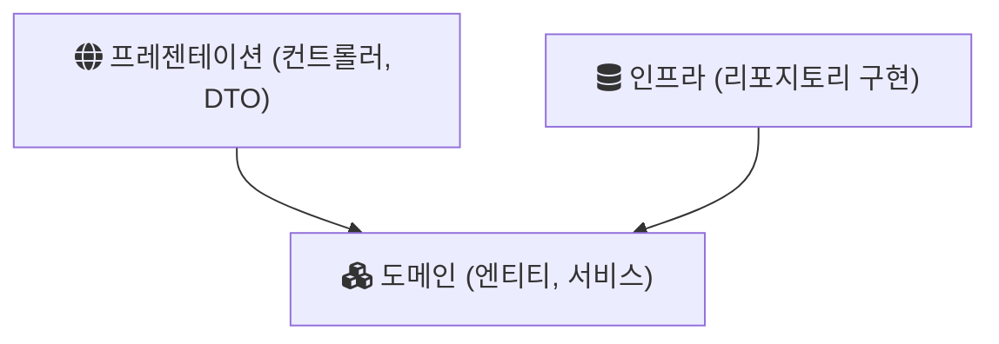

## Today I Learned

애플리케이션 아키텍처를 계층형 아키텍처로 결정하여 개발한다면, 개발순서는 통상적으로 어떻게 정하는 것이 좋을까?
API가 먼저 설계되었다면 DTO에서 단순한 더미데이터를 응답하는 컨트롤러 부터 만들면서 시작해야할까?
도메인 설계가 적절히 되었다면 도메인 계층, 인프라 계층 순서로 개발하는 것이 나을까?

### 계층 사이의 의존 방향부터

질문에 답하려면 먼저 계층이 서로를 어떻게 의존하는지 봐야 한다. 마틴 파울러가 정리한 프레젠테이션-도메인-데이터 계층 구조에서 프레젠테이션은 HTTP 요청과 화면을, 도메인은 업무 규칙과 검증과 계산을, 데이터 계층은 데이터베이스와의 통신을 맡는다. 의존은 위에서 아래로 흐른다. 프레젠테이션이 도메인에 의존하고, 도메인이 데이터 계층에 의존한다.

파울러는 여기서 한 걸음 더 나가, 도메인과 데이터 계층 사이에 매퍼를 두어 도메인이 데이터 계층에 의존하지 않게 만드는 배치도 소개한다(헥사고날 아키텍처). 이 배치에서는 도메인이 가장 안쪽에 있고, 컨트롤러와 리포지토리 구현이 모두 도메인을 바라본다.

### 두 가지 순서의 장단점

질문에 나온 두 순서는 각각 다른 위험을 먼저 줄인다.

| 시작점 | 먼저 확인되는 것 | 늦게 드러나는 것 |
| --- | --- | --- |
| 더미 응답을 주는 컨트롤러 | API 계약(URL, 요청과 응답 형태). 프론트엔드가 일찍 붙을 수 있다 | 업무 규칙이 그 계약을 실제로 채울 수 있는지 |
| 도메인 계층 | 업무 규칙과 불변식. DB 없이 단위 테스트로 검증할 수 있다 | API와 화면의 요구가 도메인 모델과 맞는지 |

의존 방향을 기준으로 보면 도메인부터 만드는 쪽이 자연스럽다. 도메인은 다른 계층을 몰라도 되므로 가장 먼저 완성하고 테스트할 수 있고, 리포지토리는 처음에 인터페이스만 두었다가 나중에 JPA 구현을 붙일 수 있다. 반대로 프론트엔드와 동시에 개발해야 하는 상황이라면 API 계약을 먼저 고정하는 것이 팀 전체의 대기 시간을 줄인다. 이때 컨트롤러의 더미 응답은 버릴 코드라는 점을 알고 시작하면 된다.

두 방식은 함께 쓸 수도 있다. 기능 하나를 단위로 잡고 API 계약을 먼저 정한 다음, 그 기능에 필요한 도메인 로직, 영속성, 컨트롤러 순으로 한 번에 관통해서 만드는 것이다. 계층 하나를 전부 완성한 뒤 다음 계층으로 넘어가는 것보다 통합 문제가 일찍 드러난다.

### 시스템이 커지면

파울러는 계층 중 하나가 너무 커지면 최상위 구조를 도메인 단위 모듈로 나누고, 각 모듈 안에서 다시 계층을 나누라고 권한다. 이 기준을 개발 순서에 옮기면, 규모가 커질수록 "어느 계층부터"보다 "어느 도메인 모듈부터"를 먼저 정하게 된다.

## 참고

- [PresentationDomainDataLayering - Martin Fowler](https://martinfowler.com/bliki/PresentationDomainDataLayering.html)
