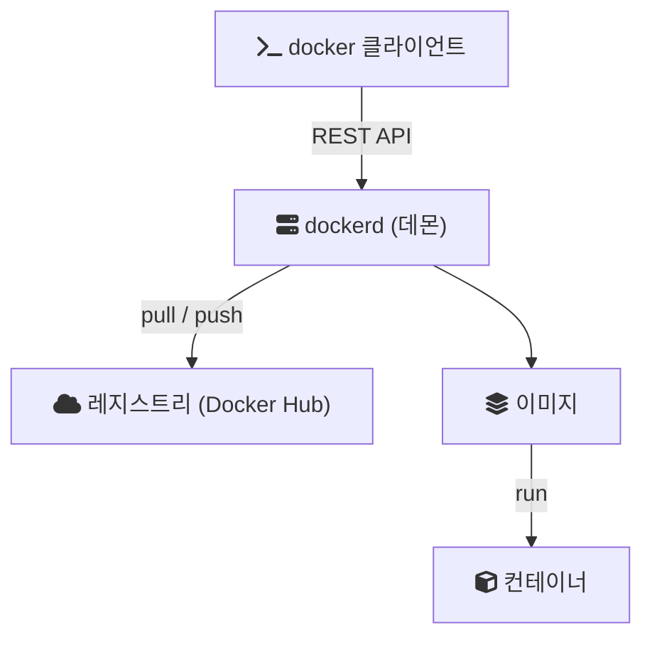

## Today I Learned

### Docker

- https://www.freecodecamp.org/news/learn-kubernetes-in-under-3-hours-a-detailed-guide-to-orchestrating-containers-114ff420e882/
- https://github.com/docker/labs/blob/master/beginner/chapters/setup.md
- https://docs.docker.com/samples/
- https://hyeo-noo.tistory.com/176
- https://tech.ktcloud.com/69

Docker를 처음 공부할 때 헷갈리는 것은 용어다. 공식 문서의 정의를 기준으로 정리하면 다음과 같다.

- 이미지(image): 컨테이너를 만드는 방법이 담긴 읽기 전용 템플릿이다. 다른 이미지 위에 내용을 덧붙여 만들 수 있어서 층(layer) 구조를 가진다.
- 컨테이너(container): 이미지를 실행한 인스턴스다. 만들고, 시작하고, 멈추고, 지울 수 있다. 애플리케이션 실행에 필요한 것을 담고 있어서 호스트에 무엇이 설치되어 있는지에 덜 의존한다.
- 레지스트리(registry): 이미지를 저장하고 배포하는 곳이다. Docker Hub가 기본 공개 레지스트리이고, `docker pull`과 `docker push`가 레지스트리와 이미지를 주고받는다.

구조는 클라이언트-서버 방식이다. 우리가 입력하는 `docker` 명령은 클라이언트이고, 실제로 이미지를 빌드하고 컨테이너를 실행하는 일은 데몬(`dockerd`)이 맡는다. 둘은 REST API로 통신하므로 같은 머신에 있을 수도 있고 다른 머신에 있을 수도 있다.



첫 번째 링크는 Kubernetes 입문 글이다. Docker가 컨테이너 하나를 만들고 실행하는 도구라면, Kubernetes는 여러 컨테이너를 여러 서버에 배치하고 관리하는 오케스트레이션 도구다.

### Dockerizing

- https://wooyoung85.tistory.com/30

애플리케이션을 Docker 이미지로 만드는 것을 Dockerizing이라고 부른다. 이미지를 만드는 절차는 `Dockerfile`에 적는다. Spring Boot 애플리케이션이라면 빌드한 jar 파일을 Java 런타임 이미지 위에 올리고 실행 명령을 지정하는 정도로 시작할 수 있다.

```dockerfile
FROM eclipse-temurin:17-jre
COPY build/libs/app.jar /app.jar
ENTRYPOINT ["java", "-jar", "/app.jar"]
```

```bash
docker build -t my-app .
docker run -p 8080:8080 my-app
```

`docker run`의 `-p 8080:8080`은 Docker 호스트의 8080 포트를 컨테이너의 8080 포트에 연결한다. 문서에 따르면 기본 bridge 네트워크에서 컨테이너 포트는 호스트와 같은 네트워크의 다른 컨테이너에서만 접근할 수 있고, 호스트 바깥에서는 접근할 수 없다. 그래서 `localhost:8080`이나 외부에서 서버에 접속하려면 포트를 publish해야 한다.

## 참고

- [Docker overview](https://docs.docker.com/get-started/docker-overview/) — Docker Docs
- [Dockerfile reference](https://docs.docker.com/reference/dockerfile/) — Docker Docs
- [Port publishing and mapping](https://docs.docker.com/engine/network/port-publishing/) — Docker Docs
