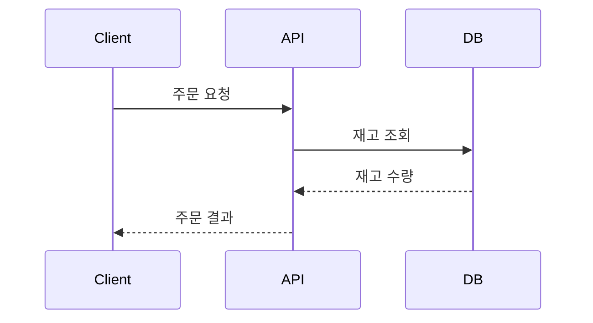

## Today I Learned

### 시퀀스 다이어그램

시퀀스 다이어그램은 UML 다이어그램 중 하나로, 객체(참여자)들이 시간 순서대로 어떤 메시지를 주고받는지를 그린다. 가로축에 참여자를 나열하고, 세로축을 시간으로 삼아 위에서 아래로 메시지를 화살표로 잇는다. 클래스 다이어그램이 "무엇이 있는가"를 보여 준다면 시퀀스 다이어그램은 "어떤 순서로 호출되는가"를 보여 준다.

글로 쓰면 머릿속에 쌓아야 하는 호출 순서를 한눈에 볼 수 있어서, API 호출 흐름이나 외부 시스템 연동을 설명할 때 유용하다. 텍스트로 그리는 도구인 [Mermaid](https://mermaid.js.org/syntax/sequenceDiagram.html)는 참여자를 소스에 등장한 순서대로 배치한다.



- https://engineer-mole.tistory.com/131

### Story Point

스토리 포인트는 작업 크기를 시간이 아니라 상대적인 크기로 추정하는 단위다. [Atlassian의 설명](https://www.atlassian.com/agile/project-management/estimation)에 따르면 스토리 포인트는 시간이나 일수 대신 복잡도, 위험, 작업량을 함께 고려해 사용자 스토리를 완료하는 데 드는 상대적인 노력을 표현한다. 팀은 함께 겪은 경험과 다른 스토리와의 비교로 포인트를 정하고, 플래닝 포커 같은 방식을 자주 쓴다. 문서의 예로는 간단한 버그 수정이 1포인트, 복잡한 기능이 8포인트다.

시간 단위 추정은 사람마다 속도가 달라 합의하기 어렵다. "이 작업이 저 작업보다 두 배쯤 크다"는 비교는 상대적으로 맞추기 쉽다. 그래서 추정을 꾸준히 되돌아보며 보정하면, 팀 안에서 일관된 기준으로 스프린트를 계획할 수 있다.

- https://engineering.linecorp.com/ko/blog/user-story-point-in-line-pay-team/

### Unit Test Naming Convention

테스트 이름은 테스트가 실패했을 때 가장 먼저 읽히는 문서다. Roy Osherove의 [Naming standards for unit tests](https://osherove.com/blog/2005/4/3/naming-standards-for-unit-tests.html)는 테스트 이름을 세 부분으로 나눈다.

```text
UnitOfWork_StateUnderTest_ExpectedBehavior
Sum_NegativeNumberAs1stParam_ExceptionThrown
```

테스트 대상(unit of work), 어떤 상태나 입력에서(state under test), 무엇을 기대하는지(expected behavior)를 이름에 담는다. 글은 테스트 이름이 구체적인 요구 사항을 표현해야 한다는 점을 이유로 든다. 이 밖에도 `should_ExpectedBehavior_when_StateUnderTest`, `given_when_then` 형태가 쓰인다. 어떤 형식이든 한 프로젝트 안에서 통일하는 것이 중요하다. JUnit 5를 쓴다면 `@DisplayName`으로 한글 설명을 붙이는 방법도 있다.

- https://medium.com/@stefanovskyi/unit-test-naming-conventions-dd9208eadbea

### application.yml

Spring Boot는 `application.properties`와 같은 설정을 YAML 형식의 `application.yml`로도 읽는다([Externalized Configuration](https://docs.spring.io/spring-boot/reference/features/external-config.html)). YAML은 들여쓰기로 계층을 표현하므로 같은 접두사를 반복하지 않아도 된다.

```yaml
spring:
  datasource:
    url: jdbc:mysql://localhost:3306/app
    username: app
```

설정 파일은 jar 안의 `application.yml`, jar 안의 `application-{profile}.yml`, jar 밖의 설정 파일, 환경 변수, 커맨드라인 인자 순으로 뒤에 오는 것이 앞의 값을 덮어쓴다. 한 파일 안에서 `---`로 문서를 나누고 `spring.config.activate.on-profile`로 프로필별 설정을 둘 수도 있다.

- https://galid1.tistory.com/664
- https://1minute-before6pm.tistory.com/12

### Lombok 코드를 Delombok 해보기

Lombok은 컴파일 시점에 getter, 생성자, `equals` 같은 코드를 만들어 넣기 때문에 소스에는 보이지 않는다. [Delombok](https://projectlombok.org/features/delombok)은 Lombok 애너테이션을 실제로 생성될 Java 코드로 풀어 쓴 소스를 만들어 준다. 원래는 javadoc처럼 Lombok이 끼어들 수 없는 도구를 위한 기능이지만, Lombok이 내부에서 무엇을 만드는지 직접 확인하는 용도로도 쓸 수 있다.

```bash
java -jar lombok.jar delombok src -d src-delomboked
```

IntelliJ에서는 Lombok 플러그인의 Delombok 메뉴로 같은 작업을 할 수 있다. `@Data`나 `@EqualsAndHashCode`가 어떤 필드로 `equals`를 만드는지 확인할 때 특히 쓸모 있다.

- https://devfunny.tistory.com/520

### 메서드 체이닝

메서드 체이닝은 메서드가 자기 자신(또는 다음에 이어 부를 객체)을 반환하게 해서 `a.b().c().d()`처럼 호출을 이어 쓰는 기법이다. 빌더 패턴, Stream API, QueryDSL이 대표적이다.

마틴 파울러는 [Fluent Interface](https://martinfowler.com/bliki/FluentInterface.html)에서 흔한 오해로 fluent interface를 메서드 체이닝과 같은 것으로 보는 것을 든다. 체이닝은 fluent interface에서 자주 쓰는 기법일 뿐이고, 진짜 목표는 API가 읽히는 흐름을 가지는 것이다. 즉 체이닝을 쓴다고 읽기 쉬워지는 것은 아니고, 이어지는 호출이 문장처럼 읽히도록 이름과 순서를 설계해야 한다. 체인이 길어지면 디버깅할 때 어느 단계에서 null이나 예외가 났는지 찾기 어려워진다는 점도 함께 고려해야 한다.

- https://gpffh1011.tistory.com/67

## 참고

- [Sequence diagrams - Mermaid](https://mermaid.js.org/syntax/sequenceDiagram.html)
- [What are story points in Agile and how do you estimate them? - Atlassian](https://www.atlassian.com/agile/project-management/estimation)
- [Naming standards for unit tests - Roy Osherove](https://osherove.com/blog/2005/4/3/naming-standards-for-unit-tests.html)
- [Externalized Configuration - Spring Boot](https://docs.spring.io/spring-boot/reference/features/external-config.html)
- [Delombok - Project Lombok](https://projectlombok.org/features/delombok)
- [Fluent Interface - Martin Fowler](https://martinfowler.com/bliki/FluentInterface.html)
- [Outracing champion Gran Turismo drivers with deep reinforcement learning - Nature](https://www.nature.com/articles/s41586-021-04357-7)
