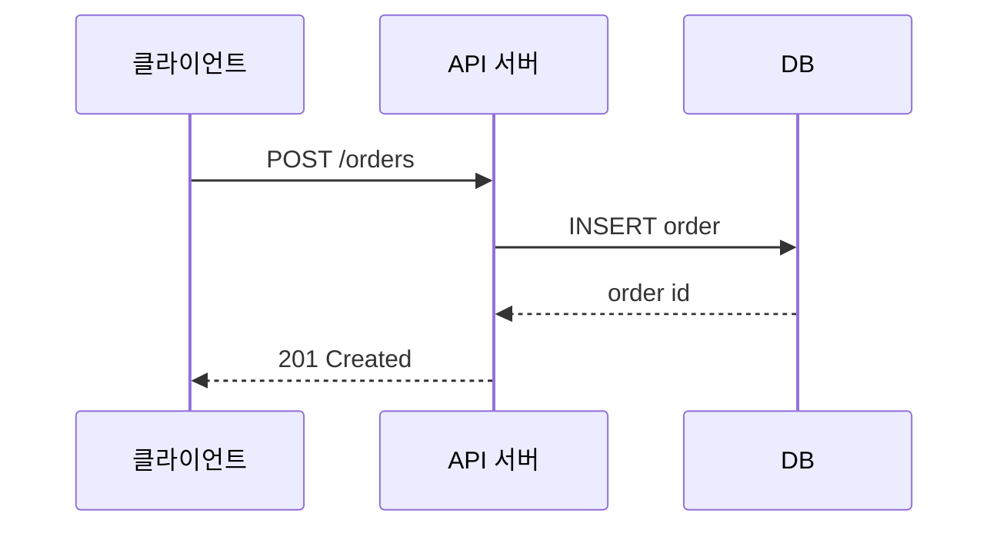

# 2022-02-14-TIL

## Today I Learned

### Diagram

설계를 설명할 때 쓰는 UML 다이어그램의 종류를 정리한 글이다. 사용자와 시스템이 주고받는 기능을 보여 주는 유스케이스 다이어그램, 클래스와 그 관계(상속, 연관, 의존)를 보여 주는 클래스 다이어그램, 처리 흐름과 분기를 보여 주는 액티비티 다이어그램, 객체 사이의 메시지 순서를 보여 주는 시퀀스 다이어그램 등이 있다. 전달하려는 것이 구조인지, 흐름인지, 시간 순서인지에 따라 고른다.

- https://valuefactory.tistory.com/981

### Sequence Diagram

시퀀스 다이어그램은 참여자(객체, 서비스)를 가로로 늘어놓고, 시간이 위에서 아래로 흐르는 생명선 위에 메시지를 화살표로 그린다. 실선 화살표는 호출, 점선 화살표는 응답이고, 조건 분기와 반복은 `alt`, `loop` 같은 프레임으로 감싼다. API 하나가 내부에서 어떤 순서로 무엇을 호출하는지 설명할 때 특히 유용하다.

- https://sabarada.tistory.com/84

### REST API Diagram

REST API를 그림으로 문서화하는 예시들이다. IBM 문서는 API가 다루는 리소스와 그 관계를 클래스 다이어그램으로 표현하고, Google Pay 패스 API 문서는 전형적인 API 호출 흐름을 단계별 다이어그램으로 보여 준다. 리소스 구조는 클래스 다이어그램으로, 호출 순서는 시퀀스나 흐름도로 나눠 그리면 읽기 쉽다.

- https://www.ibm.com/docs/en/spm/7.0.1?topic=apis-rest-api-class-diagram
- https://developers.google.com/pay/passes/guides/introduction/typical-api-flows?hl=ko

### MyBatis to JPA

MyBatis에서 JPA로 옮기는 과정을 다룬 발표 자료다. MyBatis는 SQL을 직접 작성해 결과를 객체에 매핑하고, JPA는 엔티티 매핑을 바탕으로 SQL을 생성하며 변경 감지와 지연 로딩을 제공한다. 그래서 전환은 단순히 매퍼를 리포지토리로 바꾸는 일이 아니라, 테이블 중심으로 작성된 코드를 객체와 연관관계 중심으로 다시 모델링하는 일이 된다.

- https://www.slideshare.net/dongmyo/mybatis-jpa-123381168

### 주석 쓰는게 좋을까

주석을 얼마나 써야 하는지에 대한 커뮤니티 토론이다(지금은 접근이 막혀 내용을 다시 확인하지 못했다). 흔히 정리되는 기준은 코드가 무엇을 하는지는 이름과 구조로 드러내고, 주석은 코드만으로 알 수 없는 이유(왜 이런 선택을 했는지, 외부 제약)를 적는 데 쓰라는 것이다. 코드와 함께 갱신되지 않은 주석은 오히려 잘못된 정보를 준다.

- https://okky.kr/article/359076

### DataGrip

DataGrip은 JetBrains의 데이터베이스 IDE다. 여러 종류의 DB에 연결해 스키마를 탐색하고, 자동완성과 리팩터링을 지원하는 SQL 편집기, 실행 계획 보기, 결과 편집 같은 기능을 제공한다. IntelliJ IDEA Ultimate의 Database 도구와 같은 기반이다.

- https://www.jetbrains.com/ko-kr/datagrip/features/

### Git Conflict 해결하기

두 브랜치가 같은 파일의 같은 부분을 다르게 고치면 병합할 때 충돌이 난다. Git은 해당 위치에 `<<<<<<<`, `=======`, `>>>>>>>` 표시로 두 버전을 함께 남기므로, 원하는 내용으로 고친 뒤 표시를 지우고 `git add`, `git commit`(리베이스 중이면 `git rebase --continue`)으로 마무리한다. 해결이 꼬이면 `git merge --abort`로 병합 이전 상태로 되돌릴 수 있다.

- https://velog.io/@eunjin/Git%EA%B9%83-%EB%B8%8C%EB%9E%9C%EC%B9%98-%EC%BB%A8%ED%94%8C%EB%A6%AD%ED%8A%B8-%ED%95%B4%EA%B2%B0%ED%95%98%EB%8A%94-A-to-Z-%EB%B0%A9%EB%B2%95

### Unit Test Naming Conventions

`메서드명_상황_기대결과`, `Should_기대결과_When_상황`, `Given_When_Then`처럼 테스트 이름에 상황과 기대 결과를 담는 규칙들이다. JUnit 5에서는 `@DisplayName`으로 사람이 읽는 설명을 따로 붙일 수 있다.

- https://medium.com/@stefanovskyi/unit-test-naming-conventions-dd9208eadbea
- https://dzone.com/articles/7-popular-unit-test-naming

### Stream Pipeline

스트림 파이프라인은 소스(컬렉션, 배열), 0개 이상의 중간 연산(`filter`, `map`, `sorted`), 하나의 최종 연산(`collect`, `forEach`, `count`)으로 구성된다. `java.util.stream` 패키지 문서에 따르면 중간 연산은 지연(lazy) 실행되어, 최종 연산이 호출되어야 비로소 소스를 순회한다. 그래서 `filter`와 `map`이 원소마다 한 번에 이어서 적용되고, `findFirst`처럼 단락(short-circuit) 연산은 결과를 찾는 즉시 멈춘다. 스트림은 한 번 소비하면 재사용할 수 없다.

- https://webcoding-start.tistory.com/48

### Exception Handling

공통 에러 응답 객체와 `@RestControllerAdvice`로 예외를 한곳에서 처리하는 Spring Boot 예제 저장소다.

- https://github.com/Hyune-c/exception-handling

## 참고

- [Sequence diagrams](https://mermaid.js.org/syntax/sequenceDiagram.html) — Mermaid
- [Package java.util.stream (Java SE 8 API)](https://docs.oracle.com/javase/8/docs/api/java/util/stream/package-summary.html) — Oracle Docs
- [Basic Merge Conflicts](https://git-scm.com/book/en/v2/Git-Branching-Basic-Branching-and-Merging#_basic_merge_conflicts) — Pro Git
