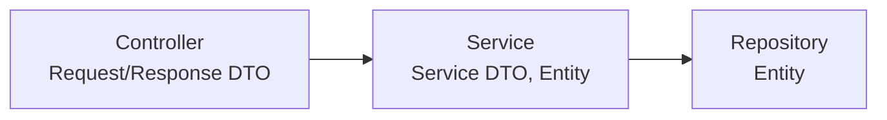
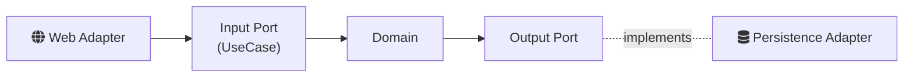

## Today I Learned

### DTO의 사용범위

정해진 규칙은 없지만 DTO는 컨트롤러에서 request, response의 용도로 사용하며, 서비스 계층으로 내려가는 dto의 경우 SomethingDto 정도로 네이밍 하면 좋을 것 같다. 즉, 컨트롤러에서만 사용하는 DTO와 서비스에서도 사용되는 DTO를 구분하는게 좋다.

레파지토리에서는 JPA의 경우 Entity, 다른 도구의 경우 DAO나 VO의 네이밍을 사용하면 될 것 같다. DTO를 레파지토리 계층까지 끌고가지는 말자.

이렇게 나누는 이유는 계층마다 바뀌는 이유가 다르기 때문이다. 요청/응답 DTO는 API 스펙이 바뀔 때, 엔티티는 테이블 구조나 도메인 규칙이 바뀔 때 변한다. 엔티티를 그대로 응답으로 내보내면 테이블 컬럼 하나를 바꿨을 뿐인데 API 응답이 깨지고, 지연 로딩 프록시나 양방향 연관관계 때문에 직렬화 오류가 나기도 한다. 반대로 요청 DTO를 서비스와 레포지토리까지 넘기면 하위 계층이 웹 계층의 형식에 묶인다. 링크된 글들도 대체로 "엔티티는 서비스 계층 안에서만, 바깥과는 DTO로" 정도에서 의견이 모인다.

- https://slipp.net/questions/23
- https://slipp.net/questions/93
- https://tecoble.techcourse.co.kr/post/2021-04-25-dto-layer-scope/
- https://os94.tistory.com/157
- https://www.inflearn.com/questions/53023
- https://ttl-blog.tistory.com/168
- https://www.baeldung.com/java-dto-pattern
- https://velog.io/@dnwlsrla40/Spring-DTO%EC%9D%98-%EC%82%AC%EC%9A%A9-%EB%B2%94%EC%9C%84%EC%97%90-%EB%8C%80%ED%95%98%EC%97%AC
- https://coder-question-ko.com/cq-ko-blog/68014
- https://rachel1208.tistory.com/m/15
- https://stackoverflow.com/questions/31438286/ddd-which-layer-dto-should-be-implemented

---

### VO, DTO, DAO, POJO

- POJO(Plain Old Java Object): 특정 프레임워크의 클래스를 상속하거나 인터페이스를 구현하도록 강제받지 않는 평범한 자바 객체다. 나머지 셋도 대부분 POJO로 만든다.
- DTO(Data Transfer Object): 계층이나 프로세스 사이에서 데이터를 옮기는 용도의 객체다. 로직 없이 필드와 접근자만 가진다.
- DAO(Data Access Object): 데이터베이스 접근 로직을 캡슐화한 객체다. Spring Data JPA의 Repository가 비슷한 역할을 한다.
- VO(Value Object): 식별자 없이 값 자체로 동등성을 판단하는 불변 객체다. `Money`, `Address` 같은 것이 예다.

- https://stackoverflow.com/questions/1612334/difference-between-dto-vo-pojo-javabeans
- https://stackoverflow.com/questions/36174516/rest-api-dtos-or-not?noredirect=1&lq=1
- https://www.quora.com/What-is-DTO-DAO-and-VO-in-Java

---

### DTO Naming

자바에서 정해진 표준은 없고, 링크된 질문의 답변들도 팀 안에서 일관되게 쓰는 것을 가장 중요하게 본다. 흔히 쓰는 방식은 `MemberDto`처럼 접미사를 붙이거나, 용도를 드러내도록 `MemberCreateRequest`, `MemberResponse`처럼 짓는 것이다. 용도별 이름은 같은 엔티티에 대해 DTO가 여러 개 생겨도 구분이 쉽다.

- https://stackoverflow.com/questions/1724774/java-data-transfer-object-naming-convention

---

### VO vs DTO

두 용어가 자주 섞여 쓰이는 데는 역사적인 이유가 있다. 초기 J2EE 패턴 문헌에서는 지금의 DTO를 Value Object라고 부르기도 했다. Adam Bien은 링크된 글에서 DTO는 계층 사이에 데이터를 나르는 단순한 컨테이너이고, Value Object는 식별자가 없는 불변 값의 묶음이라며 둘을 구분하고, 개발자들이 DTO를 의미하면서 Value Object라고 부르는 경우가 많다고 지적한다. 요즘은 DDD의 정의대로 VO를 "불변이고 값으로 비교되는 객체"로 쓰는 것이 일반적이다. 그래서 VO는 `equals`와 `hashCode`를 값 기준으로 재정의하고, setter를 두지 않는다.

- https://ijbgo.tistory.com/9
- https://www.adam-bien.com/roller/abien/entry/value_object_vs_data_transfer

---

### DTO pros & cons

DTO의 장점은 계층 사이의 결합을 끊는 것이다. API 스펙과 도메인 모델이 따로 변할 수 있고, 응답에 필요한 필드만 노출할 수 있다. 단점은 비슷한 클래스와 변환 코드가 늘어난다는 것이다. Adam Bien은 링크된 글에서 DTO는 계층 사이에 실제로 모양이 맞지 않을 때 쓸모가 있지만, 미래의 차이를 대비해 미리 만드는 투자는 그 차이가 끝내 생기지 않아 대개 보상받지 못한다고 본다. 결국 "모든 계층에 무조건 DTO"보다는 경계에서 실제로 모양이 달라지는 곳에 둔다는 판단이 필요하다.

- https://ijbgo.tistory.com/9
- https://www.adam-bien.com/roller/abien/entry/how_evil_are_actually_data

---

### Vue.js with Spring Boot

Vue.js 프런트엔드와 Spring Boot 백엔드를 함께 구성하는 예제다. 한 가지 방식은 Vue를 빌드한 정적 파일을 Spring Boot의 정적 리소스 경로에 넣어 하나의 애플리케이션으로 배포하는 것이고, 다른 방식은 둘을 별도 서버로 두고 REST API로 통신하는 것이다. 후자는 개발 중 CORS 설정이나 개발 서버의 프록시 설정이 필요하다.

- https://www.baeldung.com/spring-boot-vue-js

---

### StackOverflow clone

Stack Exchange 스타일의 Q&A 사이트를 직접 운영할 수 있는 오픈소스 대안을 모아 둔 Meta Stack Exchange 질문이다. Q&A 서비스를 설계할 때 질문, 답변, 투표, 채택, 태그 같은 기능을 기존 구현이 어떻게 모델링했는지 참고하기 좋다.

- https://meta.stackexchange.com/questions/2267/are-there-any-clones-alternatives-for-running-a-stack-exchange-style-qa-site

---

### Hexagonal Architecture

헥사고날 아키텍처는 Alistair Cockburn이 2005년에 정리한 [Ports and Adapters](https://alistair.cockburn.us/hexagonal-architecture/) 패턴이다. 애플리케이션 핵심(도메인과 유스케이스)을 가운데 두고, 바깥 세계와는 포트(인터페이스)로만 소통한다. 웹 컨트롤러나 메시지 리스너처럼 애플리케이션을 호출하는 쪽은 입력(driving) 어댑터, DB나 외부 API처럼 애플리케이션이 호출하는 쪽은 출력(driven) 어댑터가 된다. 의존성은 항상 바깥에서 안쪽으로 향한다.

이렇게 하면 핵심 로직을 DB나 프레임워크 없이 테스트할 수 있고, 데이터 소스를 바꿔도 어댑터만 교체하면 된다. 대신 포트 인터페이스와 매핑 코드가 늘어나므로 작은 CRUD 서비스에는 과할 수 있다. 링크 중 `buckpal`은 Tom Hombergs의 책 예제 저장소이고, Netflix 기술 블로그 글도 이 구조를 적용한 사례를 소개한다.

- https://github.com/thombergs/buckpal
- https://github.com/Sairyss/domain-driven-hexagon
- https://github.com/hirannor/spring-boot-hexagonal-architecture
- https://github.com/AlicanAkkus/Modular-Architecture-Hexagonal-Demo-Project
- https://github.com/CodelyTV/java-ddd-example
- https://github.com/tugcekonuklar/account-service
- https://sejoung.github.io/2021/06/2021-06-24-hexagonal/
- https://blog.imqa.io/hexagonal-architecture/
- https://medium.com/idealo-tech-blog/hexagonal-ports-adapters-architecture-e3617bcf00a0
- https://medium.com/ssense-tech/hexagonal-architecture-there-are-always-two-sides-to-every-story-bc0780ed7d9c
- https://netflixtechblog.com/ready-for-changes-with-hexagonal-architecture-b315ec967749

## 참고

- [Hexagonal architecture](https://alistair.cockburn.us/hexagonal-architecture/) — Alistair Cockburn
