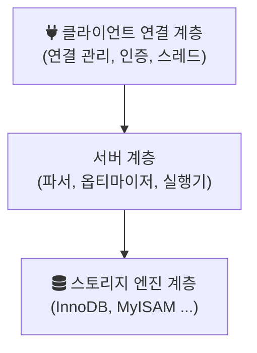

## Today I Learned

### Entity 중복

한 테이블에 대해서 용도에 따라 여러개의 중복된 엔티티를 가지는게 나은가? 아니면 엔티티 중복을 하지않도록 현재는 불필요하지만 완전히 테이블과 1대1 매핑되는 엔티티를 하나만 가지도록 하는게 나을까?

[3월 6일 TIL](/posts/2022-03-06-TIL/)에서 본 것처럼, 한 테이블에 엔티티를 여러 개 두면 Hibernate가 같은 행이라는 것을 몰라 변경이 서로 반영되지 않고 같은 트랜잭션에서 충돌할 수 있다. 그래서 쓰기는 테이블과 일대일로 대응하는 엔티티 하나로 하고, 용도별로 일부 컬럼만 필요한 조회는 DTO 프로젝션으로 처리하는 쪽이 일관성 문제를 피하기 쉽다. 컬럼이 아주 많거나 큰 컬럼이 있는 테이블이라면 자주 쓰는 컬럼만 담은 읽기 전용(`@Immutable`) 엔티티를 따로 두는 절충도 가능하다.

---

### `@GeneratedValue`를 사용해야 하는가?

`@GeneratedValue`는 기본 키 값을 애플리케이션이 아니라 DB나 JPA 구현체가 생성하게 한다. 전략은 네 가지다.

- `IDENTITY`: MySQL의 `AUTO_INCREMENT`처럼 DB가 INSERT 시점에 값을 만든다. Hibernate는 ID를 알기 위해 `persist` 시점에 바로 INSERT를 실행해야 하므로 JDBC 배치 INSERT를 쓸 수 없다.
- `SEQUENCE`: DB 시퀀스에서 값을 받아 온다. INSERT 전에 ID를 알 수 있어 배치에 유리하고, `allocationSize`로 여러 값을 미리 받아 호출 횟수를 줄인다.
- `TABLE`: 키 생성용 테이블로 시퀀스를 흉내 낸다. 모든 DB에서 동작하지만 락 경합으로 느리다.
- `AUTO`: 구현체가 DB 방언에 맞춰 고른다. 버전에 따라 선택이 달라질 수 있어 명시하는 편이 낫다.

ID를 직접 할당해야 하는 경우(외부 시스템의 키, UUID 등)에는 `@GeneratedValue`를 빼고 생성 시점에 값을 넣는다. 이때 Spring Data JPA의 `save()`는 ID가 이미 있으면 새 엔티티가 아니라고 보고 `merge`를 호출해 SELECT가 한 번 더 나가므로, `Persistable`을 구현해 새 엔티티 여부를 직접 알려 주는 방법이 있다.

- https://www.baeldung.com/jpa-strategies-when-set-primary-key
- https://coding-start.tistory.com/71
- https://www.jpa-buddy.com/blog/the-ultimate-guide-on-db-generated/
- https://dzone.com/articles/the-ultimate-guide-on-db-generated-ids-in-jpa-enti
- https://www.baeldung.com/jpa-get-auto-generated-id

---

### Composite Key

복합 키는 두 개 이상의 컬럼을 묶어 기본 키로 쓰는 것이다. 주문-상품 매핑 테이블처럼 자연스럽게 두 외래 키의 조합이 유일한 경우에 쓰인다. 링크된 글들은 장단점을 이렇게 정리한다. 별도의 대리 키 없이 비즈니스상 유일성을 DB가 보장하고 인덱스 하나를 아낄 수 있지만, 이 테이블을 참조하는 다른 테이블도 모든 키 컬럼을 외래 키로 가져야 하고, 키 값이 바뀌면 연쇄적으로 수정해야 한다. JPA에서는 `@IdClass`나 `@EmbeddedId`로 매핑하며, 키 클래스는 `Serializable`을 구현하고 `equals`/`hashCode`를 재정의해야 한다. 그래서 대리 키를 기본 키로 두고 복합 컬럼에는 유니크 제약을 거는 방식도 많이 쓴다.

- https://weblogs.sqlteam.com/jeffs/2007/08/23/composite_primary_keys/
- https://stackoverflow.com/questions/11586986/advantages-and-disadvantages-of-having-composite-primary-key

---

### JPA Entity without Id

JPA 명세는 모든 엔티티에 기본 키가 있어야 한다고 정하므로 `@Id` 없는 엔티티는 만들 수 없다. 기본 키가 없는 테이블(로그 테이블, 뷰 등)을 다뤄야 한다면, 실제로 유일한 컬럼 조합을 `@EmbeddedId`나 `@IdClass`로 지정하거나, 엔티티 대신 네이티브 쿼리나 JdbcTemplate으로 조회해 DTO에 담는다. 뷰라면 `@Immutable`을 붙여 읽기 전용으로 쓰는 방법도 있다.

- https://stackoverflow.com/questions/3820897/jpa-entity-without-id

---

### `@Valid`

`@Valid`는 Bean Validation(JSR 380) 애너테이션으로, 붙은 객체의 필드에 선언된 제약(`@NotNull`, `@Size`, `@Email` 등)을 검증하게 한다. Spring MVC 컨트롤러의 `@RequestBody @Valid MemberRequest request`처럼 쓰면 검증 실패 시 `MethodArgumentNotValidException`이 발생하고, 이를 `@ControllerAdvice`에서 400 응답으로 바꾼다. 중첩 객체의 필드도 검증하려면 해당 필드에도 `@Valid`를 붙여야 한다. Spring의 `@Validated`는 검증 그룹을 지정할 수 있고, 클래스에 붙이면 메서드 파라미터 검증을 활성화한다.

- https://appsnuri.tistory.com/115

---

### Java 17

Java 17은 Java 11 다음의 LTS 릴리즈다. Java 11 이후 정식 기능이 된 것들 중 자주 쓰는 것은 다음과 같다.

| 기능 | 정식 도입 |
| --- | --- |
| switch 표현식 ([JEP 361](https://openjdk.org/jeps/361)) | Java 14 |
| 텍스트 블록 ([JEP 378](https://openjdk.org/jeps/378)) | Java 15 |
| 레코드 ([JEP 395](https://openjdk.org/jeps/395)) | Java 16 |
| instanceof 패턴 매칭 ([JEP 394](https://openjdk.org/jeps/394)) | Java 16 |
| sealed 클래스 ([JEP 409](https://openjdk.org/jeps/409)) | Java 17 |

Java 17에서 switch 패턴 매칭([JEP 406](https://openjdk.org/jeps/406))은 아직 프리뷰다. Spring Framework 6가 Java 17을 최소 버전으로 정했다는 점도 전환을 고려하는 이유가 된다.

- https://velog.io/@riwonkim/Java-17%EB%A1%9C-%EC%A0%84%ED%99%98%EC%9D%84-%EA%B3%A0%EB%A0%A4%ED%95%B4%EC%95%BC-%ED%95%98%EB%8A%94-%EC%9D%B4%EC%9C%A0
- https://www.youtube.com/watch?v=GJB-RyHKHjY
- https://www.youtube.com/watch?v=7SlDdzVk6GE

---

### Skipping Tests with Maven

[Maven Surefire 문서](https://maven.apache.org/surefire/maven-surefire-plugin/examples/skipping-tests.html)에 따르면 테스트를 건너뛰는 옵션은 두 가지다. `-DskipTests`는 테스트 코드를 컴파일은 하되 실행만 하지 않고, `-Dmaven.test.skip=true`는 테스트 컴파일까지 건너뛴다. 후자는 Surefire, Failsafe, Compiler 플러그인이 모두 인식한다.

```bash
mvn install -DskipTests
mvn install -Dmaven.test.skip=true
```

- https://www.baeldung.com/maven-skipping-tests
- http://blog.iotinfra.net/?p=1707
- https://brocess.tistory.com/148

---

### MediaInfo

MediaInfo는 동영상이나 오디오 파일의 코덱, 해상도, 비트레이트, 재생 시간 같은 메타데이터를 읽어 주는 오픈소스 도구다. 링크된 AWS Media 블로그 글은 MediaInfo를 AWS Lambda 함수로 실행해, S3에 올라온 미디어 파일의 메타데이터를 서버 없이 추출하는 방법을 소개한다.

- https://aws.amazon.com/ko/blogs/media/running-mediainfo-as-an-aws-lambda-function/

---

### MySQL Architecture

MySQL 서버는 크게 세 층으로 나눠 볼 수 있다.



연결 계층은 클라이언트 접속을 받고 인증하며 연결마다 스레드를 할당한다. 서버 계층은 SQL을 파싱하고 옵티마이저가 실행 계획을 세워 실행한다. 실제 데이터 저장과 인덱스, 트랜잭션, 락은 스토리지 엔진이 담당하는데, 엔진은 플러그인 방식이라 테이블마다 다른 엔진을 쓸 수 있다. 트랜잭션과 행 단위 락을 지원하는 InnoDB가 기본 엔진이다.

- https://www.geeksforgeeks.org/architecture-of-mysql/

## 참고

- [Skipping Tests](https://maven.apache.org/surefire/maven-surefire-plugin/examples/skipping-tests.html) — Maven Surefire Plugin
- [JEP 409: Sealed Classes](https://openjdk.org/jeps/409) — OpenJDK
- [JEP 395: Records](https://openjdk.org/jeps/395) — OpenJDK
