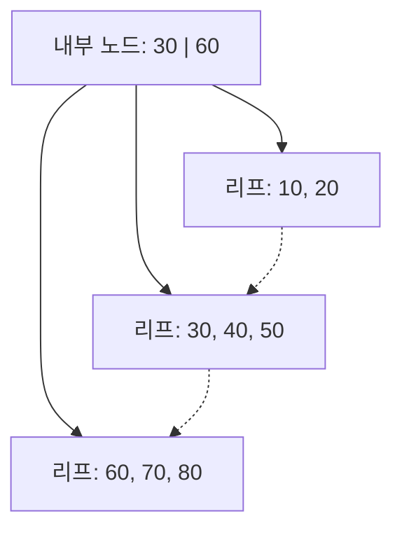

## Today I Learned

### Index

인덱스는 특정 컬럼 값으로 행을 빨리 찾기 위한 자료구조다. [MySQL 문서](https://dev.mysql.com/doc/refman/8.0/en/mysql-indexes.html)는 인덱스가 없으면 MySQL이 첫 행부터 테이블 전체를 읽으며 찾아야 하고, 테이블이 클수록 비용이 커진다고 설명한다. 인덱스가 있으면 데이터 중간의 어느 위치로 이동해야 할지 바로 알 수 있다.

대신 인덱스는 공짜가 아니다. 행을 넣고, 고치고, 지울 때마다 인덱스도 함께 갱신해야 하므로 쓰기가 느려지고 저장 공간도 더 쓴다. 그래서 조회 조건에 자주 쓰이고 값이 다양한(카디널리티가 높은) 컬럼에 거는 것이 기본이다.

인덱스를 걸어도 쓰이지 않는 경우가 있다. 같은 문서와 [B-Tree와 Hash 인덱스 비교 문서](https://dev.mysql.com/doc/refman/8.0/en/index-btree-hash.html)에서 확인한 규칙은 다음과 같다.

- 여러 컬럼 인덱스는 왼쪽부터의 접두(leftmost prefix)만 쓸 수 있다. `(col1, col2, col3)` 인덱스는 `col1`, `col1, col2`, `col1, col2, col3` 조건 검색에 쓰이지만 `col2`만으로는 쓰이지 않는다.
- B-Tree 인덱스는 `=`, `>`, `>=`, `<`, `<=`, `BETWEEN` 비교에 쓰인다. `LIKE`는 패턴이 와일드카드로 시작하지 않을 때만 쓰인다. `LIKE 'Patrick%'`는 인덱스를 타지만 `LIKE '%Patrick'`은 타지 않는다.

- https://jojoldu.tistory.com/243

---

### B+Tree

[MySQL 문서](https://dev.mysql.com/doc/refman/8.0/en/innodb-physical-structure.html)에 따르면 InnoDB 인덱스는 공간 인덱스를 제외하면 모두 B-tree 자료구조다. MySQL 용어집은 B-tree를 항상 정렬 상태를 유지해 정확히 일치하는 값과 범위(`>`, `<`, `BETWEEN`)를 빨리 찾을 수 있는 트리로 설명하고, 노드가 여러 자식을 가질 수 있으므로 자식이 둘로 제한된 이진 트리와는 다르다고 강조한다.

데이터베이스 문서는 보통 B-tree라고 부르지만, 실제로 쓰이는 형태는 흔히 B+Tree라고 부르는 변형이다. B-Tree와의 차이는 다음과 같다.

- B-Tree는 내부 노드에도 키와 데이터를 함께 둔다.
- B+Tree는 내부 노드에는 탐색 방향을 정하는 키만 두고, 실제 레코드(또는 레코드 위치)는 모두 리프 노드에 둔다. InnoDB 문서도 인덱스 레코드가 B-tree의 리프 페이지에 저장된다고 설명한다.
- 리프 노드끼리 옆으로 연결되어 있어, 범위 검색은 시작 키를 찾은 뒤 리프를 따라 옆으로 읽으면 된다.

이 구조가 디스크 기반 DB에 맞는 이유는 노드 하나가 페이지 하나이기 때문이다. InnoDB 인덱스 페이지는 기본 16KB이고, 내부 노드에는 키만 두므로 한 페이지에 많은 키를 담을 수 있다. 노드마다 자식 수가 많으니 트리 높이가 낮게 유지되고, 값 하나를 찾을 때 읽는 페이지 수도 적다. 자식이 둘뿐인 이진 트리였다면 같은 데이터에서 높이가 훨씬 높아져 디스크 읽기 횟수가 늘어난다.

리프를 옆으로 잇는 링크는 동시성 제어에도 쓰인다. [PostgreSQL의 B-tree 구현 README](https://github.com/postgres/postgres/blob/REL_14_0/src/backend/access/nbtree/README)는 Lehman과 Yao의 고동시성 B-tree 알고리즘을 구현했다고 밝히는데, 이 알고리즘은 고전 B-tree에 각 페이지의 오른쪽 링크(right-link)를 추가한다. 페이지가 분할되는 중에 탐색하던 쪽은 오른쪽 링크를 따라가 원하는 키 범위를 가진 새 페이지를 찾는다.

## 참고

- [How MySQL Uses Indexes - MySQL 8.0 Reference Manual](https://dev.mysql.com/doc/refman/8.0/en/mysql-indexes.html) — MySQL Docs
- [Comparison of B-Tree and Hash Indexes](https://dev.mysql.com/doc/refman/8.0/en/index-btree-hash.html) — MySQL 8.0 Reference Manual
- [The Physical Structure of an InnoDB Index](https://dev.mysql.com/doc/refman/8.0/en/innodb-physical-structure.html) — MySQL 8.0 Reference Manual
- [B-tree](https://dev.mysql.com/doc/refman/8.0/en/glossary.html) — MySQL Glossary
- [nbtree README - PostgreSQL REL_14_0](https://github.com/postgres/postgres/blob/REL_14_0/src/backend/access/nbtree/README) — GitHub
