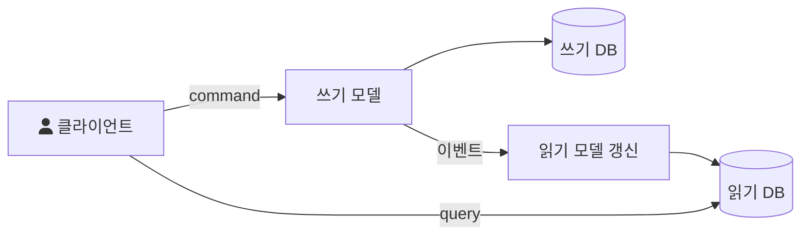
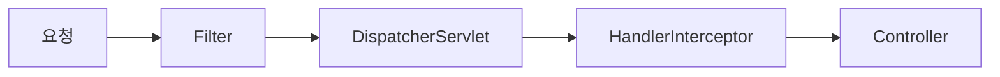

## Today I Learned

### CQRS

CQRS(Command Query Responsibility Segregation)는 데이터를 바꾸는 쪽(command)과 읽는 쪽(query)에 서로 다른 모델을 쓰는 패턴이다. 마틴 파울러의 [CQRS](https://martinfowler.com/bliki/CQRS.html) 글은 이를 정보를 갱신하는 모델과 읽는 모델을 다르게 쓸 수 있다는 개념으로 설명하면서, 어떤 상황에서는 이 분리가 가치 있지만 대부분의 시스템에서는 복잡도를 더한다고 경고한다.

왜 나눌까? 하나의 모델로 쓰기와 읽기를 모두 처리하면, 쓰기 쪽의 검증 규칙과 읽기 쪽의 다양한 조회 화면이 한 모델에 얽힌다. [Microsoft의 CQRS 패턴 문서](https://learn.microsoft.com/en-us/azure/architecture/patterns/cqrs)는 전통적인 방식이 데이터 저장소와 접근 계층에 부하를 주고 복잡한 조회 쿼리 때문에 성능 문제를 일으킬 수 있다고 설명한다. 모델을 나누면 각자의 관심사에 맞게 설계하고 따로 확장할 수 있다.

구현 수준은 두 가지다.

- 같은 데이터베이스를 쓰되 쓰기 로직과 읽기 로직만 분리한다. CQRS의 가장 기본적인 형태다.
- 읽기 전용 저장소를 따로 두고, 쓰기 모델이 발생시킨 이벤트로 읽기 모델을 갱신한다. 조회 성능은 좋아지지만 두 저장소 사이에 동기화가 필요하고, 읽기 모델은 잠시 뒤처질 수 있다(최종 일관성).

- https://docs.microsoft.com/en-us/azure/architecture/patterns/cqrs
- https://always-kimkim.tistory.com/entry/cqrs-pattern

### DB 샤딩

샤딩은 데이터를 수평 분할(horizontal partition)해서 여러 저장소에 나눠 담는 방식이다. [Microsoft의 Sharding 패턴 문서](https://learn.microsoft.com/en-us/azure/architecture/patterns/sharding)에 따르면 각 샤드는 같은 스키마를 가지지만 서로 다른 데이터 부분집합을 담고, 어떤 데이터가 어느 샤드로 갈지는 샤드 키(파티션 키)가 정한다.

문서는 샤드 키를 가장 중요한 설계 결정으로 꼽는다. 한 번 정하면 바꾸기 위해 전체 데이터를 새 샤드 배치로 옮겨야 하기 때문이다. 좋은 샤드 키는 바뀌지 않고, 값이 다양하고, 데이터와 부하를 고르게 나누며, 대부분의 요청이 샤드 하나에서 끝나도록 주요 조회 패턴과 맞아야 한다. 자동 증가 정수나 순차적인 타임스탬프는 새 데이터가 한 샤드에 몰리므로 피하라고 한다.

데이터를 나누는 전략은 세 가지다.

| 전략 | 방식 | 특징 |
| --- | --- | --- |
| Lookup(디렉터리) | 샤드 키와 샤드의 매핑 표를 둔다 | 배치를 유연하게 바꿀 수 있지만 조회 단계가 하나 늘어난다 |
| Range | 키 범위별로 샤드를 나눈다 | 구현이 쉽고 범위 조회에 유리하지만 한 샤드에 몰리기 쉽다 |
| Hash | 키의 해시 값으로 샤드를 고른다 | 고르게 분산되지만 consistent hashing 없이는 재배치가 어렵다 |

샤드 키가 주요 조회 패턴과 맞아야 하는 이유도 여기에 있다. 한 요청이 여러 샤드에 걸치면 각 샤드를 따로 조회해 결과를 합쳐야 하고, 여러 샤드에 걸친 조인과 트랜잭션은 애플리케이션이 직접 다뤄야 한다.

- https://engineering.linecorp.com/ko/blog/line-manga-server-side/
- https://www.youtube.com/watch?v=8Eb_n7JA1yA

### 책

대규모 시스템 설계와 관련된 책을 저장해 두었다. 첫 번째는 알렉스 쉬의 『가상 면접 사례로 배우는 대규모 시스템 설계 기초』다.

- http://www.yes24.com/Product/Goods/102819435
- http://www.kyobobook.co.kr/product/detailViewKor.laf?mallGb=KOR&ejkGb=KOR&barcode=9788994506128

### 필터 vs 인터셉터

둘 다 요청 처리 앞뒤에 공통 로직을 끼워 넣는 도구지만, 동작하는 위치가 다르다.

- 필터(Filter)는 서블릿 명세의 기능이다. [Jakarta Servlet Javadoc](https://jakarta.ee/specifications/servlet/6.0/apidocs/jakarta.servlet/jakarta/servlet/filter)에 따르면 리소스(서블릿이나 정적 콘텐츠)로 가는 요청이나 그 응답에 대해 필터링 작업을 하는 객체이고, `doFilter` 메서드에서 처리한다. `DispatcherServlet`에 들어가기 전에 실행되므로 Spring MVC 바깥이다.
- 인터셉터(`HandlerInterceptor`)는 Spring MVC의 기능이다. `DispatcherServlet`이 컨트롤러(핸들러)를 실행하기 전후에 호출된다.

[HandlerInterceptor Javadoc](https://docs.spring.io/spring-framework/docs/current/javadoc-api/org/springframework/web/servlet/HandlerInterceptor.html)은 둘의 차이를 직접 설명한다. 인터셉터는 기본적으로 필터와 비슷하지만 핸들러 실행 전 처리(실행을 막는 것 포함)와 후처리만 할 수 있다. 필터는 체인을 따라 넘기는 요청, 응답 객체 자체를 바꿔 끼울 수 있어 더 강력하다. 그래서 핸들러와 관련된 세밀한 공통 처리는 인터셉터, 멀티파트 폼이나 GZIP 압축처럼 요청과 응답 내용을 다루는 일은 필터가 적합하다고 안내한다. 또한 인터셉터는 컨트롤러 경로 매칭과 어긋날 수 있어 보안 계층으로는 적합하지 않고, Spring Security처럼 서블릿 필터 체인에 통합된 방식을 권장한다.

- https://mangkyu.tistory.com/173
- https://stackoverflow.com/questions/35856454/difference-between-interceptor-and-filter-in-spring-mvc#:~:text=Interceptor%3A%20%2D%20Spring%20Interceptors%20are%20similar,can%20access%20all%20Spring%20context.

### HikariCP

HikariCP는 JDBC 커넥션 풀이고, [Spring Boot 문서](https://docs.spring.io/spring-boot/reference/data/sql.html)는 성능과 동시성 때문에 HikariCP를 선호하며 클래스패스에 있으면 항상 이것을 고른다고 설명한다. DB 커넥션을 맺는 일은 비싸기 때문에, 미리 만들어 둔 커넥션을 빌려 쓰고 돌려주는 풀을 둔다. [HikariCP 저장소](https://github.com/brettwooldridge/HikariCP)는 스스로를 빠르고 단순하며 신뢰할 수 있는 "zero-overhead" 커넥션 풀로 소개하고, 라이브러리 크기는 약 165KB다.

자주 만지는 설정은 다음과 같다.

- `maximumPoolSize`: 유휴 커넥션과 사용 중인 커넥션을 합친 최대 개수다. 사실상 DB에 맺는 실제 커넥션의 최대 수이고, 적정값은 실행 환경에 따라 정해야 한다.
- `minimumIdle`: 유지하려는 최소 유휴 커넥션 수다.
- `connectionTimeout`: 풀에서 커넥션을 얻을 때까지 기다리는 최대 시간이다.
- `maxLifetime`: 커넥션 하나가 풀에서 살아 있을 수 있는 최대 시간이다.

저장소는 커넥션 풀 크기를 다룬 글로 연결하면서, DB 커넥션이 흔히 생각하는 만큼 많을 필요가 없고 너무 많으면 오히려 성능을 해칠 수 있다고 강조한다.

- https://www.baeldung.com/hikaricp

## 참고

- [CQRS](https://martinfowler.com/bliki/CQRS.html) — Martin Fowler
- [CQRS pattern - Azure Architecture Center](https://learn.microsoft.com/en-us/azure/architecture/patterns/cqrs) — Microsoft Learn
- [Sharding pattern - Azure Architecture Center](https://learn.microsoft.com/en-us/azure/architecture/patterns/sharding) — Microsoft Learn
- [Filter](https://jakarta.ee/specifications/servlet/6.0/apidocs/jakarta.servlet/jakarta/servlet/filter) — Jakarta Servlet API
- [HandlerInterceptor](https://docs.spring.io/spring-framework/docs/current/javadoc-api/org/springframework/web/servlet/HandlerInterceptor.html) — Spring Framework API
- [HikariCP](https://github.com/brettwooldridge/HikariCP) — GitHub
