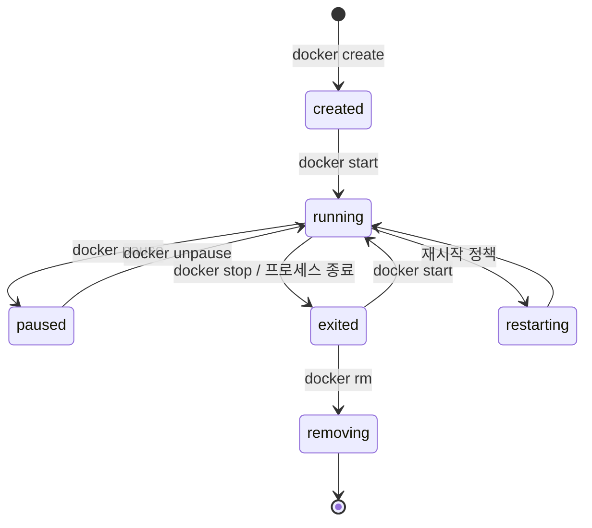

# 2022-07-19-TIL

## Today I Learned

### Datadog with Spring Boot

Datadog APM으로 Spring Boot 애플리케이션을 추적하려면 코드 수정 없이 Java 에이전트를 붙인다. `dd-java-agent.jar`를 내려받아 `-javaagent:/path/to/dd-java-agent.jar` 옵션을 `-jar`보다 앞에 두고 실행한다. 서비스 이름, 환경, 버전은 `DD_SERVICE`, `DD_ENV`, `DD_VERSION` 환경 변수나 `-Ddd.service` 같은 시스템 프로퍼티로 지정한다. 에이전트가 클래스 로딩 시점에 바이트코드를 수정해서 요청 처리 시간, 에러, 외부 호출을 자동으로 기록하고, 수집한 트레이스는 호스트나 사이드카로 떠 있는 Datadog Agent로 보낸다. 그래서 애플리케이션보다 Datadog Agent가 먼저 설치되어 있어야 한다([Datadog: Tracing Java Applications](https://docs.datadoghq.com/tracing/trace_collection/dd_libraries/java/?tabs=containers)).

```bash
java -javaagent:/opt/dd-java-agent.jar \
     -Ddd.service=order-api -Ddd.env=prod -Ddd.version=1.0.0 \
     -jar app.jar
```

- https://kim.heejae.info/post/dev/67/
- https://docs.datadoghq.com/tracing/trace_collection/dd_libraries/java/?tabs=containers

### M1 Mac에서 Netty DNS 리졸버 에러

Apple Silicon(M1) Mac에서 Spring Cloud Gateway나 WebFlux처럼 Netty를 쓰는 애플리케이션을 실행하면 `Unable to load io.netty.resolver.dns.macos.MacOSDnsServerAddressStreamProvider, fallback to system defaults. This may result in incorrect DNS resolutions on MacOS.` 경고가 뜬다. macOS의 DNS 설정을 읽는 기능이 네이티브 라이브러리로 되어 있는데, 해당 CPU 아키텍처용 라이브러리를 찾지 못해서 생기는 문제다.

Netty 이슈 #11020에서 이 문제를 다루었고, 4.1.68.Final 마일스톤에서 정리되었다. 해결 방법은 Netty 버전을 올리고 `netty-resolver-dns-native-macos`를 Apple Silicon용 classifier(`osx-aarch_64`)로 런타임 의존성에 추가하는 것이다.

```groovy
runtimeOnly("io.netty:netty-resolver-dns-native-macos:${nettyVersion}:osx-aarch_64")
```

`nettyVersion`은 프로젝트가 실제로 쓰는 Netty 버전으로 맞춘다.

- https://velog.io/@kshired/MacOS-M1-Chip-Spring-Cloud-Gateway-%EC%97%90%EB%9F%AC-%ED%95%B4%EA%B2%B0%EB%B2%95
- https://stackoverflow.com/questions/65954571/spring-boot-2-4-2-dns-resolution-problem-at-start-on-apple-m1
- https://medium.com/@boysbee/unable-to-load-io-netty-resolver-dns-macos-macosdnsserveraddressstreamprovider-46d89bf74d42
- https://github.com/netty/netty/issues/11020

### Gradle Dependency Options

Gradle `java-library` 플러그인의 의존성 설정은 의존성이 어느 클래스패스에 들어가고, 이 모듈을 쓰는 쪽에 전파되는지로 구분된다([Gradle: The Java Library Plugin](https://docs.gradle.org/current/userguide/java_library_plugin.html)).

| 설정 | 컴파일 | 런타임 | 소비자에게 노출 |
| --- | --- | --- | --- |
| `api` | O | O | O |
| `implementation` | O | O | X |
| `compileOnly` | O | X | X |
| `runtimeOnly` | X | O | X |
| `testImplementation` | 테스트 | 테스트 | X |

문서는 가능하면 `api`보다 `implementation`을 쓰라고 권한다. 내부 구현용 라이브러리가 소비자의 컴파일 클래스패스로 새지 않아서, 의도치 않은 의존을 막고 클래스패스가 작아져 컴파일과 재컴파일이 빨라진다. 예전의 `compile`, `runtime` 설정은 Gradle 7.0에서 제거되었다. Lombok처럼 컴파일 시점에만 필요한 애너테이션 프로세서는 `compileOnly`와 `annotationProcessor`를 함께 쓴다.

- https://writemylife.tistory.com/57

### Docker 컨테이너 생명주기

컨테이너는 다음 상태를 오간다. Docker 문서가 `docker ps --filter status=`에 쓸 수 있는 값으로 나열한 것과 같다([docker container ls](https://docs.docker.com/reference/cli/docker/container/ls/)).



`docker run`은 `create`와 `start`를 한 번에 하는 명령이다. `exited` 상태의 컨테이너는 파일시스템 변경 내용을 그대로 갖고 있어서 다시 시작할 수 있고, `docker rm`으로 지워야 사라진다. 이 밖에 일부만 지워진 비정상 상태인 `dead`가 있다.

- https://linuxhandbook.com/container-lifecycle-docker-commands/

### Docker Image

Dockerfile의 COPY 명령어를 JIB의 outDirectory 태그로 대체할 수 있다?

Jib은 Dockerfile과 Docker 데몬 없이 Maven·Gradle 플러그인만으로 Java 애플리케이션 이미지를 만드는 도구다. 의존성, 리소스, 클래스를 서로 다른 레이어로 나눠서 코드만 바뀌면 클래스 레이어만 다시 만든다. `jib:build`는 레지스트리로 바로 푸시하고, `jib:dockerBuild`는 로컬 Docker 데몬에, `jib:buildTar`는 tar 파일로 저장한다.

질문에 대한 답을 문서에서 찾아보면, Jib에는 `outDirectory`라는 설정은 보이지 않는다. 클래스패스 밖의 파일을 이미지에 넣는 역할은 `extraDirectories`가 하고, 기본값으로 `src/main/jib` 아래 파일을 컨테이너 루트(`/`)로 복사한다. Dockerfile의 `COPY`에 대응하는 설정은 이쪽이다. 비슷한 이름의 `outputPaths`는 tar, digest, image ID 같은 빌드 산출물을 어디에 쓸지 정하는 설정이라 용도가 다르다([Jib Maven Plugin README](https://github.com/GoogleContainerTools/jib/blob/master/jib-maven-plugin/README.md)).

같은 이미지를 프로파일별로 실행하려면 `SPRING_PROFILES_ACTIVE` 환경 변수나 `-Dspring.profiles.active`를 컨테이너 실행 시 넘기는 것이다.

- https://alden-kang.tistory.com/4
- https://tangoblog.tistory.com/18
- https://www.baeldung.com/spring-boot-docker-start-with-profile

### Spring Boot Admin Monitoring

Spring Boot Admin은 Actuator 엔드포인트를 모아 보여 주는 대시보드다. 서버 애플리케이션에 `@EnableAdminServer`를 붙여 띄우고, 클라이언트는 `spring-boot-admin-starter-client`로 서버 주소를 지정해 등록하거나 서비스 디스커버리로 발견된다. 상태 변화(UP에서 DOWN 등)를 메일이나 Slack으로 알리는 알림 기능도 있다. Actuator는 기본적으로 HTTP에 `health`만 노출하므로, Admin 화면에서 보고 싶은 엔드포인트를 클라이언트 쪽에서 열어 줘야 한다([Spring Boot Actuator](https://docs.spring.io/spring-boot/docs/2.7.x/reference/html/actuator.html)).

- https://docs.spring.io/spring-cloud-dataflow/docs/1.2.0.RELEASE/reference/html/configuration-monitoring-management.html
- https://levelup.gitconnected.com/application-monitoring-using-spring-boot-admin-part-2-ed14178c6964
- https://sncap.tistory.com/856
- https://github.com/codecentric/spring-boot-admin
- https://code-resting.tistory.com/54
- https://dzone.com/articles/a-look-at-spring-boot-admin

## 참고

- [Datadog: Tracing Java Applications](https://docs.datadoghq.com/tracing/trace_collection/dd_libraries/java/?tabs=containers)
- [Gradle User Manual: The Java Library Plugin](https://docs.gradle.org/current/userguide/java_library_plugin.html)
- [Docker CLI: docker container ls](https://docs.docker.com/reference/cli/docker/container/ls/)
- [Jib Maven Plugin README](https://github.com/GoogleContainerTools/jib/blob/master/jib-maven-plugin/README.md)
