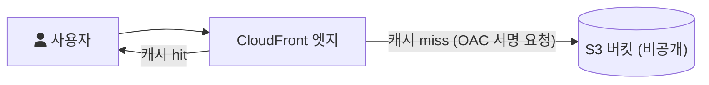

## Today I Learned

### CloudFront Functions vs Lambda@Edge

둘 다 CloudFront로 들어오는 요청이나 나가는 응답에 코드를 끼워 넣는 기능이다. [AWS 문서](https://docs.aws.amazon.com/AmazonCloudFront/latest/DeveloperGuide/edge-functions.html)는 CloudFront Functions를 지연에 민감한 대규모 CDN 커스터마이징용 가벼운 JavaScript 함수로, Lambda@Edge를 복잡한 함수와 애플리케이션 로직을 사용자 가까이에서 실행하는 AWS Lambda의 확장으로 소개한다. Lambda@Edge는 한 리전에 배포하면 CloudFront 배포와 연결할 때 코드가 전 세계로 복제된다.

[비교 문서](https://docs.aws.amazon.com/AmazonCloudFront/latest/DeveloperGuide/edge-functions-choosing.html)의 주요 차이는 다음과 같다(현재 문서 기준).

| 구분 | CloudFront Functions | Lambda@Edge |
| --- | --- | --- |
| 언어 | JavaScript | Node.js, Python |
| 이벤트 | viewer request, viewer response | viewer request/response, origin request/response |
| 실행 시간 | 1밀리초 미만 | 최대 30초 |
| 최대 메모리 | 2MB | 128MB(viewer), 10GB(origin) |
| 네트워크, 파일 시스템 접근 | 불가 | 가능 |
| 요청 본문 접근 | 불가 | 가능 |

그래서 쓰임새가 나뉜다. 문서는 CloudFront Functions에 맞는 일로 캐시 키 정규화(헤더, 쿼리 문자열, 쿠키, URL 경로 정리), 헤더 추가와 삭제, URL 리다이렉트와 재작성, JWT 같은 토큰 검증을 든다. 수 밀리초 이상 걸리거나, 외부 서비스를 호출하거나, 서드파티 라이브러리나 요청 본문이 필요한 일은 Lambda@Edge로 한다.

`viewer` 이벤트는 사용자와 CloudFront 사이, `origin` 이벤트는 CloudFront와 원본 서버 사이에서 일어난다. origin 이벤트는 캐시에 없어서 원본까지 갈 때만 실행되므로, 매 요청에 실행되는 viewer 이벤트보다 호출 횟수가 적다.

- https://medium.com/trackit/cloudfront-functions-vs-lambda-edge-which-one-should-you-choose-c88527647695
- https://www.sentiatechblog.com/cloudfront-functions-and-lambda-edge-compared

### CloudFront vs S3

S3만으로도 정적 파일을 인터넷에 공개할 수 있는데 왜 CloudFront를 앞에 두는지 정리했다. AWS 블로그 [Amazon S3 + Amazon CloudFront: A Match Made in the Cloud](https://aws.amazon.com/ko/blogs/networking-and-content-delivery/amazon-s3-amazon-cloudfront-a-match-made-in-the-cloud/)의 설명은 다음과 같다.

- 성능: CloudFront는 CDN이다. 사용자의 요청은 가까운 엣지 로케이션으로 가고, 엣지에 캐시된 파일이 있으면 바로 응답한다. 없으면 S3에서 가져와 캐시한 뒤 응답한다.
- 원본 부하: 엣지 캐시가 요청 대부분을 처리하므로 S3 버킷으로 가는 요청이 줄어든다.
- 비용: CloudFront로 데이터를 내보내는 비용이 S3에서 사용자에게 직접 내보내는 것보다 저렴한 경우가 많다고 설명한다.

보안 측면에서는 S3 버킷을 공개하지 않고 CloudFront를 통해서만 접근하게 만드는 것이 중요하다. [CloudFront 문서](https://docs.aws.amazon.com/AmazonCloudFront/latest/DeveloperGuide/private-content-restricting-access-to-s3.html)는 S3 원본에 인증된 요청을 보내는 방법으로 OAC(Origin Access Control)와 OAI(Origin Access Identity)를 제공하고, 지금은 OAC를 권장하며 OAI는 레거시로 분류한다.

- https://stackoverflow.com/questions/3327425/when-to-use-amazon-cloudfront-or-s3
- https://aws.amazon.com/ko/cloudfront/getting-started/S3/
- https://aws.amazon.com/ko/blogs/networking-and-content-delivery/amazon-s3-amazon-cloudfront-a-match-made-in-the-cloud/

### Amazon Managed Streaming for Apache Kafka(MSK)

[Amazon MSK](https://docs.aws.amazon.com/msk/latest/developerguide/what-is-msk.html)는 Apache Kafka로 스트리밍 데이터를 처리하는 애플리케이션을 만들고 운영할 수 있게 해 주는 완전 관리형 서비스다. 클러스터 생성, 변경, 삭제 같은 컨트롤 플레인 작업은 MSK가 맡고, 메시지를 보내고 받는 데이터 플레인 작업은 Kafka 그대로 쓴다. 오픈소스 Apache Kafka를 실행하므로 기존 애플리케이션, 도구, 플러그인을 코드 변경 없이 쓸 수 있다는 점이 핵심이다.

Kafka를 직접 운영하면 브로커 프로비저닝, 설정, 장애 대응, 버전 업그레이드를 모두 직접 해야 한다. MSK는 이 운영 부담을 줄이는 대신 비용이 더 들고 세부 설정의 자유도가 줄어든다. 문서에 따르면 브로커 수를 직접 정하는 Provisioned 방식 외에 용량 관리 없이 쓰는 MSK Serverless도 있다.

- https://aws.amazon.com/ko/msk/

## AI 키워드: BlenderBot 3

8월 5일 Meta AI가 175B 파라미터 대화 모델 BlenderBot 3를 공개했다. 인터넷 검색과 장기 기억을 활용해 열린 주제로 대화할 수 있고, Meta는 모델 가중치와 코드를 공개하는 동시에 일반 사용자가 직접 대화해 볼 수 있는 웹 페이지에도 배포했다. 기술 보고서는 모델 구조와 학습 방식, 배포 과정의 안전 장치를 함께 다룬다.

## 참고

- [Customize at the edge with functions - Amazon CloudFront](https://docs.aws.amazon.com/AmazonCloudFront/latest/DeveloperGuide/edge-functions.html)
- [Differences between CloudFront Functions and Lambda@Edge - Amazon CloudFront](https://docs.aws.amazon.com/AmazonCloudFront/latest/DeveloperGuide/edge-functions-choosing.html)
- [Restrict access to an Amazon S3 origin - Amazon CloudFront](https://docs.aws.amazon.com/AmazonCloudFront/latest/DeveloperGuide/private-content-restricting-access-to-s3.html)
- [What is Amazon MSK? - Amazon MSK Developer Guide](https://docs.aws.amazon.com/msk/latest/developerguide/what-is-msk.html)
- [BlenderBot 3: a deployed conversational agent that continually learns to responsibly engage - arXiv](https://arxiv.org/abs/2208.03188)
