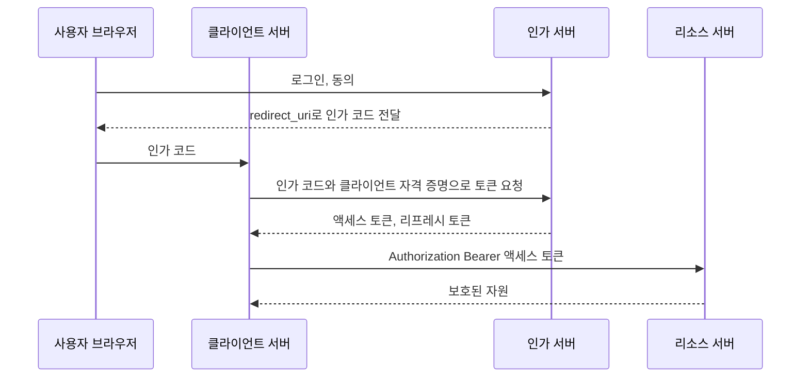

# 2022-08-23-TIL

## Today I Learned

### OAuth 2.0 Flow

OAuth 2.0(RFC 6749)은 사용자의 비밀번호를 넘기지 않고, 제3의 애플리케이션이 사용자 대신 보호된 자원에 접근할 수 있도록 권한을 위임하는 프레임워크다. 등장인물은 넷이다. 자원 소유자(사용자), 클라이언트(사용자 대신 자원을 요청하는 앱), 인가 서버(인증 후 액세스 토큰을 발급), 리소스 서버(토큰을 받고 자원을 제공)다.

RFC 6749는 권한 부여 방식(grant type)을 네 가지로 정의한다.

- Authorization Code: 사용자를 인가 서버로 리다이렉트해서 로그인·동의를 받고, 돌아온 인가 코드를 클라이언트 서버가 토큰으로 교환한다. 토큰이 브라우저를 거치지 않는다.
- Implicit: 브라우저 앱에 토큰을 바로 내려 주는 간소화된 방식이다.
- Resource Owner Password Credentials: 클라이언트가 사용자 ID와 비밀번호를 직접 받아 토큰을 얻는다. 높은 신뢰 관계에서만 쓴다.
- Client Credentials: 사용자 없이 클라이언트 자신의 자격 증명으로 토큰을 받는다.

액세스 토큰이 만료되면 리프레시 토큰으로 사용자의 재인증 없이 새 액세스 토큰을 받는다([RFC 6749](https://www.rfc-editor.org/rfc/rfc6749)).

Auth0 문서의 앱 유형별 권장은 다음과 같다. 서버가 있는 일반 웹 앱은 Authorization Code, SPA와 네이티브 앱은 PKCE를 더한 Authorization Code, 서버 간 호출(배치, 백엔드 서비스)은 Client Credentials다. Implicit은 액세스 토큰이 필요 없는 일부 경우에만 남겨 둔 레거시 방식으로 취급한다. PKCE는 클라이언트가 매번 만든 임의의 값을 인가 요청과 토큰 교환에 엮어서, 중간에 인가 코드를 가로채도 토큰으로 바꿀 수 없게 한다.



- https://frontegg.com/blog/oauth-flows#:~:text=OAuth%20flows%20are%20essentially%20processes,involvement%20for%20back%2Dend%20systems.
- https://auth0.com/docs/get-started/authentication-and-authorization-flow/which-oauth-2-0-flow-should-i-use
- https://help.salesforce.com/s/articleView?id=sf.remoteaccess_oauth_jwt_flow.htm&type=5
- https://oauth.net/2/
- https://www.rfc-editor.org/rfc/rfc6749
- https://www.udemy.com/course/oauth-2-simplified/?referralCode=B04F59AED67B8DA74FA7
- https://auth0.com/docs/get-started/authentication-and-authorization-flow/authorization-code-flow
- https://auth0.com/learn/refresh-tokens/

### Ribbon

Ribbon은 Netflix가 만든 클라이언트 사이드 로드밸런서다. 서버 앞에 별도 로드밸런서를 두는 대신, 호출하는 쪽이 서비스 디스커버리(Eureka 등)에서 받은 인스턴스 목록 중 하나를 골라 직접 호출한다. Spring Cloud Netflix에서는 `@LoadBalanced` `RestTemplate`이나 Feign과 함께 쓰였다.

다만 Spring Cloud Greenwich RC1 발표에서 Ribbon은 Hystrix, Zuul 1, Archaius 1과 함께 유지보수 모드로 들어갔고, 대체재로 Spring Cloud LoadBalancer가 제시되었다. 새 프로젝트라면 Ribbon 대신 Spring Cloud LoadBalancer를 쓰는 것이 맞다([Spring Blog: Spring Cloud Greenwich.RC1](https://spring.io/blog/2018/12/12/spring-cloud-greenwich-rc1-available-now)).

- https://cloud.spring.io/spring-cloud-netflix/multi/multi_spring-cloud-ribbon.html

### Go 1.18 Generics

Go 1.18에서 제네릭이 추가되었다. Go 블로그는 세 가지 변화로 정리한다. 함수와 타입이 대괄호 안에 타입 파라미터를 받을 수 있게 되었고, 인터페이스가 메서드 집합뿐 아니라 `int | string`처럼 타입 집합을 정의할 수 있게 되었으며, 많은 경우 타입 인자를 컴파일러가 추론한다. 빈 인터페이스의 별칭으로 `any`도 새로 생겼다([Go Blog: An Introduction To Generics](https://go.dev/blog/intro-generics)).

```go
func Max[T constraints.Ordered](a, b T) T {
    if a > b {
        return a
    }
    return b
}
```

- https://blog.logrocket.com/understanding-generics-go-1-18/
- https://itnext.io/go-generics-vs-java-generics-48cbf0e0f333
- http://golang.site/go/article/1-Go-%ED%94%84%EB%A1%9C%EA%B7%B8%EB%9E%98%EB%B0%8D-%EC%96%B8%EC%96%B4-%EC%86%8C%EA%B0%9C

### Java Generics

Java 제네릭은 클래스나 메서드가 다룰 타입을 파라미터로 받아서, 컴파일 시점에 타입 검사를 하고 형변환을 없애 주는 기능이다. 구현 방식은 타입 소거(type erasure)다. 컴파일러가 타입 검사를 마친 뒤 타입 파라미터를 경계 타입(경계가 없으면 `Object`)으로 바꾸고 필요한 곳에 형변환을 넣는다. 그래서 바이트코드에는 `List<String>`과 `List<Integer>`의 구분이 남지 않고, 런타임에 `new T()`나 `instanceof List<String>`을 쓸 수 없다. Oracle 블로그 글은 제목 그대로 바이트코드와 제네릭의 관계를 다룬다.

Go 제네릭과 비교하면, 둘 다 컴파일 시점 타입 안정성을 주지만 Java는 하위 호환성을 위해 소거 방식을 택했다는 점이 다르다.

- https://www.geeksforgeeks.org/generics-in-java/#:~:text=Generics%20means%20parameterized%20types.,work%20with%20different%20data%20types.
- https://blogs.oracle.com/java/post/bytecode-and-generics

### Testcontainers

Testcontainers는 테스트 코드에서 Docker 컨테이너를 띄워 실제 DB, 메시지 브로커, 브라우저 등을 쓰게 해 주는 라이브러리다. H2 같은 인메모리 DB로 테스트하면 운영 DB(MySQL, PostgreSQL)와 SQL 방언이나 동작이 달라 테스트는 통과하고 운영에서 실패할 수 있다. Testcontainers는 테스트 시작 시 실제 이미지로 컨테이너를 띄우고 끝나면 정리하므로, 운영과 같은 종류의 의존성으로 통합 테스트를 할 수 있다. 대신 테스트 환경에 Docker가 필요하고 컨테이너 기동 시간만큼 테스트가 느려진다.

- https://www.testcontainers.org/

## AI 키워드: Stable Diffusion 공개

2022년 8월 22일 Stability AI가 텍스트-이미지 생성 모델 Stable Diffusion을 가중치와 함께 공개했다. 상업적·비상업적 사용을 모두 허용하는 Creative ML OpenRAIL-M 라이선스를 적용했고, 발표 당시 6.9GB 정도의 VRAM으로 돌릴 수 있다고 밝혔다. 일반 소비자용 GPU에서도 이미지 생성 모델을 직접 돌릴 수 있게 되었다는 점에서 이전의 비공개 모델들과 달랐다([Stability AI](https://stability.ai/news-updates/stable-diffusion-public-release)).

## 참고

- [RFC 6749: The OAuth 2.0 Authorization Framework](https://www.rfc-editor.org/rfc/rfc6749)
- [Auth0: Which OAuth 2.0 Flow Should I Use?](https://auth0.com/docs/get-started/authentication-and-authorization-flow/which-oauth-2-0-flow-should-i-use)
- [Spring Cloud Greenwich.RC1 available now - Spring Blog](https://spring.io/blog/2018/12/12/spring-cloud-greenwich-rc1-available-now)
- [An Introduction To Generics - The Go Blog](https://go.dev/blog/intro-generics)
- [Stable Diffusion Public Release - Stability AI](https://stability.ai/news-updates/stable-diffusion-public-release)
