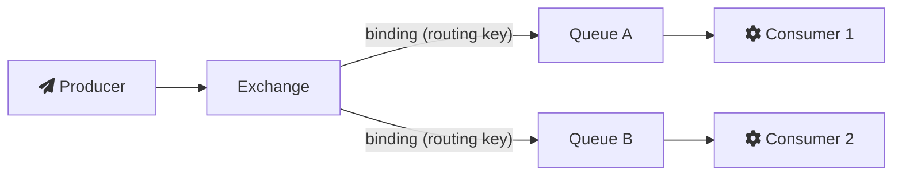

# 2022-10-25-TIL

## Today I Learned

### Substack

Substack은 작가가 글을 이메일 구독과 웹으로 발행하고 유료 구독으로 수익을 내는 플랫폼이다. Substack 공식 블로그의 "Please stop calling it the newsletter economy"(2022년 10월 13일)에서 CEO Hamish McKenzie는 Substack을 이메일 발송 도구로 보는 시각에 반대한다. 핵심은 작가가 구독자와 수익을 직접 소유하는 독립성이고, 그런 점에서 Substack은 이메일 서비스보다 Shopify, Twitch, Patreon 같은 창작자 플랫폼과 같은 범주라는 주장이다. 근거로 유료 구독 150만 건, 연 100만 달러 이상을 버는 발행물이 십여 개라는 수치를 들었다. 두 번째 링크는 글쓰기 플랫폼으로서 Substack과 Medium을 비교한 글이다.

- https://on.substack.com/p/please-stop-calling-it-the-newsletter
- https://dariusforoux.medium.com/substack-vs-medium-which-platform-is-best-for-you-fa005086205a

### RabbitMQ

RabbitMQ는 AMQP 0-9-1을 구현한 메시지 브로커다. 개념은 다음 흐름으로 정리된다([RabbitMQ: AMQP 0-9-1 Model Explained](https://www.rabbitmq.com/tutorials/amqp-concepts.html)).

- 프로듀서는 큐가 아니라 exchange로 메시지를 보낸다. exchange는 바인딩 규칙에 따라 메시지를 큐로 복사해 넣는다.
- exchange 종류: direct는 라우팅 키가 정확히 일치하는 큐로, fanout은 키와 상관없이 바인딩된 모든 큐로, topic은 `order.*.created` 같은 패턴 매칭으로, headers는 헤더 값으로 라우팅한다. 이름이 빈 기본 exchange는 모든 큐가 큐 이름을 라우팅 키로 자동 바인딩된 direct exchange다.
- 컨슈머는 브로커가 밀어 주는 메시지를 받는 push 방식이 권장되고, 처리 후 `basic.ack`로 확인을 보낸다. 확인 전에 컨슈머가 죽으면 메시지는 다른 컨슈머에게 다시 전달된다.
- 여러 컨슈머가 한 큐를 나눠 읽을 때는 prefetch로 컨슈머당 미확인 메시지 수를 제한해 부하를 고르게 나눈다. prefetch와 Kafka의 비교는 [10월 4일 TIL](/posts/2022-10-04-TIL/)에 정리했다.

공식 Get Started 튜토리얼은 단순 큐, 작업 분배(work queues), 발행/구독(fanout), 라우팅(direct), 토픽, RPC 순서로 이 개념을 하나씩 코드로 보여 준다.

- https://www.youtube.com/watch?v=NQ3fZtyXji0
- https://www.youtube.com/watch?v=nFxjaVmFj5E
- https://www.youtube.com/watch?v=H_DaPyUOeTo
- https://www.youtube.com/watch?v=deG25y_r6OY
- https://www.youtube.com/watch?v=7rkeORD4jSw
- https://www.youtube.com/watch?v=iQ4kENLfaNI&list=PLalrWAGybpB-UHbRDhFsBgXJM1g6T4IvO
- https://www.rabbitmq.com/tutorials/amqp-concepts.html
- https://www.rabbitmq.com/getstarted.html

### Sidecar Pattern

사이드카 패턴은 로깅, 모니터링, 설정, 네트워크 프록시 같은 부가 기능을 메인 애플리케이션과 같은 호스트에 별도 프로세스나 컨테이너로 붙여 배포하는 패턴이다. 오토바이 옆의 사이드카처럼 메인 애플리케이션과 생명주기를 함께해서 같이 만들어지고 같이 사라진다([Azure Architecture Center: Sidecar pattern](https://learn.microsoft.com/en-us/azure/architecture/patterns/sidecar)).

부가 기능을 애플리케이션 안에 라이브러리로 넣으면 같은 언어로 구현해야 하고 장애가 서로 번진다. 별도 서비스로 빼면 네트워크 지연이 생긴다. 사이드카는 그 중간이다. 언어와 무관하게 하나의 구현을 여러 애플리케이션에 붙일 수 있고, 같은 호스트에 있어 지연이 작으며, 메인 애플리케이션과 독립적으로 업데이트할 수 있다. Istio 같은 서비스 메시가 서비스마다 프록시를 사이드카로 붙여 라우팅, 재시도, mTLS를 처리하는 것이 대표적인 예다. 문서는 컴포넌트 간 통신이 아주 잦거나, 애플리케이션이 작아 인스턴스마다 사이드카를 두는 비용이 이점보다 크거나, 그 기능을 메인과 다르게 확장해야 하는 경우에는 맞지 않는다고 정리한다.

- https://learn.microsoft.com/en-us/azure/architecture/patterns/sidecar

### Zookeeper

ZooKeeper는 분산 애플리케이션을 위한 코디네이션 서비스다. 데이터는 파일 시스템처럼 계층 구조를 이루는 znode에 저장되고 메모리에 유지된다. znode에는 명시적으로 지울 때까지 남는 영구 노드와, 만든 클라이언트의 세션이 끝나면 자동으로 사라지는 임시(ephemeral) 노드가 있다. 클라이언트는 znode에 watch를 걸어 변경 알림을 받는다([ZooKeeper Overview](https://zookeeper.apache.org/doc/current/zookeeperOver.html)).

여러 서버가 앙상블을 이루고, 그중 리더 하나가 모든 쓰기를 처리하며 나머지 팔로워는 읽기를 나눠 처리한다. 한 클라이언트의 업데이트는 보낸 순서대로 적용되고(순차 일관성), 업데이트는 전부 성공하거나 전부 실패한다. 이런 보장 위에서 설정 관리, 그룹 멤버십, 리더 선출, 분산 락 같은 기능을 만든다. 임시 노드는 장애 감지에 특히 유용하다. 서버가 자신을 임시 노드로 등록해 두면, 그 서버가 죽어 세션이 끊길 때 노드가 사라지고 watch를 건 쪽이 바로 알 수 있다.

Kafka가 대표적인 사용처다. 브로커 목록, 컨트롤러 선출, 토픽 메타데이터 같은 클러스터 정보를 ZooKeeper에 두어 왔다. 이 밖에 Kubernetes 문서는 StatefulSet으로 ZooKeeper 앙상블을 띄우는 튜토리얼을 제공한다.

- https://kubernetes.io/ko/docs/tutorials/stateful-application/zookeeper/
- https://velog.io/@koo8624/%EB%B6%84%EC%82%B0-%EC%8B%9C%EC%8A%A4%ED%85%9C-Apache-Zookeeper
- https://devbksheen.tistory.com/entry/Kafka-Broker-Zookeeper
- https://engkimbs.tistory.com/660
- https://bcho.tistory.com/1016
- https://cornswrold.tistory.com/523
- https://xangmin.tistory.com/169
- https://zaccoding.tistory.com/26

## 참고

- [Please stop calling it the newsletter economy - Substack](https://on.substack.com/p/please-stop-calling-it-the-newsletter)
- [RabbitMQ: AMQP 0-9-1 Model Explained](https://www.rabbitmq.com/tutorials/amqp-concepts.html)
- [Azure Architecture Center: Sidecar pattern](https://learn.microsoft.com/en-us/azure/architecture/patterns/sidecar)
- [ZooKeeper Overview](https://zookeeper.apache.org/doc/current/zookeeperOver.html)
