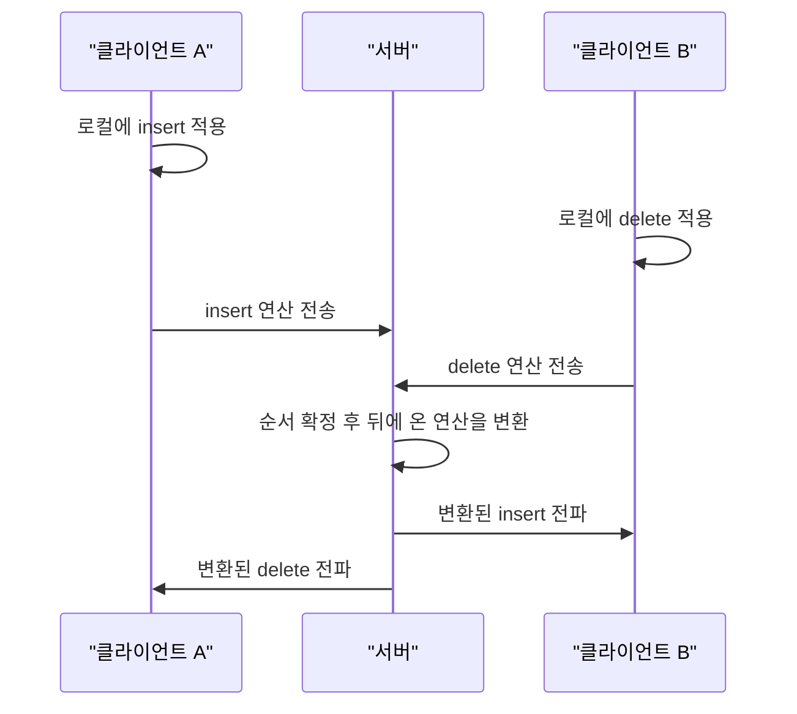

# 2023-01-27-TIL

## Today I Learned

Google Docs 같은 실시간 공동 편집이 어떻게 동작하는지 찾아보면서 Operational Transformation을 정리했고, JPA에서 연관관계 없이 조인하는 방법과 일대다 매핑 권장 방식을 다시 확인했다.

---

### Google Docs Real Time Collaborative Editing

여러 사용자가 같은 문서를 동시에 고치면, 각자의 편집이 네트워크 지연 때문에 서로 다른 순서로 도착한다. 단순히 도착 순서대로 적용하면 사용자마다 다른 문서를 보게 된다. 그래서 공동 편집 시스템은 두 가지를 동시에 만족해야 한다. 내 편집은 기다림 없이 내 화면에 바로 반영되어야 하고(낙관적 로컬 적용), 결국에는 모든 사용자의 문서가 같은 상태로 수렴해야 한다.

시스템 설계 글들이 공통으로 소개하는 구조는 다음과 같다. 클라이언트는 편집을 로컬에 먼저 적용하고 연산(operation)을 서버로 보낸다. 서버는 연산에 순서를 매겨 문서의 기준 이력을 정하고, 다른 클라이언트에 전파한다. 각 클라이언트는 아직 서버가 확인하지 않은 자기 연산과 들어온 연산이 충돌하면 아래의 OT로 변환해 적용한다.



- https://www.linkedin.com/pulse/google-docs-high-level-system-design-murat-atak
- https://srijancse.medium.com/how-real-time-collaborative-editing-work-operational-transformation-ac4902d75682
- https://www.enjoyalgorithms.com/blog/design-google-docs
- https://twitter.com/alexxubyte/status/1516806335303536642?lang=en
- https://www.quora.com/How-is-collaborative-document-editing-implemented-in-Google-Docs-How-are-infinite-undo-redo-implemented-separately-for-each-user-What-tasks-are-offloaded-to-the-client-and-which-are-done-at-the-server-itself
- https://stackoverflow.com/questions/5086699/real-time-collaborative-editing-how-does-it-work
- https://stackoverflow.com/questions/31092669/how-does-google-docs-deal-with-editing-collisions

---

### Operational Transformation

Wikipedia에 따르면 OT(Operational Transformation)는 원래 일반 텍스트 문서의 공동 편집에서 일관성 유지와 동시성 제어를 위해 고안되었고, 1989년 Ellis와 Gibbs의 GROVE 시스템에서 처음 제안되었다. 2009년에는 당시 Google Wave와 Google Docs의 협업 기능의 핵심 기술로 채택되었다.

핵심 아이디어는 동시에 일어난 연산을 서로에 맞게 변환하는 것이다. 문서가 `abc`일 때 A가 위치 0에 `x`를 넣고, B가 동시에 위치 2의 `c`를 지웠다고 하자. A의 화면에 B의 "위치 2 삭제"를 그대로 적용하면 `xabc`에서 `b`가 지워져 버린다. 그래서 A 쪽에서는 B의 연산을 "앞에 한 글자가 끼어들었으니 위치 3 삭제"로 변환해 적용한다. 양쪽이 이런 변환 규칙을 일관되게 따르면 모두 `xab`로 수렴한다. 변환 함수가 모든 연산 조합에서 정확해야 한다는 점 때문에 구현이 까다로워서, 링크된 Stack Overflow 질문처럼 검증된 라이브러리를 찾는 경우가 많다.

- https://en.wikipedia.org/wiki/Operational_transformation
- https://stackoverflow.com/questions/2043165/operational-transformation-library

---

### JPA Without Association

엔티티 사이에 연관관계 매핑이 없어도 JPQL에서 조인할 수 있다. 예전에는 `FROM A a, B b WHERE a.bId = b.id` 같은 세타 조인을 써야 해서 내부 조인만 가능했지만, Hibernate는 연관관계가 없는 엔티티끼리 `ON` 절로 조인하는 문법을 지원해 외부 조인도 쓸 수 있다.

```java
select o, m from Order o
left join Member m on o.memberId = m.id
```

연관관계를 일부러 맺지 않고 ID만 두는 설계에서도 조회 쿼리는 이렇게 풀 수 있다는 점이 핵심이다.

- https://stackoverflow.com/questions/20473033/jpa-left-join-2-tables-without-association

---

### JPA Association Best Practices

Vlad Mihalcea의 글은 일대다 매핑 방식을 비교한다. `@JoinColumn` 없는 단방향 `@OneToMany`는 테이블 두 개 대신 연결 테이블까지 세 개를 쓰게 되어 DBA 입장에서는 다대다처럼 보이고 외래 키와 인덱스도 두 배가 된다. `@JoinColumn`을 붙이면 연결 테이블은 사라지지만, Hibernate가 자식 행을 외래 키 없이 먼저 INSERT한 뒤 자식마다 외래 키를 채우는 UPDATE를 추가로 실행한다. 결론은 자식 쪽 `@ManyToOne`이 연관관계를 관리하는 양방향 매핑이 단방향보다 낫고, 컬렉션이 꼭 필요하지 않다면 `@ManyToOne`만 두고 자식 목록은 쿼리로 가져오는 편이 페이징까지 고려하면 가장 유연하다는 것이다.

- https://thorben-janssen.com/best-practices-many-one-one-many-associations-mappings/
- https://vladmihalcea.com/the-best-way-to-map-a-onetomany-association-with-jpa-and-hibernate/
- https://symphony.is/blog/jpa-pitfalls-relationship-mapping
