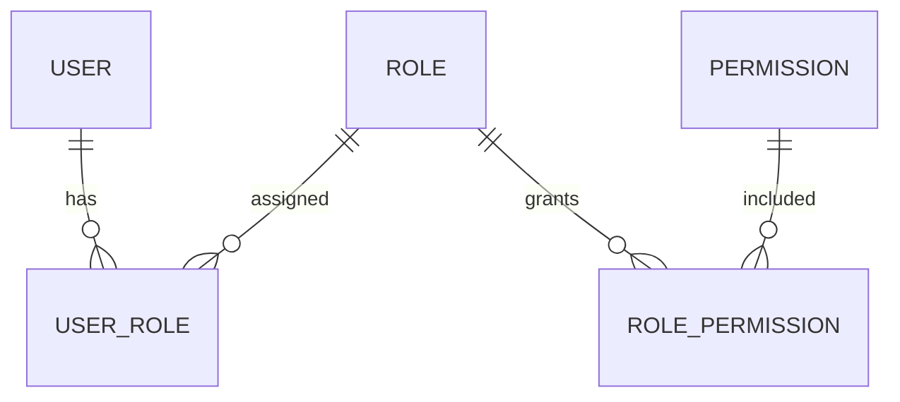

# 2023-03-21-TIL

## Today I Learned

### Role Group Database Design

권한 관리를 DB로 설계하는 대표적인 방식은 RBAC(Role-Based Access Control)다. 사용자에게 권한을 직접 주지 않고, 권한(permission)을 역할(role)에 묶은 뒤 사용자에게 역할을 준다. tutorials24x7의 MySQL 설계 가이드는 `user`, `role`, `permission` 테이블과 역할-권한 매핑 테이블 `role_permission`(복합 기본 키 `roleId`, `permissionId`)로 시작한다. 가장 단순하게는 `user`에 `roleId` 컬럼 하나를 두고, 사용자가 여러 역할을 가져야 하면 `user_role` 매핑 테이블을 둔다. 역할이나 권한을 그룹, 계층으로 묶는 확장도 가능하지만, 글의 지적대로 그만큼 권한 목록을 뽑는 쿼리가 복잡해진다.



함께 본 질문들은 역할마다 필요한 속성이 다를 때(학생과 교사가 서로 다른 정보를 가질 때)와, 사용자 그룹 단위로 권한을 줄 때 테이블을 어떻게 나눌지를 다룬다. 공통 속성은 `user`에, 역할별 속성은 별도 테이블에 두는 것이 일반적인 답이다.

- https://dba.stackexchange.com/questions/90193/multiple-user-roles-with-different-attributes
- https://dba.stackexchange.com/questions/186130/designing-a-database-structure-for-a-permissions-system
- https://mysql.tutorials24x7.com/blog/guide-to-design-database-for-rbac-in-mysql
- https://stackoverflow.com/questions/50969509/user-role-permissions-and-a-specific-group-rbac

### Menu Table

메뉴에 대한 접근이나 관리를 위해서 DB의 테이블에 메뉴를 저장해놓고 사용하는 것이 장점이 있다고 한다.

Stack Overflow 답변이 드는 이유는 두 가지다. 운영 중에도 메뉴를 추가하거나 숨기기 쉽다는 점(문제가 생긴 메뉴를 고치는 동안 접근을 막는 경우 등)과, 메뉴별 사용자 권한을 관리하기 쉽다는 점이다. 위의 RBAC 테이블과 연결해 메뉴마다 필요한 권한을 매핑해 두면, 로그인한 사용자의 권한으로 보여 줄 메뉴를 걸러 낼 수 있다. `parent_id`로 자기 참조하면 계층형 메뉴도 표현된다. 반대로 메뉴가 거의 바뀌지 않는다면 코드에 두는 편이 단순하고, 드롭다운 목록처럼 자주 읽는 데이터는 매번 DB를 조회하지 않도록 캐시를 두는 것이 함께 거론된다.

- https://stackoverflow.com/questions/34605480/what-is-the-benefits-of-creating-menu-for-web-application-based-on-database
- https://stackoverflow.com/questions/21399549/application-performance-database-table-for-dropdown-menus-vs-population-in-cod?rq=1
- https://www.codeproject.com/Articles/461654/Generating-menu-from-database-according-to-user-pr

### Progressive Download vs Streaming

progressive download는 비디오가 클라이언트의 컴퓨터에 직접 다운로드 되는 방식이다. 기본적으로 HTTP를 사용하며 보안수준은 낮다.
streaming은 임시 비디오 링크를 통해 비디오 콘텐츠를 보호한다. RTMP를 사용하며 보안수준은 상대적으로 높다.

Brightcove 글을 조금 더 옮기면, progressive download는 영상을 시청자 컴퓨터의 임시 디렉터리에 받아 두면서 받은 부분부터 재생한다. 아직 받지 않은 구간으로는 건너뛸 수 없고, 보지 않은 부분까지 내려받으므로 대역폭을 더 쓴다. 스트리밍은 시청한 만큼만 전송하고 클라이언트에 남기지 않는다. 글에서 말하는 RTMP는 Adobe가 만든 독점 프로토콜이다. 이 글은 오래된 글이라는 점을 감안해야 한다. 지금은 RTMP 대신 HLS, DASH처럼 HTTP 위에서 영상을 작은 조각으로 나눠 보내는 적응형 스트리밍이 일반적이고, 콘텐츠 보호는 서명된 URL이나 DRM으로 한다.

- https://www.brightcove.com/en/resources/blog/progressive-download-versus-streaming/

### Dolby Atmos

Dolby Atmos는 채널 단위가 아니라 소리를 공간 속 객체로 다루는 입체 음향(immersive audio) 포맷이다. AWS Elemental MediaConvert 문서에 따르면 MediaConvert는 Atmos가 포함된 Dolby Digital Plus를 인코딩할 수 있고, 입력으로는 채널 기반 입체 음향, ADM BWF(Audio Definition Model Broadcast WAV) 파일, Dolby Atmos Master File을 받는다. 입력 오디오 채널이 이미 해당 Dolby Atmos 규격에 맞게 구성되어 있어야 한다는 전제가 붙는다. 함께 저장한 Azure 블로그 글은 지금 내용을 불러오지 못했다.

- https://azure.microsoft.com/es-es/blog/delivering-premium-audio-experiences-with-dolby-digital-plus/
- https://docs.aws.amazon.com/mediaconvert/latest/ug/using-dolby-atmos-encoding.html
- https://namu.wiki/w/Dolby%20Atmos

### Full-text Search with MySQL and Elasticsearch

MySQL에도 전문 검색이 있다. MySQL 문서에 따르면 `FULLTEXT` 타입 인덱스를 InnoDB나 MyISAM 테이블의 `CHAR`, `VARCHAR`, `TEXT` 컬럼에 만들고, `MATCH() ... AGAINST()`로 검색한다. 검색 방식은 자연어 모드, 불리언 모드, 쿼리 확장 세 가지다.

```sql
SELECT * FROM posts
WHERE MATCH(body) AGAINST('technology' IN NATURAL LANGUAGE MODE);
```

Azraar Azward의 글은 Elasticsearch가 검색 속도, 동의어와 가중치, n-gram이나 퍼지 검색 같은 분석 기능에서 더 유연하고, 글과 리뷰, 태그를 한 문서로 묶어 색인할 수 있다고 평가한다. 대신 운영할 스택이 하나 늘고, 관계형 DB와 데이터를 동기화하는 문제를 해결해야 한다. 검색 요구가 단순하면 MySQL 전문 검색, 품질과 규모가 중요해지면 Elasticsearch로 옮기는 것이 일반적인 경로다.

- https://medium.com/@mazraara/full-text-search-with-mysql-and-elasticsearch-b48e79a8ad4a

### Boolean Field vs Y/N

참/거짓 컬럼을 `BOOLEAN`(0/1), `'Y'/'N'`, `'T'/'F'` 중 무엇으로 둘지에 대한 질문들이다. DB마다 지원이 달라서, 예를 들어 MySQL의 `BOOLEAN`은 사실상 `TINYINT(1)`이다. 한 답변은 두 값만 저장하는 컬럼이 나중에 세 번째 상태가 필요해질 때의 위험을 경고한다. 양돈 앱에서 성별을 비트로 저장했다가 거세한 수컷이라는 세 번째 값이 필요해진 사례다. 정말 두 상태뿐인지 먼저 따져 보고, 상태가 늘어날 수 있다면 처음부터 코드 값이나 enum으로 두는 편이 낫다. JPA에서는 `@Convert`나 Hibernate의 `YesNoConverter`로 Y/N 컬럼을 자바 `boolean`에 매핑할 수 있다.

- https://salesforce.stackexchange.com/questions/47980/boolean-field-v-yes-no-picklist
- https://stackoverflow.com/questions/1908454/using-0-1-versus-y-n-versus-t-f-in-a-logical-boolean-database-fiel
- https://stackoverflow.com/questions/615702/is-there-a-difference-between-yes-no-true-false-and-true-false-in-objective-c

### HTTP Headers

MDN 설명으로 HTTP 헤더는 클라이언트와 서버가 요청이나 응답에 부가 정보를 실어 보내는 수단이고, 대소문자를 구분하지 않는 이름과 콜론 뒤의 값으로 이루어진다. 비표준 헤더에 `X-` 접두어를 붙이던 관례는 RFC 6648에서 2012년 6월 폐기되었다. 비표준 필드가 표준이 되었을 때 이름을 바꾸기 불편하다는 이유다. 헤더는 쓰임에 따라 요청 헤더(`Accept`, `Authorization`, `User-Agent`), 응답 헤더(`Server`, `Set-Cookie`), 본문의 형식을 설명하는 표현 헤더(`Content-Type`, `Content-Encoding`)처럼 묶어 볼 수 있다.

- https://gmlwjd9405.github.io/2019/01/28/http-header-types.html
- https://velog.io/@jkijki12/HTTP-Header-%EC%A0%95%EB%A6%AC
- https://developer.mozilla.org/ko/docs/Web/HTTP/Headers
- https://techdocs.broadcom.com/us/en/ca-enterprise-software/it-operations-management/application-performance-management/10-7/administrating/cem-configuration/transaction-definition/about-transaction-identification/http-request-parameter-types.html

### Instancio

Instancio는 단위 테스트용 객체를 자동으로 만들고 필드를 채워 주는 자바 라이브러리다. setter를 줄줄이 호출해 테스트 데이터를 만드는 대신 `Instancio.create(Person.class)` 한 줄로 모든 필드가 채워진 객체를 얻고, 테스트에 의미 있는 필드만 골라 값을 지정한다. 사용자 가이드에 따르면 `Instancio.stream()`은 서로 다른 값으로 채워진 객체를 끝없이 만들어 내는 스트림을 돌려준다.

```java
Person person = Instancio.of(Person.class)
        .set(field(Person::getAge), 22)
        .create();

List<Person> people = Instancio.stream(Person.class)
        .limit(10)
        .collect(Collectors.toList());
```

테스트에서 중요하지 않은 필드를 무작위로 채우면, 그 필드에 우연히 의존하는 테스트를 드러내는 효과도 있다.

- https://www.instancio.org/user-guide/#creating-a-stream-of-objects
- https://github.com/instancio/instancio

## AI 키워드: Bard 공개 테스트

Google이 3월 21일 Bard의 접근을 미국과 영국 사용자부터 열기 시작했다. Google은 Bard를 생성형 AI와 협업하는 "초기 실험"이라고 소개하고, 다른 나라와 언어로 점차 넓히겠다고 밝혔다. 2월 발표 때는 신뢰할 수 있는 테스터만 쓸 수 있었으니, 이제 일반 사용자 피드백을 받는 단계로 넘어갔다는 말이구나 싶었다.

## 참고

- [Guide To Design Database For RBAC In MySQL - tutorials24x7](https://mysql.tutorials24x7.com/blog/guide-to-design-database-for-rbac-in-mysql)
- [Progressive Download vs. Streaming - Brightcove](https://www.brightcove.com/en/resources/blog/progressive-download-versus-streaming/)
- [Configuring Dolby Atmos encoding - AWS Elemental MediaConvert](https://docs.aws.amazon.com/mediaconvert/latest/ug/using-dolby-atmos-encoding.html)
- [Full-Text Search Functions - MySQL 8.0 Reference Manual](https://dev.mysql.com/doc/refman/8.0/en/fulltext-search.html)
- [HTTP 헤더 - MDN](https://developer.mozilla.org/ko/docs/Web/HTTP/Headers)
- [Instancio User Guide](https://www.instancio.org/user-guide/)
- [Try Bard and share your feedback - Google](https://blog.google/technology/ai/try-bard/)
