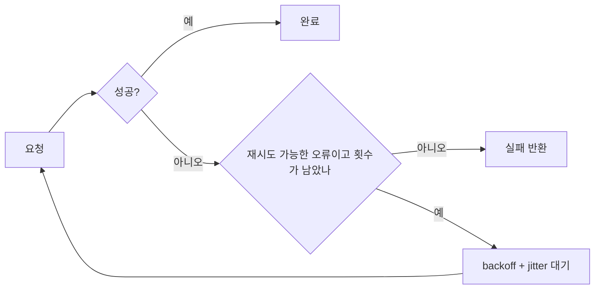
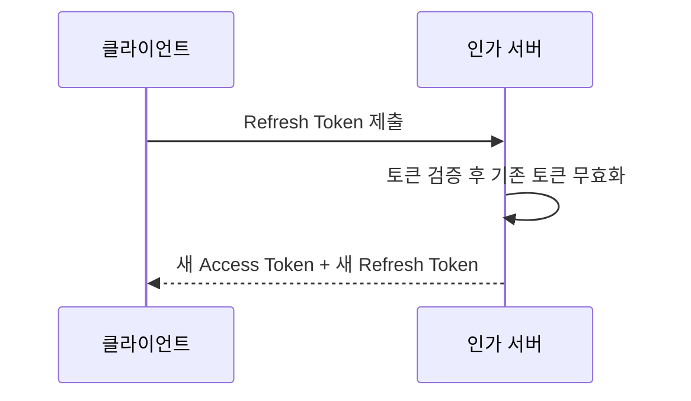

# 2023-03-29-TIL

## Today I Learned

### 사용자 역할에 따라 응답을 다르게 내려주기

같은 API라도 관리자에게는 전체 필드를, 일반 사용자에게는 일부 필드만 보여줘야 할 때가 있다. 링크들이 다루는 방법은 대략 세 갈래다.

- 역할별 DTO를 따로 두고 서비스나 컨트롤러에서 현재 사용자의 권한을 확인해 골라 반환한다. 가장 명시적이다.
- Jackson의 `@JsonView`로 필드를 뷰 단위로 묶고, 역할에 맞는 뷰로 직렬화한다. DTO 수는 줄지만 어떤 필드가 노출되는지 애너테이션을 따라가야 보인다.
- Spring Security의 `@PreAuthorize`와 JWT에 담긴 역할 클레임으로 엔드포인트 자체를 나눈다(RBAC).

응답 필드를 권한별로 거르는 일은 보안 경계이므로 프런트엔드에서 숨기는 것으로 대신하면 안 된다.

- https://stackoverflow.com/questions/62793553/spring-boot-customize-api-response-based-on-the-user-roles
- https://stackoverflow.com/questions/64378312/different-response-based-on-logged-user-role
- https://medium.com/geekculture/role-based-access-control-rbac-with-spring-boot-and-jwt-bc20a8c51c15

---

### API 재시도 모범 사례

네트워크 호출은 일시적으로 실패할 수 있으므로 클라이언트가 재시도를 해야 하지만, 아무렇게나 재시도하면 장애를 키운다. 클라우드 사업자 문서들이 공통으로 권하는 원칙은 다음과 같다.

- 재시도할 오류만 재시도한다. Google Cloud Storage 문서는 `408`, `429`, `5xx`와 연결 오류 같은 일시적 오류를 재시도 대상으로 들고, 요청 자체가 잘못된 `4xx`는 다시 보내도 결과가 같다.
- 지수 백오프에 지터를 더한다. AWS 문서는 표준 재시도 모드가 jitter를 섞은 exponential backoff를 쓰며, 지터가 없으면 동시에 실패한 클라이언트가 동시에 재시도해 트래픽이 몰리는 thundering herd 문제가 생긴다고 설명한다.
- 멱등성을 확인한다. 같은 요청을 두 번 보내도 결과가 같아야 안전하게 재시도할 수 있다. 결제처럼 멱등하지 않은 요청은 멱등 키 같은 장치가 필요하다.
- 최대 횟수와 전체 제한 시간을 둔다. 호출 경로의 여러 계층이 각자 재시도하면 실제 호출 수는 각 계층 횟수의 곱으로 늘어난다.

- https://medium.com/capital-one-tech/3-best-practices-for-api-clients-feef9ec97f1a
- https://developers.liveperson.com/retry-policy-recommendations.html
- https://climbtheladder.com/10-api-retry-best-practices/
- https://harish-bhattbhatt.medium.com/best-practices-for-retry-pattern-f29d47cd5117
- https://denalibalser.medium.com/best-practices-for-retry-685bf58de797
- https://javascript.plainenglish.io/rxjs-angular-retrying-sequential-or-parallel-http-requests-a-fixed-number-of-times-and-also-with-a-b445e1560f88
- https://pusher.com/blog/how-to-implement-http-request-retry-policies/#0-introduction
- https://docs.aws.amazon.com/general/latest/gr/api-retries.html
- https://cloud.google.com/storage/docs/retry-strategy
- https://learn.microsoft.com/en-us/azure/architecture/best-practices/retry-service-specific

---

### Y/N 문자 컬럼과 Boolean

참/거짓 값을 `CHAR(1)`의 `'Y'/'N'`이나 `ENUM('Y','N')`으로 저장할지, Boolean 타입으로 저장할지의 문제다. MySQL 문서에 따르면 `BOOL`, `BOOLEAN`은 `TINYINT(1)`의 동의어이고 0은 거짓, 0이 아닌 값은 참으로 취급한다. 즉 MySQL의 Boolean은 실제로 정수 컬럼이라 2 같은 값도 들어갈 수 있다. Y/N 문자열은 사람이 읽기 쉽고 레거시 스키마에서 흔하지만, 애플리케이션에서는 결국 boolean으로 바꿔야 한다. JPA에서는 Hibernate의 `YesNoConverter`나 직접 만든 `AttributeConverter`로 엔티티 필드는 `boolean`으로 두고 컬럼만 Y/N으로 매핑할 수 있다.

- https://stackoverflow.com/questions/10882454/is-it-bad-to-use-enumy-n-instead-of-a-boolean-field-in-a-mysql-table
- [Numeric Data Type Syntax (MySQL 8.0)](https://dev.mysql.com/doc/refman/8.0/en/numeric-type-syntax.html)

---

### Spring Boot의 페이지네이션

Spring Data는 `Pageable`을 컨트롤러 파라미터로 받고(`?page=0&size=20&sort=createdAt,desc`), 리포지토리 메서드에 그대로 넘겨 `Page<T>`를 받는 흐름을 제공한다. 직접 만들 때는 `PageRequest.of(page, size, sort)`를 쓴다. 페이지 번호는 0부터 시작한다. `Page`는 전체 개수를 구하려고 count 쿼리를 한 번 더 실행하므로, 전체 페이지 수가 필요 없다면 `Slice`를 반환해 그 비용을 피할 수 있다. 엔티티 `Page`를 그대로 응답하기보다 `page.map(...)`으로 DTO로 바꿔 내보내는 편이 응답 형식을 통제하기 쉽다.

- https://www.baeldung.com/rest-api-pagination-in-spring
- https://reflectoring.io/spring-boot-paging/
- https://stackoverflow.com/questions/47087415/how-can-i-use-pageable-in-restcontroller
- https://www.javaguides.net/2021/10/spring-boot-pagination-and-sorting-rest-api.html
- https://www.bezkoder.com/spring-boot-pagination-filter-jpa-pageable/
- https://howtodoinjava.com/spring-boot2/pagination-sorting-example/
- https://springframework.guru/spring-boot-pagination/
- https://docs.spring.io/spring-data/commons/docs/current/api/org/springframework/data/domain/PageRequest.html

---

### Instancio

Instancio는 테스트용 객체를 무작위 값으로 채워 만들어 주는 라이브러리다. 사용자 가이드는 목표를 단위 테스트의 수동 데이터 준비를 줄이는 것이라고 설명한다. `Instancio.create(Member.class)`처럼 호출하면 중첩 객체와 컬렉션까지 채운 인스턴스가 나오고, 필요한 필드만 `set(field(...), 값)`으로 고정한다. 객체 그래프마다 시드를 두어 실패한 입력을 재현할 수 있게 했고, record와 sealed 클래스도 생성할 수 있다.

- https://www.instancio.org/user-guide/#creating-record-and-sealed-classes

---

### @Valid

`@Valid`는 Bean Validation(Jakarta Validation) 표준 애너테이션으로, 컨트롤러의 `@RequestBody` 파라미터에 붙이면 Spring MVC가 바인딩 후 `@NotBlank`, `@Size` 같은 제약을 검사한다. 실패하면 `MethodArgumentNotValidException`이 발생하므로 `@ControllerAdvice`에서 오류 응답 형식을 통일한다. 서비스 계층 메서드 파라미터 검증은 클래스에 Spring의 `@Validated`를 붙여 메서드 검증(`MethodValidationPostProcessor`)을 켜야 동작한다. 생성과 수정처럼 동작마다 규칙이 다르면 검증 그룹을 쓰거나 요청 DTO를 나누는 방법이 있다.

- https://bamdule.tistory.com/35
- https://reflectoring.io/bean-validation-with-spring-boot/
- https://betterprogramming.pub/custom-validation-in-spring-boot-best-explained-part-1-1105a8c2711
- https://stackoverflow.com/questions/19089649/best-practices-for-validation-depending-on-actions-spring-mvc
- https://medium.com/@techisbeautiful/mastering-data-validation-in-spring-boot-best-practices-and-expert-tips-for-robust-and-secure-ba24dd79bc0a
- [Java Bean Validation (Spring Framework Reference)](https://docs.spring.io/spring-framework/reference/core/validation/beanvalidation.html)

---

### 흔한 Spring 실수

Toptal 글은 Spring 프로젝트에서 자주 보이는 실수를 정리한다. 너무 저수준 구현에 매달리기, 내부 구조를 그대로 노출하는 API, 관심사 분리 부족, 일관성 없는 예외 처리, 스레드 안전성 무시, 검증 누락, 테스트 부족 같은 항목이다. 하나하나는 익숙하지만 코드 리뷰 체크리스트로 쓰기 좋다.

- https://www.toptal.com/spring/top-10-most-common-spring-framework-mistakes

---

### MapStruct

MapStruct는 Bean 매핑 코드를 생성하는 애너테이션 프로세서다. 매퍼 인터페이스에 메서드를 선언하면 컴파일 시점에 구현체를 만들어 주고, 그 구현은 리플렉션 대신 일반 getter/setter 호출이다. 그래서 런타임 비용이 작고, 매핑되지 않은 필드가 있으면 컴파일 경고나 오류로 드러난다. 필드 이름이 다르면 `@Mapping(target = "...", source = "...")`으로 지정한다.

- https://medium.com/naver-cloud-platform/%EA%B8%B0%EC%88%A0-%EC%BB%A8%ED%85%90%EC%B8%A0-%EB%AC%B8%EC%9E%90-%EC%95%8C%EB%A6%BC-%EB%B0%9C%EC%86%A1-%EC%84%9C%EB%B9%84%EC%8A%A4-sens%EC%9D%98-mapstruct-%EC%A0%81%EC%9A%A9%EA%B8%B0-8fd2bc2bc33b
- https://github.com/mapstruct/mapstruct
- https://madplay.github.io/post/mapstruct-in-springboot

---

### Spring Cloud AWS

Spring Cloud AWS는 Spring 애플리케이션에서 AWS 서비스를 Spring다운 방식으로 쓰게 해 주는 프로젝트다. S3 리소스 접근, SQS/SNS 메시징, RDS 데이터소스 설정, ElastiCache 캐시, Parameter Store와 Secrets Manager를 설정 소스로 쓰는 모듈 등을 제공한다. 링크한 2.1 문서는 `org.springframework.cloud` 시절 버전이고, 이후 프로젝트는 awspring 조직으로 옮겨 groupId가 `io.awspring.cloud`로 바뀌었다. 버전을 고를 때 이 점을 확인해야 한다.

- https://cloud.spring.io/spring-cloud-static/spring-cloud-aws/2.1.0.RELEASE/single/spring-cloud-aws.html
- [Spring Cloud AWS 2.4 Reference (awspring)](https://docs.awspring.io/spring-cloud-aws/docs/2.4.4/reference/html/index.html)

---

### Refresh Token

Access Token을 짧게 유지하면 탈취됐을 때 피해 기간이 줄지만 사용자가 자주 다시 로그인해야 한다. Refresh Token은 이 둘 사이의 절충이다. RFC 6749 1.5절은 Refresh Token을 Access Token을 얻는 데 쓰는 자격 증명으로 정의하고, 현재 Access Token이 만료되거나 무효가 됐을 때 새 토큰을 받는 데 쓴다고 설명한다. 발급 여부는 인가 서버의 재량이다.

Refresh Token은 수명이 길어 탈취되면 위험하므로 서버에 저장해 두고(Redis 등) 로그아웃이나 의심 상황에서 폐기할 수 있게 하는 구현이 많다. Auth0 문서가 설명하는 Refresh Token Rotation은 토큰을 교환할 때마다 새 Refresh Token을 발급하고 사용한 것은 무효로 만든다. 이미 사용한 토큰이 다시 들어오면 재사용으로 판단해 관련 토큰을 모두 무효화하는 탐지도 함께 둔다.

- https://tecoble.techcourse.co.kr/post/2021-10-20-refresh-token/
- https://tansfil.tistory.com/59
- https://hudi.blog/refresh-token/
- https://velog.io/@park2348190/JWT%EC%97%90%EC%84%9C-Refresh-Token%EC%9D%80-%EC%99%9C-%ED%95%84%EC%9A%94%ED%95%9C%EA%B0%80
- https://auth0.com/blog/refresh-tokens-what-are-they-and-when-to-use-them/
- https://passage.id/post/how-refresh-tokens-work-a-complete-guide-for-beginners
- https://www.rfc-editor.org/rfc/rfc6749.html#section-1.2
- https://auth0.com/docs/secure/tokens/refresh-tokens/refresh-token-rotation
- https://velog.io/@jkijki12/Jwt-Refresh-Token-%EC%A0%81%EC%9A%A9%EA%B8%B0
- https://goodteacher.tistory.com/509
- https://hudi.blog/refresh-token-in-spring-boot-with-redis/
- https://llshl.tistory.com/32
- https://inkyu-yoon.github.io/docs/Language/SpringBoot/RefreshToken

---

### JWT 무효화

JWT는 서명만 검증하면 되므로 서버가 상태를 갖지 않아도 된다는 장점이 있다. 그 대가로 발급한 토큰을 만료 전에 무효화하기 어렵다. 일반적인 대응은 Access Token 수명을 짧게 두고, 로그아웃한 토큰의 식별자(`jti`)를 만료 시각까지 블랙리스트로 저장하거나, 사용자별 토큰 버전을 두어 비교하는 것이다. 어느 방식이든 요청마다 저장소를 조회하게 되므로 무상태라는 장점을 일부 포기한다. RFC 9068은 OAuth 2.0 Access Token을 JWT로 발급할 때의 공통 클레임과 검증 규칙을 정한 프로파일로, 제각각이던 벤더별 JWT 형식을 표준화하려는 목적이다.

- https://stackoverflow.com/questions/21978658/invalidating-json-web-tokens
- https://datatracker.ietf.org/doc/html/rfc9068

---

### OAuth 2.0 Token Exchange

RFC 8693은 OAuth 2.0을 확장해 클라이언트가 가진 토큰을 인가 서버(STS 역할)에 제출하고 다른 보안 토큰으로 교환받는 프로토콜을 정의한다. 새 grant type `urn:ietf:params:oauth:grant-type:token-exchange`로 토큰 엔드포인트를 호출한다. 마이크로서비스가 사용자 토큰을 받아 하위 서비스용으로 범위를 줄인 토큰을 얻는 위임(delegation)이나 대리(impersonation) 시나리오에 쓰인다.

- https://www.authlete.com/developers/token_exchange/
- [RFC 8693: OAuth 2.0 Token Exchange](https://www.rfc-editor.org/rfc/rfc8693)
