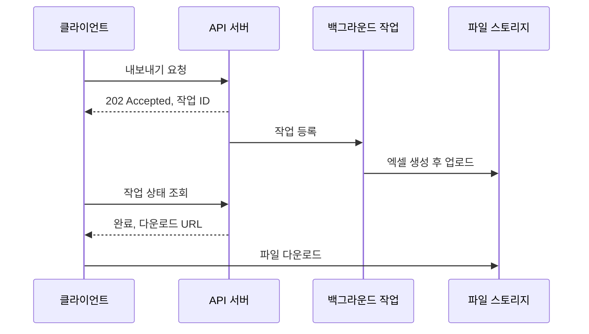

# 2023-04-17-TIL

## Today I Learned

### 엑셀 파일을 비동기로 내려받기

데이터가 많은 엑셀 다운로드를 요청 하나로 처리하면 파일을 만드는 동안 HTTP 연결과 서버 스레드가 묶이고, 게이트웨이나 로드밸런서의 타임아웃에 걸리기 쉽다. 그래서 대용량 내보내기는 보통 비동기 작업으로 바꾼다. 요청을 받으면 작업을 등록하고 작업 ID만 즉시 돌려준 뒤, 백그라운드에서 파일을 만들어 스토리지에 올린다. 클라이언트는 상태 조회 API를 폴링하거나 알림을 받아 완료되면 다운로드 링크로 받는다.



작업 상태 저장, 실패 시 재시도, 생성된 파일의 보관 기간과 접근 권한까지 함께 설계해야 한다는 점이 동기 방식보다 늘어나는 비용이다.

- https://www.outsystems.com/forums/discussion/61497/how-to-download-record-excel-asynchronously/
- https://knowledge.pricefx.com/space/KB/2112356382/When+to+Use+Asynchronous+Download+of+Excel+Files

### 대용량 엑셀 파일 생성

Apache POI의 기본 `XSSFWorkbook`은 시트의 모든 행을 메모리에 들고 있으므로 행 수가 많으면 힙이 먼저 바닥난다. POI 문서가 설명하는 SXSSF(`org.apache.poi.xssf.streaming`)는 XSSF와 API가 호환되는 스트리밍 확장으로, 메모리에는 일정 개수의 행(sliding window)만 두고 창을 벗어난 행은 임시 파일로 내보낸다. 대신 이미 내보낸 행은 다시 읽거나 수정할 수 없다.

링크한 Keyhole Software 글은 이 SXSSF를 Spring Batch와 묶는다. `@BeforeStep`에서 워크북과 시트를 만들고, `ItemWriter.write()`에서 청크 단위로 행을 쓰고, `@AfterStep`에서 파일을 마무리하는 구조다. 데이터를 DB에서 청크 단위로 읽어 오고 엑셀도 창 단위로만 메모리에 두므로 전체 데이터를 한 번에 올리지 않는다. 앞의 비동기 다운로드와 조합하면 백그라운드 작업 부분을 배치 잡으로 구현하는 셈이다.

- https://keyholesoftware.com/2012/11/12/generating-large-excel-files-using-spring-batch-part-three/
- [Apache POI Spreadsheet How-To (SXSSF)](https://poi.apache.org/components/spreadsheet/how-to.html)

### multipart/form-data와 application/json 함께 보내기

파일과 JSON 메타데이터를 한 요청에 보내야 할 때가 있다. 요청 하나의 `Content-Type`은 하나지만, `multipart/form-data`는 본문을 boundary로 나눈 여러 파트로 구성되고 RFC 7578 4.4절에 따라 파트마다 자기 `Content-Type`을 가질 수 있다. 그래서 파일 파트는 `image/png`, 메타데이터 파트는 `application/json`으로 보내면 된다.

Spring MVC에서는 `@RequestPart`로 각 파트를 받는다. Spring 문서 예시처럼 JSON 파트는 `HttpMessageConverter`를 거쳐 객체로 변환되고 파일 파트는 `MultipartFile`로 받는다.

```java
@PostMapping(value = "/posts", consumes = MediaType.MULTIPART_FORM_DATA_VALUE)
public ResponseEntity<Void> create(@RequestPart("meta") PostRequest meta,
                                   @RequestPart("file") MultipartFile file) {
    postService.create(meta, file);
    return ResponseEntity.ok().build();
}
```

클라이언트가 JSON 파트의 `Content-Type`을 지정하지 않으면 변환에 실패할 수 있으니 브라우저에서는 `Blob`에 `type: "application/json"`을 주어 FormData에 넣는다. 응답 쪽 질문(응답 헤더에 여러 Content-Type을 줄 수 있나)도 같은 원리로, 응답 하나의 미디어 타입은 하나이고 여러 형식을 함께 보내려면 multipart 같은 복합 미디어 타입을 써야 한다.

- https://velog.io/@huewilliams/%ED%8C%8C%EC%9D%BC%EA%B3%BC-JSON-%EB%8D%B0%EC%9D%B4%ED%84%B0%EB%A5%BC-%EB%8F%99%EC%8B%9C%EC%97%90-%EB%B3%B4%EB%82%B4%EA%B8%B0-1%ED%8E%B8-feat.Multipartform-data
- https://okky.kr/questions/1218089
- https://www.googlecloudcommunity.com/gc/Apigee/Multiple-Content-Types-in-single-request/m-p/58047
- https://stackoverflow.com/questions/5809099/does-the-http-protocol-support-multiple-content-types-in-response-headers
- [RFC 7578: Returning Values from Forms: multipart/form-data](https://www.rfc-editor.org/rfc/rfc7578)
- [Multipart (Spring Framework Reference)](https://docs.spring.io/spring-framework/reference/web/webmvc/mvc-controller/ann-methods/multipart-forms.html)

## AI 키워드

### Claude

Anthropic이 2023년 3월 14일 대화형 AI 어시스턴트 Claude를 채팅 인터페이스와 API로 공개했다. 고성능 모델인 Claude와 더 가볍고 저렴하며 빠른 Claude Instant 두 가지를 함께 내놓았다.

- [Introducing Claude (Anthropic)](https://www.anthropic.com/news/introducing-claude)
