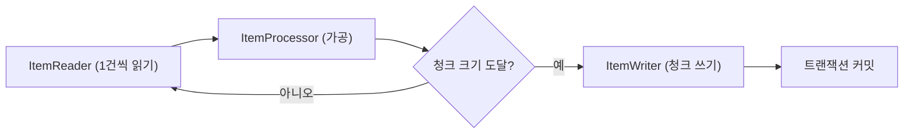

# 2023-05-19-TIL

## Today I Learned

### 퍼실리테이터

퍼실리테이터(facilitator)는 회의나 워크숍에서 직접 답을 내기보다 구성원들이 대화하고 합의에 이르도록 과정을 설계하고 진행하는 사람이다. 링크한 글들의 설명을 정리하면, 회의 목적과 진행 방식을 미리 정하고, 발언이 한쪽으로 쏠리지 않게 참여를 고르게 이끌고, 논의 내용을 정리해 결정과 후속 행동으로 연결하는 역할이다. 내용에 대해서는 중립을 지키는 것이 원칙이라 팀장이 결정권자와 진행자를 겸하면 의견이 위축되기 쉽다. 애자일 팀의 회고나 스프린트 계획에서 스크럼 마스터가 맡는 역할과 겹친다.

- https://brunch.co.kr/@liink/69
- https://badasos.kr/soslab/sub03_02_01.do#:~:text=%ED%8D%BC%EC%8B%A4%EB%A6%AC%ED%85%8C%EC%9D%B4%ED%84%B0%20%3A%20%ED%9A%8C%EC%9D%98%20%EA%B5%AC%EC%84%B1%EC%9B%90%EA%B0%84%20%EC%83%81%ED%98%B8,%EA%B2%A9%EB%A0%A4%ED%95%98%EA%B3%A0%2C%20%EB%8F%95%EB%8A%94%20%EC%82%AC%EB%9E%8C%EC%9E%85%EB%8B%88%EB%8B%A4.

### 애자일

애자일은 짧은 주기로 작동하는 결과물을 만들고 피드백을 받아 방향을 고쳐 가는 개발 방식이다. 출발점인 애자일 선언문은 네 가지 가치를 제시한다. "공정과 도구보다 개인과 상호작용을", "포괄적인 문서보다 작동하는 소프트웨어를", "계약 협상보다 고객과의 협력을", "계획을 따르기보다 변화에 대응하기를"이다. 선언문은 오른쪽 항목도 가치가 있지만 왼쪽 항목에 더 높은 가치를 둔다고 덧붙인다. 즉 문서나 계획을 버리라는 뜻이 아니라 우선순위를 말한 것이다. 스크럼과 칸반은 이 가치를 실천하는 구체적인 프레임워크이고, 링크한 글들은 애자일 팀을 유지하는 방법으로 짧은 반복, 회고, 팀의 자율성을 꼽는다.

- https://www.redhat.com/ko/devops/what-is-agile-methodology#:~:text=%EC%95%A0%EC%9E%90%EC%9D%BC%EC%9D%80%20%EC%8B%A0%EC%86%8D%ED%95%9C%20%EB%B0%98%EB%B3%B5%20%EC%9E%91%EC%97%85,%EC%9C%84%ED%95%9C%20%EC%86%8C%ED%94%84%ED%8A%B8%EC%9B%A8%EC%96%B4%20%EA%B0%9C%EB%B0%9C%20%EB%B0%A9%EC%8B%9D%EC%9E%85%EB%8B%88%EB%8B%A4.
- https://shiftee.io/ko/blog/article/howToKeepAgileTeams
- https://brunch.co.kr/@insuk/5
- https://www.elancer.co.kr/blog/view?seq=114
- https://agilemanifesto.org/iso/ko/manifesto.html

### AWS Lambda에 적합한 언어

성능은 Go가 다른 언어에 비해 빠른편이지만, 범용적인 목적의 다양한 라이브러리 지원을 받기 위해서는 가장 많이 사용하는 Node.js와 Python을 사용하는 것이 좋아보인다.

Lambda에서 언어 선택이 특히 문제가 되는 이유는 콜드 스타트다. 한동안 호출이 없던 함수는 실행 환경을 새로 만들고 런타임을 초기화해야 하므로 첫 요청이 느리다. dev.to 글은 Java 같은 JVM 언어가 콜드 스타트가 길고 Node.js와 Python은 짧다고 정리하면서도, 실제로는 함수가 대부분 웜 상태로 실행되므로 팀이 익숙한 언어와 생태계를 고르는 편이 출시 속도에 더 중요하다고 주장한다. 함수 단위로 분리되어 있으니 성능이 정말 문제가 되는 함수만 나중에 다른 언어로 다시 쓰면 된다는 것이다. 함께 저장한 LogRocket 글은 Lambda와는 별개로 GraphQL이 REST보다 늘 나은 선택은 아니라는 관점의 글이다.

- https://filia-aleks.medium.com/aws-lambda-battle-2021-performance-comparison-for-all-languages-c1b441005fd1
- https://dev.to/aws-builders/which-programming-language-in-aws-lambda-should-i-use-3j0
- https://blog.logrocket.com/graphql-vs-rest-api-why-you-shouldnt-use-graphql/

### Spring Boot의 예외 처리

Spring MVC의 예외 처리는 범위에 따라 단계가 있다. 컨트롤러 안의 `@ExceptionHandler` 메서드는 그 컨트롤러에서 난 예외만 처리하고, `@ControllerAdvice`(REST라면 `@RestControllerAdvice`) 클래스에 둔 `@ExceptionHandler`는 모든 컨트롤러에 적용된다. 예외 클래스에 `@ResponseStatus`를 붙여 상태 코드만 지정하는 방법도 있다. 실무에서는 전역 advice 하나에서 비즈니스 예외, 검증 실패(`MethodArgumentNotValidException`), 그 밖의 예외를 나눠 처리하고 응답 형식을 통일하는 구성이 일반적이다. Spring의 `ResponseEntityExceptionHandler`를 상속하면 Spring MVC가 던지는 표준 예외들의 처리를 기본 구현 위에서 고칠 수 있다.

- https://reflectoring.io/spring-boot-exception-handling/
- https://www.tutorialspoint.com/spring_boot/spring_boot_exception_handling.htm
- https://www.baeldung.com/exception-handling-for-rest-with-spring
- https://spring.io/blog/2013/11/01/exception-handling-in-spring-mvc/
- https://www.geeksforgeeks.org/spring-boot-exception-handling/

### ProblemDetail

오류 응답 형식을 팀마다 새로 정하는 대신 표준을 쓰자는 것이 RFC 7807 "Problem Details for HTTP APIs"다. 미디어 타입은 `application/problem+json`이고, `type`(문제 유형 URI), `title`, `status`, `detail`, `instance` 멤버를 정의하며 필요한 필드는 확장 멤버로 더한다. 이 RFC는 이후 RFC 9457로 개정됐다.

Spring Framework 6부터 이 형식을 `ProblemDetail` 클래스로 지원한다. 현재 Spring 문서에 따르면 `@ExceptionHandler`나 컨트롤러 메서드에서 `ProblemDetail`을 반환하면 `status`로 HTTP 상태를 정하고, `instance`가 비어 있으면 현재 요청 경로로 채운다. 표준에 없는 필드는 `setProperty(name, value)`로 넣는다. Spring Boot에서는 `spring.mvc.problemdetails.enabled`를 켜면 Spring MVC 표준 예외도 이 형식으로 응답한다(기본값은 false).

```java
@ExceptionHandler(MemberNotFoundException.class)
public ProblemDetail handle(MemberNotFoundException e) {
    ProblemDetail problem = ProblemDetail.forStatusAndDetail(HttpStatus.NOT_FOUND, e.getMessage());
    problem.setTitle("Member Not Found");
    problem.setProperty("memberId", e.getMemberId());
    return problem;
}
```

- https://docs.spring.io/spring-framework/docs/current/javadoc-api/org/springframework/http/ProblemDetail.html#setProperty(java.lang.String,java.lang.Object)
- https://howtodoinjava.com/spring-mvc/spring-problemdetail-errorresponse/
- https://www.rfc-editor.org/rfc/rfc7807
- [Error Responses (Spring Framework Reference)](https://docs.spring.io/spring-framework/reference/web/webmvc/mvc-ann-rest-exceptions.html)

### Spring Batch의 청크 단위 처리

대량 데이터를 한 트랜잭션으로 처리하면 실패 시 전부 롤백되고 메모리도 많이 쓴다. Spring Batch의 Step은 Tasklet과 청크 지향(chunk-oriented) 두 방식으로 구현한다. Tasklet은 한 번 실행되는 작업 단위이고, 청크 지향 처리는 문서 설명대로 데이터를 하나씩 읽어 청크로 모은 뒤, 읽은 개수가 commit interval에 이르면 `ItemWriter`가 청크 전체를 쓰고 트랜잭션을 커밋한다. 선택적으로 `ItemProcessor`가 읽기와 쓰기 사이에서 가공이나 필터링을 맡는다.



실패해도 이미 커밋한 청크는 남고, 재시작하면 실패한 청크부터 다시 진행할 수 있다. 이동욱 님의 Spring Batch 가이드는 청크 지향 처리의 내부 흐름을, 같은 블로그의 다른 글은 Step을 여러 파티션으로 나눠 병렬 처리하는 파티셔닝을 다룬다.

- https://www.baeldung.com/spring-batch-tasklet-chunk
- https://www.javainuse.com/spring/batch/4
- https://docs.spring.io/spring-batch/docs/current/reference/html/step.html
- https://backtony.github.io/spring/2022-01-24-spring-batch-6/
- https://jojoldu.tistory.com/331
- https://jojoldu.tistory.com/550

## AI 키워드

### PaLM 2와 Bard 확장

Google은 2023년 5월 10일 PaLM 2를 발표하면서 향상된 다국어 능력을 바탕으로 Bard를 새 언어로 확장한다고 밝혔다. 3월에 미국과 영국에서 시작한 Bard가 기반 모델 교체와 함께 더 많은 지역과 언어로 넓어진 셈이다.

- [Introducing PaLM 2 (Google)](https://blog.google/technology/ai/google-palm-2-ai-large-language-model/)
