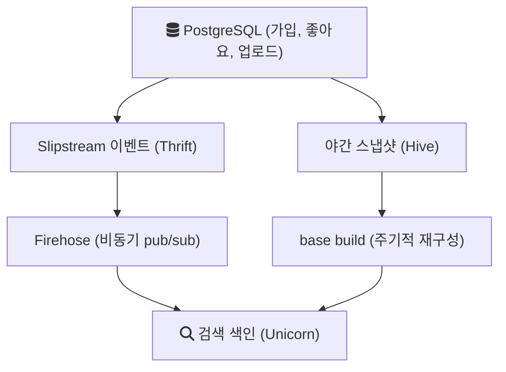

# 2023-06-13-TIL

## Today I Learned

### Instagram Hashtag Architecture

해시태그 검색을 시스템 설계 관점에서 찾아봤다. 다른 링크들은 인스타그램이나 트위터를 예로 든 시스템 설계 글이고, 마지막 링크가 Instagram 엔지니어링 블로그의 2015년 글 "Search Architecture"다. 실제 구조를 설명한 원문이라 이 글을 중심으로 정리한다([Instagram Engineering: Search Architecture](https://medium.com/instagram-engineering/search-architecture-eeb34a936d3a)).

해시태그를 "게시물 목록을 가리키는 키"로 보면 구조가 단순해진다. 게시물이 올라올 때 본문에서 해시태그를 뽑아 `해시태그 -> 게시물 ID 목록`을 만들어 두면, 검색은 이 목록을 읽는 일이 된다. 이것이 검색 엔진의 역색인(inverted index)이다.

Instagram은 2015년 초 검색 인프라를 Elasticsearch에서 Facebook의 검색 엔진 Unicorn으로 옮겼다. 검색 인프라는 해시태그, 장소, 사용자, 미디어를 모두 문서(document)로 갖는 비정규화된 저장소다. 데이터는 다음 흐름으로 들어온다.

변경 이벤트는 검색에 필요한 정보를 미리 채운 큰 Thrift 구조로 만들어 Firehose라는 pub/sub 채널로 보낸다. 검색은 이 채널을 구독해 색인을 갱신한다. Firehose 메시지는 best-effort라서 약간의 유실을 감수한다. 대신 매일 밤 PostgreSQL 스냅샷을 Hive로 옮기고, 이를 바탕으로 주기적으로 문서를 다시 만들어(base build) 실시간 데이터와 합친다. 그래서 메시지가 일부 사라져도 결국 일관된 상태가 된다(최종 일관성).

검색 요청은 두 단계로 처리된다. 먼저 역색인에서 질의에 맞는 문서 집합을 찾고(후보 생성), 각 문서의 특성으로 점수를 매겨 순위를 정한다(랭킹). 원문은 이전에는 계정 검색과 해시태그 검색을 사용자가 골라야 했지만, 하나의 검색창에서 결과를 섞어 보여 주도록 바꾸자 해시태그 클릭이 20% 넘게 늘었다고 적는다. 어떤 검색어가 해시태그 검색인지 계정 검색인지는 국가별로 모은 검색 로그와 사용자의 과거 검색으로 학습한 분류기가 판단한다.

이 글에서 가져갈 점은 두 가지다. 쓰기 경로(이벤트로 색인 갱신)와 읽기 경로(색인 조회)를 분리한다는 것, 그리고 실시간 이벤트의 유실을 주기적인 전체 재구성으로 메운다는 것이다.

- https://www.linkedin.com/pulse/twitter-system-design-narendra-l/
- https://www.thetechplatform.com/post/system-design-instagram
- https://scaleyourapp.com/instagram-architecture-how-does-it-store-search-billions-of-images/
- https://medium.com/coders-mojo/day-4-of-system-design-case-studies-series-design-instagram-part-1-10943440f29c
- https://instagram-engineering.com/search-architecture-eeb34a936d3a

## 참고

- [Search Architecture - Instagram Engineering](https://medium.com/instagram-engineering/search-architecture-eeb34a936d3a)
