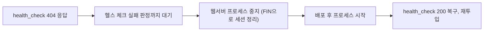

# 2023-06-15-TIL

## Today I Studied

### 로드 밸런싱 알고리즘

로드 밸런서가 요청을 어느 서버로 보낼지 정하는 방식은 서버 상태를 보지 않는 정적 방식과 상태를 반영하는 동적 방식으로 나뉜다. Kemp의 정리를 기준으로 대표적인 것은 다음과 같다.

- Round Robin: 서버를 차례로 돌아가며 보낸다. 서버 성능이 비슷하고 요청 비용이 균일할 때 단순하고 효과적이다.
- Weighted Round Robin: 서버마다 용량에 비례한 가중치를 주고 그 비율대로 보낸다.
- Least Connection: 현재 활성 연결이 가장 적은 서버로 보낸다. 요청마다 처리 시간이 크게 다를 때 유리하다.
- Weighted Response Time: 응답 시간으로 가중치를 계산해 빠른 서버에 더 보낸다.
- Source IP Hash: 클라이언트 IP로 해시를 계산해 같은 클라이언트를 같은 서버로 보낸다. 세션 고정(sticky session)이 필요할 때 쓰지만 서버 수가 바뀌면 매핑이 흔들린다.

- https://www.cloudflare.com/ko-kr/learning/performance/types-of-load-balancing-algorithms/
- https://kemptechnologies.com/load-balancer/load-balancing-algorithms-techniques
- https://aws.amazon.com/ko/what-is/load-balancing/

### L4 장비 동작

카카오 기술 블로그 글은 L3DSR(Direct Server Return) 구성의 L4 장비가 어떻게 동작하는지와 배포 시 주의점을 다룬다. L4 장비는 VIP마다 바인딩된 서버 목록을 가지고, 들어온 패킷의 IP 헤더 주소를 바꿔 목록의 서버로 넘긴다. DSR 구성이라 응답은 L4를 거치지 않고 서버가 클라이언트에게 직접 보낸다. 장비는 주기적으로 `GET /health_check.html` 같은 L7 헬스 체크를 보내고, 실패한 서버를 바인딩 목록에서 뺀다.

글이 짚는 함정은 세션 테이블이다. L4 장비는 연결별 세션 테이블을 설정된 idle timeout 동안 유지하므로, 배포하려고 헬스 체크 파일을 지워 404를 내도 Keep-Alive로 이미 맺어진 연결의 요청은 계속 그 서버로 들어온다. 헬스 체크 주기 때문에 서버가 빠졌다고 판정되기까지도 시간이 걸린다. 그래서 글은 헬스 체크를 실패시킨 뒤 판정 시간만큼 기다리고, 웹서버 프로세스를 내려 서버가 FIN을 보내게 해서 세션 테이블을 정리한 다음 배포하는 순서를 권한다.

- https://tech.kakao.com/2014/05/30/l4/

### ELB Automatic Failover

AWS의 Elastic Load Balancer도 같은 원리로 장애 서버를 뺀다. 링크한 GoSquared 글은 ELB가 인스턴스에 주기적으로 HTTP 헬스 체크를 보내 200을 받으면 In Service, 실패하면 Out of Service로 표시하고 트래픽을 끊으며, Auto Scaling Group이 비정상 인스턴스를 새 인스턴스로 교체하게 하는 구성을 설명한다. 애플리케이션이 헬스 체크 엔드포인트에서 DB 연결처럼 실제 의존성까지 확인해야 진짜 장애를 걸러낼 수 있다는 점이 실무 포인트다.

- https://www.gosquared.com/blog/use-elb-automatic-failover

### Redis Cluster vs Sentinel

둘 다 Redis의 고가용성 구성이지만 해결하는 문제가 다르다.

- Sentinel: 마스터 하나와 복제본들로 이루어진 구성을 감시하다가 마스터가 죽으면 복제본을 마스터로 승격하는 자동 장애 조치를 제공한다. 데이터는 나누지 않으므로 쓰기 용량은 마스터 한 대에 묶인다.
- Cluster: 데이터를 여러 마스터에 나눠 저장하는 샤딩과 장애 조치를 함께 제공한다. Redis 문서에 따르면 키 공간을 16384개의 해시 슬롯으로 나눠 마스터들에 분배한다. 여러 키를 다루는 명령은 키들이 같은 슬롯에 있어야 하므로, `{user:1}:profile`처럼 해시 태그로 같은 슬롯에 모아야 한다.

데이터가 한 대에 들어가고 가용성만 필요하면 Sentinel, 메모리나 쓰기 처리량을 수평으로 늘려야 하면 Cluster가 맞다.

- https://velog.io/@always/Redis-%EC%9A%B4%EC%98%81-%EB%B0%A9%EC%8B%9D-Cluster-vs-Sentinel-%EC%96%B4%EB%96%A4-%EA%B2%83%EC%9D%84-%EC%84%A0%ED%83%9D%ED%95%B4%EC%95%BC-%ED%95%A0%EA%B9%8C
- [Scale with Redis Cluster (Redis)](https://redis.io/docs/latest/operate/oss_and_stack/management/scaling/)

### Sharding

샤딩은 한 테이블의 행을 여러 DB에 나눠 저장해 쓰기와 저장 용량을 수평으로 늘리는 방법이다. 우아한형제들 글은 두 가지 전략을 비교한다. 모듈러 샤딩은 키를 샤드 수로 나눈 나머지로 위치를 정해 고르게 분산되지만, 샤드를 늘리면 데이터를 재배치해야 한다. 레인지 샤딩은 키 범위로 위치를 정해 증설이 쉽지만, 특정 범위에 데이터가 몰리면 부하가 치우친다. 구현은 Spring의 `AbstractRoutingDataSource`를 확장해, AOP로 리포지토리 메서드 파라미터에서 샤딩 키를 꺼내 ThreadLocal에 담고 그 값으로 대상 샤드를 고르는 방식이다.

JPA는 기본적으로 하나의 데이터소스를 가정하므로 샤딩은 그 아래 데이터소스 계층에서 처리하는 것이 일반적이다. Apache ShardingSphere 같은 미들웨어는 JDBC 드라이버 수준에서 샤딩 규칙을 적용한다. 어느 쪽이든 샤드를 가로지르는 조인과 트랜잭션은 어려워진다는 점을 감수해야 한다.

- https://techblog.woowahan.com/2687/
- https://www.nowwatersblog.com/backend/serverLoad/sharding
- https://stackoverflow.com/questions/13672019/database-sharding-and-jpa
- https://www.baeldung.com/spring-data-jpa-multiple-databases
- https://shardingsphere.apache.org/document/4.1.0/en/manual/sharding-jdbc/usage/sharding/

### Spring @Cacheable

`@Cacheable`은 메서드 결과를 캐시에 저장해 두고, 같은 인자로 다시 호출되면 메서드를 실행하지 않고 캐시 값을 돌려준다. 캐시 키는 기본적으로 메서드 인자로 만들고 `key` 속성의 SpEL로 바꿀 수 있다. Spring 문서 예시처럼 `condition`은 호출 전에 캐시를 적용할지 정하고, `unless`는 결과(`#result`)를 보고 저장하지 않을 경우를 정한다. 값이 바뀌면 `@CacheEvict`나 `@CachePut`으로 캐시를 갱신해야 한다. 프록시 기반이라 같은 클래스 안에서 호출하면 캐시가 적용되지 않는다는 점, 실제 저장소는 `CacheManager` 구현(Caffeine, Redis 등)에 따라 달라진다는 점도 기억해 둔다.

- https://mangkyu.tistory.com/179
- [Declarative Annotation-based Caching (Spring Framework Reference)](https://docs.spring.io/spring-framework/reference/integration/cache/annotations.html)

## AI 키워드

### OpenAI Function calling

OpenAI는 2023년 6월 13일 Chat Completions API에 function calling을 추가했다. 개발자가 함수 시그니처를 JSON Schema로 설명하면 모델이 함수를 호출해야 하는 상황을 판단하고 그 시그니처에 맞는 JSON 인자를 만들어 준다. OpenAI는 이를 모델에서 구조화된 데이터를 더 안정적으로 받는 방법으로 소개했다.

- [Function calling and other API updates (OpenAI)](https://openai.com/index/function-calling-and-other-api-updates/)
