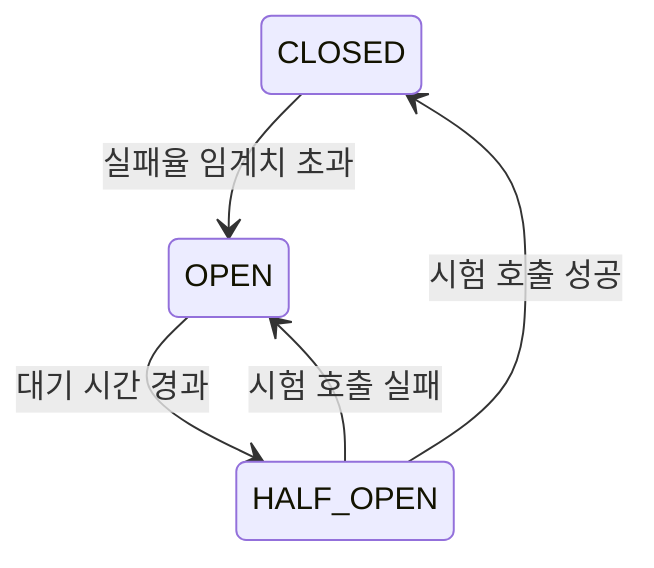

# 2023-07-02-TIL

## Today I Learned

### Spring Boot에서 대소문자를 구분하지 않는 Enum 매핑

`Enum.valueOf`는 대소문자를 구분하므로 `?status=active`나 `{"status": "active"}`는 `ACTIVE`로 변환되지 않는다. 변환 경로가 둘이라 해결도 둘로 나뉜다. 쿼리 파라미터와 경로 변수는 Spring의 변환 서비스를 거치므로 `Converter<String, Status>`(또는 모든 enum에 적용할 `ConverterFactory`)를 만들어 대문자로 바꾼 뒤 변환하도록 등록한다. JSON 본문은 Jackson이 처리하므로 `MapperFeature.ACCEPT_CASE_INSENSITIVE_ENUMS`를 켜거나 `@JsonCreator` 팩터리 메서드를 둔다.

- https://devwithus.com/enum-mapping-spring-boot/

### JPA의 optional 속성과 nullable

`@ManyToOne(optional = false)`와 `@Column(nullable = false)`(또는 `@JoinColumn(nullable = false)`)는 비슷해 보이지만 적용되는 시점이 다르다. 링크한 질문의 답변에 따르면 `nullable = false`는 스키마 생성 지시라 DDL에 `NOT NULL`을 붙이는 데 쓰이고, `optional = false`는 런타임 지시로 연관 대상이 반드시 있다고 JPA 구현체에 알려 준다. Hibernate는 이를 근거로 조회 시 외부 조인 대신 내부 조인을 쓰거나, null 대신 프록시를 만들어도 된다고 판단할 수 있다. 그래서 필수 연관관계라면 둘 다 지정해 DB 제약과 매핑 정보를 일치시키는 편이 명확하다.

Thorben Janssen의 팁은 다른 의미의 optional을 다룬다. JPA는 `Optional` 타입 필드를 매핑하지 않으므로, null일 수 있는 속성은 필드는 일반 타입으로 두고 getter만 `Optional`을 반환하게 만드는 방법을 소개한다.

- https://stackoverflow.com/questions/3331907/what-is-the-difference-between-manytooneoptional-false-vs-columnnullable-f
- https://www.objectdb.com/api/java/jpa/ManyToOne/optional
- https://thorben-janssen.com/hibernate-tips-map-entity-attribute-optional/
- https://docs.oracle.com/javaee/7/tutorial/persistence-intro001.htm#BNBQA

### 리포지토리에서 List 대신 Map 반환하기

Spring Data JPA의 쿼리 메서드는 `Map<ID, Entity>`를 반환 타입으로 지원하지 않는다. ID로 빠르게 찾을 수 있는 맵이 필요하면 리포지토리 인터페이스에 `default` 메서드를 두고 `findAll` 결과를 스트림으로 `Collectors.toMap`해서 돌려주는 방법이 간단하다.

```java
public interface MemberRepository extends JpaRepository<Member, Long> {
    default Map<Long, Member> findAllByIdAsMap(Collection<Long> ids) {
        return findAllById(ids).stream()
                .collect(Collectors.toMap(Member::getId, Function.identity()));
    }
}
```

- https://stackoverflow.com/questions/41876122/spring-data-jpa-repository-findall-to-return-map-instead-of-list

### save vs saveAll

Spring Data JPA의 `SimpleJpaRepository.saveAll()` 구현은 내부에서 각 엔티티에 대해 `save()`를 반복 호출할 뿐이다. 그런데도 성능 차이가 나는 이유는 트랜잭션이다. `SimpleJpaRepository`의 메서드에는 `@Transactional`이 붙어 있어서, 바깥에 트랜잭션이 없는 상태로 반복문 안에서 `save()`를 부르면 호출마다 트랜잭션이 새로 열리고 커밋된다. `saveAll()`은 전체가 한 트랜잭션이다. 링크한 실험 글이 확인하는 것도 이 차이이고, 서비스 메서드에 `@Transactional`을 붙이면 `save()` 반복도 같은 효과를 낸다.

`saveAll()`이 INSERT를 한 문장으로 묶어 주는 것은 아니다. JDBC 배치 삽입을 하려면 `hibernate.jdbc.batch_size`를 설정해야 하고, ID 전략이 `IDENTITY`면 INSERT 직후 생성된 키를 받아야 해서 Hibernate가 배치를 적용하지 않는다.

- https://sas-study.tistory.com/388
- https://www.baeldung.com/spring-data-save-saveall

### Tomcat 최대 스레드 풀

Spring Boot 내장 Tomcat은 요청 하나를 워커 스레드 하나가 처리한다. Spring Boot 프로퍼티 문서 기준으로 `server.tomcat.threads.max`(최대 워커 스레드 수) 기본값은 200이고, 모든 스레드가 사용 중일 때 대기할 수 있는 연결 요청 큐의 길이인 `server.tomcat.accept-count` 기본값은 100이다. `server.tomcat.max-connections`는 동시에 받아 처리하는 연결 수의 상한이다. Tomcat 문서의 Executor 설정에서도 `maxThreads` 기본값은 200이다.

스레드 수를 늘린다고 처리량이 그만큼 늘지는 않는다. 요청이 DB를 기다리는 시간이 길다면 DB 커넥션 풀 크기가 먼저 병목이 되고, 스레드가 많으면 문맥 전환과 메모리 비용이 커진다. 그래서 스레드 풀, 커넥션 풀, 하위 시스템의 처리량을 함께 맞춰 조정해야 한다.

- https://velog.io/@mooh2jj/Tomcat-Thread-Pool-%EC%A0%95%EB%A6%AC
- https://taes-k.github.io/2020/01/13/tomcat-thread/
- https://tomcat.apache.org/tomcat-8.5-doc/config/executor.html

### Circuit Breaker

외부 서비스가 느려지거나 죽었을 때 계속 호출하면 요청 스레드가 타임아웃까지 묶여 장애가 호출하는 쪽으로 번진다. 서킷 브레이커는 실패가 일정 비율을 넘으면 호출을 차단하고 바로 실패나 대체 응답(fallback)을 돌려준다. Resilience4j 문서는 이를 CLOSED, OPEN, HALF_OPEN 세 상태의 유한 상태 기계로 설명한다. CLOSED에서는 호출을 통과시키며 슬라이딩 윈도(호출 수 기준 또는 시간 기준)로 결과를 집계하고, 실패율이 임계치를 넘으면 OPEN이 되어 호출을 차단한다. 일정 시간이 지나면 HALF_OPEN에서 일부 호출만 시험해 보고 성공하면 다시 CLOSED로 돌아간다.



- https://qwer9412.tistory.com/2
- [CircuitBreaker (Resilience4j)](https://resilience4j.readme.io/docs/circuitbreaker)
