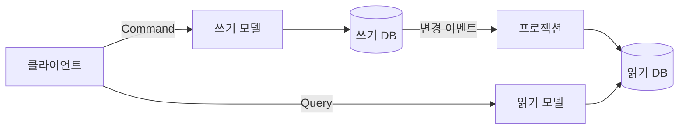

# 2023-07-03-TIL

## Today I Learned

### CQRS 패턴

CQRS(Command Query Responsibility Segregation)는 상태를 바꾸는 명령(command)과 상태를 읽는 조회(query)에 서로 다른 모델을 쓰는 패턴이다. Martin Fowler는 핵심을 정보를 갱신할 때와 읽을 때 다른 모델을 쓸 수 있다는 생각으로 요약한다. 쓰기 모델은 도메인 규칙과 일관성을 지키는 데 집중하고, 읽기 모델은 화면이 필요로 하는 모양으로 비정규화해 빠르게 조회하게 만든다.

분리의 정도는 다양하다. 같은 DB 안에서 서비스 클래스만 나누는 수준부터, 쓰기 DB의 변경을 이벤트로 받아 별도의 읽기 저장소(검색 엔진, 캐시, 읽기 전용 테이블)를 갱신하는 수준까지 있다. 뒤로 갈수록 읽기 모델이 쓰기보다 늦게 반영되는 결과적 일관성을 받아들여야 하고, 이벤트 소싱과 함께 쓰이는 경우가 많다. Fowler는 이 분리가 가치 있는 상황도 있지만 대부분의 시스템에서 CQRS는 위험한 복잡성을 더한다고 경고한다. 읽기와 쓰기의 요구가 실제로 크게 다를 때 일부 영역에만 적용하는 것이 권장되는 이유다.



- https://martinfowler.com/bliki/CQRS.html
- https://always-kimkim.tistory.com/entry/cqrs-pattern
- https://www.eventstore.com/cqrs-pattern
- https://medium.com/design-microservices-architecture-with-patterns/cqrs-design-pattern-in-microservices-architectures-5d41e359768c

---

### Variable used in Lambda Expression Should be Final or Effectively Final

람다 안에서 바깥의 지역 변수를 바꾸려고 하면 이 컴파일 오류가 난다. JLS 15.27.2절은 람다 식에서 사용하지만 람다 안에서 선언하지 않은 지역 변수, 형식 매개변수, 예외 매개변수는 `final`이거나 effectively final이어야 한다고 정한다. effectively final은 `final`을 붙이지 않았지만 초기화 후 다시 대입되지 않는 변수다.

이유는 람다가 변수 자체가 아니라 값을 캡처하기 때문이다. 지역 변수는 스택에 있어 메서드가 끝나면 사라지지만, 람다는 다른 스레드에서 나중에 실행될 수 있다. 값이 바뀔 수 있다면 람다가 본 값과 바깥의 값이 어긋나고 동시성 문제도 생긴다. 집계가 필요하면 바깥 변수를 바꾸는 대신 `reduce`, `collect`, `sum` 같은 스트림 연산을 쓰는 것이 의도에 맞다. `AtomicInteger`나 배열로 우회할 수는 있지만 문제를 숨길 뿐이다.

- https://www.codementor.io/@wesome/variable-used-in-lambda-expression-should-be-final-or-effectively-final-1urrrjtmac
- https://www.baeldung.com/java-lambda-effectively-final-local-variables

---

### JSON 데이터에 포함된 배열은 순서를 보장할까?

순서는 보장된다.

RFC 7159에 따르면 JSON의 배열은 0개 이상의 값으로 이루어진 순서 있는 시퀀스이고, 객체는 이름/값 쌍의 순서 없는 집합이다. 그래서 배열 `[3, 1, 2]`는 파서와 언어가 달라도 그 순서로 읽혀야 하지만, 객체의 필드 순서는 구현에 따라 달라질 수 있으므로 의존하면 안 된다. API 응답에서 정렬된 목록은 배열로 표현하고, 필드 순서에 의미를 두지 않는 것이 안전하다.

- https://www.baeldung.com/java-lambda-effectively-final-local-variables
- https://datatracker.ietf.org/doc/html/rfc7159

---

### 중첩 Record 클래스

DTO를 record로 만들다 보면 응답 안의 하위 구조를 중첩 record로 표현하게 된다. JLS 8.10절에 따르면 중첩 record 클래스는 암묵적으로 `static`이다. 그래서 일반 내부 클래스와 달리 바깥 인스턴스에 대한 참조를 갖지 않고, 바깥 클래스 없이 `Outer.Inner`로 생성할 수 있다. 중첩해서 응집도를 높일지, 별도 파일로 분리해 재사용할지는 하위 구조가 다른 곳에서도 쓰이는지로 판단하면 된다.

```java
public record OrderResponse(Long id, List<Item> items) {
    public record Item(String name, int quantity) {
    }
}
```

- https://velog.io/@yhlee9753/nested-record-class-%EC%9D%98-%EB%8C%80%ED%95%9C-%EA%B3%A0%EB%AF%BC
- https://javadevcentral.com/record-class-in-java

---

### Stream에 null이 있는지 확인하기

스트림과 null은 두 단계로 나눠 봐야 한다.

- 컬렉션 자체가 null일 수 있다: `collection.stream()`에서 바로 `NullPointerException`이 난다. `Optional.ofNullable(list).stream().flatMap(List::stream)`이나, Java 9의 `Stream.ofNullable`로 감싼다. 더 나은 방법은 메서드가 null 대신 빈 컬렉션을 반환하게 하는 것이다.
- 요소 중에 null이 있을 수 있다: 존재 여부는 `stream.anyMatch(Objects::isNull)`로 확인하고, 걸러내려면 `filter(Objects::nonNull)`을 쓴다.

`Collectors.toMap`은 값이 null이면 예외를 던지는 것처럼 일부 수집 연산은 null을 허용하지 않으므로, 스트림 초입에서 null을 정리해 두면 뒤쪽 연산이 단순해진다.

- https://stackoverflow.com/questions/32114965/how-to-check-if-null-is-in-stream
- https://stackoverflow.com/questions/57951065/do-we-need-to-check-if-a-stream-in-java-8-if-it-is-null-and-not-iterate
- https://java-8-tips.readthedocs.io/en/stable/optional.html
- https://www.techiedelight.com/filter-null-values-stream-java-8/
- https://www.baeldung.com/java-null-safe-streams-from-collections
- https://stackoverflow.com/questions/17081063/how-should-we-manage-jdk8-stream-for-null-values
- https://beginnersbook.com/2017/10/java-8-filter-null-values-from-a-stream/
- https://sigmasabjil.tistory.com/43
