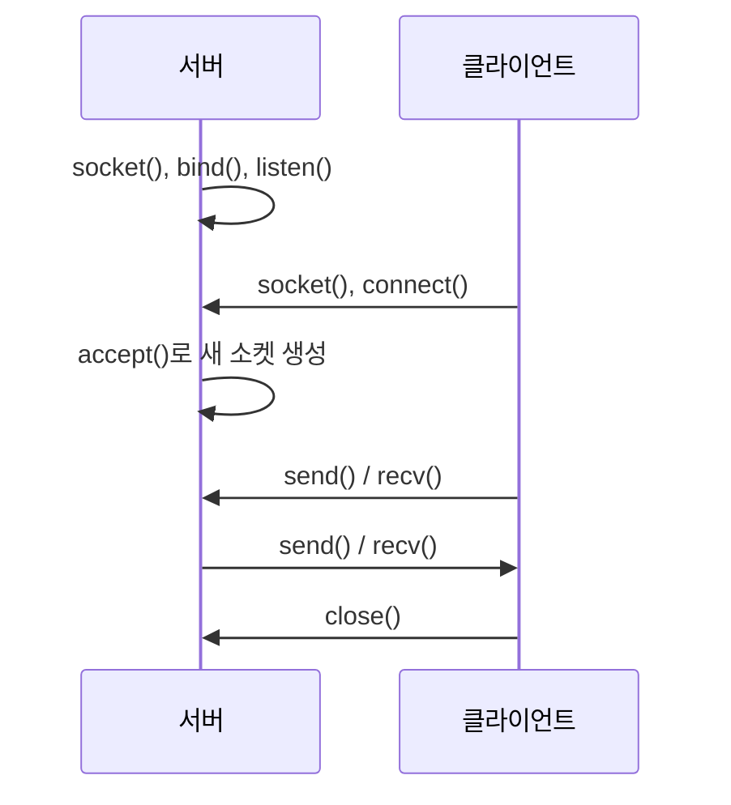

# 2023-09-07-TIL

## Today I Studied

### KakaoTalk

대규모 메신저가 연결과 트래픽을 어떻게 다루는지 카카오의 공개 자료로 살펴봤다. [카카오 브런치 글](https://brunch.co.kr/@kakao-it/170)은 지진 같은 재난 상황에서 트래픽이 폭증했던 사례를 다룬다. 글에 따르면 원인은 메시지 전송 자체보다 연결 요청이었다. 재난 문자를 받은 스마트폰이 일제히 깨어나면서 백그라운드에서 서버와 연결을 다시 맺으려는 요청이 몰렸다.

그래서 카카오톡 팀은 연결 요청을 두 종류로 나눴다. 사용자가 앱을 직접 실행한 포그라운드(FG) 연결과, 빠른 응답을 위해 백그라운드(BG)에서 미리 맺어 두는 연결이다. 비상 상황이 감지되면 FG를 먼저 처리하고 BG는 단계에 따라 뒤로 미루도록 바꿨다. 모든 요청을 똑같이 처리하지 않고 실제 사용자에게 먼저 자원을 주는 부하 제어(load shedding)의 사례로 볼 수 있다.

- https://tech.kakao.com/tag/architecture-2/
- https://brunch.co.kr/@kakao-it/170
- https://kldp.org/node/133279

---

### Music Digging Sites

기술 주제는 아니지만 음악을 찾아 듣는(digging) 데 쓰는 사이트를 모아 두었다. Discogs는 음반 발매 정보를 모은 데이터베이스이자 음반 거래 마켓이고, Beatport와 Traxsource는 DJ가 주로 쓰는 전자음악 음원 판매 사이트다. Soundeo도 DJ용 음원 다운로드 서비스다. 나머지 링크는 디깅 방법과 사이트를 소개하는 글이다.

- https://hiphople.com/kboard/18318057
- https://digging.kr/ARTICLES/?idx=15173255&bmode=view
- https://post.naver.com/viewer/postView.nhn?volumeNo=27736737&memberNo=46184220
- https://brunch.co.kr/@kith0618/6
- https://www.discogs.com/
- https://www.traxsource.com/
- https://www.beatport.com/
- https://soundeo.com/

---

### Socket

[Java 튜토리얼](https://docs.oracle.com/javase/tutorial/networking/sockets/definition.html)은 소켓을 네트워크에서 동작하는 두 프로그램 사이 양방향 통신 링크의 한쪽 끝점(endpoint)으로 정의한다. 소켓은 포트 번호에 묶이고, TCP 계층은 이 포트로 데이터를 받을 애플리케이션을 찾는다. 끝점은 IP 주소와 포트의 조합이고, TCP 연결 하나는 양쪽 끝점 두 개로 유일하게 식별된다. 그래서 같은 서버 포트에 여러 클라이언트가 동시에 연결될 수 있다.

- https://docs.oracle.com/javase/tutorial/networking/sockets/definition.html
- https://en.wikipedia.org/wiki/Network_socket
- https://www.daleseo.com/what-is-a-socket/

---

### Socket Programming

TCP 소켓 프로그래밍의 흐름은 서버와 클라이언트가 비대칭이다.

같은 튜토리얼에 따르면 서버는 연결을 수락할 때 같은 로컬 포트에 묶인 새 소켓을 받는다. 원래 소켓은 계속 다른 연결 요청을 듣고, 새 소켓으로 연결된 클라이언트와 통신한다. Java에서는 `ServerSocket`이 듣는 쪽을, `Socket`이 연결의 한쪽 끝을 맡는다.

- https://recipes4dev.tistory.com/153

---

### News Feed Architecture

뉴스 피드 시스템의 핵심 결정은 피드를 언제 만드느냐다. [이 시스템 디자인 정리](https://liuzhenglaichn.gitbook.io/system-design/news-feed/design-a-news-feed-system)는 두 방식을 비교한다.

- Fan-out on read(pull): 피드를 요청할 때 팔로우하는 사람들의 글을 모아 합친다. 쓰기는 가볍지만 읽기가 느리다.
- Fan-out on write(push): 글을 쓸 때 모든 팔로워의 피드 캐시에 미리 넣어 둔다. 읽기는 빠르지만 팔로워가 많은 사용자의 글 하나가 엄청난 쓰기를 만든다.

그래서 보통 둘을 섞는다. 같은 정리는 팔로워가 매우 많은 사용자의 글은 push를 멈추고 팔로워가 읽을 때 가져가게 하거나, 온라인 팔로워에게만 push하는 방법을 제시한다. 무엇을 위에 보여 줄지는 또 다른 문제다. [Facebook 엔지니어링 글](https://engineering.fb.com/2021/01/26/ml-applications/news-feed-ranking/)은 게시물마다 좋아요나 댓글 같은 행동을 할 확률을 여러 모델로 예측하고, 이를 합친 점수로 순위를 정한다고 설명한다.

- https://liuzhenglaichn.gitbook.io/system-design/news-feed/design-a-news-feed-system
- https://algodaily.com/lessons/dive-into-facebook-newsfeed-architecture
- https://algodaily.com/lessons/dive-into-facebook-newsfeed-architecture
- https://medium.com/double-pointer/system-design-interview-twitter-or-facebook-news-feed-f960f6d1fd70
- https://hackernoon.com/designing-a-social-media-news-feed-system
- https://engineering.fb.com/2021/01/26/ml-applications/news-feed-ranking/
