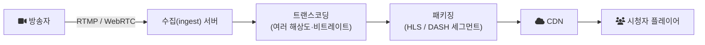

# 2023-09-21-TIL

## Today I Learned

### Live Streaming Architecture

라이브 스트리밍 서비스는 방송자 한 명의 영상을 많은 시청자에게 거의 실시간으로 전달해야 한다. 링크들에서 공통으로 나오는 구성은 수집, 변환, 배포 세 단계다.

1. 수집: 방송 소프트웨어가 RTMP 같은 프로토콜로 영상을 수집 서버에 올린다. [Sendbird 글](https://sendbird.com/ko/blog/how-to-build-a-livestreaming-app)은 플랫폼이 RTMP를 포함한 여러 스트리밍 프로토콜을 지원해야 한다고 정리한다.
2. 변환: 시청자의 네트워크 상황이 제각각이므로 원본을 여러 해상도와 비트레이트로 다시 인코딩한다.
3. 배포: 결과를 HLS나 DASH의 짧은 세그먼트로 잘라 CDN으로 내보낸다. [HLS 명세(RFC 8216)](https://www.rfc-editor.org/rfc/rfc8216)의 Master Playlist는 같은 콘텐츠의 여러 비트레이트 변형(variant)을 나열하고, 플레이어가 네트워크 상황에 맞춰 변형을 골라 받는다.

이 구조는 일반 HTTP와 CDN을 그대로 쓸 수 있어 시청자가 많아도 확장하기 쉽다. 대신 세그먼트를 다 만든 뒤에야 내보낼 수 있어서 수 초 단위의 지연이 생긴다. 지연을 더 줄여야 하는 화상 통화나 양방향 방송에는 WebRTC가 쓰인다. [MDN 문서](https://developer.mozilla.org/en-US/docs/Web/API/WebRTC_API/Signaling_and_video_calling)에 따르면 WebRTC는 연결을 맺기 전에 시그널링 서버를 통해 SDP 형식의 offer와 answer를 주고받고, ICE 후보(candidate)를 교환해 두 피어가 연결할 경로를 찾는다. [oneroomtable 글](https://oneroomtable.com/entry/WebRTC-5-%EB%9D%BC%EC%9D%B4%EB%B8%8C-%EC%8A%A4%ED%8A%B8%EB%A6%AC%EB%B0%8D-%EA%B5%AC%ED%98%84-1-offer-answer)이 이 offer/answer 흐름을 코드로 구현한다. 시청자가 많아지면 피어 간 연결만으로는 감당하기 어려워서 중계 서버(SFU 등)를 두는 구성이 일반적이다.

- https://code-developer.tistory.com/11
- https://velog.io/@hssarah/%EC%8B%A4%EC%8B%9C%EA%B0%84-%EC%8A%A4%ED%8A%B8%EB%A6%AC%EB%B0%8D%EC%9D%84-%EC%9C%84%ED%95%9C-%EC%84%9C%EB%B2%84-%EA%B5%AC%EC%B6%95
- https://sendbird.com/ko/blog/how-to-build-a-livestreaming-app
- https://oneroomtable.com/entry/WebRTC-5-%EB%9D%BC%EC%9D%B4%EB%B8%8C-%EC%8A%A4%ED%8A%B8%EB%A6%AC%EB%B0%8D-%EA%B5%AC%ED%98%84-1-offer-answer
- https://connectlive.kakaoi.ai/files/Kakao_i_Connect_Live_final_v1.03.pdf

### Instagram Alternatives

사진·영상 공유 서비스로 Instagram 외에 어떤 선택지가 있는지 비교한 글들이다. 서비스 기획 관점에서 참고용으로 모아 두었다. [PetaPixel 글](https://petapixel.com/best-instagram-alternatives/)은 Flickr, VSCO, 500px, Glass, Grainery 등을 꼽는다. 이 서비스들은 Instagram이 주지 않는 것을 차별점으로 내세운다. Glass는 구독료를 받는 대신 광고와 참여 유도 알고리즘, 데이터 추적을 없앴고, Grainery는 필름 사진가를 위해 게시물에 필름 종류와 카메라, 렌즈 정보를 적을 수 있게 했다.

- https://www.androidauthority.com/instagram-alternatives-3316324/
- https://petapixel.com/best-instagram-alternatives/
- https://www.datasourse.com/alternative-apps-sites-like-instagram/
- https://www.fotor.com/blog/instagram-alternatives/
- https://beebom.com/best-instagram-alternatives/
