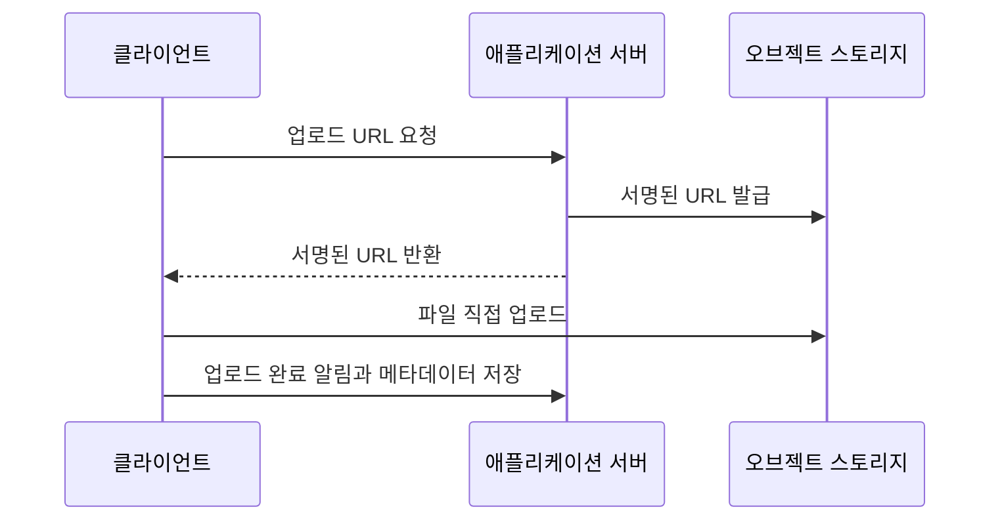

# 2023-10-31-TIL

## Today I Learned

### File Upload Architecture

파일 업로드 기능은 파일이 어느 경로로 저장소까지 가느냐에 따라 구조가 갈린다. 가장 단순한 방식은 클라이언트가 애플리케이션 서버로 파일을 올리고, 서버가 다시 스토리지로 옮기는 것이다. 구현은 쉽지만 큰 파일이 몰리면 서버의 네트워크 대역폭과 메모리, 요청 처리 스레드가 업로드에 묶인다.

그래서 많이 쓰는 대안이 스토리지에 직접 올리는 방식이다. [AWS 블로그](https://aws.amazon.com/blogs/compute/uploading-to-amazon-s3-directly-from-a-web-or-mobile-application/)는 S3에 직접 업로드하면 요청을 애플리케이션 서버로 프록시하지 않아도 되므로 네트워크 트래픽과 서버 CPU 사용량을 크게 줄일 수 있다고 설명한다.



이 구조에서 서버는 권한 확인과 URL 발급, 메타데이터 관리만 맡는다. 업로드 후 썸네일 생성이나 바이러스 검사 같은 후처리는 스토리지 이벤트로 비동기 처리하는 경우가 많다.

- https://www.linkedin.com/pulse/how-design-file-upload-sharing-services-narendra-l
- https://joaogbsczip.medium.com/build-a-file-upload-service-with-nodejs-typescript-clean-architecture-dd7de1c92e3d
- https://softwareengineering.stackexchange.com/questions/391145/architecture-for-uploading-large-files-from-many-end-points-to-the-cloud-storage
- https://medium.com/@biea.kua/performance-efficient-and-secured-file-transfer-to-cloud-file-storage-a3e8fca16f32
- https://cloudinary.com/guides/front-end-development/file-upload-as-a-service-how-it-works-and-5-leading-solutions
- https://jgefroh.medium.com/software-architecture-image-uploading-67997101a034

### Multipart

[Adam Chalmers의 글](https://blog.adamchalmers.com/multipart/)에 따르면 multipart가 생기기 전에는 파일도 `application/x-www-form-urlencoded`로 URL 인코딩해서 올려야 했다. 바이너리 파일은 인코딩하면 크기가 크게 늘어나므로, 1998년 RFC 2388이 여러 파일을 인코딩 없이 한 HTTP 본문에 담는 `multipart/form-data`를 제안했다. 지금은 [RFC 7578](https://www.rfc-editor.org/rfc/rfc7578)이 이 형식을 정의한다.

본문은 boundary 문자열로 구분된 여러 파트로 이루어진다. 각 파트는 `Content-Disposition`으로 폼 필드 이름과 파일 이름을, `Content-Type`으로 파일 형식을 알린다. RFC 7578은 파트 헤더로 이 둘과 제한적인 경우의 `Content-Transfer-Encoding` 외에는 쓰지 않는다고 정한다. 글은 서버가 파트를 하나씩 스트리밍으로 처리할 수 있다는 점도 장점으로 든다. 여러 파일을 JSON에 Base64로 넣으면 본문 전체를 메모리에 올려 디코딩해야 한다.

- https://blog.adamchalmers.com/multipart/

### Multipart vs Octet Stream

파일 하나만 올리는 API라면 본문 전체를 파일로 보내는 `application/octet-stream`도 선택지다. [Stack Overflow 답변](https://stackoverflow.com/questions/29347234/multipart-form-data-vs-application-octet-stream)들은 `multipart/form-data`를 권하는 이유로 나중에 파일과 함께 다른 필드를 보내야 할 때 호환성을 깨지 않고 추가할 수 있다는 점, HTML 폼에서 바로 호출할 수 있다는 점을 든다. 서버가 `Content-Type` 헤더를 보고 두 형식을 모두 받게 만들 수도 있다.

- https://stackoverflow.com/questions/29347234/multipart-form-data-vs-application-octet-stream
- https://itecnote.com/tecnote/multipart-form-data-vs-application-octet-stream/

### Multipart vs Raw Contents

[같은 주제의 다른 질문](https://stackoverflow.com/questions/32336083/file-upload-api-multipart-form-data-vs-raw-contents-in-body)의 답변은 프로토콜 수준의 차이를 이렇게 요약한다. multipart 요청은 정해진 형식을 따라야 하고, 본문에 원본 파일을 그대로 담는 요청은 형식이 자유롭다. 그래서 multipart 쪽이 파트 헤더와 boundary만큼 크고, 작은 파일을 많이 보낼 때는 이 오버헤드가 병목이 될 수 있다. 원본을 그대로 보낼 때는 파일 이름 같은 메타데이터를 URL 경로나 헤더로 따로 전달해야 한다. 앞의 pre-signed URL로 S3에 `PUT`하는 방식이 원본 전송의 대표적인 예다.

- https://stackoverflow.com/questions/32336083/file-upload-api-multipart-form-data-vs-raw-contents-in-body

### FTP vs HTTP

[FTP](https://en.wikipedia.org/wiki/File_Transfer_Protocol)는 파일 전송만을 위한 프로토콜로, 명령을 주고받는 제어 연결과 파일을 실제로 보내는 데이터 연결을 따로 맺는다. 데이터 연결을 서버가 클라이언트로 거는 active 모드와, 클라이언트가 서버로 거는 passive 모드가 있다. 클라이언트가 방화벽 뒤에 있어 들어오는 연결을 받을 수 없으면 passive 모드를 쓴다. HTTP는 요청과 응답을 한 연결로 주고받으므로 방화벽과 프록시, CDN을 지나기 쉽고, 웹 애플리케이션과 같은 인증·보안 체계를 그대로 쓸 수 있다.

- https://www.scaler.com/topics/difference-between-http-and-ftp/

### Edge Computing

[엣지 컴퓨팅](https://en.wikipedia.org/wiki/Edge_computing)은 연산과 데이터 저장을 데이터가 생기는 곳이나 사용자에 가깝게 옮기는 분산 컴퓨팅 모델이다. 멀리 있는 중앙 데이터센터까지 왕복하지 않으므로 지연 시간이 줄고, 원본 데이터를 다 보내지 않고 가까운 곳에서 걸러 보내면 대역폭도 아낀다. CDN 엣지에서 코드를 실행하는 서비스나, 공장 설비 옆에서 센서 데이터를 먼저 처리하는 장비가 예다.

- https://en.wikipedia.org/wiki/Edge_computing
- https://www.simplilearn.com/edge-computing-vs-cloud-computing-article#:~:text=Edge%20computing%20is%20used%20to,connectivity%20to%20a%20centralized%20location.
- https://azure.microsoft.com/en-us/resources/cloud-computing-dictionary/what-is-edge-computing#:~:text=Edge%20computing%20is%20a%20distributed,the%20edge%20of%20the%20network.

### Java Record Extend

Java 레코드는 다른 클래스를 상속할 수 없다. [JEP 395](https://openjdk.org/jeps/395)에 따르면 레코드 선언에는 `extends` 절이 없고, 상위 클래스는 항상 `java.lang.Record`다. 상위 클래스를 지정하면 헤더에 적은 컴포넌트 외의 상태를 물려받게 되기 때문이다. 레코드는 암묵적으로 `final`이라 다른 클래스가 레코드를 상속할 수도 없다. 대신 인터페이스는 자유롭게 구현할 수 있다. 그래서 여러 레코드에 공통 동작이 필요하면 공통 인터페이스를 두고 각 레코드가 구현하게 한다.

```java
sealed interface Shape permits Circle, Square {}
record Circle(double r) implements Shape {}
record Square(double side) implements Shape {}
```
