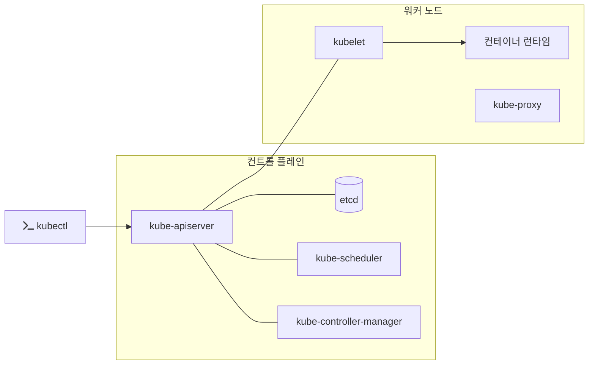

# 2023-11-15-TIL

## Today I Learned

### ARN

ARN(Amazon Resource Name)은 AWS 리소스를 유일하게 식별하는 이름이다. [IAM 사용자 가이드](https://docs.aws.amazon.com/IAM/latest/UserGuide/reference-arns.html)에 따르면 IAM 정책이나 API 호출처럼 AWS 전체에서 리소스를 모호하지 않게 가리켜야 할 때 ARN을 쓴다. 형식은 `arn:partition:service:region:account-id:resource-id`이고, 서비스에 따라 `resource-type/resource-id`처럼 리소스 종류가 붙는다.

```text
arn:aws:iam::123456789012:user/john
arn:aws:sns:us-east-1:123456789012:example-sns-topic-name
```

IAM 사용자처럼 리전에 속하지 않는 리소스는 region 자리가 비어 있다. 정책의 `Resource`에 ARN을 적고 `*` 와일드카드로 범위를 넓히는 식으로 권한을 정한다.

### How to Customize naming of Lombok getter/setter

lombok의 getter 및 setter 메서드 네이밍을 java record 스타일의 getter와 동일하게 설정하고 싶은데, lombok의 기본 제공 메서드는 getXxx()와 같은 형식이라서 커스터마이징 하고싶다.

[Lombok의 `@Accessors` 문서](https://projectlombok.org/features/experimental/Accessors)에 그 옵션이 있다. `@Accessors(fluent = true)`를 붙이면 `pepper` 필드의 getter는 `pepper()`, setter는 `pepper(T newValue)`가 된다. 레코드의 접근자와 같은 모양이다. `fluent = true`이면 `chain`도 기본으로 켜져서 setter가 `this`를 반환한다. 프로젝트 전체에 적용하려면 `lombok.config`에 `lombok.accessors.fluent = true`를 둔다.

다만 `@Accessors`는 Lombok에서 실험적(experimental) 기능으로 분류되어 있다. 또 Jackson 같은 라이브러리는 기본적으로 JavaBeans 규칙(`getXxx`, `isXxx`)으로 프로퍼티를 찾으므로, fluent 접근자만 있는 클래스를 JSON으로 바꾸면 필드가 보이지 않을 수 있다. 링크된 medium 글처럼 Jackson 쪽 설정을 함께 맞춰야 한다. `boolean` 필드의 `is` 접두어처럼 이름 하나만 바꾸고 싶은 경우는 [@Getter/@Setter 문서](https://projectlombok.org/features/GetterSetter)와 이슈 #836의 논의처럼 Lombok이 직접 지원하지 않아서, 그 메서드만 직접 작성하는 편이 낫다.

- https://stackoverflow.com/questions/42669129/edit-lombok-getter-method-name-for-boolean-member-having-prefix-has
- https://github.com/projectlombok/lombok/issues/836
- https://projectlombok.org/features/GetterSetter
- https://www.baeldung.com/lombok-builder-custom-setter
- https://medium.com/@kocesat/custom-naming-of-java-object-fields-using-lombok-and-jackson-2cb2eb942b5d


## Today I Studied

### Kubernetes Cluster

클러스터는 쿠버네티스가 관리하는 머신 전체다. 머신 하나하나가 노드이고, 노드 위에서 파드가, 파드 안에서 컨테이너가 돈다. 즉 클러스터 ⊃ 노드 ⊃ 파드 ⊃ 컨테이너의 포함 관계다. 사용자는 어느 노드에 무엇을 띄울지 직접 정하지 않고 원하는 상태만 선언하며, 배치는 쿠버네티스가 정한다.

- https://www.cloudzero.com/blog/kubernetes-node-vs-pod/
- https://medium.com/google-cloud/kubernetes-101-pods-nodes-containers-and-clusters-c1509e409e16

### Kubernetes Architecture

[공식 문서](https://kubernetes.io/docs/concepts/overview/components/)에 따르면 클러스터는 컨트롤 플레인과 하나 이상의 워커 노드로 이루어진다.



- kube-apiserver: 쿠버네티스 HTTP API를 노출하는 핵심 서버다. 모든 구성 요소와 `kubectl`이 이 서버를 거친다.
- etcd: API 서버의 모든 데이터를 저장하는 일관적이고 가용성 높은 키-값 저장소다.
- kube-scheduler: 아직 노드가 정해지지 않은 파드를 찾아 적당한 노드에 배정한다.
- kube-controller-manager: 실제 상태를 선언된 상태로 맞추는 컨트롤러들을 실행한다.
- kubelet: 각 노드에서 파드와 그 컨테이너가 실행되고 있는지 보장한다.
- kube-proxy: 노드의 네트워크 규칙을 관리해 Service를 구현한다.

- https://mohan08p.medium.com/simplified-kubernetes-architecture-3febe12480eb
- https://kubernetes.io/docs/concepts/architecture/
- https://www.redhat.com/en/topics/containers/kubernetes-architecture
- https://avinetworks.com/glossary/kubernetes-architecture/
- https://kubernetes.io/docs/concepts/overview/components/

### Kubernetes Labels and Annotations

레이블은 셀렉터로 오브젝트를 골라내는 식별용이고, 어노테이션은 식별에 쓰지 않는 메타데이터라는 구분은 지난 정리와 같다. 이번에는 권장 레이블을 봤다. [공식 문서](https://kubernetes.io/docs/concepts/overview/working-with-objects/common-labels/)는 도구들이 같은 방식으로 오브젝트를 이해할 수 있게 `app.kubernetes.io` 접두어를 쓰는 공통 레이블을 권한다.

| 레이블 | 의미 | 예 |
| --- | --- | --- |
| `app.kubernetes.io/name` | 애플리케이션 이름 | `mysql` |
| `app.kubernetes.io/instance` | 애플리케이션 인스턴스를 식별하는 고유 이름 | `mysql-abcxyz` |
| `app.kubernetes.io/version` | 애플리케이션 버전 | `5.7.21` |
| `app.kubernetes.io/component` | 아키텍처 안에서의 구성 요소 | `database` |
| `app.kubernetes.io/part-of` | 이 애플리케이션이 속한 상위 애플리케이션 | `wordpress` |
| `app.kubernetes.io/managed-by` | 이 애플리케이션을 관리하는 도구 | `Helm` |

[잘 알려진 레이블·어노테이션·테인트 목록](https://kubernetes.io/docs/reference/labels-annotations-taints/)에는 쿠버네티스 자체가 쓰는 키가 정리되어 있다.

- https://kubernetes.io/docs/concepts/overview/working-with-objects/common-labels/
- https://kubernetes.io/docs/reference/labels-annotations-taints/
- https://blog.getambassador.io/kubernetes-labels-vs-annotations-95fc47196b6d
- https://www.cloudzero.com/blog/kubernetes-annotations-vs-labels/

### Kubernetes Namespaces

네임스페이스는 클러스터 안에서 리소스 이름의 범위를 나누는 단위다. 네임스페이스마다 리소스 쿼터와 권한을 따로 줄 수 있다. [공식 문서](https://kubernetes.io/docs/concepts/overview/working-with-objects/namespaces/)에 따르면 Service를 만들면 `<service-name>.<namespace-name>.svc.cluster.local` 형식의 DNS 이름이 생긴다. 같은 네임스페이스에서는 Service 이름만으로, 다른 네임스페이스에서는 이 전체 이름으로 접근한다.

- https://medium.com/dzerolabs/just-in-time-kubernetes-namespaces-labels-annotations-and-basic-application-deployment-f62568a9eaaf
- https://kubernetes.io/docs/concepts/overview/working-with-objects/namespaces/

### Kubernetes Kubectl

Kubernetes에서 지원하는 커맨드라인 도구

[kubectl](https://kubernetes.io/docs/reference/kubectl/)은 kube-apiserver의 API를 호출해 클러스터와 통신하는 명령줄 도구다. 기본적으로 `$HOME/.kube/config` 파일에서 클러스터 주소와 인증 정보를 읽는다. 명령은 `kubectl [command] [TYPE] [NAME] [flags]` 형태다.

```bash
kubectl get pods -n my-namespace
kubectl describe pod my-pod
kubectl apply -f deployment.yaml
kubectl logs -f my-pod
```

- https://kubernetes.io/docs/reference/kubectl/
- https://kubernetes.io/docs/reference/kubectl/kubectl/
- https://guide.ncloud-docs.com/docs/k8s-k8sexamples-ingress

### Kubernetes Ingress

[Ingress](https://kubernetes.io/docs/concepts/services-networking/ingress/)는 클러스터 바깥에서 들어오는 HTTP와 HTTPS 요청을 클러스터 안의 Service로 보내는 규칙이다. 호스트 이름과 경로에 따라 다른 Service로 보내고, TLS 종료와 이름 기반 가상 호스팅을 할 수 있다. `api.example.com`은 API 서버로, `example.com/static`은 정적 파일 서버로 보내는 식이다.

- https://kubernetes.io/docs/concepts/services-networking/ingress/
- https://blog.naver.com/alice_k106/221502890249

### Kubernetes Ingress Controller

Ingress 리소스는 규칙일 뿐이고, 실제로 요청을 받아 그 규칙대로 전달하는 것은 Ingress 컨트롤러다. 공식 문서는 Ingress 리소스만 만들면 아무 효과가 없고 컨트롤러가 있어야 한다고 명시한다. [Ingress 컨트롤러 문서](https://kubernetes.io/docs/concepts/services-networking/ingress-controllers/)는 여러 구현 중에서 골라 설치하도록 안내하고, 구현마다 동작이 조금씩 다르니 선택한 컨트롤러의 문서를 확인하라고 덧붙인다. Nginx 기반의 [ingress-nginx](https://github.com/kubernetes/ingress-nginx/blob/main/README.md#readme)가 대표적인 구현이다.

- https://kubernetes.io/docs/concepts/services-networking/ingress-controllers/
- https://github.com/kubernetes/ingress-nginx/blob/main/README.md#readme

### Kubernetes Service Object

파드는 언제든 다시 만들어지고 그때마다 IP가 바뀐다. [Service](https://kubernetes.io/docs/concepts/services-networking/service/)는 레이블 셀렉터로 고른 파드 묶음 앞에 고정된 접근 지점을 두는 오브젝트다. 타입에 따라 노출 범위가 다르다.

- `ClusterIP`: 클러스터 내부 IP로만 노출한다. 기본값이다.
- `NodePort`: 모든 노드의 같은 포트로 노출해 외부에서도 접근할 수 있게 한다.
- `LoadBalancer`: 클라우드 제공자의 외부 로드 밸런서를 붙인다.
- `ExternalName`: 클러스터 밖의 DNS 이름으로 연결하는 별칭을 만든다.

- https://kubernetes.io/docs/concepts/services-networking/service/
- https://kubernetes.io/docs/tutorials/kubernetes-basics/expose/expose-intro/
- https://seongjin.me/kubernetes-service-types/
- https://velog.io/@jihwankim94/K8s-Service-Object

### Virtual Hosting

[가상 호스팅](https://en.wikipedia.org/wiki/Virtual_hosting)은 서버 하나에서 여러 도메인의 사이트를 운영하는 방법이다. IP마다 사이트를 나누는 IP 기반 방식과, 클라이언트가 보낸 호스트 이름으로 나누는 이름 기반 방식이 있다. 이름 기반 방식은 HTTP/1.1부터 요청에 대상 호스트 이름(`Host` 헤더)이 들어가서 가능해졌다. Ingress의 호스트 규칙이 바로 이름 기반 가상 호스팅이다.

- https://en.wikipedia.org/wiki/Virtual_hosting
- https://rma7.tistory.com/73
- https://www.ibm.com/docs/ko/sva/10.0.4?topic=hosting-virtual

### Reverse Proxy

[리버스 프록시](https://en.wikipedia.org/wiki/Reverse_proxy)는 클라이언트 요청을 대신 받아 뒤쪽 서버로 전달하는 서버다. 클라이언트는 실제 서버를 모르고 프록시와만 통신한다. 위키백과는 쓰임새로 여러 서버로의 부하 분산, 정적 콘텐츠 캐시, TLS 암호화 처리 대행을 든다. Ingress 컨트롤러도 결국 클러스터 앞의 리버스 프록시다.

리버스 프록시, 로드 밸런서, API 게이트웨이는 기능이 겹친다. 대략 리버스 프록시가 가장 넓은 개념이고, 로드 밸런서는 여러 서버로의 분산에, API 게이트웨이는 인증과 요청 제한 같은 API 관리 기능에 초점을 둔다. 쿠버네티스에서는 Ingress의 후속으로 Gateway API가 나왔다. [쿠버네티스 블로그](https://kubernetes.io/blog/2022/07/13/gateway-api-graduates-to-beta/)는 2022년 7월 Gateway API v0.5.0에서 핵심 리소스가 베타가 됐다고 알리며, Gateway API를 Ingress 기능의 상위 집합이자 역할 중심(role-oriented)으로 설계된 API로 소개한다.

- https://ko.wikipedia.org/wiki/%EB%A6%AC%EB%B2%84%EC%8A%A4_%ED%94%84%EB%A1%9D%EC%8B%9C
- https://losskatsu.github.io/it-infra/reverse-proxy/
- https://aday7.tistory.com/entry/%EB%A6%AC%EB%B2%84%EC%8A%A4-%ED%94%84%EB%A1%9D%EC%8B%9CReverse-Proxy-%EC%89%BD%EA%B2%8C-%EC%9D%B4%ED%95%B4%ED%95%98%EA%B8%B0-%EA%B0%9C%EB%85%90%EB%B6%80%ED%84%B0-%ED%95%84%EC%9A%94%EC%84%B1-%EC%98%A4%ED%94%88-%EC%86%8C%EC%8A%A4-%EC%86%94%EB%A3%A8%EC%85%98%EA%B9%8C%EC%A7%80#:~:text=%EB%A6%AC%EB%B2%84%EC%8A%A4%20%ED%94%84%EB%A1%9D%EC%8B%9C(Reverse%20proxy)%20%EA%B0%9C%EB%85%90,%EC%A0%84%EB%8B%AC%ED%95%98%EB%8A%94%20%EC%97%AD%ED%95%A0%EC%9D%84%20%ED%95%A9%EB%8B%88%EB%8B%A4.
- https://www.designgurus.io/blog/Load-Balancer-Reverse-Proxy-API-Gateway
- https://medium.com/google-cloud/kubernetes-ingress-vs-gateway-api-647ee233693d
- https://kubernetes.io/blog/2022/07/13/gateway-api-graduates-to-beta/
- https://gateway-api.sigs.k8s.io/implementations/

### Nginx

Nginx는 웹 서버이자 리버스 프록시, 로드 밸런서로 널리 쓰이는 소프트웨어다. [nginx.org](https://nginx.org/en/)에 따르면 마스터 프로세스 하나와 워커 프로세스 여러 개로 동작한다. [The Architecture of Open Source Applications의 nginx 장](https://aosabook.org/en/v2/nginx.html)은 워커가 이벤트 알림과 비동기 작업 처리로 많은 연결을 다루는 구조를 설명한다. 연결마다 프로세스나 스레드를 두는 방식보다 동시 연결이 많을 때 자원을 적게 쓰는 것이 설계 목표였다. 위의 ingress-nginx처럼 쿠버네티스 Ingress 컨트롤러의 기반으로도 쓰인다.

- https://blog.naver.com/gi_balja/223028077537
- https://velog.io/@wijihoon123/Nginx%EB%9E%80-%EB%AC%B4%EC%97%87%EC%9D%B8%EA%B0%80
