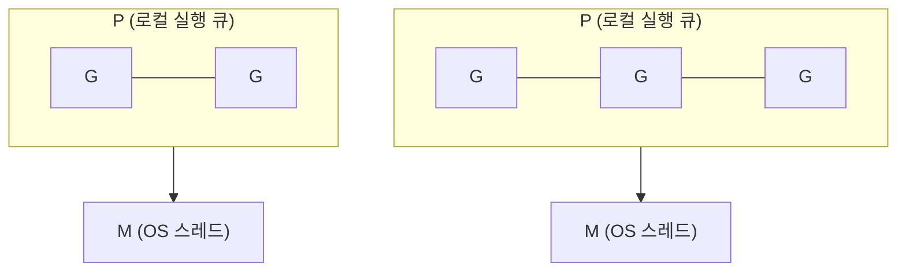

# 2024-01-02-TIL

## Today I Learned

### Spring Boot File Upload to S3

Spring Boot 서버에서 S3로 파일을 올리는 방법과, 올라간 뒤 후처리를 Lambda로 넘기는 구성을 모았다. 후처리 쪽의 기본 형태는 [Lambda 튜토리얼](https://docs.aws.amazon.com/lambda/latest/dg/with-s3-example.html)에 나온다. S3 버킷에 트리거를 설정해 두면 객체가 추가될 때마다 Lambda 함수가 실행되고, 이벤트로 버킷 이름과 객체 키를 받는다. 튜토리얼은 받은 객체의 형식을 CloudWatch Logs에 남기는 간단한 함수로 이 흐름을 보여 준다.

이렇게 나누면 업로드 API는 저장까지만 책임지고, 썸네일 생성이나 메타데이터 추출 같은 무거운 작업은 이벤트로 분리된다. 업로드 요청의 응답 시간이 후처리 시간에 묶이지 않고, 후처리가 실패해도 업로드 자체는 성공한 상태로 남는다. 대신 사용자에게 후처리 완료를 언제 보여 줄지는 별도로 설계해야 한다.

- https://techblog.woowahan.com/11392/
- https://awstip.com/s3-upload-lambda-trigger-5afd9e9be819
- https://blog.naver.com/demonic3540/221635831475
- https://docs.aws.amazon.com/lambda/latest/dg/with-s3-example.html
- https://medium.com/geekculture/how-to-upload-file-to-s3-using-python-aws-lambda-9aa03bb2c752

---

### Golang Concurrency Model: Goroutines

고루틴은 Go 런타임이 관리하는 가벼운 실행 단위다. [Effective Go](https://go.dev/doc/effective_go)에 따르면 고루틴 하나의 비용은 스택 공간 할당 정도이고, 스택은 작게 시작해 필요할 때 늘어난다. 고루틴은 여러 OS 스레드에 다중화되어, 하나가 I/O로 막혀도 나머지는 계속 실행된다.

이 배치를 맡는 것이 런타임 스케줄러다. [Go 1.21 런타임 소스(`proc.go`)](https://github.com/golang/go/blob/go1.21.0/src/runtime/proc.go)의 첫 주석은 스케줄러의 일을 실행 준비된 고루틴을 워커 스레드에 나눠 주는 것으로 정의하고, 세 개념을 소개한다.

- G: 고루틴
- M: 워커 스레드(machine), 즉 OS 스레드
- P: 프로세서. Go 코드를 실행하는 데 필요한 자원이다. M은 P를 가져야 Go 코드를 실행할 수 있고, 시스템 콜로 막혀 있을 때는 P 없이 있을 수 있다.



P의 개수가 `GOMAXPROCS`이고, 각 P는 실행할 고루틴의 로컬 큐를 가진다. 같은 파일에서 일이 없는 P가 다른 P의 일을 가져오는(`stealWork`) 코드도 볼 수 있다. M이 시스템 콜로 막히면 P를 내려놓아 다른 M이 그 P의 고루틴을 이어서 실행하므로, 블로킹 호출 하나가 다른 고루틴까지 멈추지 않는다. 오래 실행되는 고루틴이 스레드를 독점하는 문제는 [A Journey With Go 글](https://medium.com/a-journey-with-go/go-goroutine-and-preemption-d6bc2aa2f4b7)이 다루는데, 글 머리의 안내대로 Go 1.14에서 비동기 선점(asynchronous preemption)이 들어와 일부 내용은 그 이전 기준이다.

- https://www.linkedin.com/pulse/internal-workings-gos-concurrency-model-david-solis
- https://osmh.dev/posts/goroutines-under-the-hood
- https://www.reddit.com/r/golang/comments/15z6or7/a_blog_showing_internals_of_how_goroutines_work/
- https://levelup.gitconnected.com/understanding-goroutines-6b1c4bc463df
- https://medium.com/a-journey-with-go/go-goroutine-and-preemption-d6bc2aa2f4b7
- https://velog.io/@khsb2012/go-goroutine
- https://gobyexample.com/goroutines
- https://www.educative.io/answers/what-is-a-goroutine
- https://www.linkedin.com/pulse/concurrency-patterns-go-part-2-miah-md-shahjahan
- https://betterprogramming.pub/deep-dive-into-concurrency-of-go-93002344d37b
- https://appliedgo.com/courses/concurrency
- https://levelup.gitconnected.com/goroutine-scheduler-revealed-youll-never-see-goroutines-the-same-way-again-3c159b01c25a
- https://velog.io/@ymlee3218/Goroutine-%EB%8F%99%EC%9E%91-%EB%B0%A9%EC%8B%9D
- https://dev.to/ankitmalikg/goroutine-vs-os-thread-3aae
- https://ykarma1996.tistory.com/188
- https://velog.io/@khsb2012/go-goroutine
- https://ssup2.github.io/theory_analysis/Golang_Goroutine_Scheduling/

---

### Kotlin Coroutines

[Kotlin 공식 문서](https://kotlinlang.org/docs/coroutines-overview.html)는 코루틴을 스레드의 가벼운 대안으로 소개한다. 핵심은 `suspend` 함수다. `suspend`가 붙은 함수는 스레드를 막지 않고 실행을 멈췄다가 다시 이어 갈 수 있어서, 비동기 코드를 순차 코드처럼 쓸 수 있다. 코루틴은 `kotlinx.coroutines` 라이브러리의 `launch`나 `async` 같은 빌더로 `CoroutineScope` 안에서 시작하고, 스코프가 그 안에서 시작된 코루틴의 수명을 관리한다(구조화된 동시성).

```kotlin
suspend fun fetchUser(id: Long): User = userApi.get(id) // 스레드를 막지 않고 중단

fun main() = runBlocking {
    val a = async { fetchUser(1) }
    val b = async { fetchUser(2) }
    println(listOf(a.await(), b.await()))
}
```

고루틴과 비교하면 출발점이 다르다. 고루틴은 런타임이 모든 함수를 선점·스케줄링하므로 함수에 표시가 필요 없지만, 코틀린 코루틴은 중단 가능한 지점을 `suspend`로 명시하고 컴파일러가 이를 변환한다. 그래서 코루틴 안에서 블로킹 I/O를 하는 일반 함수를 부르면 스레드가 그대로 막히고, 이런 호출은 `Dispatchers.IO` 같은 별도 디스패처로 보내야 한다.

- https://medium.com/@vijaychutty/network-call-with-kotlin-coroutines-85e9821416dd
- https://www.stefankreidel.io/blog/kotlin-coroutines-async
- https://myungpyo.medium.com/deep-dive-into-coroutine-flow-1-d33f3b08928d
- https://www.droidcon.com/2022/09/22/design-of-kotlin-coroutines/
- https://proandroiddev.com/kotlin-coroutines-in-andriod-ff0b3b399fa0
- https://silica.io/understanding-kotlin-coroutines/
- https://theboreddev.com/understanding-kotlin-coroutines/
- https://www.oreilly.com/library/view/go-building-web/9781787123496/ch19s03.html
- https://medium.com/@asadawadia/parallel-requests-in-kotlin-vs-golang-72fc8a8fead7
- https://thecontentauthority.com/blog/goroutine-vs-coroutine

---

### Green Thread

[그린 스레드](https://en.wikipedia.org/wiki/Green_thread)는 운영체제가 아니라 런타임 라이브러리나 가상 머신이 스케줄링하는 스레드다. 이름은 초기 Java의 스레드 라이브러리에서 왔고, Java는 1.3에서 그린 스레드를 버리고 네이티브 스레드로 옮겼다. 위키백과는 그 이유가 된 한계를 두 가지로 정리한다. 멀티코어에서 네이티브 스레드는 작업을 여러 프로세서에 나눌 수 있지만 그린 스레드는 보통 그러지 못한다. 또 그린 스레드 하나가 블로킹 시스템 콜을 하면 프로세스 안의 모든 스레드가 함께 막히므로, 논블로킹이나 비동기 I/O를 써야 한다.

고루틴과 Java의 가상 스레드는 이 한계를 푼 후손에 가깝다. 사용자 수준 스레드를 여러 OS 스레드 위에 배치하는 M:N 구조로 멀티코어를 쓰고, 블로킹 호출이 생기면 실행 단위를 OS 스레드에서 떼어 내거나 스레드를 보충한다. 위키백과도 가상 스레드가 블로킹 호출 시 가능하면 캐리어 스레드에서 내려오고, 그렇지 못하면 플랫폼 스레드 수를 늘려 보완한다고 설명한다.

- https://en.wikipedia.org/wiki/Green_thread

---

### 검색할 때 유용한 수식어구

~ Documentation, ~ Docs 이렇게 검색하면 특정 기술의 공식 문서가 최상단에 나온다.
~ Tutorial 라고 검색하면 특정 기술의 기본 사용법에 대한 글을 찾을 수 있다.
~ Best Practices 라고 검색하면 특정 기술의 적용 방법을 아주 상세하면서도 합리적으로 제시하는 글이 많이 보인다.
~ Deep Dive, ~ Internals, ~ Architecture 와 같은 검색으로 특정 기술의 내부 구조나 상세한 설명을 찾을 수 있다.

