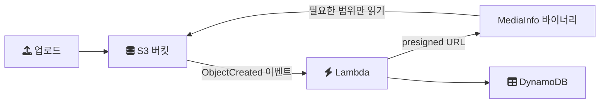

# 2024-01-04-TIL

## Today I Learned

### Extracting Video Metadata using Lambda and Mediainfo

업로드된 영상의 코덱, 해상도, 재생 시간, 비트레이트 같은 기술 메타데이터를 서버리스로 추출하는 방법을 정리한다. 핵심 도구는 MediaInfo로, 미디어 파일의 컨테이너와 스트림 정보를 읽어 XML이나 JSON으로 출력하는 오픈소스 CLI다.

AWS Compute 블로그의 구성은 다음과 같다.

- MediaInfo를 Amazon Linux에서 `--with-libcurl` 옵션으로 정적 바이너리로 빌드해 Lambda 배포 패키지에 함께 넣는다. 외부 의존성이 없으므로 Lambda 런타임에서 그대로 실행된다.
- S3 버킷에 `s3:ObjectCreated:*` 이벤트 알림을 걸어 파일이 올라오면 Lambda가 호출된다.
- Lambda는 파일을 내려받지 않고 S3 presigned URL을 만들어 MediaInfo에 넘긴다. curl 지원 덕분에 MediaInfo가 메타데이터 해석에 필요한 부분만 HTTP로 읽는다.
- 추출한 XML은 객체 키를 해시 키로 하는 DynamoDB 테이블에 저장한다.

파일 전체를 Lambda의 임시 스토리지로 받지 않는다는 점이 이 구조의 요점이다. 큰 영상도 메모리와 실행 시간을 적게 쓰면서 처리할 수 있다. Media 블로그의 후속 글은 같은 구성을 AWS SAM 템플릿으로 배포하는 방법을, dev.to 글은 반대로 Lambda로 이미지나 영상의 메타데이터를 제거해 개인정보를 지우는 용도를 다룬다. S3 이벤트로 Lambda를 트리거하는 기본 설정은 마지막 Medium 글에 단계별로 나와 있다.

참고

- [Running MediaInfo as an AWS Lambda function](https://aws.amazon.com/ko/blogs/media/running-mediainfo-as-an-aws-lambda-function/)
- [Extracting Video Metadata using Lambda and Mediainfo](https://aws.amazon.com/ko/blogs/compute/extracting-video-metadata-using-lambda-and-mediainfo/)
- https://www.linkedin.com/pulse/serverless-little-helper-aws-lambda-mediainfo-thomas-pister
- [Leverage AWS Serverless Application Model to run MediaInfo at scale](https://aws.amazon.com/ko/blogs/media/leverage-aws-serverless-application-model-to-run-mediainfo-at-scale/)
- https://dev.to/aws-builders/secure-your-media-files-by-removing-metadata-with-aws-lambda-1hkp
- https://medium.com/codex/invoke-lambda-function-when-we-upload-data-into-s3-bucket-part-1-e1e5a0081ecd

### Software Architecture Model: C4 Model

C4 모델은 Simon Brown이 제안한 소프트웨어 아키텍처 시각화 방법이다. 지도를 확대하듯 추상화 수준을 나눠 같은 시스템을 네 단계의 다이어그램으로 그린다.

1. System Context: 대상 시스템과 그 시스템을 사용하는 사람, 연동하는 외부 시스템의 관계
2. Container: 시스템을 이루는 실행 단위. 웹 애플리케이션, API 서버, 데이터베이스, 메시지 큐처럼 따로 배포되고 실행되는 것
3. Component: 하나의 컨테이너 내부를 구성하는 주요 모듈과 책임
4. Code: 컴포넌트의 구현 수준. 클래스 다이어그램 등으로 표현하며, 보통 필요할 때만 그린다

여기서 Container는 Docker 컨테이너가 아니라 "독립적으로 실행되는 애플리케이션이나 데이터 저장소"라는 뜻이다. 참고 링크에 SwiftData의 `ModelContainer`나 출판 분야의 context와 container 비교 글이 함께 있는데, container라는 말이 분야마다 다른 뜻으로 쓰이므로 C4에서의 의미를 따로 구분해 두어야 한다.

C4 공식 사이트는 이 모델이 특정 표기법이나 도구에 묶이지 않는다고 설명한다. UML처럼 엄격한 표기 규칙 대신 상자와 선, 그리고 각 요소의 이름, 기술, 책임을 적는 방식을 권한다. 네 가지 핵심 다이어그램 외에 System Landscape, Dynamic, Deployment 다이어그램을 보조로 둔다.

같은 묶음의 나머지 글은 아키텍처 모델 전반과 아키텍처 스타일과 패턴의 구분을 다룬다. 해당 Medium 글은 스타일을 시스템 요소와 상호작용을 설명하는 공통 어휘와 제약(마이크로서비스, 계층형, 이벤트 기반 등)으로, 패턴을 그 어휘를 사용해 구체적인 기능 또는 비기능 문제를 푸는 해법으로 구분한다.

참고

- [C4 model](https://c4model.com/)
- https://codime.medium.com/a-quick-guide-to-the-c4-architecture-model-d9a06923dae1
- https://www.cinimex.ru/en/solutions/the-c4-software-architecture-model/
- https://www.hackingwithswift.com/quick-start/swiftdata/whats-the-difference-between-modelcontainer-modelcontext-and-modelconfiguration
- https://embeddeduse.com/2022/07/11/visualising-the-architecture-of-qt-embedded-systems-context-and-container-diagrams/
- https://magellanmediapartners.com/publishing-innovation/context_vs_container/
- [C4 model - Wikipedia](https://en.wikipedia.org/wiki/C4_model)
- https://www.tutorialspoint.com/software_architecture_design/architecture_models.htm
- https://medium.com/@publicapplicationcenter/tutorial-notes-software-architecture-models-6207edeeb0bb
- https://medium.com/@ali.gelenler/architectural-styles-vs-architectural-patterns-7fab51713470
- https://medium.com/@yusufalikync/system-design-interview-study-notes-i-bdcecc2bac10

## Today I Studied

### 다음 스터디 아이디어

Golang으로 각자 토이 프로젝트 주제를 선정하고, 목표는 각 프로젝트의 완성을 목표로 한다. 그리고 매주 본인의 프로젝트 진행사항을 공유하면서 코드리뷰를 한다.

CodeCrafters에서 Golang으로 특정 주제에 대해서 각자의 깃 레포지토리에서 진행한다.
- https://app.codecrafters.io/catalog

CodeCrafters는 Redis, Git, SQLite, HTTP 서버, DNS 서버 같은 도구를 직접 구현해 보는 챌린지를 단계별로 제공한다. 각 단계마다 테스트가 주어지고, 자신의 Git 저장소에 push하면 테스트가 실행되는 방식이라 각자 저장소에서 진행하고 코드 리뷰를 하는 스터디 형식과 잘 맞는다. Go도 지원 언어 트랙 중 하나다.

### Side Projects with Go

Go로 만들 만한 토이 프로젝트 주제를 모은 링크다. 스터디 주제를 고를 때의 기준은 표준 라이브러리만으로 시작할 수 있는가이다. Go 표준 라이브러리에는 HTTP 서버와 클라이언트(`net/http`), JSON 인코딩(`encoding/json`), CLI 플래그 처리(`flag`)가 들어 있고, 동시성은 언어 차원의 고루틴과 채널로 다룬다. 그래서 작은 CLI 도구나 API 서버, 네트워크 서버처럼 외부 프레임워크 없이 언어의 핵심 기능을 고루 써 보는 주제가 첫 프로젝트로 적당하다.

- https://blog.goorm.io/commit_7th_sketch/
- https://www.youtube.com/watch?v=h6diXgf2Sq0
- https://medium.com/javarevisited/10-projects-you-can-build-to-learn-golang-in-2023-ca48a8de8714
- https://www.reddit.com/r/golang/comments/ojjgum/what_are_some_good_project_ideas_for_a_go_beginner/
- https://www.codeavail.com/blog/golang-project-ideas/
- https://codersdaily.in/blog/top-10-golang-project-ideas-in-2023
