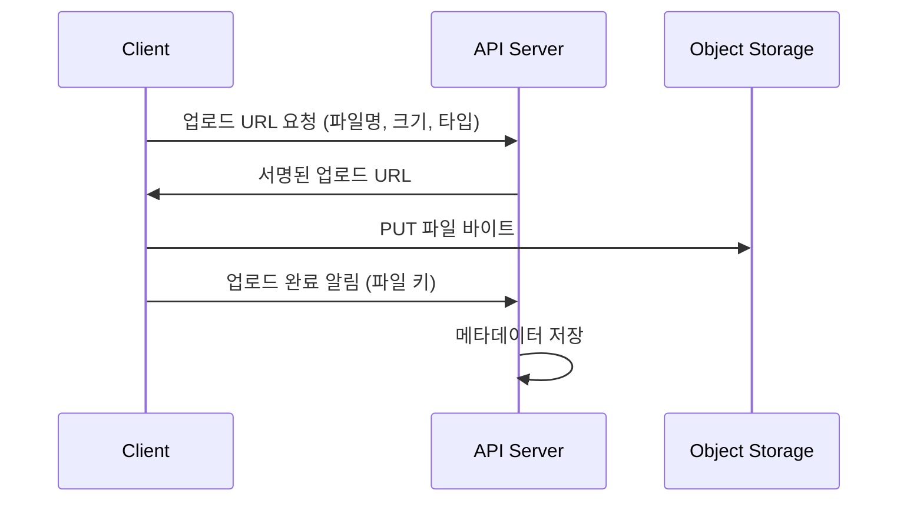

# 2024-02-28-TIL

## Today I Learned

### File Upload API

REST API에서 파일 업로드를 어떻게 설계할지, 여러 서비스의 공개 API 문서를 비교하며 정리한다. 서비스마다 세부는 다르지만 방식은 크게 세 가지로 묶인다.

#### 서버가 직접 받는 방식

클라이언트가 `multipart/form-data`로 파일과 메타데이터를 함께 보내고, API 서버가 받아 스토리지에 저장한다. 구현이 단순하고 서버가 파일을 검사하거나 변환하기 쉽다. 대신 파일 바이트가 모두 API 서버를 거치므로 큰 파일이 많으면 서버의 대역폭, 메모리, 요청 타임아웃이 병목이 된다. ImageKit, Cloudinary의 업로드 API가 이 형태에 가깝다.

또 하나의 선택지는 파일과 메타데이터를 분리하는 것이다. 먼저 파일만 업로드해 식별자를 받고, 이후 리소스 생성 요청에서 그 식별자를 참조한다. Stack Overflow의 해당 질문에서 가장 많은 추천을 받은 답변이 이 방식으로, 이미지를 선택하는 즉시 별도 엔드포인트로 업로드를 시작하고 나중에 리소스와 연결한다. 다른 답변은 이미지를 독립 리소스(`/image`)로 둘지 사용자 하위 리소스(`/user/:id/image`)로 둘지, 표현을 Base64 JSON으로 할지 multipart로 할지를 결정 항목으로 정리한다. 메타데이터 API는 JSON만 주고받는 일반 REST로 유지할 수 있다는 장점이 있다.

#### 스토리지에 직접 올리는 방식 (presigned URL)

서버는 업로드할 위치와 권한만 발급하고, 실제 파일은 클라이언트가 스토리지에 직접 올린다. Wix Media Manager의 Generate File Upload URL처럼 업로드 URL을 먼저 받는 API가 이 방식이다. S3에서는 presigned URL로 같은 구조를 만든다.

API 서버가 파일 바이트를 다루지 않으므로 확장성이 좋다. 대신 업로드 완료 확인, 서명 URL의 유효 시간, 허용할 Content-Type과 크기 제한을 별도로 챙겨야 한다.

#### 큰 파일을 나눠 올리는 방식 (resumable, multipart)

큰 파일은 한 번의 요청으로 보내다 끊기면 처음부터 다시 보내야 한다. 그래서 대형 서비스들은 업로드 세션을 열고 조각 단위로 보내는 API를 둔다.

- Google Drive API는 `uploadType`을 `media`(메타데이터 없는 작은 파일), `multipart`(작은 파일과 메타데이터를 한 요청에), `resumable`(큰 파일이나 끊길 수 있는 환경)로 구분한다. resumable 업로드는 먼저 세션 URI를 받고, 연결이 끊기면 마지막으로 받은 바이트부터 이어서 보낸다.
- Twitter v1 미디어 업로드 API는 한 번에 올리는 단순 업로드와 함께, INIT, APPEND, FINALIZE 단계로 조각을 이어 붙이는 chunked 업로드를 제공한다.
- Amazon S3는 한 번의 PUT으로 최대 5GB까지 올릴 수 있고, 더 큰 객체는 multipart upload로 파트를 독립적으로, 병렬로 올린 뒤 완료 요청으로 합친다.
- Google Cloud Storage XML API도 단일 PUT 업로드를 제공한다.

#### 설계할 때 정리할 점

- 엔드포인트 이름은 동사 대신 리소스로 짓는다(`POST /files`, `POST /users/{id}/avatar`). freeCodeCamp의 REST 엔드포인트 설계 글이 이 원칙을 정리한다.
- 업로드 요청에는 크기와 MIME 타입 제한을 두고, 확장자만 믿지 말고 서버나 후처리 단계에서 실제 내용을 검증한다.
- 업로드 결과로 파일 식별자와 접근 URL을 돌려주고, 파일 메타데이터(소유자, 크기, 타입, 상태)를 DB에 따로 관리한다.
- 파일 크기 분포를 보고 단일 요청, presigned URL, 분할 업로드 중 무엇을 기본으로 할지 정한다.

참고

- https://stackoverflow.com/questions/33279153/rest-api-file-ie-images-processing-best-practices
- https://www.saurabhmisra.dev/file-uploads-rest-api/
- https://i8c.be/2020/04/03/design-of-a-file-upload-api/
- https://docs.imagekit.io/api-reference/upload-file-api
- https://developers.notion.com/docs/working-with-files-and-media
- https://cloudinary.com/documentation/upload_images
- https://developer.twitter.com/en/docs/twitter-api/v1/media/upload-media/api-reference/post-media-upload
- https://dev.wix.com/docs/rest/api-reference/media/media-manager/upload-api
- https://dev.wix.com/docs/rest/api-reference/media/media-manager/files/generate-file-upload-url
- [Google Drive API: 파일 데이터 업로드](https://developers.google.com/drive/api/guides/manage-uploads?hl=ko)
- https://developers.google.com/android-publisher/upload?hl=ko
- https://cloud.google.com/storage/docs/xml-api/put-object-upload
- https://www.rowy.io/blog/google-drive-api
- https://www.freecodecamp.org/news/rest-api-best-practices-rest-endpoint-design-examples/
- [Uploading objects - Amazon S3](https://docs.aws.amazon.com/AmazonS3/latest/userguide/upload-objects.html)

## AI 키워드

2024년 2월 15일 OpenAI가 텍스트로 최대 1분 길이의 영상을 생성하는 모델 Sora를 공개했다. 같은 날 Google DeepMind는 최대 100만 토큰의 컨텍스트 윈도를 지원하는 Gemini 1.5를 발표했다. 출처는 Wikipedia의 2024 in artificial intelligence 항목과 각 회사의 발표 글이다.
