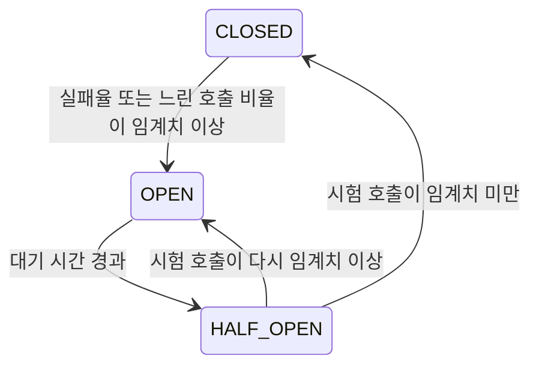

# 2024-03-20-TIL

## Today I Learned

### RabbitMQ vs SQS vs Kafka

RabbitMQ의 EOS가 빈번하게 이루어지면서 다른 큐 서비스로 전환을 할 수 있을지 조사 해보았다. RabbitMQ의 기능과 가장 유사한 큐가 SQS인데, SQS의 성능이 생각보다 많이 떨어져서 쉽지 않을것 같다.

세 가지는 모두 메시지를 비동기로 전달하지만 모델이 다르다.

| 구분 | RabbitMQ | Amazon SQS | Apache Kafka |
| --- | --- | --- | --- |
| 모델 | 메시지 브로커(큐) | 완전 관리형 큐 | 분산 커밋 로그 |
| 라우팅 | exchange와 binding으로 유연하게 라우팅 | 큐 단위, 팬아웃은 SNS와 조합 | 토픽과 파티션 |
| 소비 후 메시지 | ack하면 큐에서 제거 | 삭제 요청 시 제거 | 보존 기간 동안 로그에 남고 오프셋으로 재처리 가능 |
| 순서 | 큐 단위 순서 | Standard는 best-effort, FIFO는 메시지 그룹 내 순서 보장 | 파티션 내 순서 보장 |
| 운영 | 직접 운영하거나 관리형 서비스 사용 | 서버 운영 없음 | 직접 운영하거나 관리형 서비스 사용 |

RabbitMQ에서 SQS로 옮길 때 걸리는 지점은 다음과 같다.

- 라우팅: RabbitMQ의 topic, direct, fanout exchange로 하던 라우팅을 SQS 단독으로는 표현할 수 없어서, SNS 토픽과 구독 필터를 조합해야 한다.
- 전달 보장: SQS Standard 큐는 at-least-once 전달이라 같은 메시지가 두 번 올 수 있고 순서도 보장하지 않는다. 소비자는 멱등하게 만들어야 한다. FIFO 큐는 중복 제거와 메시지 그룹 내 순서를 제공하지만, AWS 문서 기준으로 API 호출 수에 처리량 한도가 있다.
- 소비 방식: RabbitMQ는 브로커가 소비자에게 메시지를 push하지만, SQS는 소비자가 `ReceiveMessage`로 가져가는 pull 방식이다. 처리 중인 메시지는 visibility timeout 동안 다른 소비자에게 보이지 않는다.

Kafka는 메시지를 지우지 않고 로그로 보존하기 때문에, 이벤트 스트리밍이나 재처리가 필요한 경우에 맞고, 작업 큐처럼 메시지 하나를 한 번 처리하고 끝내는 용도라면 RabbitMQ나 SQS가 더 단순하다.

참고

- https://habr.com/en/articles/716182/
- https://www.aspecto.io/blog/kafka-vs-rabbitmq-vs-aws-sns-sqs-which-broker-to-choose/
- https://yoonbing9.tistory.com/130w
- https://medium.com/systemdesign-us-blog/kafka-vs-rabbitmq-vs-sqs-70d1bfefa274
- [Amazon SQS queue types](https://docs.aws.amazon.com/AWSSimpleQueueService/latest/SQSDeveloperGuide/sqs-queue-types.html)

### Circuit Breaker Pattern

Circuit Breaker는 장애가 난 외부 서비스로 호출을 계속 보내지 않도록 차단하는 패턴이다. 전기 회로의 차단기처럼 실패가 일정 비율을 넘으면 회로를 열어 호출을 즉시 실패시키고, 일정 시간이 지나면 일부 호출만 흘려 보내 복구 여부를 확인한다.



Resilience4j 문서 기준으로 CLOSED 상태에서는 모든 호출을 허용하면서 결과를 슬라이딩 윈도(최근 N건 기준 또는 최근 N초 기준)에 기록한다. 최소 호출 수 이상이 쌓인 뒤 실패율이나 느린 호출 비율이 임계치를 넘으면 OPEN으로 바뀌고, 이때 호출은 `CallNotPermittedException`으로 바로 거절된다. 대기 시간이 지나면 HALF_OPEN에서 정해진 수의 호출만 허용해 결과를 보고 CLOSED나 OPEN으로 돌아간다.

Retry가 일시적 오류를 넘기기 위한 장치라면, Circuit Breaker는 오래가는 장애에서 재시도가 부하를 키우지 않도록 빨리 실패시키는 장치다. 둘은 보통 함께 쓴다.

참고

- https://mangkyu.tistory.com/261
- [CircuitBreaker - Resilience4j](https://resilience4j.readme.io/docs/circuitbreaker)

### TCP Syn Retry

TCP 연결을 맺을 때 클라이언트가 보낸 SYN에 응답이 없으면 커널이 SYN을 재전송한다. 재전송 간격은 매번 두 배로 늘어나는데, TCP 수준에서 이미 지수 backoff가 동작하는 셈이다. Linux에서는 `net.ipv4.tcp_syn_retries`가 재전송 횟수를 정한다. 커널 문서 ip-sysctl 기준으로 기본값은 6이고, 초기 RTO 1초에서 시작하면 마지막 재전송까지 63초, 연결 시도가 최종 실패하기까지 127초가 걸린다.

애플리케이션에서 connect timeout을 따로 주지 않으면 서버가 응답하지 않을 때 이 시간만큼 기다릴 수 있다. 그래서 HTTP 클라이언트나 DB 드라이버에서는 connect timeout을 명시적으로 짧게 두는 것이 일반적이다.

```sh
sysctl net.ipv4.tcp_syn_retries
```

참고

- https://medium.com/@avocadi/tcp-syn-retries-f30756ec7c55
- [ip-sysctl - Linux kernel documentation](https://www.kernel.org/doc/Documentation/networking/ip-sysctl.txt)

### Retry and Backoff Pattern

재시도 간격을 지수적으로 늘리고(exponential backoff) 무작위 값을 섞는(jitter) 패턴이다. AWS 아키텍처 블로그의 Exponential Backoff And Jitter는 jitter가 없으면 같은 시점에 실패한 클라이언트들이 같은 시점에 다시 몰리고, 대기 구간 전체에서 무작위로 고르는 Full Jitter(`random(0, min(cap, base * 2^attempt))`)가 전체 작업량을 가장 적게 쓴다고 정리한다.

AWS SDK도 같은 원리로 재시도한다. SDK 레퍼런스 가이드는 `standard`, `adaptive`, `legacy` 재시도 모드를 설명하는데, standard 모드는 jitter를 섞은 지수 backoff와 재시도 횟수를 제한하는 retry quota를 쓰고, adaptive 모드는 여기에 클라이언트 측 속도 제한을 더해 스로틀링 응답이 오면 요청 속도 자체를 낮춘다. 최대 시도 횟수는 `AWS_MAX_ATTEMPTS`나 설정 파일의 `max_attempts`로 바꾼다. 재시도 대상은 반드시 멱등해야 한다는 점은 어디서나 같다.

참고

- [Retry with backoff pattern - AWS Prescriptive Guidance](https://docs.aws.amazon.com/prescriptive-guidance/latest/cloud-design-patterns/retry-backoff.html)
- https://medium.com/@banavalikar/retry-with-exponential-backoff-using-aws-lambda-1b054e55fb60
- [Exponential Backoff And Jitter](https://aws.amazon.com/ko/blogs/architecture/exponential-backoff-and-jitter/)
- [Retry behavior - AWS SDKs and Tools Reference Guide](https://docs.aws.amazon.com/sdkref/latest/guide/feature-retry-behavior.html)
