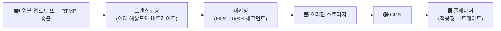

# 2024-05-02-TIL

## Today I Learned

음악과 영상 스트리밍 서비스가 어떤 구조로 만들어지는지, 그리고 그 아래에서 쓰이는 프로토콜과 아키텍처 패턴을 정리한다.

### Music App System Design

음악 스트리밍 서비스를 설계할 때는 크게 두 가지 데이터 흐름을 나눠 본다. 하나는 곡, 앨범, 아티스트, 플레이리스트 같은 메타데이터로, 일반적인 API 서버와 데이터베이스가 다룬다. 다른 하나는 오디오 파일 자체로, 크기가 크고 읽기 위주이므로 오브젝트 스토리지에 두고 CDN을 통해 내려보낸다. 재생은 파일 전체를 받는 대신 조각 단위로 받아 바로 재생하고, 네트워크 상태에 따라 비트레이트를 바꿀 수 있게 여러 품질로 미리 인코딩해 둔다. 재생 기록은 추천, 차트, 그리고 권리자 정산의 기초 데이터가 되므로 별도 이벤트로 수집한다.

나머지 두 글은 기술 구조보다 음악 스트리밍 산업의 흐름과 시장 변화를 다룬다.

### Live Streaming Protocol

라이브 스트리밍은 보통 송출(ingest)과 전달(delivery) 구간에서 다른 프로토콜을 쓴다. 방송자의 인코더가 미디어 서버로 영상을 보내는 구간과, 서버가 수많은 시청자에게 나눠 주는 구간의 요구 사항이 다르기 때문이다.

| 프로토콜 | 주 용도 | 특징 |
| --- | --- | --- |
| RTMP | 송출 | Adobe가 만든 TCP 기반 프로토콜. Flash 재생은 사라졌지만 인코더에서 서버로 보내는 용도로 여전히 널리 쓰인다 |
| RTSP | 송출, IP 카메라 | 감시 카메라 시스템에서 표준처럼 쓰이지만 브라우저 재생 지원은 약하다 |
| SRT | 송출, 배포 | UDP 기반 오픈소스 프로토콜. 손실 패킷을 복구해 불안정한 네트워크에서도 안정적으로 보낸다 |
| HLS | 전달 | Apple이 만든 HTTP 기반 적응형 비트레이트 스트리밍. 기기 지원이 가장 넓다 |
| MPEG-DASH | 전달 | 특정 회사에 종속되지 않는 HTTP 기반 적응형 스트리밍 표준 |
| WebRTC | 양방향 실시간 | 브라우저에 내장된 UDP 기반 기술. 지연이 가장 짧지만 대규모 시청자에게 뿌리기는 어렵다 |

HLS와 DASH는 영상을 몇 초 단위의 세그먼트 파일로 나누고, 세그먼트 목록을 담은 매니페스트(HLS는 `.m3u8`)를 클라이언트가 주기적으로 받아 가는 방식이다. 평범한 HTTP 파일이므로 CDN 캐시를 그대로 활용할 수 있다는 것이 가장 큰 장점이고, 세그먼트를 쌓아 두고 재생하는 구조 때문에 지연이 길어진다는 것이 단점이다. Wowza의 정리에 따르면 일반 HLS와 DASH의 지연은 수 초에서 수십 초 범위이고, 이를 줄이기 위해 Low-Latency HLS 같은 확장이 나왔다. 그래서 대규모 라이브 서비스는 송출을 RTMP나 SRT로 받고, 시청자에게는 HLS나 DASH로 전달하는 조합을 흔히 쓴다.

### Video Streaming Service Architecture

영상 스트리밍 서비스의 처리 흐름은 대략 다음과 같다.

트랜스코딩은 연산 비용이 가장 큰 단계라 작업 큐와 워커로 수평 확장하는 구조가 일반적이다. 플레이어는 대역폭을 측정해 세그먼트마다 다른 품질을 고르므로(adaptive bitrate), 서버는 같은 영상을 여러 품질로 준비해 두어야 한다. 시청 트래픽의 대부분은 CDN이 받아 내고 오리진은 캐시 미스만 처리한다. 라이브 서비스라면 여기에 업로드 대신 실시간 송출을 받는 단계가 붙고, 세그먼트를 만드는 즉시 내보내야 하므로 지연 시간이 추가 설계 대상이 된다.

### Open Source Alternatives to Twitch

직접 운영할 수 있는 라이브 스트리밍 플랫폼의 예다. Owncast는 자기 서버에서 실행하는 무료 오픈소스 라이브 스트리밍 서버로, RTMP 같은 표준 프로토콜로 송출을 받고 채팅과 모더레이션 기능을 내장한다. 앞에서 정리한 RTMP 송출과 HLS 전달 구조를 작은 규모로 직접 확인해 볼 수 있는 구현이기도 하다.

### Pipeline Architecture

파이프라인 아키텍처는 처리를 여러 단계(filter)로 나누고, 각 단계의 출력을 다음 단계의 입력으로 연결(pipe)하는 구조다. Unix 셸의 `cat log | grep ERROR | sort | uniq -c`가 대표적인 예다. 각 단계는 입력과 출력 형식만 맞추면 서로를 몰라도 되므로 독립적으로 교체하거나 재사용할 수 있고, 단계별로 병렬화하거나 확장하기도 쉽다. 위의 영상 처리 흐름(트랜스코딩, 패키징, 배포)도 같은 구조로 볼 수 있다.

단점은 단계 간 데이터 변환 비용이 들고, 한 단계가 느리면 전체 처리량이 그 단계에 묶인다는 것이다. 단계 사이에 큐를 두면 속도 차이를 흡수할 수 있지만 지연과 운영 복잡도가 늘어난다.

### gRPC vs REST

AWS의 비교 문서 기준으로 정리하면 다음과 같다.

| 구분 | gRPC | REST |
| --- | --- | --- |
| 전송 | HTTP/2 | 주로 HTTP/1.1 |
| 데이터 형식 | Protocol Buffers(바이너리) | 주로 JSON(텍스트) |
| 통신 방식 | 단항 호출과 클라이언트, 서버, 양방향 스트리밍 | 요청 하나에 응답 하나 |
| 결합도 | 클라이언트와 서버가 같은 `.proto` 정의를 공유 | 느슨함 |
| 코드 생성 | `protoc`로 기본 제공 | 별도 도구 필요 |
| 브라우저 | 직접 호출이 제한적 | 그대로 사용 |

그래서 gRPC는 내부 마이크로서비스 간 통신이나 스트리밍처럼 성능과 계약이 중요한 곳에, REST는 공개 API나 브라우저가 직접 호출하는 API에 주로 쓰인다.

## 참고

- [medium.com/@arorasagar1811/music-app-system-design-6eae57b0c41d](https://medium.com/@arorasagar1811/music-app-system-design-6eae57b0c41d) — Medium
- [How Music Streaming Works + 5 Key Trends](https://soundcharts.com/blog/how-music-streaming-works-trends) — soundcharts.com
- [medium.com/@alisaalexander/digital-music-streaming-disruption-or-innovation-73ef02aefffd](https://medium.com/@alisaalexander/digital-music-streaming-disruption-or-innovation-73ef02aefffd) — Medium
- [federicogianno.medium.com/streaming-secrets-a-comprehensive-look-at-twitch-tvs-technical-infrastructure-bbe3d5d81736](https://federicogianno.medium.com/streaming-secrets-a-comprehensive-look-at-twitch-tvs-technical-infrastructure-bbe3d5d81736) — Medium
- [kouzie.github.io/기타/Live-Streaming-Protocol/#](https://kouzie.github.io/%EA%B8%B0%ED%83%80/Live-Streaming-Protocol/#) — kouzie.github.io
- [Video Streaming Protocols - RTMP vs RTSP vs HLS vs WebRTC vs SRT which is best?](https://getstream.io/blog/streaming-protocols/) — getstream.io
- [cdnetworks.com/media-delivery-blog/video-streaming-protocols](https://www.cdnetworks.com/media-delivery-blog/video-streaming-protocols/) — cdnetworks.com
- [How to choose the best video streaming protocol for your application?](https://www.rst.software/blog/how-to-choose-the-best-video-streaming-protocol-for-your-application) — RST Software
- [Streaming Protocols](https://www.wowza.com/blog/streaming-protocols) — Wowza
- [Streaming Protocols Comparison](https://restream.io/blog/streaming-protocols/) — restream.io
- [RTSP: The Real-Time Streaming Protocol Explained](https://www.wowza.com/blog/rtsp-the-real-time-streaming-protocol-explained) — wowza.com
- [스트리밍 서비스 프로토콜 종류](https://idlecomputer.tistory.com/92) — Tistory
- [스트리밍이란](https://blog.daouidc.com/blog/cdn-streaming-0#:~:text=%EC%8A%A4%ED%8A%B8%EB%A6%AC%EB%B0%8D%EC%9D%80%20%EC%9D%8C%EC%9B%90%EC%9D%B4%EB%82%98%20%EC%98%81%EC%83%81,%EC%88%98%20%EC%9E%88%EB%8F%84%EB%A1%9D%20%ED%95%98%EB%8A%94%20%EA%B8%B0%EC%88%A0%EC%9E%85%EB%8B%88%EB%8B%A4.) — blog.daouidc.com
- [Architecture for a video streaming service](https://hygraph.com/blog/video-streaming-architecture) — hygraph.com
- [Designing a Scalable Architecture for Your Video Streaming App](https://www.mindbowser.com/how-to-build-a-scalable-video-streaming-app-architecture/) — mindbowser.com
- [csl.snu.ac.kr/papers/pdp15.pdf](http://csl.snu.ac.kr/papers/pdp15.pdf) — csl.snu.ac.kr
- [medium.com/@interviewready/designing-a-live-video-streaming-system-like-espn-14c8b3ff16c3](https://medium.com/@interviewready/designing-a-live-video-streaming-system-like-espn-14c8b3ff16c3) — Medium
- [Reddit](https://www.reddit.com/r/linux_gaming/comments/uylsw2/open_source_alternatives_to_twitch/) — Reddit
- [Play Free, Rental, and Premium Indie Games Online](https://www.glitch.fun/) — Glitch
- [Owncast](https://owncast.online/) — owncast.online
- [Odysee](https://odysee.com/) — odysee.com
- [Pipeline (software)](https://en.wikipedia.org/wiki/Pipeline_(software)) — Wikipedia
- [cs.sjsu.edu/~pearce/modules/patterns/distArch/pipeline.htm](https://www.cs.sjsu.edu/~pearce/modules/patterns/distArch/pipeline.htm) — cs.sjsu.edu
- [levelup.gitconnected.com/design-patterns-implementing-pipeline-design-pattern-824bd2d42bab](https://levelup.gitconnected.com/design-patterns-implementing-pipeline-design-pattern-824bd2d42bab) — levelup.gitconnected.com
- [Pipeline Architecture · Umair's Blog](https://umairsaeed.com/pipeline-architecture/) — umairsaeed.com
- [gRPC와 REST의 차이점](https://aws.amazon.com/ko/compare/the-difference-between-grpc-and-rest/) — AWS
