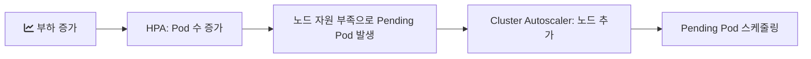

# 2024-05-24-TIL

## Today I Learned

Kubernetes와 EKS 운영에 필요한 개념을 워크로드, 오토스케일링, 배포, 관측성, 서비스 메시 순서로 정리한다. 전체 흐름은 아래 Kubernetes 정리 문서를 기준으로 보았다.

- https://whchoi98.gitbook.io/k8s

### Stateful vs Stateless

Stateless 서비스는 요청을 처리하는 데 필요한 상태를 서버 안에 두지 않는다. 어떤 인스턴스가 요청을 받아도 결과가 같으므로 인스턴스를 자유롭게 늘리고 줄이거나 교체할 수 있다. Stateful 서비스는 데이터베이스처럼 인스턴스가 자신의 데이터와 정체성을 유지해야 하고, 재시작 후에도 그 상태가 살아 있어야 한다. 컨테이너 환경에서는 애플리케이션을 가능한 한 stateless로 만들고 상태는 외부 저장소(DB, 캐시, 오브젝트 스토리지)로 빼는 것이 기본 방향이다.

- https://renovacloud.com/stateful-vs-stateless-architecture-overview/?lang=en#:~:text=The%20key%20difference%20between%20stateful,that%20will%20survive%20service%20restarts.
- https://www.redhat.com/en/topics/cloud-native-apps/stateful-vs-stateless
- https://inpa.tistory.com/entry/WEB-%F0%9F%93%9A-Stateful-Stateless-%EC%A0%95%EB%A6%AC

### ReplicaSet vs StatefulSet vs DaemonSet vs Deployments

| 리소스 | 역할 |
| --- | --- |
| ReplicaSet | 지정한 수의 동일한 Pod가 항상 떠 있도록 유지한다 |
| Deployment | ReplicaSet을 관리하며 롤링 업데이트와 롤백을 제공한다. stateless 앱의 기본 선택 |
| StatefulSet | Pod마다 고정된 이름(`db-0`, `db-1`)과 전용 PersistentVolume을 주고, 순서대로 생성하고 종료한다. DB, 메시지 브로커 같은 stateful 앱용 |
| DaemonSet | 모든 노드(또는 선택한 노드)에 Pod를 하나씩 띄운다. 로그 수집기, 모니터링 에이전트 같은 노드 단위 작업용 |

ReplicaSet을 직접 만드는 일은 드물고, 보통 Deployment가 업데이트할 때마다 새 ReplicaSet을 만들어 관리한다.

- https://semaphoreci.com/blog/replicaset-statefulset-daemonset-deployments
- https://medium.com/stakater/k8s-deployments-vs-statefulsets-vs-daemonsets-60582f0c62d4

### Ingress Controller

Ingress는 클러스터 외부의 HTTP(S) 요청을 호스트와 경로 규칙에 따라 내부 Service로 보내는 규칙을 정의하는 리소스다. 규칙만으로는 아무 일도 일어나지 않고, 그 규칙을 읽어 실제로 트래픽을 처리하는 Ingress Controller가 클러스터에 있어야 한다. Kubernetes 문서는 Ingress Controller가 다른 컨트롤러와 달리 클러스터와 함께 자동으로 시작되지 않는다고 설명한다. NGINX Ingress Controller나 EKS의 AWS Load Balancer Controller(Ingress마다 ALB를 생성)처럼 환경에 맞는 구현을 골라 설치한다.

- https://kubernetes.io/docs/concepts/services-networking/ingress-controllers/
- https://velog.io/@dojun527/%EC%BF%A0%EB%B2%84%EB%84%A4%ED%8B%B0%EC%8A%A4-%EC%9D%B8%EA%B7%B8%EB%A0%88%EC%8A%A4Ingress

### Helm

Helm은 Kubernetes용 패키지 매니저다. Helm 문서는 세 가지 개념으로 설명한다. Chart는 애플리케이션을 띄우는 데 필요한 리소스 정의를 템플릿으로 묶은 패키지, Repository는 차트를 모아 공유하는 저장소, Release는 차트를 클러스터에 설치한 하나의 인스턴스다. 같은 차트를 `values.yaml`만 바꿔 환경별로 여러 번 설치할 수 있고, `helm upgrade`와 `helm rollback`으로 릴리스 버전을 관리한다.

- https://helm.sh/ko/docs/intro/using_helm/
- https://coding-start.tistory.com/310

### Kubernetes Autoscaler: HPA, VPA, CA

Horizontal Pod Scaling(HPA), Vertical Pod Scaling(VPA)

Kubernetes의 오토스케일링은 세 층위로 나뉜다.

- HPA(Horizontal Pod Autoscaler): CPU 사용률 같은 지표를 보고 Deployment의 Pod 수를 늘리거나 줄인다.
- VPA(Vertical Pod Autoscaler): Pod의 CPU와 메모리 requests를 실제 사용량에 맞게 조정한다. 값을 바꾸려면 Pod를 다시 만들어야 하므로, 같은 지표로 HPA와 동시에 쓰면 서로 충돌할 수 있다.
- CA(Cluster Autoscaler): Pod를 더 띄울 노드 자원이 없을 때 노드 자체를 늘리고, 놀고 있는 노드를 줄인다.



KEDA는 큐 길이 같은 외부 이벤트 지표로 스케일링하는 도구로, Spectro Cloud 글에서 HPA, VPA와 함께 비교된다.

- https://kimjingo.tistory.com/166
- https://granulate.io/blog/kubernetes-how-it-works-hpa-vpa-7-best-practices/
- https://www.spectrocloud.com/blog/kubernetes-autoscaling-patterns-hpa-vpa-and-keda
- https://medium.com/@randhirthakur076/hpa-vs-vpa-horizontal-pod-scaling-vs-vertical-pod-scaling-4a75af87720a
- https://medium.com/tensult/cluster-autoscaler-ca-and-horizontal-pod-autoscaler-hpa-on-kubernetes-f25ba7fd00b9
- https://clarkshim.tistory.com/129

### Cluster Autoscaler

kubernetes/autoscaler 저장소에는 Cluster Autoscaler와 VPA가 함께 있다. Cluster Autoscaler FAQ에 따르면 주된 목적은 Pending 상태의 Pod가 실행될 자리를 마련하는 것이다. 주기적으로 스케줄되지 못한 Pod가 있는지 확인해 노드 그룹의 크기를 늘리고, 사용률이 낮고 그 위의 Pod를 다른 곳으로 옮길 수 있는 노드가 일정 시간 지속되면 그 노드를 제거한다. CPU 사용률이 아니라 스케줄 가능 여부를 기준으로 동작한다는 점이 HPA와 다르다.

- https://github.com/kubernetes/autoscaler

### RollingUpdate

Deployment의 기본 배포 전략은 `RollingUpdate`다. 새 ReplicaSet의 Pod를 조금씩 늘리면서 기존 ReplicaSet의 Pod를 줄여, 서비스를 멈추지 않고 버전을 교체한다. 다른 전략인 `Recreate`는 기존 Pod를 모두 종료한 뒤 새 Pod를 만든다.

속도는 두 값으로 조절한다. Kubernetes 문서 기준으로 둘 다 기본값은 25%다.

- `maxUnavailable`: 업데이트 중 사용할 수 없어도 되는 Pod의 최대 수(또는 비율)
- `maxSurge`: 원하는 replica 수를 넘어 추가로 띄울 수 있는 Pod의 최대 수(또는 비율)

```yaml
spec:
  strategy:
    type: RollingUpdate
    rollingUpdate:
      maxUnavailable: 25%
      maxSurge: 25%
```

새 Pod가 readiness probe를 통과해야 다음 단계로 넘어가므로 probe 설정이 롤링 업데이트의 안전성을 좌우한다. 문제가 생기면 `kubectl rollout undo deployment/<name>`으로 이전 리비전으로 되돌린다.

### AWS Karpenter vs Cluster Autoscaler

Cluster Autoscaler는 미리 정의한 노드 그룹(EKS에서는 Auto Scaling Group)의 크기를 조절한다. 그래서 노드 그룹마다 인스턴스 타입이 고정되고, 다양한 타입을 쓰려면 노드 그룹을 여러 개 만들어야 한다. Karpenter는 노드 그룹 없이 스케줄되지 못한 Pod의 요구 사항(CPU, 메모리, 아키텍처, 가용 영역 등)을 보고 맞는 인스턴스를 직접 골라 띄우고, 남는 노드를 합치는 consolidation 기능도 갖고 있다.

- https://medium.com/@deepeshjaiswal6734/difference-between-cluster-autoscaler-karpenter-7b5cc82ffb9b

### Creating EC2 Instance Using AWS APIs

EC2 인스턴스는 `RunInstances` API로 만든다. AMI ID, 인스턴스 타입, 서브넷, 보안 그룹, 키 페어 등을 파라미터로 넘기며, CLI의 `aws ec2 run-instances`나 각 언어 SDK도 결국 이 API를 호출한다. 앞의 Cluster Autoscaler나 Karpenter도 내부적으로는 이런 AWS API를 호출해 노드를 만든다.

- https://stackoverflow.com/questions/48264530/how-to-create-an-ec2-instance-using-aws-apis

### AWS X-Ray vs Datadog

AWS X-Ray는 요청이 여러 서비스를 거치는 경로를 추적하는 AWS의 분산 추적 서비스이고, Datadog은 메트릭, 로그, 트레이스, APM을 한 플랫폼에서 제공하는 상용 관측성 서비스다. X-Ray는 AWS 서비스와의 통합과 사용량 기반 과금이 장점이고, Datadog은 기능 범위와 대시보드 통합이 장점이지만 비용이 더 든다. 두 번째 글은 한 회사가 Datadog에서 X-Ray와 CloudWatch 조합으로 옮겨 가는 사례를 다룬다.

- https://www.peerspot.com/products/comparisons/aws-x-ray_vs_datadog
- https://medium.com/@kujtimii.h/how-devstride-is-moving-from-datadog-to-aws-x-ray-and-cloudwatch-for-observability-27b509df67c

### Monitoring, Logging, Tracing

관측성의 세 가지 축이다.

- Monitoring(메트릭): CPU, 응답 시간, 에러율처럼 시간에 따른 수치를 모아 상태를 보고 알람을 건다.
- Logging: 개별 이벤트의 상세 기록. 무슨 일이 있었는지를 사후에 확인한다.
- Tracing: 하나의 요청이 여러 서비스를 거치는 경로와 구간별 소요 시간을 추적한다. 마이크로서비스에서 어느 구간이 느린지 찾는 데 필요하다.

- https://www.bmc.com/blogs/monitoring-logging-tracing/

### ArgoCD

Argo CD는 Kubernetes용 선언적 GitOps 지속 배포 도구다. Git 저장소에 있는 매니페스트(일반 YAML, Helm, Kustomize)를 원하는 상태로 보고, 클러스터의 실제 상태와 계속 비교해 차이가 있으면 OutOfSync로 표시하고 자동 또는 수동으로 동기화한다. 배포 이력이 Git 커밋으로 남고, 롤백도 Git에서 되돌리는 것으로 처리할 수 있다.

- https://wlsdn3004.tistory.com/37
- https://argo-cd.readthedocs.io/en/latest/

### EKS Workshop

CustomResourceDefinition(CRD)은 Kubernetes API에 새로운 리소스 타입을 추가하는 방법이다. CRD를 등록하면 `kubectl`로 일반 리소스처럼 생성하고 조회할 수 있고, 이 리소스를 감시하며 실제 동작을 수행하는 컨트롤러(operator)와 함께 쓴다. 앞의 Argo CD의 `Application`, Istio의 `VirtualService`도 CRD다.

- https://archive.eksworkshop.com/intermediate/270_custom_resource_definition/creating_crd/

### Istio Service Mesh

서비스 메시는 서비스 간 통신을 애플리케이션 코드 밖의 인프라 계층에서 처리하는 구조다. Istio는 각 Pod 옆에 Envoy 프록시를 사이드카로 붙이고(데이터 플레인), 컨트롤 플레인이 이 프록시들에 라우팅 규칙과 인증서를 배포한다. 그 결과 코드 변경 없이 다음 기능을 얻는다.

- 트래픽 관리: 가중치 기반 카나리 배포, 재시도, 타임아웃, 서킷 브레이커
- 보안: 서비스 간 mTLS와 인가 정책
- 관측성: 서비스 간 호출의 메트릭과 트레이스

대가는 프록시가 추가하는 지연과 자원 사용, 그리고 운영 복잡도다. Linkerd, Consul과 비교한 글이 각 메시의 기능과 복잡도 차이를 정리한다.

- https://istio.io/latest/about/service-mesh/
- https://gruuuuu.github.io/cloud/service-mesh-istio/
- https://www.baeldung.com/ops/istio-service-mesh
- https://tetrate.io/what-is-istio-service-mesh/
- https://medium.com/google-cloud/comparing-service-meshes-a-comparison-of-istio-linkerd-and-consul-7699357ac714
- https://engineering.deloitte.com.au/articles/2018/how-istio-collaborate-with-microservices/
- https://yummy0102.tistory.com/372
- https://events.istio.io/istiocon-2021/slides/b5p-SpringCloud-ZhangChaomeng.pdf

### Spring Cloud Gateway vs Istio

Spring Cloud Gateway는 애플리케이션으로 동작하는 API 게이트웨이로, 외부에서 들어오는 요청(north-south 트래픽)의 라우팅, 인증, 필터링을 Java 코드와 설정으로 처리한다. Istio는 인프라 계층에서 서비스 간 통신(east-west 트래픽)을 주로 다룬다. 역할이 겹치는 부분이 있지만, 하나는 애플리케이션 계층의 게이트웨이이고 다른 하나는 플랫폼 계층의 메시라는 점이 다르다.

- https://gdngy.tistory.com/113

### AWS App Mesh vs Istio

- https://bokthank.tistory.com/5

App Mesh는 더이상 사용하지 않는게 좋다고 한다.

AWS App Mesh는 Envoy 프록시 기반의 AWS 관리형 서비스 메시다. 이후 AWS는 App Mesh 지원을 2026년 9월 30일에 종료한다고 공지했고, App Mesh 문서는 Amazon ECS Service Connect로의 이전 가이드를 안내한다.

### Amazon VPC Lattice

Amazon VPC Lattice는 여러 VPC와 계정에 흩어진 서비스를 연결하고 보호하고 모니터링하는 완전 관리형 애플리케이션 네트워킹 서비스다. 서비스(대상 그룹, 리스너, 규칙으로 구성)를 서비스 네트워크라는 논리적 경계에 묶고, 서비스 네트워크에 연결된 VPC의 클라이언트가 인증 정책에 따라 서비스에 접근한다. 사이드카 프록시 없이 서비스 간 연결과 인가를 AWS 네트워크 계층에서 처리한다는 점에서 서비스 메시와 다른 접근이다.

- https://docs.aws.amazon.com/ko_kr/vpc-lattice/latest/ug/what-is-vpc-lattice.html

## AI 키워드

2024년 5월 13일 OpenAI가 오디오, 이미지, 텍스트를 하나의 모델에서 실시간으로 다루는 GPT-4o를 발표했다. 다음 날에는 Google이 미국에서 검색 결과 위에 AI 요약을 보여 주는 AI Overviews를 도입했다. 출처는 OpenAI의 Hello GPT-4o 발표 글과 Wikipedia의 2024 in artificial intelligence 항목이다.
