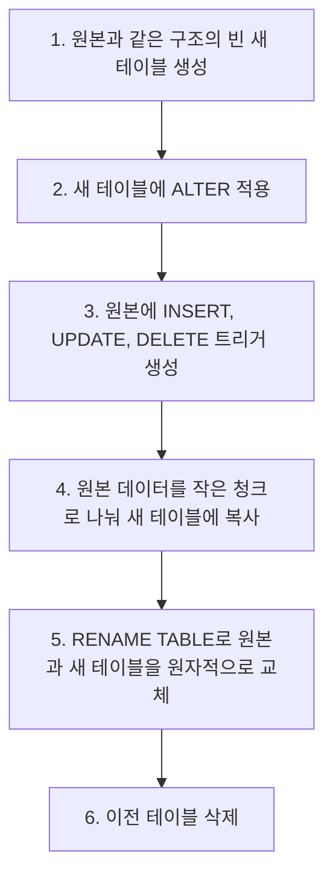

# 2024-07-08-TIL

## Today I Learned

### AA(Application Architect)

Application Architector란 시스템 특징에 적합한 (하나 혹은 그 이상의)프로그램의 아키텍처를 설계하고, 이것을 개발팀 전원이 파악할 수 있도록 약속된 표기방법(UML 등등)으로 문서를 작성하여 개발팀에 공유할 수 있도록하는 사람이다.

국내 SI나 대형 프로젝트 조직에서는 아키텍트 역할을 AA(Application Architect), TA(Technical Architect), DA(Data Architect)처럼 영역별로 나누어 부르는 경우가 많다. 이 중 AA는 애플리케이션 계층을 맡는다. 주로 다음을 정한다.

- 애플리케이션의 구조와 계층, 모듈 경계, 모듈 간 의존 방향
- 공통 프레임워크와 라이브러리, 코딩 표준과 개발 가이드
- 인증, 로깅, 예외 처리, 트랜잭션 같은 공통 관심사의 처리 방식
- 성능, 확장성, 보안 같은 비기능 요구 사항을 어떻게 충족할지

TA가 서버, 네트워크, 미들웨어 같은 기반 인프라를, DA가 데이터 모델과 데이터 흐름을 맡는다면, AA는 그 위에서 돌아가는 프로그램의 설계를 책임지는 셈이다. 설계를 문서로 남기는 것만큼 개발 과정에서 그 설계가 지켜지는지 리뷰하고 조정하는 일도 역할에 포함된다.

해외 자료에서는 같은 이름이 조금 다른 범위로 쓰인다. Indeed 글은 Application Architect를 애플리케이션 개발과 문제 해결을 관리하면서 고객과 함께 애플리케이션을 계획하고 설계하거나 개발팀을 이끄는 직무로 설명하고, Salesforce의 Application Architect는 Salesforce 플랫폼 위의 애플리케이션 설계 역량을 인증하는 자격 이름이다.

---

### pt-online-schema-change

대용량 MySQL 테이블에 `ALTER TABLE`을 그대로 실행하면 작업 방식에 따라 테이블 복사와 잠금이 발생해 서비스 쓰기가 오래 막힐 수 있다. Percona Toolkit의 `pt-online-schema-change`는 원본 테이블을 잠그지 않고 스키마를 바꾸기 위한 도구다.

Percona 문서에 따른 동작 순서는 다음과 같다.



복사하는 동안 원본에 들어온 변경은 트리거가 새 테이블에도 반영하므로, 마지막 교체 시점에 두 테이블이 같은 내용을 갖는다. 청크 크기는 한 청크 복사가 정해진 시간(`--chunk-time`) 안에 끝나도록 동적으로 조정된다.

사용할 때 확인할 점은 다음과 같다.

- 원본 테이블에 기본 키나 유니크 인덱스가 있어야 한다. DELETE 트리거가 새 테이블의 행을 찾는 데 필요하기 때문이다.
- 트리거 방식을 쓰기 때문에 테이블에 이미 트리거가 있으면 기본적으로 동작하지 않는다.
- 외래 키가 있으면 `--alter-foreign-keys-method`로 처리 방식(`rebuild_constraints`, `drop_swap`, `none`)을 정해야 한다.
- 실행 중 서버 부하가 `--max-load`를 넘으면 잠시 멈추고, `--critical-load`를 넘으면 중단한다. 레플리카 지연이 `--max-lag`를 넘어도 복사를 멈춘다.
- 실제로 변경하려면 `--execute`를 명시해야 하고, 먼저 `--dry-run`으로 확인할 수 있다.

```sh
pt-online-schema-change \
  --alter "ADD COLUMN status VARCHAR(20) NOT NULL DEFAULT 'READY'" \
  D=mydb,t=orders --dry-run

pt-online-schema-change \
  --alter "ADD COLUMN status VARCHAR(20) NOT NULL DEFAULT 'READY'" \
  D=mydb,t=orders --execute
```

트리거가 모든 쓰기마다 추가 작업을 하므로 쓰기가 많은 테이블에서는 실행 중 부하가 늘어난다. MySQL 자체의 Online DDL로 잠금 없이 처리할 수 있는 변경이라면 그쪽이 더 단순하므로, 변경 종류별로 어떤 방식이 가능한지 먼저 확인한다.

## 참고

- [medium.com/@tas.com/aa란-application-architect-e2b6f85685b2](https://medium.com/@tas.com/aa%EB%9E%80-application-architect-e2b6f85685b2) — Medium
- [Application Architect란?](https://hatssarjy.tistory.com/606) — Tistory
- [indeed.com/career-advice/career-development/application-architect-skills](https://www.indeed.com/career-advice/career-development/application-architect-skills) — indeed.com
- [What does an application architect do?](https://www.linkedin.com/advice/0/what-does-application-architect-do-skills-application-development-gxj4e) — LinkedIn
- [trailhead.salesforce.com/en/credentials/applicationarchitect](https://trailhead.salesforce.com/en/credentials/applicationarchitect) — trailhead.salesforce.com
- [pt-online-schema-change](https://docs.percona.com/percona-toolkit/pt-online-schema-change.html) — Percona Toolkit Documentation
- [(mysql) Percona pt-online-schema-change 설치 및 사용하기](https://jojoldu.tistory.com/358) — Tistory
- [pt-osc(pt-online-schema-change) 설치 및 사용법](https://martin-son.github.io/Martin-IT-Blog/mysql/3rd%20party%20tool/pt-osc/2022/08/20/pt-osc-%EC%84%A4%EC%B9%98-%EB%B0%8F-%EC%82%AC%EC%9A%A9%EB%B2%95.html) — martin-son.github.io
