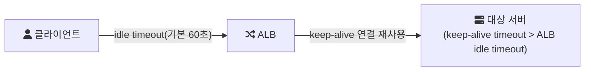

# 2024-07-16-TIL

## Today I Learned

### Auto Complete API Best Practices

자동완성 API는 사용자가 한 글자 칠 때마다 호출될 수 있어서 요청 수가 많고, 응답이 늦으면 바로 체감된다. 그래서 설계할 때는 정확도만큼 호출 빈도와 지연을 관리하는 것이 중요하다.

Google Places Autocomplete 문서에서 가져갈 점은 다음과 같다.

- 세션 토큰: 사용자가 입력을 시작해 장소를 선택하고 상세 정보를 요청할 때까지를 하나의 세션으로 묶는 임의 문자열이다. 세션 안의 여러 자동완성 요청이 한 세션으로 과금되므로 비용이 줄어든다.
- 호출 지연: 몇 글자가 입력될 때까지 요청을 미루면 API 호출 수를 줄일 수 있다.
- 위치 기반 가중치(location bias)와 제한(restriction): 사용자 위치 근처 결과를 우선하거나, 특정 영역 안의 결과만 돌려준다.
- 필요한 필드만 요청해 응답 크기와 비용을 줄인다.

API 설계 측면에서는 `GET /autocomplete?q=...&limit=10`처럼 검색 리소스로 두고, 클라이언트는 디바운싱으로 입력이 잠시 멈춘 뒤에만 호출한다. 서버는 접두어 검색에 맞는 인덱스(트라이, 검색 엔진의 edge n-gram 등)와 인기 검색어 캐시를 둔다. Algolia 글은 UX 관점에서 추천 목록을 짧게 유지하고(데스크톱은 10개 안팎, 모바일은 4~8개), 카테고리로 검색 범위를 좁힐 수 있게 하며, 최근 검색어를 기억하고, 키보드로 탐색할 수 있게 하라고 정리한다.

---

### ALB Timeout and Allow Traffic Time

ALB는 클라이언트와의 연결, 대상(target)과의 연결을 각각 따로 유지한다. ALB의 idle timeout은 연결에서 데이터가 오가지 않는 상태를 허용하는 시간으로, 기본값은 60초다. 요청 처리 시간이 이보다 길면 ALB가 연결을 끊고 클라이언트는 504를 받는다.

AWS 트러블슈팅 문서가 502 오류의 원인 중 하나로 드는 것은 반대 방향의 문제다. ALB는 대상과의 연결을 keep-alive로 재사용하는데, 대상 서버(Tomcat, Nginx, Node.js 등)의 keep-alive timeout이 ALB idle timeout보다 짧으면 대상이 먼저 연결을 닫을 수 있다. 그 순간 ALB가 그 연결로 요청을 보내면 TCP RST나 FIN을 받고 502를 돌려준다. 그래서 대상 애플리케이션의 keep-alive timeout을 ALB idle timeout보다 길게 설정하라고 권장한다.

---

### Event Storming

Event Storming은 Alberto Brandolini가 도메인 주도 설계(DDD) 맥락에서 만든 워크숍 기반 모델링 방법이다. 개발자와 도메인 전문가가 넓은 벽에 붙인 종이 앞에 모여, 비즈니스에서 일어나는 일을 포스트잇으로 시간 순서대로 붙여 나간다.

포스트잇 색은 개념을 구분한다. 주황색은 도메인 이벤트(과거형으로 쓴 "주문이 접수됨" 같은 일), 파란색은 이벤트를 일으키는 커맨드, 노란색은 애그리거트이고, 그 밖에 액터, 정책, 외부 시스템, 뷰를 다른 색으로 표시한다.

진행은 보통 도메인 이벤트를 자유롭게 쏟아내는 것에서 시작해, 시간 순서로 정렬하고, 각 이벤트를 일으키는 커맨드와 액터, 이벤트에 반응하는 정책을 붙여 가는 순서다. 그 과정에서 용어가 어긋나는 지점과 이벤트가 몰리는 경계가 드러나는데, 이것이 바운디드 컨텍스트와 애그리거트를 나누는 근거가 된다. 코드보다 먼저 도메인 지식을 팀 전체가 공유한다는 것이 이 방법의 핵심 가치다.

---

### @Transactional(readOnly = true)

`readOnly = true`는 이 트랜잭션에서 데이터를 변경하지 않는다는 힌트다. Spring은 이 값을 트랜잭션 매니저와 JDBC 드라이버, JPA 구현체에 전달하고, 실제 효과는 구현체마다 다르다.

- JPA(Hibernate)에서는 읽기 전용 트랜잭션의 플러시 모드를 바꿔 커밋 시점의 플러시를 하지 않는다. 엔티티 스냅샷을 비교하는 변경 감지 작업도 줄어들어 대량 조회에서 메모리와 CPU를 아낄 수 있다.
- JDBC 커넥션에 `setReadOnly(true)`가 전달되어, 드라이버와 DB가 읽기 전용 최적화를 할 수 있다.
- `AbstractRoutingDataSource`와 함께 쓰면 읽기 전용 트랜잭션을 레플리카 DB로 보내는 라우팅 기준으로 활용할 수 있다.

주의할 점은 이것이 쓰기를 막는 보안 장치가 아니라는 것이다. 또 레플리카로 라우팅하는 구성에서는 복제 지연 때문에 방금 쓴 데이터가 조회되지 않을 수 있다. 클래스에 `@Transactional(readOnly = true)`를 두고 쓰기 메서드에만 `@Transactional`을 다시 붙이는 패턴이 흔히 쓰인다.

---

### SQL Join in Performance

조인 성능은 옵티마이저가 고르는 조인 알고리즘과 인덱스에 크게 좌우된다. MySQL의 기본 조인 방식인 Nested Loop Join은 드라이빙 테이블의 각 행마다 드리븐 테이블을 찾아가므로, 드리븐 테이블의 조인 컬럼에 인덱스가 있는지가 결정적이다. 인덱스가 없으면 행마다 풀 스캔이 일어난다. MySQL 8.0.18부터는 동등 조인에서 인덱스를 쓸 수 없을 때 Hash Join을 사용할 수 있다.

실무에서 확인할 순서는 다음과 같다.

1. `EXPLAIN`으로 조인 순서, 접근 방식(`type`), 사용 인덱스를 확인한다.
2. 드리븐 테이블의 조인 컬럼에 인덱스가 있는지 본다.
3. 조인 전에 `WHERE` 조건으로 드라이빙 테이블의 행 수를 줄일 수 있는지 본다.
4. 조인한 결과에 필요 없는 컬럼까지 `SELECT *`로 가져오고 있지 않은지 확인한다.

## 참고

- [Place Autocomplete](https://developers.google.com/maps/documentation/places/web-service/autocomplete?hl=ko) — Google Maps Platform
- [Address autocomplete best practices](https://www.smarty.com/blog/address-autocomplete-best-practices) — smarty.com
- [softwareengineering.stackexchange.com/questions/294445/rest-autocomplete-endpoint-design](https://softwareengineering.stackexchange.com/questions/294445/rest-autocomplete-endpoint-design) — softwareengineering.stackexchange.com
- [Auto suggest: best practices for autocomplete suggestion](https://www.algolia.com/blog/ux/auto-suggest-best-practices-for-autocomplete-suggestion/) — algolia.com
- [Application Load Balancer HTTP 502 오류 해결](https://repost.aws/ko/knowledge-center/elb-alb-troubleshoot-502-errors) — repost.aws
- [Troubleshoot your Application Load Balancers](https://docs.aws.amazon.com/elasticloadbalancing/latest/application/load-balancer-troubleshooting.html) — AWS Docs
- [EventStorming](https://www.eventstorming.com/) — eventstorming.com
- [Event storming](https://en.wikipedia.org/wiki/Event_storming) — Wikipedia
- [DDD를 적용하기 위해 🌪Event Storming🌪을 시도해보았다](https://velog.io/@s2moon98/Event-Storming%EC%9D%84-%EC%8B%9C%EB%8F%84%ED%95%B4%EB%B3%B4%EC%9E%90) — velog
- [Spring Boot Tomcat Access Log 필터링](https://do-study.tistory.com/130) — Tistory
- [@Transactional(readOnly = true)를 왜 붙여야 하나요](https://hungseong.tistory.com/74) — Tistory
- [@Transactional(readOnly = true)를 사용하는 이유와 주의할점](https://velog.io/@jhbae0420/TransactionalreadOnly-true%EB%A5%BC-%EC%82%AC%EC%9A%A9%ED%95%98%EB%8A%94-%EC%9D%B4%EC%9C%A0%EC%99%80-%EC%A3%BC%EC%9D%98%ED%95%A0%EC%A0%90) — velog
- [(SQL) 성능 관점에서 보는 결합(Join)](https://schatz37.tistory.com/2) — Tistory
