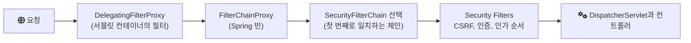

# 2024-08-05-TIL

## Today I Learned

### Spring Security Architecture

Spring Security의 서블릿 지원은 서블릿 필터 위에 만들어져 있다. 공식 문서 기준으로 요청이 지나가는 구조는 다음과 같다.

- `DelegatingFilterProxy`: 서블릿 컨테이너의 필터 생명주기와 Spring `ApplicationContext`를 잇는 다리다. 실제 작업은 Spring 빈으로 등록된 필터에 위임한다.
- `FilterChainProxy`: Spring Security의 진입점이 되는 특별한 필터로, 요청에 맞는 `SecurityFilterChain`을 골라 그 안의 필터들을 실행한다. 요청이 끝나면 `SecurityContext`를 비우고, `HttpFirewall`로 잘못된 요청을 걸러낸다.
- `SecurityFilterChain`: URL 패턴이나 `RequestMatcher`별로 여러 개를 둘 수 있고, 첫 번째로 일치하는 체인 하나만 실행된다. API용 체인과 관리자 화면용 체인을 나누는 식이다.
- `ExceptionTranslationFilter`: 인증 실패(`AuthenticationException`)면 인증 진입점(로그인 페이지나 401 응답)으로, 권한 부족(`AccessDeniedException`)이면 `AccessDeniedHandler`(403)로 처리한다.

인증 결과는 `SecurityContextHolder`에 `Authentication` 객체로 저장되고, 인증 자체는 `AuthenticationManager`(보통 `ProviderManager`)가 여러 `AuthenticationProvider`에 위임해 처리한다. 인가는 `AuthorizationFilter`가 `AuthorizationManager`에게 접근 허용 여부를 묻는 구조다.

참고

- [Architecture - Spring Security](https://docs.spring.io/spring-security/reference/servlet/architecture.html)
- https://dev-coco.tistory.com/174
- https://medium.com/@rasheed99/introduction-on-spring-security-architecture-eb5d7de75a4f
- [Authorization Architecture - Spring Security](https://docs.spring.io/spring-security/reference/servlet/authorization/architecture.html)

### Authentication vs Authorization

- 인증(Authentication): 사용자가 누구인지 확인하는 과정이다. 비밀번호, OTP, 생체 정보 등으로 "당신이 주장하는 그 사람이 맞는가"를 검증한다.
- 인가(Authorization): 인증된 사용자가 무엇을 할 수 있는지 결정하는 과정이다. 역할이나 권한, 정책에 따라 특정 리소스에 접근할 수 있는지 판단한다.

인증이 먼저이고 인가가 그다음이다. HTTP 상태 코드도 이 구분을 따른다. 401 Unauthorized는 이름과 달리 인증이 안 된 상태를, 403 Forbidden은 인증은 됐지만 권한이 없는 상태를 뜻한다. OAuth 2.0은 인가를 위임하는 프로토콜이고, 인증 정보를 표준화한 것은 그 위에 얹은 OpenID Connect라는 점도 이 구분에서 나온다.

참고

- [Authentication and Authorization - Auth0 Docs](https://auth0.com/docs/get-started/identity-fundamentals/authentication-and-authorization)
- https://baek.dev/post/24/
- https://www.fortinet.com/de/resources/cyberglossary/authentication-vs-authorization#:~:text=Authentication%20is%20verifying%20the%20true,or%20permissions%20in%20a%20system.

### Web Application Authentication Best Practices

OWASP Authentication Cheat Sheet을 기준으로 정리하면 다음과 같다.

- 비밀번호 정책: 너무 짧은 비밀번호는 막되, 긴 패스프레이즈와 유니코드, 공백을 허용한다. 유출된 비밀번호 목록과 대조해 흔한 비밀번호를 거부한다.
- 비밀번호 저장: 평문이나 단순 해시가 아니라 비밀번호 저장용 해시 함수로 저장하고, 비교는 상수 시간 함수로 한다.
- 오류 메시지: "아이디가 없음"과 "비밀번호가 틀림"을 구분하지 않는 일반적인 메시지를 쓰고, 응답 시간도 같게 맞춰 계정 존재 여부를 알아낼 수 없게 한다.
- 자동화 공격 방어: 다중 인증(MFA)이 가장 효과적이고, 계정 잠금과 CAPTCHA를 보조 수단으로 쓴다.
- 기타: 민감한 작업 전에 재인증을 요구하고, 비밀번호는 TLS로만 전송하며, 인증 이벤트를 로깅하고 모니터링한다.

나머지 글들은 세션 기반 인증, 토큰 기반 인증(JWT), OAuth 2.0과 OpenID Connect, API 키, 패스키 같은 인증 방식을 비교한다. 브라우저 기반 웹 애플리케이션이냐, 서버 간 API 호출이냐에 따라 적합한 방식이 다르다.

참고

- https://www.authgear.com/post/web-application-authentication-best-practices
- [Authentication Cheat Sheet - OWASP](https://cheatsheetseries.owasp.org/cheatsheets/Authentication_Cheat_Sheet.html)
- https://stackoverflow.blog/2021/10/06/best-practices-for-authentication-and-authorization-for-rest-apis/
- https://www.permit.io/blog/best-practices-for-api-authentication-and-authorization
- https://goteleport.com/blog/authentication-best-practices/
- https://www.baeldung.com/cs/authentication-web-apps
- https://www.linkedin.com/advice/1/what-best-practices-securing-your-authentication
- https://www.idrnd.ai/5-authentication-methods-that-can-prevent-the-next-breach/
- https://frontegg.com/blog/authentication#JSON-Web-Token-(JWT)
- https://www.techtarget.com/searchsecurity/tip/Use-these-6-user-authentication-types-to-secure-networks
- https://www.strongdm.com/blog/authentication-methods
- https://cloud.google.com/docs/authentication?hl=ko
- https://www.freecodecamp.org/news/user-authentication-methods-explained/

### JWT Authentication Best Practices

JWT는 서명된 JSON 토큰이라 서버가 상태를 저장하지 않고도 검증할 수 있다는 장점이 있지만, 잘못 검증하면 위조된 토큰을 받아들이게 된다. Curity의 JWT Best Practices에서 가져갈 점은 다음과 같다.

- 알고리즘: 허용할 서명 알고리즘을 명시적으로 정하고 `none`은 받지 않는다. 대칭 키보다 비대칭 서명을 권장한다.
- 검증 항목: 내부망에서도 항상 서명을 검증하고, 발급자(`iss`)와 대상(`aud`)이 기대한 값인지 확인한다. Access token과 ID token을 구분해 용도에 맞게 쓰는지도 본다.
- 만료: 만료 시간(`exp`)을 짧게 두고, 시계 오차 허용 범위는 최소로 한다.
- 키: 서명 검증 키는 발급자의 JWKS 엔드포인트에서 받고, 헤더의 `kid`, `jku` 같은 값이 신뢰하는 발급자의 것인지 확인한다.
- 내용: JWT payload는 서명될 뿐 기본적으로 암호화되지 않으므로 누구나 읽을 수 있다. 민감한 정보는 넣지 않는다.
- 세션: JWT를 세션 저장 수단으로 쓰지 말라고 한다. 발급한 토큰을 만료 전에 무효화하기 어렵기 때문이다.

참고

- [JWT Security Best Practices - Curity](https://curity.io/resources/learn/jwt-best-practices/)
- https://blog.logrocket.com/jwt-authentication-best-practices/
- https://medium.com/@darshana-edirisinghe/jwt-security-concerns-f79e63ff4871

### Logging Best Practices

Better Stack의 가이드를 기준으로 정리하면 다음과 같다.

- 목적부터 정한다. 무엇을 알아내려고 로그를 남기는지가 정해져야 레벨과 내용이 정해진다.
- 로그 레벨(DEBUG, INFO, WARN, ERROR)을 일관된 기준으로 쓴다.
- JSON 같은 구조화된 형식으로 남겨 기계가 파싱하고 검색할 수 있게 한다.
- 요청 ID, 사용자 ID 같은 맥락을 함께 남긴다. 요청마다 핵심 정보를 한 줄로 요약하는 canonical log line도 권한다.
- 로그를 한곳에 모으고, 보관 기간과 접근 권한을 정한다.
- 비밀번호, 토큰, 개인정보는 남기지 않는다.
- 로깅 자체의 성능 비용을 고려하고, 필요하면 샘플링한다.
- 추세 모니터링은 로그가 아니라 메트릭으로 한다.

참고

- [Logging Best Practices - Better Stack](https://betterstack.com/community/guides/logging/logging-best-practices/)
- https://newrelic.com/blog/best-practices/best-log-management-practices
- https://www.dataset.com/blog/the-10-commandments-of-logging/

## AI 키워드

2024년 8월 1일 유럽연합의 AI 규제법인 AI Act가 발효되었다. AI 시스템을 위험 수준에 따라 나눠 규제하는 공통 법적 틀로, 의무 사항은 이후 단계적으로 적용된다. 출처는 European Commission의 보도자료 AI Act enters into force와 Wikipedia의 2024 in artificial intelligence 항목이다.
