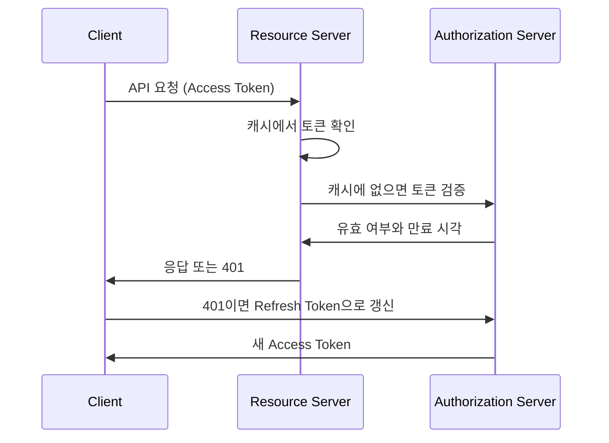

# 2024-09-02-TIL

## Today I Learned

### 토큰의 발급 주체가 아닌 프로젝트에서의 인증 방식

토큰의 발급 주체가 아닌 서버를 구축하면서 토큰을 그대로

DB에 토큰 담고 스레드 로컬에서 (like caching) hit되는 토큰을 캐싱하는 방식으로 성능 향상을 하도록 구성하는게 일반적

인스타그램 처럼 글로벌한 서비스에서 1억개의 세션을 가지고 있을 수 없음 -> https://about.instagram.com/ko-kr/blog/announcements/understanding-verification-on-instagram

현재는 서버팀의 엑세스 토큰 만료시간인 30분을 스튜디오의 레디스 TTL과 동일하게 설정해서 토큰을 보관하도록 설정됨

정석대로라면 FE에서 리프레시 토큰을 핸들링해서 FLO 서버쪽으로 갱신하는 로직이 있어야 함

- 방법1) FE -> FLO -> FE -> STUDIO
- 방법2) FE -> MCP -> FLO -> MCP -> FE

위 메모의 상황을 OAuth 2.0 용어로 옮기면, 토큰을 발급하는 쪽은 인가 서버(authorization server)이고 토큰을 받아 요청을 처리하는 쪽은 리소스 서버(resource server)다. 리소스 서버는 토큰을 직접 만들지 않으므로, 받은 토큰이 유효한지 확인하는 방법을 정해야 한다.

- 자체 검증: 토큰이 서명된 JWT라면 인가 서버의 공개 키로 서명과 만료 시간을 직접 검증한다. 네트워크 호출이 없지만, 만료 전에 폐기된 토큰을 알아채기 어렵다.
- 인가 서버에 확인: 불투명한(opaque) 토큰이라면 인가 서버에 토큰이 유효한지 물어야 한다. RFC 7662 OAuth 2.0 Token Introspection이 이 요청 형식을 표준화했다. 매 요청마다 호출하면 인가 서버에 부하와 지연이 생긴다.

그래서 검증 결과를 캐시하는 구성이 자주 쓰인다. 메모의 방식처럼 확인된 토큰을 Redis에 저장하고 TTL을 액세스 토큰의 만료 시간과 같거나 짧게 두면, 토큰이 만료된 뒤에는 캐시에서도 사라져 다시 검증하게 된다. 캐시가 살아 있는 동안에는 토큰 폐기가 즉시 반영되지 않는다는 점이 이 방식의 트레이드오프다.

액세스 토큰 갱신은 리프레시 토큰을 가진 클라이언트가 인가 서버에 직접 요청하는 것이 OAuth 2.0의 기본 흐름이다. 리소스 서버는 리프레시 토큰을 다루지 않고, 만료된 액세스 토큰에는 401을 돌려 클라이언트가 갱신하게 한다. 메모의 방법 1이 이 흐름에 가깝고, 방법 2는 중간 서버가 토큰 갱신을 대행하는 구조다.

### OAuth 2.0

OAuth 2.0(RFC 6749)은 사용자가 자신의 비밀번호를 제3자 애플리케이션에 주지 않고도, 그 애플리케이션이 자기 자원에 제한적으로 접근하도록 허락하는 인가 프레임워크다. 네 가지 역할을 정의한다.

- Resource Owner: 자원의 주인인 사용자
- Client: 사용자를 대신해 자원에 접근하려는 애플리케이션
- Authorization Server: 사용자를 인증하고 동의를 받아 액세스 토큰을 발급하는 서버
- Resource Server: 액세스 토큰을 받아 보호된 자원을 제공하는 서버

토큰을 얻는 방법(grant type)으로 RFC 6749는 Authorization Code, Implicit, Resource Owner Password Credentials, Client Credentials를 정의한다. 지금은 브라우저와 모바일 앱에서도 PKCE를 붙인 Authorization Code 방식을 권장하고, Implicit과 Password 방식은 보안 문제로 쓰지 않는 추세다. 서버 간 호출에는 Client Credentials를 쓴다.

액세스 토큰은 짧게 살고, 리프레시 토큰은 더 오래 살면서 새 액세스 토큰을 받는 데만 쓰인다. 리프레시 토큰은 인가 서버에만 보내고 리소스 서버에는 보내지 않는다.

- https://oauth.net/2/
- https://datatracker.ietf.org/doc/html/rfc6749
- https://f-lab.kr/insight/understanding-oauth-2-0?gad_source=1&gclid=CjwKCAjwxNW2BhAkEiwA24Cm9D4LjevLOYfXIY89slUjmx71MfJtNT6trl5mNTNv9fRfIjHBKHgwSRoC1P8QAvD_BwE

### Instagram System Design

인스타그램 같은 사진 공유 서비스의 설계는 시스템 디자인 면접의 단골 주제다. 핵심 기능은 사진 업로드, 팔로우, 피드 조회이고, 읽기가 쓰기보다 훨씬 많다는 점이 설계의 출발점이다.

- 미디어 저장: 이미지와 영상은 오브젝트 스토리지에 저장하고 CDN으로 전달한다. 메타데이터(작성자, 캡션, 위치)는 DB에 따로 저장한다.
- 피드 생성: 글을 쓸 때 팔로워들의 피드에 미리 넣어 두는 fan-out on write는 조회가 빠르지만, 팔로워가 매우 많은 계정에서는 쓰기 비용이 폭증한다. 조회할 때 팔로우한 계정들의 글을 모으는 fan-out on read는 반대의 특성을 가진다. 보통 두 방식을 섞어 일반 계정은 미리 넣고 유명 계정은 조회 시점에 합친다.
- 식별자: 글, 사진, 댓글이 여러 DB 샤드에 나뉘어 저장되므로 전역적으로 유일한 ID가 필요하다. 아래 분산 키 생성 항목과 이어진다.

- https://www.linkedin.com/posts/rocky-bhatia-a4801010_%3F%3F%3F%3F%3F%3F%3F%3F%3F-%3F%3F%3F%3F%3F%3F-%3F%3F%3F%3F%3F%3F-activity-7108774214278496257-qLOD/
- https://medium.com/javarevisited/microservices-in-practice-developing-instagram-clone-introduction-4f6d78abdfa1
- https://joondong.tistory.com/96

### Key Generation in Distributed System

여러 서버나 샤드가 동시에 데이터를 만들 때 겹치지 않는 ID를 만드는 방법이다. 단일 DB의 AUTO_INCREMENT는 DB 하나에서만 유일성이 보장되므로 분산 환경에서는 다른 방법이 필요하다.

| 방식 | 특징 |
| --- | --- |
| UUID | 각 서버가 독립적으로 생성하고 충돌 확률이 매우 낮다. 크고 정렬되지 않는다(v4 기준) |
| 티켓 서버 | ID 발급만 담당하는 중앙 DB가 번호를 나눠 준다. 단순하지만 단일 장애 지점이 된다 |
| 구간 할당 | 서버마다 ID 범위를 미리 받아 그 안에서 발급한다. 중앙 서버 호출을 줄인다 |
| Snowflake 류 | 타임스탬프, 서버(워커) 번호, 서버 내 순번을 비트로 이어 붙인 64비트 정수. 시간순 정렬이 되고 각 서버가 독립적으로 생성한다 |

Snowflake 방식은 정렬 가능하고 크기가 작아 DB 인덱스에 유리하지만, 서버 시계가 뒤로 가면 중복 ID가 날 수 있어 시계 역행을 감지하는 처리가 필요하고, 워커 번호를 겹치지 않게 배정해야 한다.

목록의 OWASP Key Management Cheat Sheet는 같은 "key"라도 데이터 식별자가 아니라 암호화 키의 생성, 저장, 교체, 폐기를 다루는 문서다. 암호화 키는 예측할 수 없어야 하므로 반드시 암호학적으로 안전한 난수 생성기로 만들어야 한다는 점에서, 정렬 가능성과 크기가 중요한 ID 생성과는 요구 사항이 정반대다.

- https://www.researchgate.net/figure/Key-Generation-Architecture_fig3_319701437
- https://medium.com/@vaniukov.s/5-best-strategies-to-upgrade-your-data-architecture-11f3f96d04c3
- https://cheatsheetseries.owasp.org/cheatsheets/Key_Management_Cheat_Sheet.html
- https://medium.com/@sandeep4.verma/system-design-distributed-global-unique-id-generation-d6a440cc8e5
