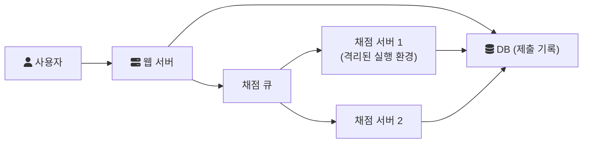

# 2025-02-05-TIL

## Today I Learned

### Engine in Software

소프트웨어에서 엔진은 자동차의 엔진을 비유적으로 표현하면서 사용되기 시작한것으로 보이며, 복잡한 시스템에서 핵심 요소를 부르는 말로 종종 사용된다. 사용 사례를 보면, 검색 엔진, 언리얼 엔진 등 기능 자체가 무겁고 비용이 많이 드는 경우에 자주 사용되는것으로 보인다.

```
1. 소프트웨어 엔진
특정한 기능을 수행하는 프로그램이나 라이브러리를 의미합니다.

- 게임 엔진 (Game Engine): 그래픽, 물리 연산, 애니메이션, 인공지능(AI) 등을 처리하는 프레임워크
예: Unity, Unreal Engine, Godot
- 렌더링 엔진 (Rendering Engine): 2D 또는 3D 그래픽을 생성하는 시스템
예: WebKit(웹 브라우저), DirectX, OpenGL
- 검색 엔진 (Search Engine): 데이터를 색인화하고 검색 기능을 제공하는 소프트웨어
예: Google Search, Elasticsearch
- 물리 엔진 (Physics Engine): 충돌 감지 및 물리적 움직임을 시뮬레이션하는 엔진
예: Havok, Box2D, Bullet Physics
- AI 엔진 (AI Engine): 인공지능 모델을 학습 및 실행하는 엔진
예: TensorFlow, PyTorch
```

```
A software engine is a core component of a complex software system. The word "engine" is a metaphor of a car's engine. Thus a software engine is a complex subsystem.

There is no formal guideline for what should be called an engine, but the term has become widespread in the software industry.
```

```
소프트웨어에서 엔진이란, 특정 프로그램 내부에서 또는 다른 프로그램들을 위해 핵심적인 기능을 수행하는 프로그램을 말합니다. 컴퓨터 프로그래밍에서 기계적인 엔진에 해당하는 용어입니다. 

엔진은 다음과 같은 역할을 합니다. 

- 개발에 필요한 기능을 즉시 사용할 수 있도록 제공합니다.
- 개발의 단가와 복잡도를 줄여줍니다.
- 제 일정에 복잡한 게임을 출시할 수 있게 해 줍니다.
```

정리하면 엔진은 기능의 이름이라기보다 역할의 이름이다. 위키백과도 무엇을 엔진이라고 불러야 하는지에 대한 공식 기준은 없다고 설명한다. 공통점을 뽑아 보면 다음과 같다.

- 복잡하고 비용이 큰 핵심 처리를 맡는다. 렌더링, 물리 연산, 색인과 검색, 규칙 평가처럼 직접 구현하기 어려운 부분이다.
- 그 위에 올라가는 애플리케이션과 분리되어 있다. 게임 엔진 위에서 여러 게임이, 브라우저 엔진 위에서 여러 브라우저가 만들어진다.
- 입력과 설정을 받아 정해진 방식으로 결과를 내는 실행기다. 데이터베이스의 스토리지 엔진, 템플릿 엔진, 룰 엔진, 워크플로 엔진도 같은 의미로 쓰인다.

라이브러리가 호출되는 도구라면, 엔진은 애플리케이션이 그 위에서 동작하는 기반에 가깝다는 점에서 프레임워크와도 겹친다.

- [Software engine](https://en.wikipedia.org/wiki/Software_engine)

### Online Judge Site Architecture

온라인 저지는 사용자가 제출한 코드를 서버에서 컴파일하고 실행해 채점하는 서비스다. 신뢰할 수 없는 코드를 실행해야 하므로 웹 서비스 부분과 채점 부분을 분리하는 것이 기본 구조다.

스타트링크 블로그의 BOJ 구축기에 따르면, BOJ는 처음에 Apache, PHP, MySQL로 시작했고 채점은 C로 작성한 두 프로그램이 맡았다. 채점 관리자가 MySQL에서 채점할 제출 번호를 가져와 채점 프로그램을 실행하고, 채점 프로그램이 결과를 DB에 직접 기록하는 구조다. 이후 직접 만든 MVC 프레임워크로 웹 부분을 정리했고, 트래픽이 늘자 Redis로 페이지 결과를 캐시하고, 채점 서버를 두 대로 늘려 제출 번호의 홀짝으로 나눠 채점했다. 실시간 채점 현황은 Pusher로 전달한다. 글은 앞으로의 계획으로 채점기를 Docker로 컨테이너화하고, 제출 번호로 나누는 대신 분산 큐로 채점 작업을 나눠 부하를 고르게 하는 방향을 든다.



채점 서버에서 가장 중요한 것은 격리다. 제출 코드가 파일 시스템이나 네트워크에 접근하지 못하게 하고, 시간과 메모리를 제한해야 한다. 채점 작업을 큐로 분리하면 채점 서버를 독립적으로 늘릴 수 있고, 채점이 밀려도 웹 서비스는 영향을 받지 않는다.

- [BOJ는 어떻게 만들어졌을까?](https://startlink.blog/2015/12/21/boj%EB%8A%94-%EC%96%B4%EB%96%BB%EA%B2%8C-%EB%A7%8C%EB%93%A4%EC%96%B4%EC%A1%8C%EC%9D%84%EA%B9%8C/)

### Payment and Settlement System Architecture

결제는 고객의 돈을 받는 흐름이고, 정산은 받은 돈을 수수료와 세금 등을 계산해 판매자나 권리자에게 나눠 주는 흐름이다. 결제는 실시간성과 중복 방지가, 정산은 대량 집계의 정확성과 추적 가능성이 핵심이다.

Pragmatic Engineer의 Designing a Payment System에서 가져갈 개념은 다음과 같다.

- PSP(Payment Service Provider): 대부분의 서비스는 은행이나 카드사와 직접 연결하지 않고 PSP를 통해 결제한다. 민감한 카드 정보는 PSP가 다룬다.
- 멱등성: 같은 결제 요청이 두 번 와도 한 번만 처리되어야 한다. 요청마다 고유한 멱등 키를 두고, 같은 키가 다시 오면 이전 결과를 돌려준다.
- 복식부기 원장(double-entry ledger): 모든 거래를 차변과 대변 두 계정에 같은 금액으로 기록해, 전체 기록의 합이 항상 0이 되게 한다. 돈의 흐름을 추적하고 오류를 찾는 근거가 된다.
- 대사(reconciliation): 내부 결제 기록과 PSP, 은행의 정산 파일을 주기적으로 비교해 불일치를 찾는다. 분산 시스템에서 일부 요청이 실패하거나 중복되는 것을 결국 바로잡는 장치다.
- 재시도: 실패한 결제는 지수 backoff로 재시도하되, 멱등성으로 중복 청구를 막는다.

국내 기술 블로그 글들은 정산 쪽 사례를 다룬다. 우아한형제들의 글은 정산 시스템의 파일럿 프로젝트를, 오늘의집 글은 광고 정산 시스템에 Kafka Streams를 도입한 사례를, FLO의 글은 음원 정산 시스템의 구성을 소개한다.

- [정산지기를 향한 첫걸음 (feat. 파일럿 프로젝트)](https://techblog.woowahan.com/2668/)
- [광고 정산 시스템에 Kafka Streams 도입하기](https://www.bucketplace.com/post/2022-05-20-%EA%B4%91%EA%B3%A0-%EC%A0%95%EC%82%B0-%EC%8B%9C%EC%8A%A4%ED%85%9C%EC%97%90-kafka-streams-%EB%8F%84%EC%9E%85%ED%95%98%EA%B8%B0/)
- [Payment System Interface Modernization on AWS: Modern Cloud-Native Payment Systems](https://docs.aws.amazon.com/architecture-diagrams/latest/payment-system-interface-modernization/payment-system-interface-modernization.html)
- [FLO의 정산시스템, 어떻게 이루어져 있을까?](https://www.blog-dreamus.com/post/flo%EC%9D%98-%EC%A0%95%EC%82%B0%EC%8B%9C%EC%8A%A4%ED%85%9C-%EC%96%B4%EB%96%BB%EA%B2%8C-%EC%9D%B4%EB%A3%A8%EC%96%B4%EC%A0%B8-%EC%9E%88%EC%9D%84%EA%B9%8C)
- [[멋쟁이채소처럼] 결제, 포인트, 보증금 테이블 설계(1)](https://velog.io/@may_yun/%EB%A9%8B%EC%9F%81%EC%9D%B4%EC%B1%84%EC%86%8C%EC%B2%98%EB%9F%BC-%EA%B2%B0%EC%A0%9C-%ED%8F%AC%EC%9D%B8%ED%8A%B8-%EB%B3%B4%EC%A6%9D%EA%B8%88-%ED%85%8C%EC%9D%B4%EB%B8%94-%EC%84%A4%EA%B3%841)
- [Payment System Architecture](https://medium.com/@erande.kedar/payment-system-architecture-3040b323368a)
- [Settlement Architecture](https://forum.interledger.org/t/settlement-architecture/545)
- [Designing a Payment System](https://newsletter.pragmaticengineer.com/p/designing-a-payment-system)
- [Software Architecture - Payments System](https://austincorso.com/2020/05/24/payments-system.html)
- [System Design Interview - Designing Payment Systems; Follow-up Questions and Probable Issues](https://hackernoon.com/system-design-interview-designing-payment-systems-follow-up-questions-and-probable-issues)

### System Design Concepts

시스템 디자인에서 반복해서 쓰이는 기본 개념 스무 가지를 짧게 훑는 영상과, 그런 개념들(로드 밸런싱, 캐싱, CDN, 데이터 분산 저장 등)이 Netflix 같은 대규모 스트리밍 서비스 설계에서 어떻게 조합되는지 보여 주는 글이다.

- [20 System Design Concepts Explained in 10 Minutes](https://www.youtube.com/watch?v=i53Gi_K3o7I)
- [Netflix System Design](https://www.codekarle.com/system-design/netflix-system-design.html)

### ngram Full-Text Parser

MySQL의 ngram 전문 검색 파서는 띄어쓰기로 단어를 나누는 기본 파서 대신 텍스트를 길이 n의 연속된 글자 조각으로 잘라 색인한다. 문서는 중국어, 일본어, 한국어를 위한 파서라고 설명한다. `ngram_token_size`의 기본값은 2이고, `FULLTEXT ... WITH PARSER ngram`으로 인덱스를 만든다. Natural language 모드에서는 조각들의 합집합으로, Boolean 모드에서는 조각을 이어 붙인 구문 검색으로 바뀌므로 검색 의도에 맞는 모드를 골라야 한다.

- [ngram Full-Text Parser](https://dev.mysql.com/doc/refman/8.4/en/fulltext-search-ngram.html)

### LM Studio

LM Studio는 LLM을 내 컴퓨터에서 오프라인으로 내려받아 실행하는 데스크톱 애플리케이션이다. 공식 문서에 따르면 `llama.cpp` 기반의 GGUF 모델(macOS, Windows, Linux)과 Apple Silicon용 MLX 모델을 지원하고, 채팅 UI 외에 OpenAI 호환 API 서버로 모델을 띄워 다른 애플리케이션에서 호출할 수 있다. Ollama도 로컬에서 모델을 실행하고 API로 제공한다는 점은 같지만, CLI와 백그라운드 서버 중심이라는 점에서 GUI 중심인 LM Studio와 사용 방식이 다르다. 데이터를 외부로 보내지 않고 모델을 써야 하거나, API 비용 없이 실험하고 싶을 때 선택지가 된다.

- [LM Studio란? - 특징, 기능 그리고 Ollama 차이점](https://hyunicecream.tistory.com/117)

## AI 키워드

2025년 1월 20일 중국 스타트업 DeepSeek가 오픈 웨이트 추론 모델 DeepSeek-R1을 공개했다. 비교 대상 모델들보다 훨씬 적은 학습 비용으로 만들었다는 점이 주목받았고, 1월 27일에는 DeepSeek 앱이 미국 iOS 앱스토어 무료 앱 다운로드 1위에 올랐다. 출처는 Wikipedia의 2025 in artificial intelligence 항목이다. 위의 LM Studio 같은 도구로 공개된 모델을 로컬에서 직접 실행해 볼 수 있다.
