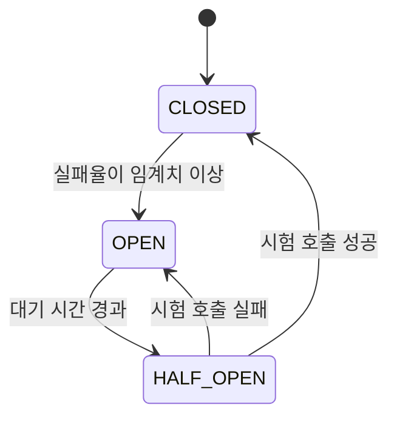

외부 시스템 연동은 “우리 코드가 아닌 부분”이 섞이기 때문에 장애 해석이 더 어렵다.  
실무에서는 연동 자체보다 **실패를 어떻게 다루는가**가 더 중요하다.

외부 연동은 결제 대행사, 본인 인증, 지도, 메시지 발송처럼 우리 서비스가 다른 회사나 다른 팀의 API를 호출하는 모든 경우를 말한다. 우리 쪽에서는 상대 서버의 상태를 볼 수 없고, 고칠 수도 없다. 그래서 이 장의 질문은 "상대가 실패하거나 느려질 때 우리 서비스는 어떻게 행동하는가"로 모인다.

## 외부 연동에서 흔한 문제

- 타임아웃
- 일시적 네트워크 실패
- 상대 시스템의 지연 증가
- 재시도로 인한 중복 요청
- 스펙 변경
- 부분 성공 상태

이 중 부분 성공 상태가 가장 다루기 까다롭다. 결제 승인 요청을 보냈는데 응답을 받기 전에 타임아웃이 났다면, 상대 시스템에서는 승인이 됐을 수도 있고 안 됐을 수도 있다. 우리 쪽 기록은 "실패"인데 상대 쪽 기록은 "성공"인 상태가 생긴다. 그래서 타임아웃은 실패로 단정하지 않고 "결과를 모름"으로 다뤄야 한다.

## 먼저 구분해야 할 것

### 1. 연결 실패인가, 응답 지연인가

- DNS 문제
- TCP 연결 실패
- TLS handshake 실패
- 애플리케이션 레벨 응답 지연

이걸 구분하지 않으면 원인을 잘못 짚는다.

요청 하나는 이 순서대로 단계를 밟는다. 도메인 이름을 IP로 바꾸고(DNS), TCP 연결을 맺고, TLS 핸드셰이크로 암호화 채널을 만든 뒤에야 HTTP 요청을 보낸다. 앞의 세 단계에서 실패하면 요청은 상대 애플리케이션에 도달하지도 않은 것이다. 마지막 단계에서 늦어지면 상대가 요청을 받고 처리하는 중이다. 두 경우는 재시도해도 되는지가 다르다.

### 2. 일시적 실패인가, 구조적 실패인가

- 순간적 timeout
- 특정 시간대 집중 부하
- 잘못된 요청 형식
- 상대 시스템 장애

재시도 가능한 실패와 아닌 실패를 구분해야 한다.

잘못된 요청 형식은 몇 번을 다시 보내도 같은 오류가 난다. 400번대 응답 대부분이 이런 경우다. 순간적인 타임아웃이나 503처럼 상대가 일시적으로 처리하지 못한 경우만 재시도 대상이 된다.

## 실무에서 꼭 필요한 패턴

### 타임아웃 분리

- connection timeout
- read timeout
- write timeout

을 나눠서 봐야 한다. 하나로 뭉뚱그리면 어디서 지연되는지 알 수 없다.

Java 표준 `HttpClient`를 예로 들면 두 타임아웃이 따로 있다. `HttpClient.Builder.connectTimeout`은 새 연결을 맺어야 할 때 그 시간 안에 연결되지 않으면 `HttpConnectTimeoutException`을 던진다. `HttpRequest.Builder.timeout`은 그 시간 안에 응답을 받지 못하면 `HttpTimeoutException`을 던진다([HttpClient.Builder](https://docs.oracle.com/en/java/javase/21/docs/api/java.net.http/java/net/http/HttpClient.Builder.html), [HttpRequest.Builder](https://docs.oracle.com/en/java/javase/21/docs/api/java.net.http/java/net/http/HttpRequest.Builder.html)).

```java
HttpClient client = HttpClient.newBuilder()
        .connectTimeout(Duration.ofSeconds(1))   // 연결 수립 제한
        .build();

HttpRequest request = HttpRequest.newBuilder(URI.create("https://api.example.com/payments"))
        .timeout(Duration.ofSeconds(3))          // 응답 대기 제한
        .build();
```

예외 종류가 다르니 로그와 지표에서도 둘을 나눠 셀 수 있다. 연결 타임아웃이 늘었다면 네트워크나 상대 서버의 연결 수용 문제를, 응답 타임아웃이 늘었다면 상대의 처리 지연을 먼저 의심한다.

### 재시도

재시도는 만능이 아니다.

- 멱등한 요청인가
- 중복 결제가 가능한가
- 재시도 폭주가 추가 부하를 만들지 않는가

를 먼저 봐야 한다.

HTTP 명세는 같은 요청을 여러 번 보내도 한 번 보낸 것과 의도한 효과가 같은 메서드를 멱등(idempotent)하다고 정의하고, PUT, DELETE와 안전한 메서드(GET 등)를 멱등 메서드로 꼽는다. 또 클라이언트는 요청이 실제로 멱등하다는 것을 알 방법이 없다면 멱등하지 않은 메서드를 자동으로 재시도하면 안 된다고 적는다([RFC 9110 9.2.2](https://www.rfc-editor.org/rfc/rfc9110.html#name-idempotent-methods)). 결제 승인 같은 POST를 재시도하려면 요청마다 고유 키를 붙이고 상대가 같은 키의 중복 요청을 한 번만 처리하도록 하는 약속이 먼저 있어야 한다.

재시도 폭주에 대해서는 Google SRE 책의 조언이 구체적이다. 재시도에는 항상 무작위성을 섞은 지수 백오프를 쓰고, 요청당 재시도 횟수를 제한하며, 여러 계층에서 각각 재시도하지 않도록 하라고 한다. 계층마다 재시도하면 최상위 요청 하나가 각 계층 시도 횟수의 곱만큼 최하위 계층에 요청을 만들 수 있다([Google SRE Book: Addressing Cascading Failures](https://sre.google/sre-book/addressing-cascading-failures/)). 세 계층이 각각 3번씩 시도하면 최하위 서버에는 최대 27번의 요청이 간다.

### Circuit Breaker

외부 시스템이 죽었는데 계속 호출하면 우리 서비스도 같이 망가질 수 있다.  
그래서 일정 수준 이상 실패하면 빠르게 차단하는 전략이 필요하다.

Resilience4j의 서킷 브레이커를 예로 들면 세 가지 주요 상태를 오간다([Resilience4j CircuitBreaker](https://resilience4j.readme.io/docs/circuitbreaker)).



- CLOSED: 평소 상태다. 호출을 그대로 보내고 결과를 기록한다.
- OPEN: 호출을 보내지 않고 즉시 `CallNotPermittedException`으로 거부한다. 응답을 기다리지 않으니 우리 쪽 스레드와 커넥션이 묶이지 않는다.
- HALF_OPEN: 일정 시간이 지나면 몇 건만 시험 삼아 보내 상대가 회복됐는지 본다.

문서 기준 기본값은 실패율 임계치 50%, 상태를 판단하기 전 최소 호출 수 100건, OPEN 유지 시간 60초다. 트래픽이 적은 API라면 최소 호출 수 100건이 쌓이지 않아 서킷이 열리지 않을 수 있으므로 값을 서비스에 맞게 조정해야 한다. 서킷 브레이커 개념 자체는 [Circuit Braker](/posts/circuit-braker/) 노트에도 남겨 두었다.

### Fallback

실패 시:

- 빈 응답
- 캐시된 응답
- 대체 경로

중 무엇을 줄지 사전에 정해야 한다.

어떤 대체 응답이 허용되는지는 기술이 아니라 도메인이 정한다. 추천 상품 목록은 빈 목록을 보여 줘도 서비스가 굴러가지만, 결제 결과는 캐시된 값으로 대신할 수 없다. 대체 응답을 줄 수 없는 연동이라면 빠르게 실패를 알리고, 나중에 상태를 다시 확인할 방법을 마련하는 것이 fallback이 된다.

외부 연동 하나가 느려질 때 그 연동에 쓰는 스레드나 커넥션을 따로 나눠 다른 기능까지 번지지 않게 하는 방법은 [Bulkhead Pattern](/posts/bulkhead/)에서 다뤘다.

## 로그와 모니터링

외부 연동은 반드시 아래 정보가 남아야 한다.

- 대상 시스템
- 요청 식별자
- latency
- 상태 코드
- timeout 여부
- retry 횟수

이게 없으면 “간헐적 실패”를 설명할 수 없다.

요청 식별자는 특히 상대 회사와 함께 장애를 확인할 때 필요하다. "어제 오후에 몇 건 실패했다"로는 상대가 찾을 수 없지만, 요청 ID와 시각이 있으면 상대 로그에서 같은 요청을 찾아 "우리 쪽에는 도달하지 않았다"거나 "처리는 됐는데 응답이 늦었다"를 확인할 수 있다.

## 이 장에서 가져갈 점

- 외부 호출에는 타임아웃 없는 호출이 없어야 한다. 연결과 응답 타임아웃을 각각 정한다.
- 타임아웃은 실패가 아니라 "결과를 모름"이다. 결과를 나중에 조회하거나 대사(reconciliation)할 방법을 함께 설계한다.
- 재시도는 멱등성이 보장되는 요청에만, 횟수 제한과 지터를 섞은 백오프와 함께, 한 계층에서만 한다.
- 상대가 계속 실패하면 서킷 브레이커로 호출을 끊어 우리 쪽 자원을 지킨다.

## 정리

외부 연동 문제는 라이브러리 사용법보다 실패 모델을 이해하는 게 핵심이다.  
주니어는 특히 “성공 경로 구현”에 집중하기 쉽지만, 실무에서는 실패 경로를 먼저 설계하는 쪽이 더 중요하다.

## 참고

- [RFC 9110: HTTP Semantics, 9.2.2 Idempotent Methods](https://www.rfc-editor.org/rfc/rfc9110.html#name-idempotent-methods) — IETF
- [HttpClient.Builder](https://docs.oracle.com/en/java/javase/21/docs/api/java.net.http/java/net/http/HttpClient.Builder.html) — Java SE 21 API
- [HttpRequest.Builder](https://docs.oracle.com/en/java/javase/21/docs/api/java.net.http/java/net/http/HttpRequest.Builder.html) — Java SE 21 API
- [Addressing Cascading Failures](https://sre.google/sre-book/addressing-cascading-failures/) — Google SRE Book
- [CircuitBreaker](https://resilience4j.readme.io/docs/circuitbreaker) — Resilience4j Documentation
