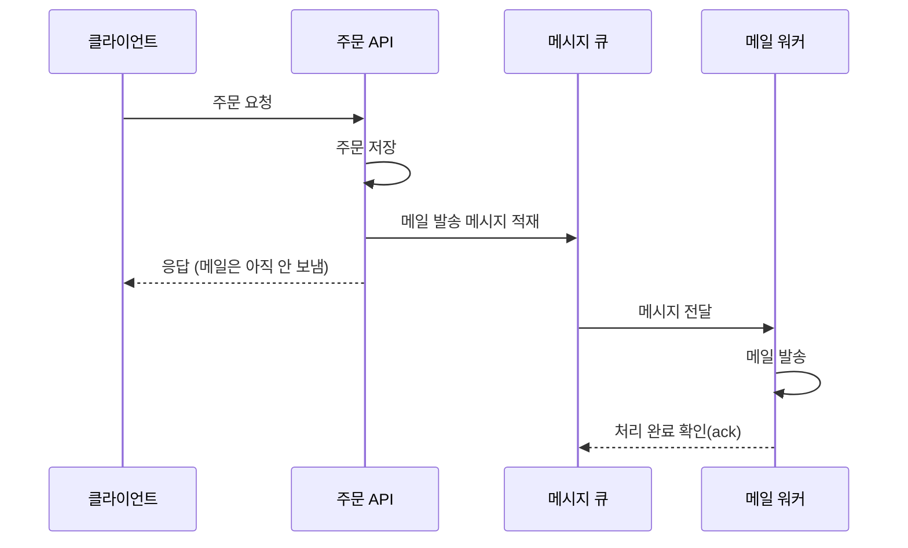
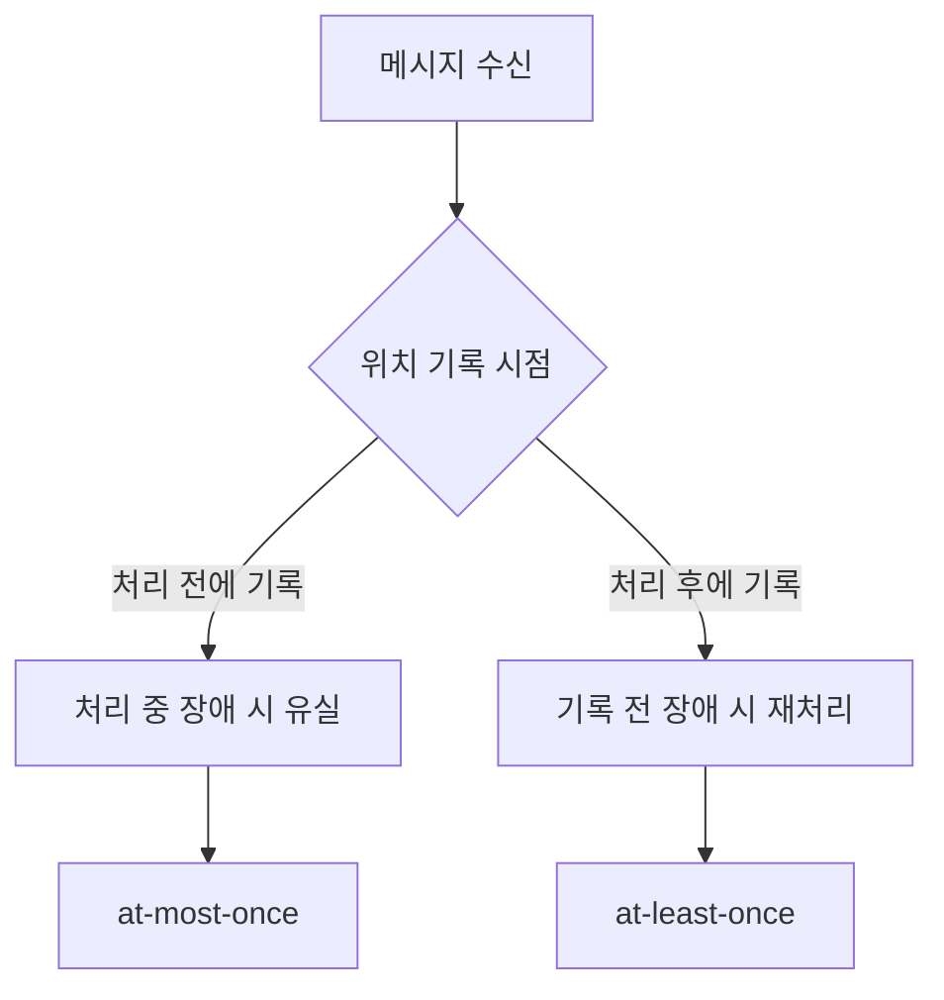

비동기는 단순히 “빠르게 만드는 기법”이 아니다.  
정확히는 요청 처리 경로를 분리해서 사용자 응답 시간과 내부 처리 비용을 분리하는 설계 방식에 가깝다.

동기 호출에서는 요청을 받은 서버가 후속 작업까지 모두 끝낸 뒤에 응답한다. 비동기 연동에서는 서버가 "해야 할 일"을 메시지로 남기고 먼저 응답하며, 실제 작업은 별도의 소비자(consumer)가 나중에 처리한다. 응답은 빨라지지만, 작업이 끝났는지 실패했는지를 아는 시점도 그만큼 뒤로 밀린다.

아래 그림은 주문 요청 뒤에 이메일을 보내는 경우를 두 방식으로 나란히 그린 것이다.

동기 방식이었다면 `A-->>C` 응답은 메일 발송이 끝난 뒤에야 나간다. 비동기 방식에서는 응답과 메일 발송이 서로 다른 시점, 다른 프로세스에서 일어난다.

## 언제 비동기를 고려해야 하는가

- 요청 직후 반드시 끝날 필요가 없는 작업
- 오래 걸리는 외부 연동
- 대량 처리
- 실패해도 재시도 가능한 작업
- 사용자 경험과 분리해도 되는 후처리

예:

- 이메일 발송
- 푸시 알림
- 로그 적재
- 이미지/파일 처리
- 통계 집계

공통점은 사용자가 그 결과를 응답 안에서 바로 확인하지 않아도 된다는 것이다. 이메일이 몇 초 늦게 도착해도 주문 자체는 성공이다. 반대로 결제 승인 여부처럼 응답에 결과가 들어가야 하는 작업은 이 목록에 들어오기 어렵다.

## 비동기를 잘못 쓰는 경우

- 정합성이 핵심인데 비동기로 넘겨 버림
- 결과 확인이 필요한데 eventually consistent로 흘려 보냄
- 재시도와 멱등성 없이 큐만 붙임
- 장애 추적 체계 없이 “나중에 처리”만 믿음

eventually consistent(최종 일관성)는 "지금 당장은 데이터가 서로 다를 수 있지만, 새 변경이 없으면 결국 같아진다"는 성질이다. 재고 차감처럼 순간의 불일치가 곧 사고로 이어지는 데이터에 이 성질을 적용하면, 그 "잠깐"이 초과 판매가 된다. 멱등성(idempotency)은 같은 작업을 여러 번 실행해도 한 번 실행한 것과 결과가 같은 성질이다. 아래에서 보듯 큐는 중복 전달을 피하기 어렵기 때문에, 멱등성 없이 큐를 붙이면 같은 메일이 두 번 나가거나 같은 포인트가 두 번 쌓인다.

## 비동기 시스템에서 봐야 할 것

### 1. 전달 보장

- at-most-once
- at-least-once
- exactly-once는 실제론 매우 어렵다

Kafka 설계 문서는 세 가지를 이렇게 구분한다([Kafka Design, Message Delivery Semantics](https://kafka.apache.org/39/design/design/)).

- at-most-once: 메시지가 유실될 수는 있지만 다시 전달되지는 않는다.
- at-least-once: 유실되지는 않지만 다시 전달될 수 있다.
- exactly-once: 각 메시지가 정확히 한 번만 전달된다.

어느 쪽이 되는지는 소비자가 "어디까지 읽었는지"를 언제 기록하느냐로 갈린다. 같은 문서에 따르면 위치를 먼저 저장하고 처리하다가 죽으면, 다음 소비자는 저장된 위치부터 읽으므로 처리 못 한 메시지를 건너뛴다(at-most-once). 처리를 먼저 하고 위치를 저장하기 전에 죽으면, 다음 소비자가 같은 메시지를 다시 처리한다(at-least-once).

exactly-once도 조건부로는 가능하다. Kafka는 소비 위치와 결과를 같은 트랜잭션에 쓰는 경우(결과도 Kafka 토픽에 쓸 때) exactly-once를 지원하지만, 결과를 외부 시스템에 쓴다면 그 시스템과 위치 저장을 함께 맞춰야 한다고 설명한다. Amazon SQS 표준 큐도 메시지 사본을 저장한 서버 하나가 삭제 시점에 응답하지 않으면 그 사본이 지워지지 않아 같은 메시지를 다시 받을 수 있다고 밝히고, 애플리케이션을 멱등하게 설계하라고 권한다([Amazon SQS at-least-once delivery](https://docs.aws.amazon.com/AWSSimpleQueueService/latest/SQSDeveloperGuide/standard-queues-at-least-once-delivery.html)).

그래서 대부분은 **중복 허용 + 멱등 처리** 전략으로 간다.

멱등 처리의 가장 단순한 형태는 메시지마다 고유 ID를 두고, 처리한 ID를 기록해서 같은 ID가 다시 오면 건너뛰는 것이다. 처리 결과 저장과 ID 기록이 같은 트랜잭션 안에 있어야 "처리는 됐는데 ID 기록은 안 된" 틈이 생기지 않는다.

### 2. 순서 보장

메시지가 순서대로 와야 하는지 아닌지에 따라 설계가 크게 달라진다.

"주문 생성 → 주문 취소" 순서가 뒤집혀 도착하면 취소할 주문이 아직 없는 상태가 된다. 반면 통계 집계처럼 순서와 무관하게 합산만 하면 되는 작업은 순서를 신경 쓰지 않아도 된다. 순서가 필요하면 보통 같은 대상(같은 주문 ID 등)의 메시지를 한 줄로 처리되게 묶어야 하고, 그만큼 병렬성이 줄어든다. 재시도도 순서를 깨뜨릴 수 있다. AWS 문서는 순서가 정확히 지켜져야 하는 작업이라면 FIFO 큐에 DLQ를 붙이지 말라고 경고한다([Amazon SQS dead-letter queues](https://docs.aws.amazon.com/AWSSimpleQueueService/latest/SQSDeveloperGuide/sqs-dead-letter-queues.html)). 실패한 메시지 하나를 옆으로 빼면 뒤의 메시지가 먼저 처리되기 때문이다.

### 3. 실패 처리

- 재시도
- DLQ
- poison message 처리
- 운영자 알림

DLQ(dead-letter queue)는 정상적으로 처리되지 못한 메시지를 따로 모아 두는 큐다. poison message는 몇 번을 다시 시도해도 실패하는 메시지(형식이 깨졌거나 존재하지 않는 대상을 가리키는 등)를 말한다. 이런 메시지를 계속 원래 큐로 되돌리면 같은 실패가 끝없이 반복되면서 다른 메시지 처리까지 막는다.

브로커들은 재시도 횟수에 상한을 두는 방식으로 이를 끊는다. SQS는 `maxReceiveCount`만큼 받아 간 뒤에도 삭제되지 않은 메시지를 DLQ로 옮긴다. RabbitMQ는 소비자가 재큐잉 없이 거절한 메시지, TTL이 지난 메시지, 큐 길이 제한을 넘은 메시지, quorum queue의 전달 횟수 제한(`delivery-limit`)을 넘은 메시지를 dead-letter exchange로 보낸다([RabbitMQ Dead Letter Exchanges](https://www.rabbitmq.com/docs/dlx)). DLQ에 쌓인 메시지는 원인을 고친 뒤 다시 원래 큐로 돌려보내야(redrive) 하므로, DLQ에 메시지가 들어오는 순간 운영자가 알 수 있게 알림을 거는 것까지가 실패 처리다.

### 4. 적체

비동기 시스템은 병목이 사라지는 게 아니라 **뒤로 밀릴 뿐**이다.  
큐 길이, 소비 속도, 지연 시간을 계속 봐야 한다.

생산 속도가 소비 속도보다 빠른 상태가 이어지면 큐 길이는 계속 늘어나고, 사용자가 체감하는 "메일이 늦게 온다"는 증상으로 드러난다. 큐 길이만 보면 일시적인 몰림인지 소비자가 멈춘 것인지 구분하기 어렵다. 가장 오래된 메시지의 나이를 함께 보면 구분이 쉬워진다. SQS가 `ApproximateAgeOfOldestMessage` 같은 지표를 제공하는 이유도 여기에 있다.

## 동기 vs 비동기 판단 기준

- 사용자가 즉시 결과를 알아야 하는가
- 실패 시 바로 알려야 하는가
- 순서가 중요한가
- 중복을 허용할 수 있는가
- 지연을 감수해도 되는가

이 질문에 답한 뒤 결정해야 한다.

앞의 두 질문에 "예"라면 동기 처리가 기본값이다. 뒤의 세 질문은 비동기를 선택했을 때 무엇을 추가로 설계해야 하는지 알려 준다. 순서가 중요하면 순서 보장 구조가, 중복을 허용할 수 없으면 멱등 처리가, 지연을 감수하기 어렵다면 적체 모니터링과 소비자 확장 계획이 필요하다.

## 이 장에서 가져갈 점

비동기는 성능 최적화 기법이 아니라 **처리 경계 조정 기법**이다.  
적절히 쓰면 응답 시간을 분리하고 확장성을 높일 수 있지만, 잘못 쓰면 정합성과 운영 복잡도만 키운다.

큐를 붙이는 순간 중복 전달, 순서 역전, 실패 메시지, 적체라는 네 가지 질문이 함께 따라온다. 이 질문에 대한 답(멱등 키, 순서 단위, DLQ와 알림, 적체 지표)을 준비하지 않았다면 아직 비동기로 넘길 준비가 된 것이 아니다.

동기·비동기의 개념 자체는 [동기·비동기 강의 정리](/posts/inflearn-sync-async-review/)에, 재시도와 멱등성의 관계는 [Stateless와 Idempotent](/posts/stateless-and-idempotent/)에 정리해 두었다.

## 참고

- [Apache Kafka Documentation, Design: Message Delivery Semantics](https://kafka.apache.org/39/design/design/)
- [Amazon SQS Developer Guide, at-least-once delivery](https://docs.aws.amazon.com/AWSSimpleQueueService/latest/SQSDeveloperGuide/standard-queues-at-least-once-delivery.html)
- [Amazon SQS Developer Guide, Using dead-letter queues](https://docs.aws.amazon.com/AWSSimpleQueueService/latest/SQSDeveloperGuide/sqs-dead-letter-queues.html)
- [RabbitMQ Documentation, Dead Letter Exchanges](https://www.rabbitmq.com/docs/dlx)
