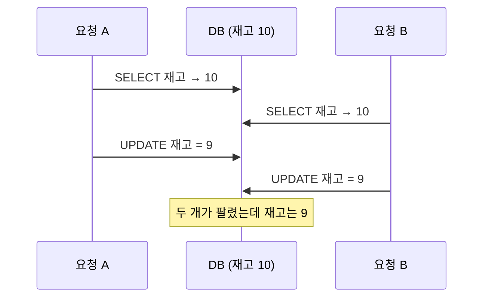

동시성 문제는 멀티스레드 문법 문제로만 이해하면 부족하다.  
실무에서 동시성은 대부분 “같은 데이터를 여러 요청이 동시에 건드릴 때 어떤 결과가 만들어지는가”의 문제다.

웹 서버는 요청마다 다른 스레드에서, 서버가 여러 대라면 다른 프로세스에서 같은 코드를 동시에 실행한다. 코드 한 줄 한 줄이 맞더라도, 두 요청의 실행 순서가 섞이면 어느 쪽도 의도하지 않은 결과가 나온다.

---

## 자주 만나는 동시성 문제

- Lost Update
- Double Spending
- 중복 처리
- 재고 음수
- 상태 전이 꼬임
- 순서 역전

가장 기본이 되는 Lost Update(갱신 손실)를 보면 나머지도 같은 구조라는 것이 보인다. 재고가 10개인 상품에 두 주문이 동시에 들어온 경우다.



두 요청 모두 "10을 읽고 1을 빼서 쓴다"는 올바른 코드를 실행했다. 문제는 읽기와 쓰기 사이에 다른 요청이 끼어들 수 있다는 데 있다. 재고 음수, 쿠폰 중복 사용(Double Spending)도 "확인하고 나서 바꾸는" 사이에 다른 요청이 같은 확인을 통과한 결과다.

---

## 왜 위험한가

테스트 환경에서는 잘 재현되지 않기 때문이다.

- 로컬은 요청량이 적고
- 데이터가 단순하고
- 타이밍이 잘 겹치지 않는다

하지만 운영에서는 동시에 수십, 수백 건이 들어오면서 문제를 드러낸다.

재현하려면 의도적으로 타이밍을 겹치게 만들어야 한다. 테스트에서 `CountDownLatch`로 여러 스레드를 같은 순간에 출발시키거나, 위 그림처럼 두 DB 세션을 열어 쿼리 순서를 손으로 섞어 실행해 보는 방법이 있다.

---

## 해결 관점

### 1. 비관적 락

- `SELECT ... FOR UPDATE`
- 명시적 row lock

정합성은 강하지만 경합이 심해지면 성능이 떨어진다.

"충돌이 날 것"이라고 비관적으로 가정하고, 읽는 시점에 미리 잠그는 방식이다. MySQL 문서는 같은 트랜잭션 안에서 데이터를 조회한 뒤 관련 데이터를 수정한다면 일반 `SELECT`로는 충분히 보호되지 않는다고 설명한다. `SELECT ... FOR UPDATE`는 검색한 인덱스 레코드에 `UPDATE`를 실행한 것과 같은 락을 걸어, 다른 트랜잭션이 그 행을 수정하거나 `FOR SHARE`로 읽지 못하게 한다([MySQL: Locking Reads](https://dev.mysql.com/doc/refman/8.4/en/innodb-locking-reads.html)).

```sql
START TRANSACTION;
SELECT quantity FROM stock WHERE product_id = 42 FOR UPDATE;  -- 다른 트랜잭션은 여기서 대기
UPDATE stock SET quantity = quantity - 1 WHERE product_id = 42;
COMMIT;
```

위 그림에서 요청 B의 `SELECT`가 A의 커밋까지 기다리게 되므로 B는 9를 읽는다. 락을 쥔 시간만큼 다른 요청이 기다리므로, 락을 잡은 채 외부 API를 호출하는 식으로 트랜잭션을 길게 만들면 안 된다. 검색 조건에 맞는 인덱스가 없으면 생각보다 넓은 범위가 잠길 수 있다는 점은 [Gap Lock](/posts/gap-lock/)에서 다뤘다.

### 2. 낙관적 락

- version column
- compare-and-swap

충돌이 적은 환경에서 유리하다.

"충돌은 드물 것"이라고 가정하고, 잠그지 않고 진행하다가 쓰는 순간에 충돌을 감지한다. JPA에서는 엔티티에 `@Version` 필드를 두면 된다. Jakarta Persistence 명세는 이 필드를 낙관적 락 값으로 쓰이는 버전 필드로 정의한다([Jakarta Persistence: Version](https://jakarta.ee/specifications/persistence/3.1/apidocs/jakarta.persistence/jakarta/persistence/version)).

```java
@Entity
public class Stock {
    @Id
    private Long productId;
    private int quantity;

    @Version
    private Long version;
}
```

수정할 때 Hibernate 같은 JPA 구현체는 `UPDATE stock SET quantity = ?, version = version + 1 WHERE product_id = ? AND version = ?`처럼 읽을 때의 버전을 조건에 넣는다([Hibernate User Guide: Optimistic locking](https://docs.jboss.org/hibernate/orm/6.6/userguide/html_single/Hibernate_User_Guide.html#locking-optimistic)). 그 사이 다른 요청이 먼저 수정했다면 버전이 달라 갱신된 행이 0건이 되고, `OptimisticLockException`이 발생한다. 이 예외가 나면 현재 트랜잭션은 롤백 대상으로 표시된다([Jakarta Persistence: OptimisticLockException](https://jakarta.ee/specifications/persistence/3.1/apidocs/jakarta.persistence/jakarta/persistence/optimisticlockexception)). 충돌한 요청은 다시 읽어서 재시도하거나 사용자에게 실패를 알린다. 충돌이 잦으면 재시도가 반복되어 오히려 비관적 락보다 느려진다.

compare-and-swap은 같은 생각을 메모리 수준에서 구현한 것이다. 이 방식의 원리와 한계는 [Lock-Free와 CAS](/posts/lock-free-and-cas/)에 정리했다.

락 없이 해결되는 경우도 있다. 재고 차감은 읽고 계산해서 쓰는 대신 조건부 갱신 한 문장으로 바꿀 수 있다.

```sql
UPDATE stock SET quantity = quantity - 1
WHERE product_id = 42 AND quantity > 0;
```

갱신된 행이 0건이면 재고가 없다는 뜻이다. 읽기와 쓰기가 한 문장 안에서 일어나므로 그 사이에 다른 요청이 끼어들 틈이 없다.

### 3. 유니크 제약

애플리케이션 로직보다 DB 제약이 더 강력한 경우가 많다.

예:

- 중복 주문 방지 키
- 중복 발급 방지

"이미 발급했는지 조회하고 없으면 INSERT"하는 코드는 위의 Lost Update와 같은 틈을 가진다. 두 요청이 동시에 "없음"을 확인하고 둘 다 INSERT할 수 있다. `(user_id, coupon_id)`에 유니크 제약을 걸면 두 번째 INSERT는 DB가 거부한다. 애플리케이션은 중복 키 예외를 "이미 발급됨"으로 해석하면 된다.

```sql
ALTER TABLE coupon_issue ADD CONSTRAINT uk_user_coupon UNIQUE (user_id, coupon_id);
```

### 4. 멱등성 키

특히 외부 연동/재시도 환경에서는 매우 중요하다.

클라이언트가 결제 요청을 보냈는데 응답 전에 네트워크가 끊겼다면, 클라이언트는 같은 요청을 다시 보낼 수밖에 없다. 서버가 이 두 요청을 구분하지 못하면 결제가 두 번 된다. 멱등성 키는 클라이언트가 요청마다 고유한 키를 붙이고, 서버가 같은 키의 요청은 한 번만 처리하고 이후에는 처음 결과를 돌려주는 방식이다. IETF에는 이를 표준 헤더로 정의하려는 초안이 있고, 초안은 `Idempotency-Key` 요청 헤더로 POST나 PATCH 같은 멱등하지 않은 메서드를 장애에 강하게 만들 수 있다고 설명한다([draft-ietf-httpapi-idempotency-key-header](https://datatracker.ietf.org/doc/draft-ietf-httpapi-idempotency-key-header/)). 서버 쪽에서는 이 키를 위의 유니크 제약으로 저장하면 동시에 들어온 같은 키의 요청도 하나만 통과한다.

---

## 주니어가 기억해야 할 것

- 동시성은 코드 블록 하나의 문제가 아니다
- DB 트랜잭션, 락, 상태 모델과 같이 봐야 한다
- “이 요청이 동시에 두 번 들어오면 어떻게 되는가?”를 항상 물어봐야 한다
- 정합성 비용과 성능 비용은 트레이드오프다

두 번째 항목에서 트랜잭션만으로 충분하다고 생각하기 쉽다. 하지만 위의 Lost Update는 두 요청이 각각 트랜잭션 안에 있어도 일어난다. MySQL InnoDB는 READ COMMITTED와 REPEATABLE READ에서 일반 `SELECT`를 일관된 읽기(consistent read)로 처리하고, 이 읽기는 락을 걸지 않기 때문이다([MySQL: Consistent Nonlocking Reads](https://dev.mysql.com/doc/refman/8.4/en/innodb-consistent-read.html)). 트랜잭션이 무엇을 보장하고 무엇을 보장하지 않는지는 [데이터베이스 트랜잭션을 어떻게 봐야 하는가](/posts/transaction/)에서 이어진다.

`synchronized`나 `ReentrantLock` 같은 JVM 안의 락은 서버가 한 대일 때만 통한다. 서버가 두 대 이상이면 각 JVM의 락은 서로를 모르므로, DB 락이나 분산 락처럼 모든 서버가 공유하는 지점에서 막아야 한다. 분산 락이 있어도 경쟁이 남을 수 있는 사례는 [분산 락이 있어도 레이스가 발생한 이유](/posts/bulk-insert-with-lock-part4/)에 있다.

---

## 이 장에서 가져갈 점

- 동시성 버그는 "읽고, 판단하고, 쓰는" 사이의 틈에서 생긴다. 그 틈을 없애거나(조건부 갱신), 잠그거나(비관적 락), 쓰는 순간 감지한다(낙관적 락, 유니크 제약).
- 경합이 잦으면 비관적 락, 드물면 낙관적 락이 유리하다. 어느 쪽이 맞는지는 실제 충돌 빈도로 판단한다.
- 마지막 방어선은 DB 제약이다. 애플리케이션 검사가 뚫려도 유니크 제약은 뚫리지 않는다.

---

## 정리

동시성은 고급 주제가 아니라 실무 기본기다.  
결제, 재고, 예약, 상태 변경처럼 핵심 도메인을 다루는 순간 반드시 마주친다.

## 참고

- [Locking Reads](https://dev.mysql.com/doc/refman/8.4/en/innodb-locking-reads.html) — MySQL 8.4 Reference Manual
- [Consistent Nonlocking Reads](https://dev.mysql.com/doc/refman/8.4/en/innodb-consistent-read.html) — MySQL 8.4 Reference Manual
- [Hibernate ORM User Guide: Optimistic locking](https://docs.jboss.org/hibernate/orm/6.6/userguide/html_single/Hibernate_User_Guide.html#locking-optimistic) — Hibernate
- [Version](https://jakarta.ee/specifications/persistence/3.1/apidocs/jakarta.persistence/jakarta/persistence/version) — Jakarta Persistence 3.1 API
- [OptimisticLockException](https://jakarta.ee/specifications/persistence/3.1/apidocs/jakarta.persistence/jakarta/persistence/optimisticlockexception) — Jakarta Persistence 3.1 API
- [The Idempotency-Key HTTP Header Field](https://datatracker.ietf.org/doc/draft-ietf-httpapi-idempotency-key-header/) — IETF Internet-Draft
