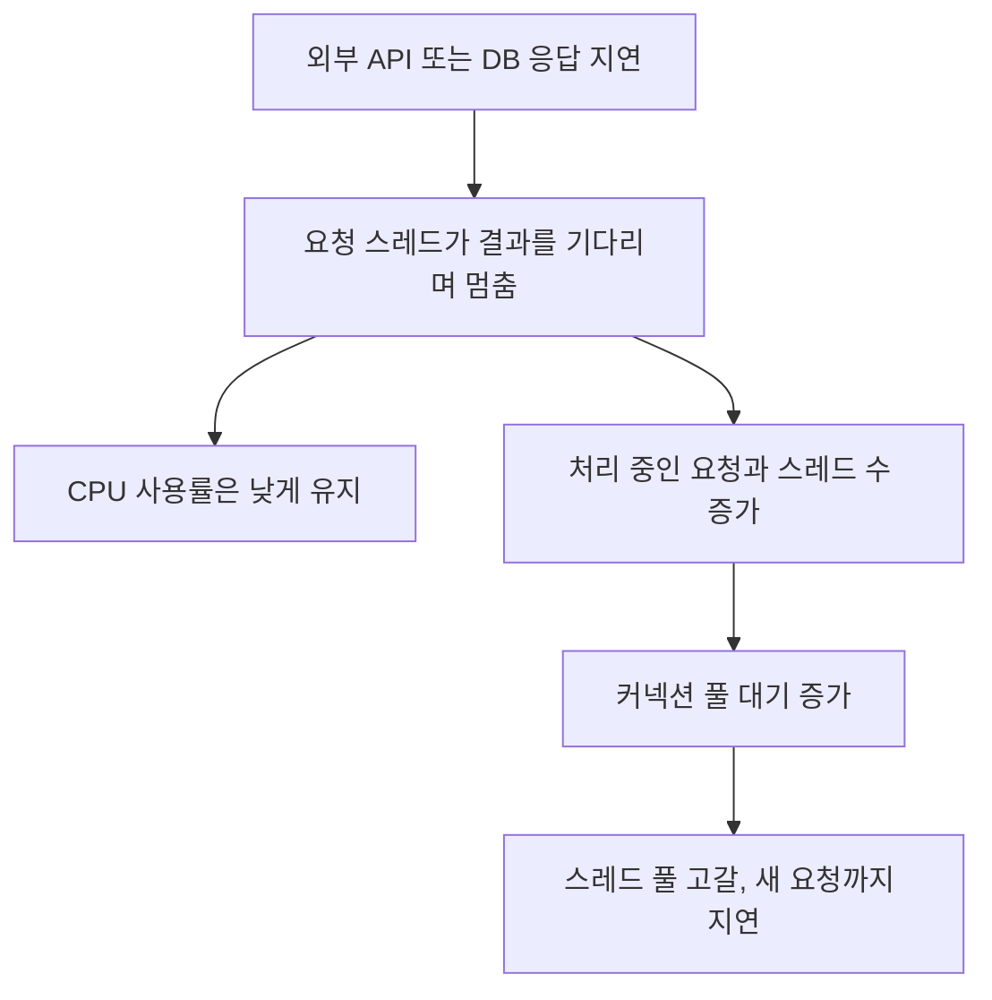

백엔드 서비스는 CPU보다 I/O 때문에 느려지는 경우가 많다.  
DB, 파일, 네트워크, 외부 API 모두 I/O 자원이다.

I/O(입출력)는 프로그램이 CPU와 메모리 바깥의 무언가와 데이터를 주고받는 일이다. 디스크에서 파일을 읽거나, 네트워크로 DB에 쿼리를 보내고 결과를 받는 일이 모두 여기에 들어간다. 이 작업들은 CPU 연산보다 훨씬 느리고, 그동안 요청을 처리하던 스레드는 대부분 결과를 기다리며 멈춰 있다.

## I/O 병목이 보이는 신호

- CPU는 남는데 응답 시간이 느리다
- 스레드가 많이 쌓인다
- connection pool 대기가 늘어난다
- 외부 호출이나 DB 호출 시간이 길다

네 신호는 하나의 흐름으로 이어진다. 요청 하나를 스레드 하나가 처리하는 서버(thread-per-request)에서 각 스레드가 DB 응답을 기다리느라 멈춰 있으면, CPU는 할 일이 없어 사용률이 낮게 나온다. 그 사이 새 요청은 계속 들어오므로 스레드 수가 늘어나고, 모든 스레드가 같은 커넥션 풀을 바라보고 있으니 커넥션을 얻으려는 대기열도 길어진다.



이 상태에서 thread dump를 떠 보면 많은 스레드가 소켓 읽기나 커넥션 획득 지점에서 멈춰 있는 모습이 보인다. 스택을 읽는 방법은 [thread dump 읽는 법](/posts/thread-dump-basics/)에 따로 정리했다.

## 왜 중요한가

I/O 병목은 애플리케이션 코드 최적화만으로는 해결되지 않는 경우가 많다.

- DB 쿼리 지연
- 디스크 flush 지연
- 네트워크 지연
- 외부 API 응답 지연

같은 원인을 분리해야 한다.

반복문을 다듬어서 CPU 시간을 1ms 줄여도, 요청 시간의 대부분이 DB 응답을 기다리는 300ms라면 체감 차이는 없다. 그래서 먼저 "요청 시간 중 어디서 기다리는가"를 구간별로 나눠 봐야 한다. DB 호출 시간, 외부 API 호출 시간, 커넥션 획득 대기 시간을 따로 측정해 두면, 같은 "느리다"는 증상도 쿼리 문제인지 풀 크기 문제인지 상대 시스템 문제인지 구분할 수 있다.

커넥션 풀 크기를 무작정 키우는 것도 해결책이 아니다. HikariCP 위키는 코어 수보다 많은 스레드를 동시에 돌리면 시분할에 따른 컨텍스트 스위칭 때문에 오히려 느려지고, 디스크나 네트워크 대기가 있을 때에만 코어 수보다 조금 큰 풀이 이득이라고 설명한다. 그래서 작은 풀에 스레드들이 줄을 서는 상태를 바람직하다고 본다([HikariCP, About Pool Sizing](https://github.com/brettwooldridge/HikariCP/wiki/About-Pool-Sizing)). 풀을 키우면 애플리케이션 쪽 대기는 줄어들지만, 그만큼의 동시 쿼리가 DB로 넘어가 DB 안에서 기다리게 된다. 커넥션 풀의 기본 동작은 [Connection Pool](/posts/connection-pool/)에, DB 쪽에서 본 비용은 [Postgres 커넥션 하나의 비용](/posts/cost-of-a-postgres-connection/)에 정리했다.

## 해결 방향

### 1. 병렬화

독립적인 I/O는 병렬 실행으로 줄일 수 있다.  
다만 무한정 병렬화하면 오히려 downstream 부하만 키운다.

상품 정보, 재고, 리뷰를 서로 다른 API에서 가져와야 한다면, 순서대로 호출할 때 총 시간은 세 호출 시간의 합이다. 서로 의존하지 않는다면 동시에 호출해서 가장 느린 호출 시간만큼으로 줄일 수 있다.

```java
ExecutorService ioPool = Executors.newFixedThreadPool(16); // 동시 호출 수 상한

CompletableFuture<Product> product = CompletableFuture.supplyAsync(() -> productClient.get(id), ioPool);
CompletableFuture<Stock> stock = CompletableFuture.supplyAsync(() -> stockClient.get(id), ioPool);
CompletableFuture<List<Review>> reviews = CompletableFuture.supplyAsync(() -> reviewClient.list(id), ioPool);

CompletableFuture.allOf(product, stock, reviews).join();
```

여기서 고정 크기 풀이 "무한정 병렬화"를 막는 장치다. 요청 하나가 호출 세 개를 만드는 구조에서 상한이 없으면, 트래픽이 몰릴 때 하위 시스템(downstream)이 받는 동시 요청이 몇 배로 불어난다. 병렬화는 내 응답 시간을 줄이는 대신 상대 시스템의 순간 부하를 키운다는 점을 같이 계산해야 한다.

Java 21의 가상 스레드(virtual thread)도 같은 맥락에서 볼 수 있다. JEP 444는 가상 스레드에서 블로킹 I/O를 호출하면 런타임이 OS 수준에서는 논블로킹 호출을 하고 가상 스레드만 잠시 내려 둔다고 설명한다. 다만 가상 스레드가 코드를 더 빨리 실행하지는 않으며, 목적은 지연 시간 단축이 아니라 처리량 확대라고 명시한다([JEP 444: Virtual Threads](https://openjdk.org/jeps/444)). 기다리는 스레드를 싸게 만들 뿐, 기다림의 원인인 느린 쿼리나 느린 외부 API를 고쳐 주지는 않는다.

### 2. 캐시

반복 조회는 캐시가 가장 강력할 수 있다.

같은 데이터를 여러 번 읽는다면 I/O 자체를 없애는 것이 가장 확실한 개선이다. 대신 원본이 바뀌었을 때 캐시가 옛 값을 돌려줄 수 있다는 일관성 문제와, 캐시가 비는 순간 요청이 한꺼번에 원본으로 몰리는 문제가 함께 생긴다. 캐시가 계층별로 어떻게 쓰이는지는 [CPU부터 CDN까지: 모든 계층에서의 캐싱](/posts/cache-across-layers/)에, 만료 순간의 몰림은 [캐시 스탬피드](/posts/cache-stampede/)에 정리했다.

### 3. 배치와 스트리밍 구분

대량 데이터를 한 번에 읽지 말고 청크/스트림으로 처리하는 것이 낫다.

100만 건을 한 번의 쿼리로 모두 메모리에 올리면 DB 응답 하나가 매우 길어지고, 애플리케이션 메모리도 그만큼 차지한다. 1,000건씩 끊어 읽고 처리하면 한 번의 I/O가 짧아지고 메모리 사용량이 일정하게 유지된다. 처리 도중 실패해도 마지막으로 끝낸 청크부터 다시 시작할 수 있다는 장점도 있다.

### 4. 비동기/큐 분리

응답 경로에서 바로 처리할 필요 없는 I/O는 비동기로 넘길 수 있다.

메일 발송이나 외부 시스템 통보처럼 사용자가 결과를 바로 볼 필요가 없는 I/O는 큐에 넣고 응답을 먼저 보낼 수 있다. 이때 생기는 중복 전달, 순서, 적체 문제는 [5장 비동기 연동](/posts/chap-05/)에서 정리했다.

## 이 장에서 가져갈 점

I/O 병목은 “느린 코드” 문제가 아니라,  
대기 시간이 어디서 발생하는지와 자원 경계를 어떻게 나눌지의 문제다.

네 가지 해결 방향은 각각 대기를 다르게 다룬다. 병렬화는 대기를 겹치고, 캐시는 대기를 없애고, 청크 처리는 대기를 잘게 나누고, 비동기는 대기를 응답 경로 밖으로 옮긴다. 어느 쪽을 고르든 먼저 구간별 대기 시간을 측정해서 어떤 대기를 다룰지 정해야 한다.

## 참고

- [HikariCP Wiki, About Pool Sizing](https://github.com/brettwooldridge/HikariCP/wiki/About-Pool-Sizing)
- [JEP 444: Virtual Threads](https://openjdk.org/jeps/444)
