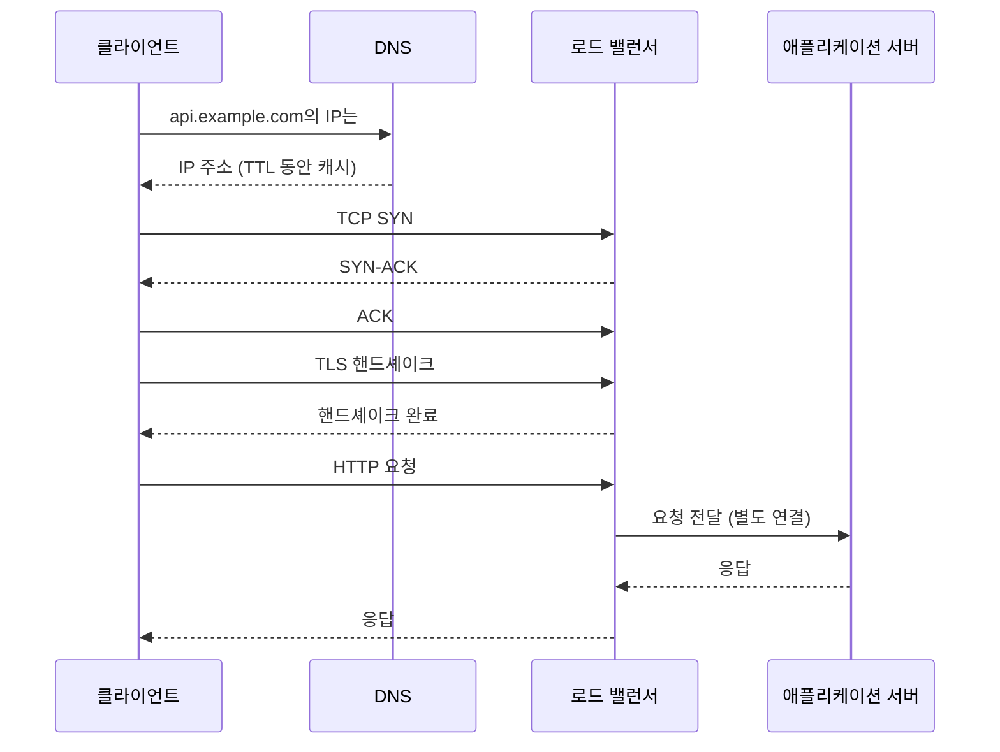

백엔드 개발자는 네트워크를 깊게 전공하지 않아도 되지만,  
HTTP 요청 하나가 어떤 경로를 거쳐 서버에 도달하는지는 이해해야 한다.

---

## 최소한 알아야 할 것

- DNS
- TCP handshake
- TLS
- HTTP keep-alive
- timeout
- load balancer / reverse proxy

이 목록은 요청 하나가 실제로 밟는 순서와 거의 같다. 새 연결로 HTTPS 요청을 보낸다면 다음 단계를 차례로 거친다.

- DNS: 도메인 이름을 IP 주소로 바꾼다. 응답에는 TTL이 있어, 그 시간 동안은 결과를 캐시해도 된다. RFC 1035는 TTL을 리소스 레코드를 캐시할 수 있는 시간 간격으로 정의한다.
- TCP 핸드셰이크: SYN, SYN-ACK, ACK 세 번의 패킷으로 연결을 맺는다. RFC 9293은 이를 연결을 수립하는 절차인 3-way handshake로 설명한다([RFC 9293](https://www.rfc-editor.org/rfc/rfc9293)). 데이터를 보내기 전에 왕복이 한 번 든다.
- TLS: 암호화 채널을 만드는 핸드셰이크다. TLS 1.3의 기본 핸드셰이크는 한 번의 왕복으로 끝나고(1-RTT), 이전 세션을 재개하면 일부 데이터를 첫 패킷에 실을 수도 있다([RFC 8446](https://www.rfc-editor.org/rfc/rfc8446)). TLS 종료 위치에 대해서는 [SSL/TLS](/posts/ssl-tls/) 노트에 정리했다.

새 연결 하나를 맺는 데만 TCP와 TLS 합쳐 최소 두 번의 왕복이 든다. 서버와 클라이언트 사이 왕복 시간이 50ms라면 HTTP 요청을 보내기도 전에 100ms가 지나간다.

---

## 왜 중요한가

외부 연동 문제나 응답 지연 문제는 네트워크 기초를 모르면 전부 “그냥 느리다”로만 보인다.

예를 들어:

- DNS 지연
- TCP 연결 수립 지연
- TLS handshake 비용
- LB idle timeout

은 전부 서로 다른 문제다.

위 그림의 단계마다 느려지는 원인과 확인 방법이 다르다. DNS 조회가 느리면 리졸버를, 연결 수립이 느리면 상대 서버의 연결 수용 상태나 네트워크 경로를, TLS 핸드셰이크가 느리면 연결 재사용 여부를 본다. "어느 단계에서 시간이 걸렸는가"를 나눠 보는 것이 출발점이다.

DNS에는 애플리케이션 쪽 캐시도 있다. Java의 `InetAddress`는 이름 조회 결과를 캐시하고, 그 기간은 보안 속성 `networkaddress.cache.ttl`로 정한다. 기본값은 구현에 따라 정해진 시간이고, `-1`은 영원히 캐시한다는 뜻이다([InetAddress Javadoc](https://docs.oracle.com/en/java/javase/21/docs/api/java.base/java/net/InetAddress.html)). 상대 서비스가 IP를 바꿨는데 우리 서버만 계속 옛 주소로 접속한다면 이 캐시 설정을 확인한다.

---

## 실무에서 자주 헷갈리는 것

### connection timeout vs read timeout

- connection timeout: 연결 자체가 안 됨
- read timeout: 연결은 됐지만 응답이 늦음

위 그림에 대입하면 connection timeout은 TCP 핸드셰이크 단계에서, read timeout은 HTTP 요청을 보낸 뒤 응답을 기다리는 단계에서 걸린다. Java `HttpClient`는 두 경우에 각각 `HttpConnectTimeoutException`과 `HttpTimeoutException`을 던진다([HttpClient.Builder](https://docs.oracle.com/en/java/javase/21/docs/api/java.net.http/java/net/http/HttpClient.Builder.html)). connection timeout이 났다면 요청은 상대 애플리케이션에 도달하지 않았다. read timeout이 났다면 상대가 요청을 처리했을 수도 있으므로, 재시도 전에 멱등성을 따져야 한다. 이 판단은 [4장 외부 연동](/posts/chap-04/)에서 다뤘다.

### keep-alive

매 요청마다 연결을 새로 만드는 건 비싸다.  
그래서 커넥션 재사용이 중요하다.

HTTP/1.1은 기본적으로 지속 연결(persistent connection)을 써서, 한 연결로 여러 요청과 응답을 주고받는다. `Connection: close`가 있을 때만 응답 후 연결을 닫는다([RFC 9112 9.3](https://www.rfc-editor.org/rfc/rfc9112#name-persistence)). 앞에서 본 TCP와 TLS 왕복 비용을 첫 요청에서만 내고 이후 요청은 건너뛰는 셈이다. 실무에서는 HTTP 클라이언트의 커넥션 풀이 이 재사용을 맡는다. 클라이언트 객체를 요청마다 새로 만들면 풀도 매번 새로 생겨 재사용이 일어나지 않는다. 자세한 내용은 [Keep-Alive](/posts/keep-alive/) 노트에 있다.

연결을 재사용하면 새로운 문제가 하나 생긴다. 쉬고 있는 연결을 중간 장비나 상대 서버가 먼저 끊을 수 있다는 것이다. AWS Application Load Balancer는 클라이언트나 타깃과의 연결에 데이터가 오가지 않은 채 idle timeout이 지나면 연결을 닫고, 이 값의 기본은 60초다. AWS 문서는 애플리케이션의 idle timeout을 로드 밸런서보다 길게 설정하라고 권한다. 애플리케이션이 먼저 연결을 닫으면, 로드 밸런서가 그 사실을 알기 전에 닫힌 연결로 요청을 보내 클라이언트에 502 Bad Gateway를 돌려줄 수 있기 때문이다([ALB: Connection idle timeout](https://docs.aws.amazon.com/elasticloadbalancing/latest/application/edit-load-balancer-attributes.html)). 간헐적인 502가 트래픽이 적은 시간대에 몰린다면 이 설정부터 의심할 만하다.

### 프록시 계층

클라이언트와 애플리케이션 서버 사이에는 종종:

- CDN
- LB
- reverse proxy
- ingress

같은 계층이 있다. 문제는 이 중간 계층에서 생기기도 한다.

중간 계층이 생기면 확인할 것이 늘어난다.

- 연결이 계층마다 따로 맺어진다. 클라이언트와 LB 사이 연결과 LB와 서버 사이 연결은 별개이고, 각자 타임아웃이 있다. 가장 짧은 타임아웃이 전체 요청의 상한이 된다.
- 애플리케이션이 보는 클라이언트 IP는 바로 앞 프록시의 IP다. 원래 IP와 프로토콜은 `X-Forwarded-For`, `X-Forwarded-Proto` 같은 헤더로 전달되므로, 접속 로그나 IP 기반 제한은 이 헤더를 읽도록 설정해야 한다.
- 오류 응답의 출처를 구분해야 한다. 502나 504는 애플리케이션이 아니라 중간 계층이 만든 응답일 수 있다. 애플리케이션 로그에 해당 요청이 없다면 중간 계층의 로그를 본다.

---

## 이 장에서 가져갈 점

- 요청 하나를 DNS, TCP, TLS, HTTP 단계로 나눠 보면 "느리다"를 "어느 단계가 느리다"로 바꿀 수 있다.
- 새 연결은 비싸다. 커넥션 풀과 keep-alive로 연결을 재사용하고, 클라이언트 객체는 공유한다.
- 연결을 재사용하는 모든 구간에서 idle timeout의 대소 관계를 맞춘다. 뒤쪽(서버)이 앞쪽(LB)보다 길어야 한다.
- 중간 계층마다 연결과 타임아웃과 로그가 따로 있다는 것을 기억한다.

---

## 정리

네트워크를 알아야 하는 이유는 “프로토콜 이론” 때문이 아니라,  
장애를 계층별로 나눠서 해석하기 위해서다.

## 참고

- [RFC 1035: Domain Names - Implementation and Specification](https://www.rfc-editor.org/rfc/rfc1035) — IETF
- [RFC 9293: Transmission Control Protocol](https://www.rfc-editor.org/rfc/rfc9293) — IETF
- [RFC 8446: The Transport Layer Security (TLS) Protocol Version 1.3](https://www.rfc-editor.org/rfc/rfc8446) — IETF
- [RFC 9112: HTTP/1.1, 9.3 Persistence](https://www.rfc-editor.org/rfc/rfc9112#name-persistence) — IETF
- [InetAddress](https://docs.oracle.com/en/java/javase/21/docs/api/java.base/java/net/InetAddress.html) — Java SE 21 API
- [HttpClient.Builder](https://docs.oracle.com/en/java/javase/21/docs/api/java.net.http/java/net/http/HttpClient.Builder.html) — Java SE 21 API
- [Edit attributes for your Application Load Balancer](https://docs.aws.amazon.com/elasticloadbalancing/latest/application/edit-load-balancer-attributes.html) — Elastic Load Balancing User Guide
