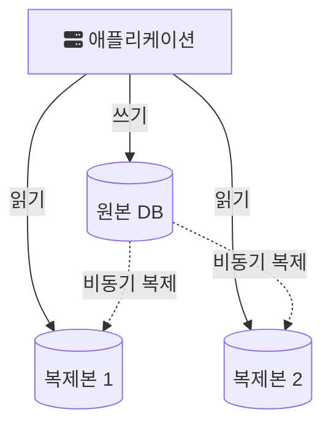

마지막 장은 특정 기술보다 “구조를 어떤 문제를 해결하기 위해 도입하는가”에 초점이 있다.

그래서 아래 구조들도 "무엇인가"보다 "어떤 병목을 줄이는 대신 무엇을 새로 떠안는가"의 짝으로 정리했다.

## 자주 등장하는 구조

### 1. 계층형 구조

- Controller
- Service
- Repository

가장 흔하지만, 계층 분리가 자동으로 좋은 설계를 의미하는 건 아니다.

각 계층의 역할은 보통 이렇게 나뉜다. Controller는 HTTP 요청을 받아 입력을 검증하고 응답 형식으로 바꾼다. Service는 트랜잭션 경계와 업무 규칙을 담는다. Repository는 데이터 저장소 접근을 감춘다. 의존 방향은 위에서 아래로만 흐르고, 아래 계층은 위 계층을 모른다.

계층을 나눴는데도 설계가 나빠지는 대표적인 경우는 두 가지다. 하나는 Service가 Repository 호출만 그대로 전달하고 업무 규칙은 Controller나 엔티티 여기저기에 흩어지는 경우다. 다른 하나는 Service 하나가 여러 도메인의 규칙을 모두 끌어안아 수천 줄로 커지는 경우다. 파일이 계층별로 나뉘어 있어도 변경 하나가 여러 계층을 동시에 건드린다면, 나눈 기준이 변경의 단위와 맞지 않는다는 뜻이다. 이 기준은 [응집도와 결합도에 관하여](/posts/cohesion-coupling/)에서 더 다뤘다.

### 2. 캐시 계층

- DB 부하 절감
- 응답 속도 개선

하지만 일관성 비용이 뒤따른다.

가장 흔한 형태는 cache-aside다. 읽을 때 캐시를 먼저 보고, 없으면(cache miss) 원본 저장소에서 읽어 캐시에 넣은 뒤 돌려준다. 쓸 때는 원본을 고치고 캐시 항목을 무효화한다. Azure 아키텍처 문서는 이 순서가 중요하다고 짚는다. 캐시를 먼저 지우면 원본이 갱신되기 전의 짧은 틈에 다른 요청이 옛 값을 다시 캐시에 채울 수 있기 때문이다. 같은 문서는 cache-aside가 캐시와 원본 사이의 일관성을 보장하지 않으며, 쓰기 직후 다음 읽기 전까지는 옛 값이 보일 수 있다고 정리한다([Cache-Aside pattern](https://learn.microsoft.com/en-us/azure/architecture/patterns/cache-aside)).

만료 시간(TTL)도 양쪽으로 비용이 있다. 너무 짧으면 원본 조회가 계속 반복되고, 너무 길면 옛 값이 오래 남는다. 인기 있는 키가 만료되는 순간 요청이 한꺼번에 원본으로 몰리는 문제는 [캐시 스탬피드](/posts/cache-stampede/)에 따로 정리했다.

### 3. 큐 기반 처리

- 비동기 처리
- 트래픽 흡수
- 재시도 분리

하지만 운영 복잡도와 멱등성 문제가 따라온다.

트래픽 흡수는 순간적으로 몰린 요청을 큐에 쌓아 두고 소비자가 감당할 수 있는 속도로 꺼내 처리하는 것이다. 대신 같은 메시지가 두 번 전달될 수 있으므로 소비자는 멱등하게 처리해야 하고, 계속 실패하는 메시지를 따로 빼는 DLQ와 적체 모니터링이 필요하다. 자세한 내용은 [5장 비동기 연동](/posts/chap-05/)에 있다.

### 4. 읽기/쓰기 분리

- 조회 부하가 큰 시스템에서 유용
- 하지만 replication lag와 일관성 이슈가 생길 수 있다

쓰기는 원본(source) DB 한 곳으로, 읽기는 복제본(replica) 여러 대로 보내는 구조다. MySQL 문서도 읽기가 많고 쓰기가 적은 환경에서 복제를 읽기 확장에 쓰는 구성을 소개한다([MySQL 8.4, Using Replication for Scale-Out](https://dev.mysql.com/doc/refman/8.4/en/replication-solutions-scaleout.html)).

문제는 그림의 점선이다. MySQL 복제는 기본적으로 비동기다("Replication is asynchronous by default", [MySQL 8.4, Replication](https://dev.mysql.com/doc/refman/8.4/en/replication.html)). 원본에 쓴 변경이 복제본에 반영되기까지 지연(replication lag)이 있으므로, 사용자가 글을 저장한 직후 목록을 새로고침했는데 방금 쓴 글이 안 보이는 일이 생긴다. 그래서 "방금 자기가 쓴 데이터를 다시 읽는 요청"은 원본으로 보내는 식의 예외 규칙이 함께 필요하다. 복제의 기본 동작은 [데이터베이스 리플리케이션 기본 정리](/posts/db-replication/)에 정리했다.

읽기 모델과 쓰기 모델을 아예 다른 모델로 나누는 것이 CQRS(Command Query Responsibility Segregation)다. Martin Fowler는 대부분의 시스템은 읽는 방식과 쓰는 방식이 같은 CRUD 모델에 잘 맞고, 그런 시스템에 CQRS를 더하면 복잡도만 크게 늘 수 있다고 경고한다([Martin Fowler, CQRS](https://martinfowler.com/bliki/CQRS.html)). DB를 나누는 것과 모델을 나누는 것은 다른 결정이고, 뒤로 갈수록 비용이 크다.

## 패턴을 볼 때 질문해야 할 것

- 이 구조가 해결하는 병목은 무엇인가
- 대신 어떤 복잡도가 늘어나는가
- 운영자가 이해 가능한 수준인가
- 지금 트래픽과 팀 규모에 과한가

위 네 구조에 이 질문을 적용하면 다음과 같이 정리된다.

| 구조 | 줄이는 병목 | 새로 생기는 비용 |
| --- | --- | --- |
| 계층형 구조 | 책임이 뒤섞인 코드의 변경 비용 | 계층 간 전달 코드, 잘못 나눈 경계 |
| 캐시 계층 | 반복 조회의 DB 부하와 지연 | 옛 값 노출, 만료 시점의 몰림 |
| 큐 기반 처리 | 응답 경로의 느린 작업, 순간 트래픽 | 중복 전달, 순서, DLQ와 적체 운영 |
| 읽기/쓰기 분리 | 원본 DB의 읽기 부하 | 복제 지연, 읽기 라우팅 규칙 |

결정의 근거를 나중에 다시 확인할 수 있도록, 이런 표를 [ADR](/posts/architecture-decision-records/)로 남겨 두는 방법도 있다.

## 이 책 전체의 결론

좋은 백엔드 개발자는 패턴 이름을 많이 아는 사람이 아니라,  
문제가 생겼을 때 어떤 계층에서 병목과 위험이 생기는지 읽고 적절한 구조를 고를 수 있는 사람이다.

결국 설계 패턴은 멋진 구조를 만들기 위한 것이 아니라,  
**실제 운영 문제를 줄이기 위한 선택지**로 봐야 한다.

## 참고

- [Azure Architecture Center, Cache-Aside pattern](https://learn.microsoft.com/en-us/azure/architecture/patterns/cache-aside)
- [MySQL 8.4 Reference Manual, Replication](https://dev.mysql.com/doc/refman/8.4/en/replication.html)
- [MySQL 8.4 Reference Manual, Using Replication for Scale-Out](https://dev.mysql.com/doc/refman/8.4/en/replication-solutions-scaleout.html)
- [Martin Fowler, CQRS](https://martinfowler.com/bliki/CQRS.html)
