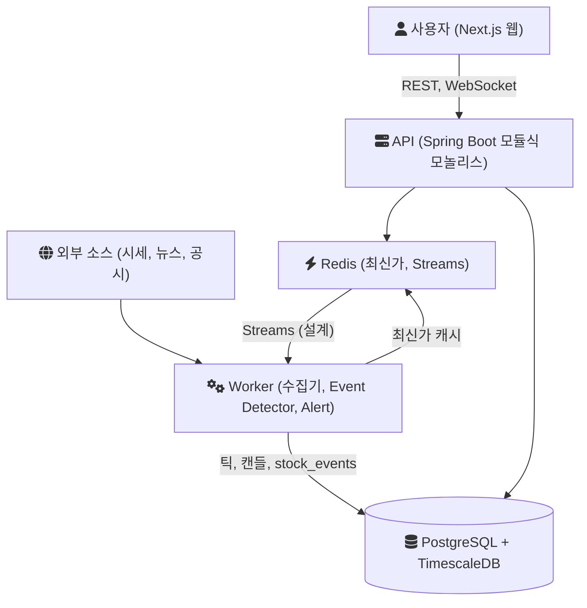
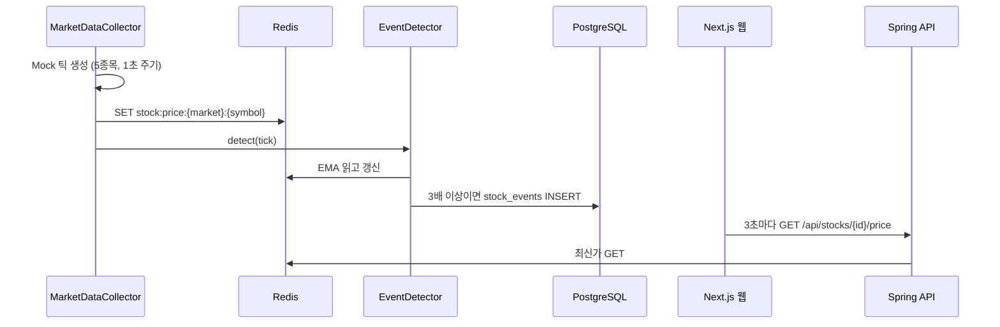

[monticker](https://github.com/polynomeer/monticker)는 주가 차트 위에 뉴스, 공시, 거래량 이상, 감성 신호를 시간순으로 올려서 "왜 움직였는가"를 보여 주려는 주식 관찰 앱이다. 이 글은 저장소를 처음 열 때 세운 설계를 정리한다. 무엇을 만들려 했는지, 구성 요소와 데이터 흐름, 기술마다 무엇과 비교해 골랐는지, 그리고 첫 커밋들이 실제로 만든 것과 아직 비어 있던 것을 차례로 적는다.

저장소의 첫 커밋 [`2bac5c1`](https://github.com/polynomeer/monticker/commit/2bac5c13f5362d854e43363cda816c35e4a2d3ef)은 MIT `LICENSE` 파일 하나다. 설계 문서와 코드 골격은 그다음 커밋 묶음에 들어왔다. 이 글이 말하는 "초기 설계"는 그 묶음, 즉 설계 문서 커밋 [`a7e622e`](https://github.com/polynomeer/monticker/commit/a7e622e5d8886e8fe9120ef2d73286e421924773)부터 [`8cdcd5a`](https://github.com/polynomeer/monticker/commit/8cdcd5a858609e1162369bd79d71f9e1ebc31a5a)까지의 상태다. 이후에 바뀐 구조는 다루지 않는다.

## 풀려던 문제와 조건

보통의 주식 앱은 가격, 차트, 뉴스 목록을 따로 보여 준다. 가격이 튄 시각과 뉴스가 나온 시각을 맞춰 보는 일은 사용자 몫이다. 초기 제품 문서 [`docs/product.md`](https://github.com/polynomeer/monticker/blob/a7e622e5d8886e8fe9120ef2d73286e421924773/docs/product.md)는 이것을 뒤집어, 중심 객체를 가격이 아니라 이벤트로 두었다.

```
일반 앱:     stock → price → chart
monticker:  stock → price + news + disclosure + volume + sentiment
                → stock_events → chart timeline
```

MVP(최소 기능 제품)에서 가장 중요한 화면은 "종목 상세 = 차트 + 이벤트 타임라인 + 관련 뉴스"로 정했다. 실주문, AI 자동매매, 커뮤니티, 네이티브 앱은 MVP에서 뺐다.

결론을 읽기 전에 조건을 먼저 적는다. 이 설계는 아래 조건에서 나왔다.

| 항목 | 초기 문서와 코드의 값 |
|------|----------------------|
| 팀 규모 | 1~2명 ([ADR-001](https://github.com/polynomeer/monticker/blob/098febe4289691d2ea929328496a2cf26b096393/docs/decisions/001-modular-monolith.md)) |
| 데이터 | 실제 시세 API 연결 전. Mock 생성기가 5개 종목(국내 3, 나스닥 2)을 1초마다 만든다 |
| 트래픽 | 측정값 없음. 문서에 목표 수치도 없다 |
| 배포 | 1단계는 단일 VM + Docker Compose |
| 대상 시장 | KOSPI/KOSDAQ 필수, 미국 시장은 선택 |

트래픽 수치가 없다는 점이 중요하다. 아래의 선택은 부하를 재서 고른 것이 아니라, 1~2명이 운영할 수 있는 부품 수를 기준으로 고른 것이다.

## 초기 아키텍처

[`docs/architecture.md`](https://github.com/polynomeer/monticker/blob/a7e622e5d8886e8fe9120ef2d73286e421924773/docs/architecture.md)의 핵심 원칙은 "event-centric, not price-centric"이다. 구성은 Spring Boot 모듈식 모놀리스 하나, 비동기 작업을 맡는 worker 하나, PostgreSQL + TimescaleDB, Redis다. 문서가 그린 구조를 그대로 옮기면 다음과 같다.



데이터 흐름은 한 방향이다. 수집기가 받은 시세는 Redis(최신가)와 TimescaleDB(틱, 캔들)에 쓰인다. Event Detector가 시세를 보고 급등이나 거래량 급증을 찾으면 `stock_events`에 한 줄을 쓴다. 뉴스와 공시 수집기도 같은 테이블에 쓴다. API는 이 테이블을 시간 범위로 읽어 차트 타임라인에 내려 준다.

실시간 파이프라인은 문서에서 이렇게 설계되었다. 수집기 하나가 Redis 최신가 캐시와 TimescaleDB에 쓰고, Redis Stream을 통해 Candle Aggregator, Event Detector, WebSocket Broadcaster에 같은 틱을 나눠 준다. 규모가 커지면 Kafka, 더 커지면 Kafka + Flink로 바꾼다는 단계도 함께 적혀 있다.

## 모듈식 모놀리스와 worker 분리

[ADR-001](https://github.com/polynomeer/monticker/blob/098febe4289691d2ea929328496a2cf26b096393/docs/decisions/001-modular-monolith.md)은 처음부터 [마이크로서비스](/posts/MicroServiceArchitecture/)로 나눌지를 다룬다. 시세 수집, 이벤트 탐지, 뉴스, 공시, 알림, 포트폴리오, AI 요약까지 도메인이 많아서 나눌 이유처럼 보였다.

| 선택지 | 이 프로젝트에서 얻는 것 | 치르는 것 |
|--------|------------------------|-----------|
| 마이크로서비스 | 서비스별 독립 배포, 독립 확장 | 1~2명이 서비스 수만큼 배포, 네트워크 호출, 장애 지점을 운영 |
| 단일 애플리케이션 | 가장 단순함 | 수집, 탐지 같은 주기 작업이 API 요청 처리와 한 프로세스에서 자원을 나눔 |
| 모듈식 모놀리스 + worker | 모듈 경계는 패키지로, 주기 작업은 별도 프로세스로 | 모듈 사이 의존을 규율로 지켜야 함 |

ADR-001은 세 번째를 골랐다. 이유는 팀 규모, 패키지와 인터페이스만으로 경계를 나눌 수 있다는 점, 도메인을 이해하기 전에 서비스 경계를 고정하면 잘못 자르기 쉽다는 점이다. Martin Fowler도 같은 관찰을 적었다. 경험 많은 설계자도 처음에는 경계를 제대로 긋기 어렵고, 서비스 사이로 기능을 옮기는 일은 모놀리스 안에서보다 훨씬 어렵다는 것이다([MonolithFirst](https://martinfowler.com/bliki/MonolithFirst.html)).

치르는 비용도 ADR에 적혀 있다. 모든 모듈이 커넥션 풀 하나를 같이 쓰고, 다른 모듈의 Repository를 직접 부르지 않는다는 규칙은 사람이 지켜야 한다. 재검토 조건은 "한 모듈(예: WebSocket broadcaster, Event Detector)이 다른 모듈은 한가한데 혼자 자원을 다 쓸 때"다.

## stock_events를 중심 테이블로

[ADR-003](https://github.com/polynomeer/monticker/blob/098febe4289691d2ea929328496a2cf26b096393/docs/decisions/003-stock-events-central.md)은 타임라인을 어떻게 만들지를 두 안으로 비교한다.

1. 뉴스, 공시, 시세 테이블을 각각 조회해서 애플리케이션에서 합친다.
2. 수집 시점에 모든 이벤트를 `stock_events` 하나로 정규화해서 쓰고, 타임라인 API는 그것만 읽는다.

2번을 골랐다. 그래서 타임라인 조회는 `WHERE stock_id = ? AND event_time BETWEEN ? AND ? ORDER BY event_time` 하나로 끝난다. 중요도 점수, 감성 점수, 중복 제거를 읽을 때마다가 아니라 쓸 때 한 번만 계산한다. 새 이벤트 소스가 생겨도 타임라인 API는 바뀌지 않는다.

대가는 쓰기 쪽으로 옮겨 간다. 모든 수집기가 `stock_events`에 쓰는 책임을 지고, 원본으로 돌아가는 연결은 `source_type`과 `source_id`로 유지해야 한다. 같은 이벤트가 두 번 들어가지 않도록 `stock_id + event_type + 시간 버킷` 기준으로 쓰기 시점에 중복을 막아야 한다. 소스마다 다른 부가 정보는 `metadata_json`(JSONB 컬럼)에 둔다.

## 시계열 저장소: TimescaleDB

시세 틱과 캔들은 계속 쓰이고 시간 범위로 읽힌다. [ADR-002](https://github.com/polynomeer/monticker/blob/098febe4289691d2ea929328496a2cf26b096393/docs/decisions/002-timescaledb.md)는 일반 PostgreSQL 테이블이 수억 행으로 커지면 성능이 떨어진다는 점에서 출발한다.

| 선택지 | 성질 (출처) | 이 프로젝트에서의 의미 |
|--------|-------------|------------------------|
| PostgreSQL 선언적 파티셔닝 | 기존 파티션에 맞지 않는 행을 넣으면 오류가 나고, 파티션은 직접 추가해야 한다 ([PostgreSQL 16 문서](https://www.postgresql.org/docs/16/ddl-partitioning.html)) | 월별 파티션 생성 스크립트를 따로 운영 |
| 별도 시계열 DB (InfluxDB 등) | InfluxDB 3 Core는 line protocol로 쓰고 SQL, InfluxQL로 읽는다 ([InfluxDB 3 Core 문서](https://docs.influxdata.com/influxdb3/core/)) | 클라이언트와 운영 모델이 하나 더 생기고, `stocks` 같은 업무 테이블과 같은 DB에서 조인할 수 없음 |
| TimescaleDB | PostgreSQL 확장. hypertable은 데이터를 시간 범위별 chunk로 나누고, 일반 PostgreSQL 테이블처럼 다룬다 ([Hypertables](https://www.tigerdata.com/docs/use-timescale/latest/hypertables)) | 같은 연결, 같은 Flyway 마이그레이션 |

ADR-002는 TimescaleDB를 골랐다. 근거는 hypertable(시간 기준으로 자동 분할되는 테이블)의 자동 분할, PostgreSQL과 같은 연결과 마이그레이션 도구, 그리고 `time_bucket`과 continuous aggregate 같은 시계열 함수다. continuous aggregate는 새 데이터가 들어오면 백그라운드에서 갱신되는 집계용 hypertable이다([About continuous aggregates](https://www.tigerdata.com/docs/use-timescale/latest/continuous-aggregates/about-continuous-aggregates)). 캔들 집계를 이것으로 처리할 수 있다는 기대가 있었다.

비용은 이미지와 마이그레이션에 남았다. Docker Compose는 `postgres` 대신 `timescale/timescaledb` 이미지를 써야 하고, 테이블을 만든 뒤 `create_hypertable()`을 불러야 한다. 재검토 조건은 단일 TimescaleDB 노드가 쓰기량을 감당하지 못할 때다.

## 캐시와 메시지 버스: Redis와 Redis Streams

Redis는 처음부터 최신가 캐시로 들어 있었다. `stock:price:KR:005930` 같은 키로 종목별 최신가를 두고, 알림 쿨다운(같은 알림을 일정 시간 다시 보내지 않는 장치)과 뉴스 중복 해시도 Redis 키로 설계했다.

수집기와 후속 소비자 사이의 버스는 [ADR-004](https://github.com/polynomeer/monticker/blob/098febe4289691d2ea929328496a2cf26b096393/docs/decisions/004-redis-streams-over-kafka.md)가 다룬다. 후보는 Redis Pub/Sub, Redis Streams, Kafka 세 가지였다.

| 선택지 | 전달 보장 (출처) | 운영 부담 |
|--------|------------------|-----------|
| Redis Pub/Sub | at-most-once. 구독자가 처리하지 못한 메시지는 영영 사라진다 ([Redis Pub/Sub](https://redis.io/docs/latest/develop/pubsub/)) | 이미 있는 Redis |
| Redis Streams | 메시지가 저장되고, consumer group과 pending entries list로 at-least-once 소비가 가능하다 ([Redis Streams](https://redis.io/docs/latest/develop/data-types/streams/)) | 이미 있는 Redis |
| Kafka | 이벤트는 소비 후에도 지워지지 않고 토픽별 설정 기간만큼 보존된다. 같은 파티션 안에서는 쓴 순서대로 읽힌다 ([Kafka Introduction](https://kafka.apache.org/intro)) | 브로커 클러스터와 토픽 관리가 새로 생김 |

consumer group은 여러 소비자가 한 스트림을 나눠 읽는 단위이고, pending entries list는 전달했지만 아직 확인(`XACK`)받지 못한 메시지 목록이다. 소비자가 죽어도 확인받지 못한 메시지는 이 목록에 남는다.

ADR-004는 Redis Streams를 골랐다. Redis가 이미 스택에 있으니 새 인프라가 없고, consumer group과 ACK가 MVP 수준의 신뢰성에는 충분하며, 적은 처리량에서 Kafka의 운영 부담은 정당화되지 않는다는 이유다. Kafka의 저장 구조는 [Kafka의 저장 구조](/posts/kafka-storage-internals/)에 따로 정리했다.

ADR이 적은 대가는 두 가지다. Redis가 캐시와 스트림을 함께 맡으므로 단일 장애 지점이 된다. 그리고 Streams는 장기 재처리(replay)에 쓰지 않으므로 이벤트 이력은 스트림이 아니라 `stock_events`에 남긴다. Kafka로 옮길 조건도 적혀 있다. 틱 처리량이 Redis 단일 스레드 쓰기 한계를 넘을 때, 백필이나 감사를 위해 재처리가 필요할 때, 서로 다른 처리 로직을 가진 소비 애플리케이션이 여럿 생길 때다.

## 백엔드와 프론트엔드 스택

아키텍처 스타일, 시계열 저장소, 메시지 버스와 달리 언어와 프론트엔드의 선택 이유는 초기 저장소에 적혀 있지 않았다. 초기 문서의 백엔드 표기는 "Java or Kotlin"이었고, 골격 커밋에서 Kotlin으로 정해졌다. 그래서 이 부분은 초기 커밋과 문서를 근거로 이유를 재구성해 [ADR-064](https://github.com/polynomeer/monticker/blob/477c1b422de93ca5193de75e66495a37d448889f/docs/decisions/064-initial-stack-rationale.md)에 따로 남겼다. 아래 내용은 그 재구성이며, 당시의 논의 기록은 아니다.

### Kotlin과 Spring Boot

골격 [`dd55259`](https://github.com/polynomeer/monticker/commit/dd55259cb8351d2317cdac275c2051c65cd11a45)은 Kotlin 1.9.25, Spring Boot 3.5.0, JDK 17 toolchain으로 api와 worker 두 애플리케이션을 만들었다.

| 선택지 | 이 프로젝트에서의 비교 |
|--------|------------------------|
| Java + Spring Boot | 같은 생태계. 문서가 처음 적은 후보 |
| Kotlin + Spring Boot | 같은 생태계에 null 가능 여부를 타입으로 구분 |
| TypeScript 백엔드 | 프론트엔드와 언어를 맞출 수 있으나, ORM, 마이그레이션, 보안, WebSocket 구성을 다시 골라야 함 |

Spring Boot는 문서에서 이미 정해져 있었다. JPA, Flyway, Spring Security, WebSocket을 한 생태계에서 쓰는 편이 1~2명 팀에 맞다. Kotlin 타입 시스템은 null이 될 수 있는 타입과 없는 타입을 구분한다([Kotlin Null safety](https://kotlinlang.org/docs/null-safety.html)). 외부 API 응답처럼 값이 빠질 수 있는 데이터를 많이 다루는 수집기에서는 이 구분이 컴파일 시점에 드러난다.

대가는 설정에 있다. Kotlin 클래스는 기본이 `final`이라 Spring이 프록시를 만들려면 `kotlin-spring` 플러그인으로 열어 줘야 한다([Spring Boot Kotlin Support](https://docs.spring.io/spring-boot/reference/features/kotlin.html)). 골격의 `plugin.spring`, `plugin.jpa`, `allOpen` 설정이 그것이다.

### Next.js와 Lightweight Charts

웹 골격 [`a983fbf`](https://github.com/polynomeer/monticker/commit/a983fbf46a94c1467c54d6cd5f6aca2147efe4fb)은 Next.js 15.1, React 19, TypeScript, Tailwind CSS, TanStack Query, Zustand로 시작했다. Next.js는 풀스택 웹 애플리케이션을 위한 React 프레임워크이고 App Router는 Server Components 같은 최신 React 기능을 지원한다([Next.js Docs](https://nextjs.org/docs)). 대안인 React + Vite SPA에서 Vite는 빌드 도구이며, 라우팅이나 SSR(서버 사이드 렌더링)은 플러그인이나 다른 도구로 붙여야 한다([Vite Guide](https://vite.dev/guide/)). MVP 화면은 SPA로도 만들 수 있으므로, Next.js를 고른 이유는 라우팅과 빌드를 따로 고르지 않아도 된다는 편의 쪽이다. 대가는 Next.js 서버라는 배포 단위가 하나 늘어나는 것이다.

상태는 문서가 정한 대로 나눴다. 서버에서 받아 오는 데이터는 TanStack Query, 실시간 시세는 Zustand에 둔다. TanStack Query 문서는 전통적인 상태 관리 라이브러리가 비동기 서버 상태에 약하다는 데서 출발한다([TanStack Query Overview](https://tanstack.com/query/latest/docs/framework/react/overview)).

차트는 [`fd5480e`](https://github.com/polynomeer/monticker/commit/fd5480e9f329db5615671336c978a94db8dc85ea)에서 Lightweight Charts 4.2로 붙였다. README는 이 라이브러리를 "one of the smallest and fastest financial HTML5 charts"(가장 작고 빠른 금융용 HTML5 차트 중 하나)라고 소개한다([lightweight-charts](https://github.com/tradingview/lightweight-charts)). MVP 핵심 화면이 캔들 차트 위 이벤트 마커이므로 금융 차트 전용이라는 점이 맞았다.

### 실시간 전달과 실행 환경

api는 [`bdc136b`](https://github.com/polynomeer/monticker/commit/bdc136bb489bc2eecf192a3a401ac36e9d7ce4c3)에서 STOMP over SockJS 엔드포인트 `/ws`를 열고 Spring 내장 simple broker를 켰다. 외부 브로커(RabbitMQ 등) relay를 쓰면 인프라가 하나 늘어난다. Spring 문서는 simple broker가 STOMP 명령의 일부만 지원하고 클러스터링에는 적합하지 않다고 적는다([Spring STOMP External Broker](https://docs.spring.io/spring-framework/reference/web/websocket/stomp/handle-broker-relay.html)). api가 한 대인 동안에는 이 한계가 드러나지 않는다.

로컬과 1단계 배포는 Docker Compose다([`d996f80`](https://github.com/polynomeer/monticker/commit/d996f8042c718ce195a0bd1e14f1fd646a2601b9)). `timescale/timescaledb:latest-pg16`과 `redis:7-alpine`만 기본으로 뜨고, api와 web은 `full` 프로필에 묶었다. Compose는 `profiles`가 없는 서비스만 기본으로 띄운다([Docker Compose profiles](https://docs.docker.com/compose/how-tos/profiles/)). 그래서 개발 중에는 DB와 Redis만 컨테이너로 띄우고 애플리케이션은 IDE에서 돌린다. Kubernetes는 문서상 3단계로 미뤄 두었다.

## 첫 커밋들이 실제로 만든 것

설계 문서가 그린 그림과 첫 커밋들의 코드는 같지 않았다. 문서에는 Redis Streams가 수집기와 소비자를 잇는 버스로 그려져 있지만, 이 시점의 worker에는 Streams를 쓰는 코드가 없다. [`6794a02`](https://github.com/polynomeer/monticker/commit/6794a022ef119575164b958f84c3a3fba728612c)의 `MarketDataCollector`는 `@Scheduled(fixedDelay = 1000)` 메서드 하나에서 Mock 틱을 만들고 Redis에 최신가를 썼다. [`218de93`](https://github.com/polynomeer/monticker/commit/218de937868ea393fe00f4672c68cb9b35c87b45)에서 같은 루프 안에 Event Detector 호출이 붙었다.

한 틱이 처리되는 순서를 그리면 다음과 같다.



나머지도 정리하면 이렇다.

- 탐지기는 문서의 "20일 같은 시각 평균" 대신 Redis에 저장한 EMA(지수이동평균, 최근 값에 더 큰 가중치를 주는 평균)와 비교했다. 코드 주석은 Mock 단계라 과거 데이터가 없어서 쓰는 대용이라고 적는다. 거래량이 EMA의 3배면 중요도 60, 5배면 85다.
- 같은 종목, 같은 유형의 이벤트는 같은 분 안에 한 번만 쓴다. 코드에서 먼저 조회하고, DB에는 `date_trunc('minute', event_time)` 위의 유니크 인덱스를 걸었다([`c7f3fea`](https://github.com/polynomeer/monticker/commit/c7f3feadfebf912f3e46e27964040bd6c8b5a880)). 그런데 PostgreSQL은 인덱스 정의에 쓰는 함수가 immutable(인자만으로 결과가 정해짐)이어야 하고([CREATE INDEX](https://www.postgresql.org/docs/16/sql-createindex.html)), `timestamptz`에 대한 `date_trunc`는 현재 `TimeZone` 설정을 기준으로 자른다([Date/Time Functions](https://www.postgresql.org/docs/16/functions-datetime.html)). 그래서 [`bfe3443`](https://github.com/polynomeer/monticker/commit/bfe3443bbffd2e0244907eeebd8e05fb4eb07f2c)에서 `event_time AT TIME ZONE 'UTC'`를 거치도록 고쳤다.
- `price_ticks`, `candles_1m`, `candles_1d` 테이블은 [`da14708`](https://github.com/polynomeer/monticker/commit/da1470869c183ac9be1deec133bf485ecdde9201)에서 만들었고, hypertable 변환은 마이그레이션이 아니라 별도 `init-timescaledb.sql` 스크립트로 뺐다. 이 시점에는 이 테이블들을 채우는 코드가 없다. 캔들 API와 알림 평가기는 이 테이블을 읽지만, 데이터는 테스트에서 직접 넣은 것뿐이다.
- api의 `PriceBroadcaster`는 `/topic/stocks/{id}`로 보내는 메서드를 갖고 있었지만 부르는 곳이 없었다. 웹은 커밋 메시지대로 STOMP를 붙이기 전까지 3초 REST 폴링을 썼다([`50dccb8`](https://github.com/polynomeer/monticker/commit/50dccb8478a54f5384bfe8ec6f2517805207cf5d)).
- 알림 평가기는 5초마다 활성 규칙을 읽어 가격 상하한만 비교하고, 같은 규칙은 10분 안에 다시 보내지 않았다([`b29b828`](https://github.com/polynomeer/monticker/commit/b29b828782becb3fee56605fb3f48af8f62e0ce7)). 문서의 복합 조건 알림은 아직 없었다.
- MVP에서 뺀다고 적은 네이티브 앱도 Expo 골격으로 먼저 들어왔다([`04218d6`](https://github.com/polynomeer/monticker/commit/04218d6f7229c9fe422af535a924717aed5b2053)). 관심종목 조회와 푸시 토큰 등록 정도다.

정리하면 첫 커밋들은 설계의 저장 구조(`stock_events`, TimescaleDB 스키마, Redis 키)는 그대로 만들었고, 실시간 경로는 Streams 없이 한 프로세스 안의 직접 호출로 시작했다.

## 설계가 남겨 둔 질문

초기 문서가 스스로 열어 둔 질문은 다음과 같다.

- 실시간 버스. 문서의 단계표는 Redis Streams 다음에 Kafka를 둔다. 그런데 첫 코드에는 Streams조차 없었으므로, 먼저 Streams를 거칠지 Kafka로 바로 갈지는 정해지지 않은 상태였다.
- 이상 탐지 기준. 문서는 종목별 "20일 같은 시각 평균"을 기준으로 삼으라고 했지만, 그러려면 과거 시세가 쌓여야 한다. EMA는 그때까지의 대용이다.
- 실제 시세 소스. 외부 API 문서는 국내 시장에 KIS Developers를 권했지만 첫 코드는 Mock 생성기뿐이었다.
- 틱과 캔들 저장. TimescaleDB 스키마는 있었지만 누가 언제 틱을 쓰고 캔들을 집계할지는 코드로 정해지지 않았다.
- api 수평 확장. simple broker와 Redis 단일 인스턴스는 api가 한 대일 때의 선택이다. 두 대가 되면 실시간 전달 경로를 다시 설계해야 한다.
- 모듈 분리. 단계표는 worker를 도메인별로 나누는 것을 2단계, 마이크로서비스를 4단계로 두고 "트래픽이 요구할 때만"이라는 조건을 붙였다.

## 참고

- [polynomeer/monticker](https://github.com/polynomeer/monticker) — 저장소
- [docs/product.md @a7e622e](https://github.com/polynomeer/monticker/blob/a7e622e5d8886e8fe9120ef2d73286e421924773/docs/product.md)
- [docs/architecture.md @a7e622e](https://github.com/polynomeer/monticker/blob/a7e622e5d8886e8fe9120ef2d73286e421924773/docs/architecture.md)
- [docs/external-apis.md @a7e622e](https://github.com/polynomeer/monticker/blob/a7e622e5d8886e8fe9120ef2d73286e421924773/docs/external-apis.md)
- [ADR-001 Modular Monolith](https://github.com/polynomeer/monticker/blob/098febe4289691d2ea929328496a2cf26b096393/docs/decisions/001-modular-monolith.md)
- [ADR-002 TimescaleDB](https://github.com/polynomeer/monticker/blob/098febe4289691d2ea929328496a2cf26b096393/docs/decisions/002-timescaledb.md)
- [ADR-003 stock_events](https://github.com/polynomeer/monticker/blob/098febe4289691d2ea929328496a2cf26b096393/docs/decisions/003-stock-events-central.md)
- [ADR-004 Redis Streams over Kafka](https://github.com/polynomeer/monticker/blob/098febe4289691d2ea929328496a2cf26b096393/docs/decisions/004-redis-streams-over-kafka.md)
- [ADR-064 초기 기술 스택 선택 근거 (사후 재구성)](https://github.com/polynomeer/monticker/blob/477c1b422de93ca5193de75e66495a37d448889f/docs/decisions/064-initial-stack-rationale.md)
- [Martin Fowler, MonolithFirst](https://martinfowler.com/bliki/MonolithFirst.html)
- [PostgreSQL 16, Table Partitioning](https://www.postgresql.org/docs/16/ddl-partitioning.html)
- [PostgreSQL 16, CREATE INDEX](https://www.postgresql.org/docs/16/sql-createindex.html)
- [PostgreSQL 16, Date/Time Functions and Operators](https://www.postgresql.org/docs/16/functions-datetime.html)
- [Tiger Data, Hypertables](https://www.tigerdata.com/docs/use-timescale/latest/hypertables)
- [Tiger Data, About continuous aggregates](https://www.tigerdata.com/docs/use-timescale/latest/continuous-aggregates/about-continuous-aggregates)
- [InfluxDB 3 Core](https://docs.influxdata.com/influxdb3/core/)
- [Redis, Pub/Sub](https://redis.io/docs/latest/develop/pubsub/)
- [Redis, Streams](https://redis.io/docs/latest/develop/data-types/streams/)
- [Apache Kafka, Introduction](https://kafka.apache.org/intro)
- [Kotlin, Null safety](https://kotlinlang.org/docs/null-safety.html)
- [Spring Boot, Kotlin Support](https://docs.spring.io/spring-boot/reference/features/kotlin.html)
- [Spring Framework, STOMP External Broker](https://docs.spring.io/spring-framework/reference/web/websocket/stomp/handle-broker-relay.html)
- [Next.js Docs](https://nextjs.org/docs)
- [Vite, Getting Started](https://vite.dev/guide/)
- [TanStack Query, Overview](https://tanstack.com/query/latest/docs/framework/react/overview)
- [TradingView, lightweight-charts](https://github.com/tradingview/lightweight-charts)
- [Docker Compose, Using profiles](https://docs.docker.com/compose/how-tos/profiles/)
