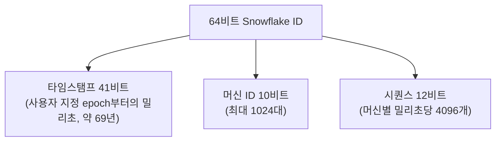

분산 환경에서 고유한 키를 생성하는 것에는 많은 고려사항이 있다.

DB 한 대를 쓸 때는 `AUTO_INCREMENT` 같은 기능이 1, 2, 3 순서로 겹치지 않는 번호를 알아서 매겨 준다. 그런데 쓰기를 받는 서버나 DB가 여러 대가 되면 "다음 번호"를 아는 곳이 하나가 아니게 된다. 모든 노드가 한 곳에 번호를 물어보면 그곳이 병목이자 단일 장애 지점이 되고, 각자 번호를 매기면 겹칠 수 있다. 이 글은 이 문제를 푸는 대표적인 방식과 각 방식이 무엇을 포기하는지를 정리한다.

## ID에 요구되는 성질

방식을 고르기 전에 무엇이 필요한지부터 정해야 한다. 자주 나오는 요구는 다음과 같다.

- 유일성: 어떤 경우에도 겹치지 않아야 한다. 이것만은 타협할 수 없다.
- 크기: 64비트 정수에 들어가는가, 128비트가 필요한가. 크기는 인덱스 크기와 저장 공간에 바로 영향을 준다.
- 정렬 가능성: 생성 순서대로 정렬되는가. "이 ID 이후의 글" 같은 조회나 B+Tree 인덱스의 삽입 위치에 영향을 준다.
- 조정 없음(uncoordinated): ID를 만들 때 다른 노드와 통신해야 하는가.
- 노출 위험: ID에서 생성 시각, 서버 정보, 전체 건수가 드러나도 되는가.

이 성질들은 서로 부딪친다. 조정 없이 만들면서 엄격한 순서까지 보장하기는 어렵고, 64비트에 넣으려면 비트를 어디에 쓸지 아껴야 한다.

## DB 시퀀스와 티켓 서버

가장 단순한 방법은 번호 발급을 한 곳에 맡기는 것이다. Flickr는 2010년에 이 방식을 "티켓 서버"로 소개했다. 행 하나짜리 테이블에 `REPLACE INTO`를 실행해 auto-increment 값을 올리고 `LAST_INSERT_ID()`로 그 값을 읽는다([Flickr, Ticket Servers](https://code.flickr.net/2010/02/08/ticket-servers-distributed-unique-primary-keys-on-the-cheap/)).

```sql
REPLACE INTO Tickets64 (stub) VALUES ('a');
SELECT LAST_INSERT_ID();
```

티켓 서버 한 대는 단일 장애 지점이 되므로, Flickr는 두 대를 두고 한쪽은 홀수, 다른 쪽은 짝수만 발급하게 했다. MySQL의 `auto_increment_increment`(증가 간격)와 `auto_increment_offset`(시작점)을 각각 2와 1, 2와 2로 설정하는 방식이다. MySQL 문서에 따르면 다음 값은 `auto_increment_offset + N × auto_increment_increment`로 정해진다([MySQL 8.4, Replication Source Options](https://dev.mysql.com/doc/refman/8.4/en/replication-options-source.html)).

이 방식은 작고 정렬 가능한 정수를 만든다는 장점이 있다. 대신 모든 ID 발급이 네트워크 왕복 한 번과 DB 쓰기 한 번을 필요로 하고, 두 서버가 번갈아 발급하면 전체 순서는 대략적으로만 맞는다.

## UUID

UUID는 128비트 식별자다. 2024년 5월에 나온 RFC 9562가 이전 표준인 RFC 4122를 대체했다([RFC 9562](https://www.rfc-editor.org/rfc/rfc9562.html)).

가장 널리 쓰이는 UUIDv4는 버전과 변형(variant)을 나타내는 비트를 뺀 122비트를 난수로 채운다. 노드끼리 아무 통신 없이 만들 수 있고 충돌 확률이 무시할 만큼 낮다. 문제는 정렬이다. RFC 9562는 순서 없이 생성된 값은 인덱스에서 서로 멀리 떨어진 위치에 들어가 성능을 떨어뜨린다고 설명한다. B+Tree 인덱스에서는 새 값이 매번 임의의 리프 페이지에 들어가므로, 캐시에 올려 둔 페이지를 재사용하기 어렵고 페이지 분할도 잦아진다.

그래서 RFC 9562는 시간 순서를 담은 UUIDv7을 새로 정의했다. 앞 48비트에 Unix 밀리초 타임스탬프를 넣고, 나머지는 버전·변형 비트와 난수로 채운다. 같은 밀리초 안에서도 순서를 지키고 싶다면 카운터를 두는 등의 방법을 6.2절에서 제시한다. RFC는 가능하면 UUIDv1이나 v6 대신 v7을 쓰라고 권한다.

```text
UUIDv7 (128비트)
| unix_ts_ms (48) | ver (4) | rand_a (12) | var (2) | rand_b (62) |
```

UUID의 남은 비용은 크기다. 64비트 정수의 두 배이고, 이 값이 기본 키라면 그 키를 참조하는 모든 보조 인덱스와 외래 키에도 같은 크기가 복사된다.

## Snowflake

Twitter는 2010년에 MySQL에서 Cassandra로 옮기면서, Cassandra에 순차 ID 발급 기능이 없어 Snowflake를 만들었다. 요구사항은 노드 간 조정 없이 만들 것, 대략적인 시간 순서를 지킬 것(k-sorted), 그리고 64비트 안에 들어갈 것이었다([twitter/snowflake README, snowflake-2010](https://github.com/twitter-archive/snowflake/tree/snowflake-2010)).

README에 적힌 비트 구성은 다음과 같다.



맨 앞이 타임스탬프이므로 ID를 숫자로 정렬하면 대략 생성 순서가 된다. 머신 ID가 노드마다 다르므로 노드끼리 통신하지 않아도 겹치지 않고, 같은 밀리초 안에서는 시퀀스로 구분한다.

대신 시계에 의존한다. NTP 등으로 시계가 뒤로 돌아가면 이미 쓴 타임스탬프를 다시 쓸 위험이 있다. README는 이런 경우 Snowflake가 마지막으로 ID를 만든 시각을 지날 때까지 ID 생성을 거부한다고 설명한다. 머신 ID를 노드마다 겹치지 않게 배정하는 일도 운영자의 몫이다.

## 방식 비교

| 방식 | 크기 | 정렬 | 발급 시 조정 | 주요 비용 |
| --- | --- | --- | --- | --- |
| DB 시퀀스 / 티켓 서버 | 64비트 | 순서대로(서버 여러 대면 대략) | 필요 | 발급마다 DB 왕복, 발급 서버 가용성 |
| UUIDv4 | 128비트 | 안 됨 | 불필요 | 크기, 인덱스 지역성 저하 |
| UUIDv7 | 128비트 | 밀리초 단위 시간순 | 불필요 | 크기, 생성 시각 노출 |
| Snowflake | 64비트 | 대략 시간순 | 불필요(머신 ID 배정은 필요) | 시계 의존, 머신 ID 관리 |

아래 첫 번째 링크는 이 밖에도 NanoID, MongoDB ObjectID, Sonyflake까지 비교한다. 예를 들어 ObjectID는 기계 정보가 클라이언트에 드러난다는 점을, Sonyflake는 수명을 늘리는 대신 밀리초당 생성 가능 수가 줄어든다는 점을 단점으로 든다.

## 고를 때의 기준

- 쓰기 노드가 하나이거나 발급 지연을 감당할 수 있으면 DB 시퀀스가 가장 단순하다.
- 클라이언트나 여러 서비스가 저장 전에 ID를 먼저 만들어야 하고 128비트를 감당할 수 있으면 UUIDv7이 무난하다. 정렬이 필요 없고 생성 시각을 숨기고 싶다면 v4가 맞다.
- 64비트 정수가 꼭 필요하고 노드 수가 많으면 Snowflake 계열을 검토한다. 이때는 머신 ID 배정과 시계 동기화를 운영 절차로 함께 준비해야 한다.

어느 방식이든 ID가 외부에 노출되면 그 안의 정보(생성 시각, 대략적인 발급량)도 함께 노출된다는 점을 확인해야 한다.

## 참고

- https://blog.devtrovert.com/p/how-to-generate-unique-ids-in-distributed
- https://medium.com/@sandeep4.verma/system-design-distributed-global-unique-id-generation-d6a440cc8e5
- [RFC 9562, Universally Unique IDentifiers (UUIDs)](https://www.rfc-editor.org/rfc/rfc9562.html)
- [twitter/snowflake README (snowflake-2010 태그)](https://github.com/twitter-archive/snowflake/tree/snowflake-2010)
- [Flickr Engineering, Ticket Servers: Distributed Unique Primary Keys on the Cheap](https://code.flickr.net/2010/02/08/ticket-servers-distributed-unique-primary-keys-on-the-cheap/)
- [MySQL 8.4 Reference Manual, Replication Source Options and Variables](https://dev.mysql.com/doc/refman/8.4/en/replication-options-source.html)
